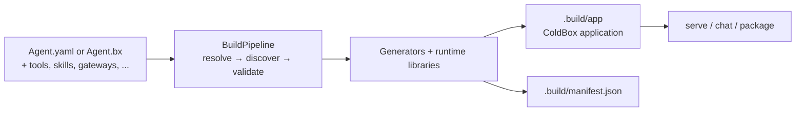

# BxAgents Developer Guide

BxAgents is a BoxLang module built on ColdBox and BX AI. It turns an agent's
convention-based project into a runnable ColdBox application **at build time**.
This page is for contributors working on the framework; to build an agent with
it, start with the [quick start](docs/getting-started/quick-start.md).



See the [build pipeline](docs/build-pipeline.md) for phase details.

## Get started

From the repository root, install **JDK 21+** and **CommandBox with bx-cli**
(`commandbox-boxlang`), then run:

```bash
./gradlew downloadBoxLang   # BoxLang, MiniServer and bundled BoxLang modules
./gradlew installDevLibs    # ColdBox, TestBox and other development libraries
./gradlew shadowJar         # assemble the module at build/modules/bxagents
./gradlew testBx            # fast BoxLang/TestBox suite
```

Use the Gradle wrapper from the root. Module versions are in
[`gradle.properties`](gradle.properties); ColdBox library dependencies are in
[`src/main/lib/box.json`](src/main/lib/box.json). See
[development setup](CONTRIBUTING.md#development-setup) for details.

## Find your way around

| Area | Start here |
| --- | --- |
| Module lifecycle and CLI dispatch | [`ModuleConfig.bx`](src/main/bx/ModuleConfig.bx), [`models/cli/`](src/main/bx/models/cli/) |
| Configuration, discovery, validation and generation | [`models/build/`](src/main/bx/models/build/), especially [`BuildPipeline.bx`](src/main/bx/models/build/BuildPipeline.bx) and [`generators/`](src/main/bx/models/build/generators/) |
| Agent runtime features | [`models/`](src/main/bx/models/), organized by feature |
| Java integration and terminal UI | [`src/main/java/`](src/main/java/), including [`tui/`](src/main/java/ortus/boxlang/bxagents/tui/) |
| Web app | [`bxagentsui/`](src/main/bx/bxagentsui/) and [`ui/`](ui/) |
| Tests, fixtures and examples | [`tests/specs/`](tests/specs/), [`src/test/`](src/test/), [`examples/`](examples/) |

## Edit, run and test

BoxLang source is dynamic: edit `src/main/bx` or a spec and rerun `testBx`;
Java changes are compiled by the relevant Gradle tasks. The source mapping is
convenient, but it is **not the same as an installed module**: rebuild with
`shadowJar` and exercise a real install when changing module references or CLI
dispatch. Integration and example tasks rebuild the packaged module themselves.

```bash
./gradlew testBx                     # TestBox, excluding ColdBox HTTP integration
./gradlew test                       # Java/JUnit tests
./gradlew testColdBoxIntegration     # generated app + real HTTP server
./gradlew verifyExamples             # build all example projects
./gradlew spotlessCheck              # Java formatting
```

The integration task may **skip** if its prerequisites are missing; check its
output rather than treating a skipped task as a pass. For the complete local
verification command, see the [README](readme.md#gradle-tasks).

To run the web app against this checkout and a scripted model (no API key),
after setup run `cd ui`, `npm install`, then `npm run dev`. Open
<http://127.0.0.1:8780/chat>; see the [UI guide](ui/README.md) for sign-in,
restart behavior, linting and browser tests.

To try an agent as a user, install the module as described in
[installation](docs/getting-started/installation.md), then from an agent
project run `bxAgents build`, `bxAgents doctor` and `bxAgents serve` or
`bxAgents chat`. `serve` needs the MiniServer executable on `PATH`. Use an
[example](examples/README.md) as a starting point; a real model may require
provider credentials.

## Extend and collaborate

1. **Start from an existing feature.** For a CLI verb, follow a class in
   [`models/cli/`](src/main/bx/models/cli/) and its registration in
   [`ModuleConfig.bx`](src/main/bx/ModuleConfig.bx). For a new project
   convention, trace discovery, validation and generation through the build
   pipeline; add an example and focused tests.
2. **Respect module boundaries.** Within shipped BoxLang classes, reference
   siblings using `"path.to.Class@bxagents"`; `ModuleConfig.bx` is the
   exception. Verify against a real install, not only the source mapping.
3. **Test behavior, not just generated text.** Use TestBox for BoxLang,
   JUnit for Java, and real HTTP integration when runtime behavior matters.
   Keep TamboUI calls inside the Java `tui` package.
4. **Document and submit.** Update related docs; while `1.0.x` is unreleased,
   mirror site changes in [`docs/versions/1.0.x/`](docs/versions/1.0.x/).
   Work on a dedicated branch and open a PR against `development`, with tests
   and the issue linked. Follow [CONTRIBUTING.md](CONTRIBUTING.md) for
   formatting, reporting and contribution guidelines.
