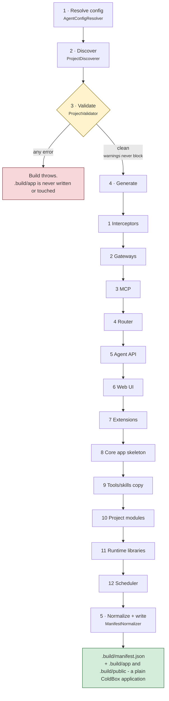

# The Build Pipeline

`bxAgents build` runs a fixed sequence of phases, once, producing a plain ColdBox application laid out like the [ColdBox BoxLang application template](https://github.com/coldbox-templates/boxlang): the code in `.build/app`, the web root in `.build/public`. Nothing here runs again at request time - that's the whole point of build-time assembly. This page walks the phases in the exact order `BuildPipeline.bx` runs them.

## What is in `.build`, and what is served

```text
.build/
  miniserver.json      how boxlang-miniserver finds everything below (paths relative to .build)
  manifest.json        the internal manifest (not served, not packaged)
  app/                 the generated code: handlers, config, agent/, tools/, skills/, models/, interceptors/, modules/bxagentsui/ ...
    Application.bx     the template's guard: `abort;`
  public/              the web root, and the ONLY folder that is served
    Application.bx     the app's Application.bx (see conventions/application-bx.md)
    index.bxm          the front controller every request is rewritten to
    robots.txt  favicon.ico
    includes/          images/, i18n/, bxagentsui/build/assets/ (the web page's scripts and styles)
  lib/                 coldbox/, modules/ (qb, cbsecurity, cbauth, cbmailservices), java/
  runtime/             the BoxLang home
    boxlang.json       the template's engine config
    modules/bxagents/  a copy of the bxagents module: the ONLY module the served app loads
    global/  lib/  logs/
  boxlang_modules/     the project's own installed BoxLang modules
```

`bxAgents serve` starts `boxlang-miniserver` **in `.build`** with `BOXLANG_HOME=.build/runtime`, using `.build/miniserver.json`:

```json
{ "port": 8080, "host": "127.0.0.1", "webRoot": "public", "configPath": "runtime/boxlang.json",
  "serverHome": "runtime", "rewrites": true, "rewriteFileName": "index.bxm", "healthCheck": true,
  "passPredicate": "regex( '^/index\\.bxm(/.*)?$' )" }
```

- **Only `public/` is a web root.** Nothing in `app/`, `lib/`, `runtime/` or `boxlang_modules/` can be fetched by its address: `/config/agent-settings.json`, `/project/Agent.yml`, `/agent/instructions.md` and a listing of `/config/` were all downloadable without a token before this layout, and answer 404 now. An address nothing routes is a small JSON `404`, not an error page.
- **Only `index.bxm` runs.** The server's default runs any `.bx` or `.bxm` under the web root as a request; the `passPredicate` limits that to the front controller, so a class under `app/` is not callable by address.
- **Only the `bxagents` module loads.** The module is copied into `runtime/modules/bxagents` (with the BoxLang modules bundled inside it), and `runtime/` is the BoxLang home, so the machine's own `~/.boxlang/modules` is never read. The copy is skipped while a stamp (the module's `box.json` and the hash of its jars) is unchanged.
- **The paths are relative**, so a copy of `.build` anywhere (a packaged `.bxa` unzipped on another machine) is served by starting the server in it. A folder name with a space in it does not work: the `boxlang-miniserver` launcher script does not quote `BOXLANG_HOME`.
- `public/includes/` shows its file names (the server lists a folder that has no index file, and `miniserver.json` has no switch for it); it holds only what the browser is meant to load.

The template is carried inside the module as a pinned snapshot (`src/main/bx/templates/coldbox-boxlang`, its `VERSION` names the version and the exact commit), so a build never reads the network. Its `public/` files (`index.bxm`, `robots.txt`, `favicon.ico`, `includes/`), `runtime/boxlang.json` and `app/Application.bx` are laid out unchanged, apart from one line of `runtime/boxlang.json`: whitespace compression is off. `public/Application.bx` is **derived** from the template's and changed (a thin class extending the generated base, see [Application.bx](conventions/application-bx.md#where-it-ends-up)). On BoxLang 1.19.0 a native `SSE()` stream is unaffected by that setting (14 frames with it on or off); only a hand-written `writeOutput` event stream loses its blank lines when it is on, so the line is a safety net.



Before phase 1, `build` restores any skill that `.agents/skills.lock.json` lists and the disk lacks, and any extension that `extensions.lock.json` lists and the disk lacks; a failed restore stops the build.

Validation is the gate: it collects **every** error rather than failing fast, and nothing is generated until it comes back clean.

(Packaging into a `.bxa` is a deliberately separate step - see [Deployment & Secrets](deployment-and-secrets.md) - so a fast `build` → inspect → `build` again loop never pays a packaging cost it doesn't need.)

## 1. Resolve config

[`AgentConfigResolver`](conventions/agent-yaml.md) loads the agent definition (`Agent.yml`, or the class-based `Agent.bx`), applies the active environment's overrides (the `environments:` block of an `Agent.yml`, or the override method and `configure()` of an `Agent.bx`), then deep-merges in `boxlang.json`/`boxlang-{env}.json`/`miniserver.json`/`miniserver-{env}.json` if present. The person's own files then go over the result for the root agent: `~/.bxagents/Agent.yml` and the agent's own `Agent.yml` in its data home ([layered settings](conventions/layered-settings.md)). Produces the single resolved config struct every later phase reads from.

## 2. Discover

[`ProjectDiscoverer`](conventions/agent-bx.md) walks the project root and enumerates every convention folder (`tools/`, `skills/` and the registry's `.agents/skills/`, `subagents/`, `gateways/`, `mcp/`, `interceptors/`, `modules/`) into raw `{ name, path, type }` entries. `schedules/*.bx` are listed the same way, one entry per BoxLang scheduler file. Pure discovery - no interpretation of file contents happens yet.

## 3. Validate

[`ProjectValidator`](conventions/agent-bx.md) runs every validator and collects **every** error (never fail-fast) plus any warnings: duplicate tool/skill/model/subagent names, duplicate agent `name`s across the whole subagent tree (see [subagents/](conventions/subagents.md#retrieving-an-agent-from-schedules)), circular subagent/module references, the two gateway entry shapes, remote MCP config completeness, and model/provider validity. If any errors were collected, the build throws immediately here - no `.build/app` is written or touched. Warnings (e.g. a `schedules/` folder with no `Scheduler.bx` in it) never block the build.

## 4. Generate

Only reached once validation is clean. Any `.build/app` from an earlier build is deleted first, then the template is laid out: its `public/` (replacing the old one), its `runtime/boxlang.json`, `app/Application.bx` and the empty folders its conventions name. In order:

1. **Interceptors** - [`InterceptorSplitter`](conventions/interceptors.md) copies `agent`-scope interceptors into `.build/app/interceptors`, `runtime`-scope ones into a separate `.build/runtime-interceptors` directory, outside the app (BxAgents does not register those for you).
2. **Gateways** - [`GatewayGenerator`](conventions/gateways/index.md) emits `aiGatewayRegistry().register(...)` statements for channel-adapter entries, and writes a small `.build/app/handlers/*.bx` webhook handler for each `whatsapp-cloud`, `teams`, `twilio` or `github` entry. If any entry is a push-style gateway (e.g. `type: "telegram"`), it also produces the start-up statement that builds a single bx-ai `GatewaySession` (bundling every push-style gateway) bound to the project's root agent.
3. **MCP** - [`McpGenerator`](conventions/mcp.md) copies local `mcp/*` servers into `.build/app/mcp` and emits their `mcpServer(...).registerTool(...)` registration statements.
4. **Router** - [`RouterGenerator`](conventions/gateways/index.md) writes `.build/app/config/Router.bx`: the reserved [`/__bxagents`](conventions/agent-bx.md#the-always-on-agent-route) agent API (at `agentApi.path`, unless `agentApi.enabled` is `false`), the same four turn routes under the path of each `exposes: "agent"` entry, one `route(path).toMCP(...)` per `exposes: "mcp"` entry, the cbSecurity middleware for `agentApi.allowedIPs` and `agentApi.rateLimit` when set, a single `route("/gateways").toAiGateway()` if the project has any channel-adapter gateway, and one webhook route per `whatsapp-cloud` (GET+POST), `teams`, `twilio` or `github` push-style gateway present.
5. **Agent API** - `AgentApiGenerator` writes `.build/app/handlers/AgentApi.bx`, every action of the agent API (`invoke`, `stream`, `batch`, `info`, and the run-control, conversation, notes, command and token actions such as `events`, `cancel`, `steer`, `resume`, `sessions` and `command`), all served by the one handler. Skipped when `agentApi.enabled` is `false`.
6. **Web UI** - [`WebUiGenerator`](conventions/web-ui.md) runs for any `exposes: "webui"` entry, installing the web app module at `<appDir>/modules/bxagentsui` with its settings in `config/bxagentsui.json` (mounted at the entry's `path`, a client of the [agent API](conventions/agent-bx.md#the-always-on-agent-route), so no handler of its own), `models/ChatDb.bx` (the sign-in accounts and the store's forward-only migrations, built at boot by a start-up statement rather than on whichever request touches the database first) and the user models (`User`, `UserService`, `PasswordHasher`). `apiKeyEnvVar` becomes the agent API's shared secret. When `users` are declared it also writes the account seeder, the sign-in form (`config/bxagentsui-login.html`, served at `<path>/login.html`), `interceptors/WebUiLoginGate.bx` and `handlers/ChatAuth.bx`. It returns the resolved database config, which the next step needs.
7. **Extensions** - `ExtensionsGenerator` copies the project's `extensions/` folder to `.build/app/extensions` and writes `config/extensions.json` from the `extensions:` block of `Agent.yml`, so the served agent loads them. Skipped when there is no `extensions/` folder.
8. **Core app skeleton** - `ColdBoxAppGenerator` writes the generated base `app/bxagents/Application.bx` (see [Application.bx](conventions/application-bx.md)), `public/Application.bx` (derived from the template's own file, and ending as a thin class that extends the base: [what is derived and what is changed](conventions/application-bx.md#where-it-ends-up)), `app/bxagents/Scheduler.bx`, `config/Coldbox.bx`, `config/WireBox.bx`, `handlers/NotFound.bx` and `agent/GeneratedAgentFactory.bx`, threading in every statement gathered above (gateway registrations, the `GatewaySession` start, MCP registrations, the web UI's store warm-up and account seeding, and - if `tools/` has any files - a bare `aiToolRegistry().scan("app.tools")` call: bx-ai expands the dotted path against a mapping, `/app` here, so it must be a mapping path and not one relative to the app) into the base's `after()`, which `onApplicationStart()` calls once ColdBox has loaded. Class paths in generated code go through the template's `/app` mapping (`app.schedules.Nightly`, `app.agent.GeneratedAgentFactory`, `app.interceptors.AuditLogger`). Interceptors are registered there too, one `getInterceptorService().register(...)` per agent-scope interceptor and web UI gate: the generated config declares no `interceptors` array and registers them this way, which works (the note on `config/Coldbox.bx` below says why the array's old failure was measured against a file ColdBox never loaded). Every generated agent also now always receives a checkpointer (`withCheckpointer(...)`, defaulting to a `cache`-backed `aiMemory()` if the project declares no `checkpointer` config and the class set none of its own) - without one, human-in-the-loop approval flows through any gateway other than `cli` fail outright. `config/WireBox.bx` maps every agent in the tree (root + every subagent) under its own declared `name`, not just the fixed root `"GeneratedAgent"` alias - see [schedules/](conventions/schedules.md). Each agent node's `instructions.md` is **copied into the app** as part of this step, mirroring the source layout under `agent/` - the root project's to `.build/app/agent/instructions.md`, each subagent's to `.build/app/agent/subagents/<name>/instructions.md` - so every node keeps its own and the built app carries the file it reads at runtime. The factory reads all three of its runtime paths (`instructions.md`, its own `tools/`, and any class-based agent's copied `Agent.bx`) through a small generated `resolveAppPath()` helper that resolves them relative to the factory's own location on disk, falling back to the build-time absolute path if that self-location doesn't resolve - which is what makes a packaged `.bxa` genuinely relocatable rather than runnable only on the machine that built it. For a project with a `webui` exposure it also turns session management on, registers the SQLite datasource (naming it as the app default via `this.datasource`), creates the database's parent directory in `onApplicationStart()` - SQLite creates the file but never the folder holding it - and pins qb's grammar in `config/Coldbox.bx`. That file is called `Coldbox.bx` (ColdBox's convention) and assigns `variables.coldbox` and `variables.moduleSettings`: it used to be called `ColdBox.bx`, which ColdBox never loads on a case-sensitive file system, with unscoped assignments that are local to `configure()` in BoxLang, so the generated app name and qb grammar never applied before. It also sets `modulesExternalLocation` to `/modules` (ColdBox finds its modules in `.build/lib/modules`) and `defaultEvent` and `invalidEventHandler` to the generated `NotFound.index`, the JSON 404.
9. **Tools/skills copy** - `ToolsSkillsCopier` wipes and rewrites `.build/app/tools` and `.build/app/skills` verbatim from your project's own folders, adding the registry skills from `.agents/skills/` to the app's `skills/`.
10. **Project modules** - `BoxLangModulesCopier` copies the BoxLang modules installed in the project's `boxlang_modules/` into `.build/boxlang_modules`, leaving out any that `box.json` lists only as a development dependency. Skipped when there is no `boxlang_modules/` folder.
11. **Runtime libraries** - `RuntimeLibsCopier` copies the ColdBox runtime bundled inside BxAgents into `.build/lib`: `coldbox/` plus `modules/qb`, `modules/cbsecurity`, `modules/cbauth`, `modules/cbmailservices` and their dependencies. A `lib/` folder in your project (same layout) is copied afterwards and wins, which is how you add or override a library. The bundled copy exists only in an installed or built module, so a source checkout skips this step with a warning.
12. **Schedulers** - [`SchedulerGenerator`](conventions/schedules.md) copies each `schedules/*.bx` to `.build/app/schedules/<Name>.bx`, adding `extends="app.bxagents.Scheduler"` to a class that names no parent (`bxagents.Scheduler`, the name the docs use, means the same class). The base already lists them in `this.schedulers`, so BoxLang starts them with the app.
13. **The bxagents module and the server config** - `ModuleCopier` copies the installed `bxagents` module into `.build/runtime/modules/bxagents` (to a work folder, then renamed, so an interrupted copy never carries the stamp; skipped while the stamp is unchanged), and `MiniServerJson` writes `.build/miniserver.json` (port 8080 on `127.0.0.1`; `serve` rewrites it with the port and host asked for). A source checkout has no installed module: the build says so, and `BXAGENTS_MODULE_DIR` names the built one (`build/modules/bxagents`).

## 5. Normalize + write the manifest

[`ManifestNormalizer`](manifest.md) produces the canonical, hash-stamped internal manifest from the discovery + resolved-config data, and the pipeline writes it to `.build/manifest.json`.

## Idempotency

Rebuilding an unchanged project produces byte-identical output, down to the manifest's per-file content hashes - the entire point of paying the assembly cost once, at build time, rather than deferring any of this work into request handling.
