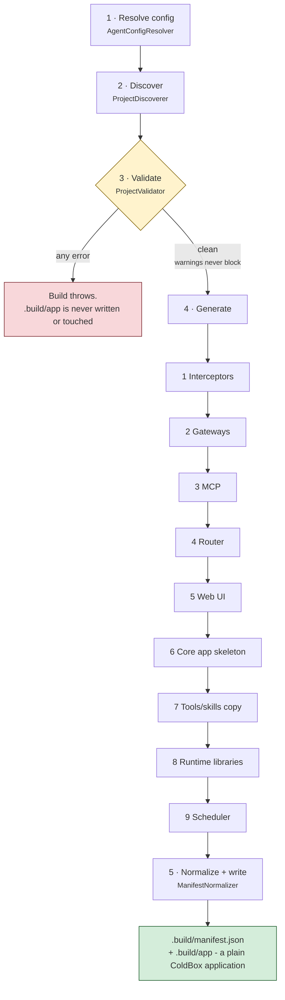

# The Build Pipeline

`bxAgents build` runs a fixed sequence of phases, once, producing a plain ColdBox application. Nothing here runs again at request time - that's the whole point of build-time assembly. This page walks the phases in the exact order `BuildPipeline.bx` runs them.

Validation is the gate: it collects **every** error rather than failing fast, and nothing is generated until it comes back clean.

(Packaging into a `.bxa` is a deliberately separate step - see [Deployment & Secrets](deployment-and-secrets.md) - so a fast `build` → inspect → `build` again loop never pays a packaging cost it doesn't need.)

## 1. Resolve config

[`AgentConfigResolver`](conventions/agent-yaml.md) loads the agent definition (`Agent.yaml`, or the class-based `Agent.bx`), applies the active environment's overrides (the `environments:` block of an `Agent.yaml`, or the override method and `configure()` of an `Agent.bx`), then deep-merges in `boxlang.json`/`boxlang-{env}.json`/`miniserver.json`/`miniserver-{env}.json` if present. Produces the single resolved config struct every later phase reads from.

## 2. Discover

[`ProjectDiscoverer`](conventions/agent-bx.md) walks the project root and enumerates every convention folder (`models/`, `tools/`, `skills/`, `subagents/`, `gateways/`, `mcp/`, `interceptors/`, `modules/`) into raw `{ name, path, type }` entries. `schedules/` is the one exception - it's not a list of entries, just a single `hasScheduler`/`schedulerPath` pair, since it holds one real ColdBox scheduler file rather than a set of BxAgents-defined config entries. Pure discovery - no interpretation of file contents happens yet.

## 3. Validate

[`ProjectValidator`](conventions/agent-bx.md) runs every validator and collects **every** error (never fail-fast) plus any warnings: duplicate tool/skill/model/subagent names, duplicate agent `name`s across the whole subagent tree (see [subagents/](conventions/subagents.md#retrieving-an-agent-from-schedulesschedulerbx)), circular subagent/module references, the two gateway entry shapes, remote MCP config completeness, and model/provider validity. If any errors were collected, the build throws immediately here - no `.build/app` is written or touched. Warnings (e.g. a `schedules/` folder with no `Scheduler.bx` in it) never block the build.

## 4. Generate

Only reached once validation is clean. In order:

1. **Interceptors** - [`InterceptorSplitter`](conventions/interceptors.md) copies `agent`-scope interceptors into `.build/app/interceptors`, `runtime`-scope ones into a separate `.build/runtime-interceptors` directory, outside the app (BxAgents does not register those for you).
2. **Gateways** - [`GatewayGenerator`](conventions/gateways/index.md) emits `aiGatewayRegistry().register(...)` statements for channel-adapter entries, and writes a small `.build/app/handlers/*.bx` webhook handler for each `whatsapp-cloud`, `teams`, `twilio` or `github` entry. If any entry is a push-style gateway (e.g. `type: "telegram"`), it also produces the start-up statement that builds a single bx-ai `GatewaySession` (bundling every push-style gateway) bound to the project's root agent.
3. **MCP** - [`McpGenerator`](conventions/mcp.md) copies local `mcp/*` servers into `.build/app/mcp` and emits their `mcpServer(...).registerTool(...)` registration statements.
4. **Router** - [`RouterGenerator`](conventions/gateways/index.md) writes `.build/app/config/Router.bx`: the reserved [`/__bxagents`](conventions/agent-bx.md#the-always-on-agent-route) agent route (unless `agentApi.enabled` is `false`), one `route(path).toAi(...)`/`toMCP(...)` per exposure entry, a single `route("/gateways").toAiGateway()` if the project has any channel-adapter gateway, and one webhook route per `whatsapp-cloud` (GET+POST), `teams`, `twilio` or `github` push-style gateway present.
5. **Web UI** - [`WebUiGenerator`](conventions/web-ui.md) runs for any `exposes: "webui"` entry, writing the static `<path>/index.html`, `handlers/ChatUi.bx` (the twenty-action API), `models/ChatDb.bx` (the SQLite store and its forward-only migrations, built at boot by a start-up statement rather than on whichever request touches the database first), the user models (`User`, `UserService`, `PasswordHasher`), and - only when `apiKeyEnvVar` is set - `interceptors/WebUiAuthGate.bx`. When `users` are declared it also writes the account seeder, `interceptors/WebUiLoginGate.bx` and `handlers/ChatAuth.bx`. It returns the resolved database config, which the next step needs.
6. **Core app skeleton** - `ColdBoxAppGenerator` writes `Application.bx`, `config/ColdBox.bx`, `config/WireBox.bx`, `agent/GeneratedAgentFactory.bx`, and `index.bxm`, threading in every statement gathered above (gateway registrations, the `GatewaySession` start, MCP registrations, the web UI's store warm-up and account seeding, and - if `tools/` has any files - a bare `aiToolRegistry().scan("tools")` call) into `Application.bx`'s `onApplicationStart()`. Interceptors are registered there too, one `getInterceptorService().register(...)` per agent-scope interceptor and web UI gate: a declarative `interceptors` array in `config/ColdBox.bx` never reaches ColdBox's interceptor service, so the generated config declares none. Every generated agent also now always receives a checkpointer (`withCheckpointer(...)`, defaulting to a `cache`-backed `aiMemory()` if the project declares no `checkpointer` config and the class set none of its own) - without one, human-in-the-loop approval flows through any gateway other than `cli` fail outright. `config/WireBox.bx` maps every agent in the tree (root + every subagent) under its own declared `name`, not just the fixed root `"GeneratedAgent"` alias - see [schedules/](conventions/schedules.md). Each agent node's `instructions.md` is **copied into the app** as part of this step, mirroring the source layout under `agent/` - the root project's to `.build/app/agent/instructions.md`, each subagent's to `.build/app/agent/subagents/<name>/instructions.md` - so every node keeps its own and the built app carries the file it reads at runtime. The factory reads all three of its runtime paths (`instructions.md`, its own `tools/`, and any class-based agent's copied `Agent.bx`) through a small generated `resolveAppPath()` helper that resolves them relative to the factory's own location on disk, falling back to the build-time absolute path if that self-location doesn't resolve - which is what makes a packaged `.bxa` genuinely relocatable rather than runnable only on the machine that built it. For a project with a `webui` exposure it also turns session management on, registers the SQLite datasource (naming it as the app default via `this.datasource`), creates the database's parent directory in `onApplicationStart()` - SQLite creates the file but never the folder holding it - and pins qb's grammar in `config/ColdBox.bx`.
7. **Tools/skills copy** - `ToolsSkillsCopier` wipes and rewrites `.build/app/tools` and `.build/app/skills` verbatim from your project's own folders.
8. **Runtime libraries** - `RuntimeLibsCopier` copies the ColdBox runtime bundled inside BxAgents into `.build/app`: `coldbox/` plus `modules/qb`, `modules/cbsecurity`, `modules/cbauth`, `modules/cbmailservices` and their dependencies. A `lib/` folder in your project (same layout) is copied afterwards and wins, which is how you add or override a library. The bundled copy exists only in an installed or built module, so a source checkout skips this step with a warning.
9. **Scheduler** - [`SchedulerGenerator`](conventions/schedules.md) copies `schedules/Scheduler.bx` through to `.build/app/config/Scheduler.bx` untouched, if present - no generation, it's real ColdBox code you wrote yourself.

## 5. Normalize + write the manifest

[`ManifestNormalizer`](manifest.md) produces the canonical, hash-stamped internal manifest from the discovery + resolved-config data, and the pipeline writes it to `.build/manifest.json`.

## Idempotency

Rebuilding an unchanged project produces byte-identical output, down to the manifest's per-file content hashes - the entire point of paying the assembly cost once, at build time, rather than deferring any of this work into request handling.
