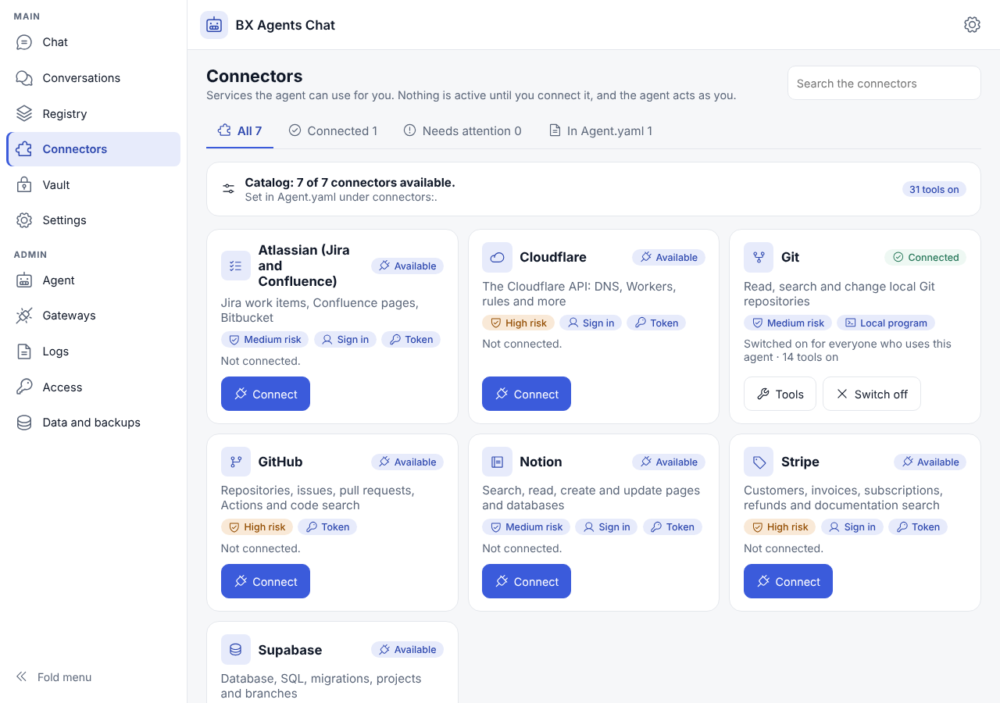

# Connectors

A **connector** is a ready-made connection to a service that has an MCP server. BX Agents ships with seven: [GitHub, Stripe, Notion, Atlassian, Cloudflare, Supabase and Git](connector-catalog.md). Every agent offers them by default. Offering one does not connect it: nothing contacts a service until a person connects their own account.

- **Personal.** A token or sign in belongs to one person. The agent uses it only when that person asks, and two people never share a token or a session.
- **Sealed.** Tokens are stored in the [vault](vault.md), locked to the host of the service. The model never sees one.
- **Your own servers still work.** The services you write under `mcpServers` in [Agent.yaml](agent-yaml.md) are separate. An `mcpServers` entry with the same name as a connector replaces that connector, and the build warns.

<video controls preload="metadata" poster="/assets/video/connectors-poster.png" style="max-width:100%">
  <source src="/assets/video/connectors.mp4" type="video/mp4">
  <source src="/assets/video/connectors.webm" type="video/webm">
  <track kind="captions" src="/assets/video/connectors.vtt" srclang="en" label="English" default>
</video>



## States

| State | Meaning |
|---|---|
| available | Offered, not connected by you |
| connected | Connected, its tools are on |
| needs attention | Connected, but the service refused the token (it failed, expired or was revoked), at connect time or during a call. Connect again |
| needs a program | A local program the connector runs (such as `uvx` for Git) is not installed |

## Limit them in Agent.yaml

```yaml
# Agent.yaml
connectors:                  # leave the key out to offer every connector
  only: [ github, notion ]   # just these
  override:
    github:
      timeout: 30000
      options: { readonly: true }
      tools: [ search_repositories ]
  toolWarning: 100           # warn a person above this many tools
```

Or offer everything except some:

```yaml
connectors:
  exclude: [ stripe ]
```

`exclude` names connectors that `only` would offer, so using both for different connectors is an error at build.

`connectors: none` turns the catalog off. The order of evaluation is `only`, then `exclude`, then `override`. `override` accepts `timeout` (milliseconds, 1000 to 600000), `options` (the values a connector asks for), `scopes` (only for connectors with a sign in) and `tools` (the most a person may switch on: a ceiling, not a default). `toolWarning` is a whole number from 10 to 2000 (100 by default). Everything is checked when the project is built, and `bxAgents inspect` shows what each agent offers.

## Connecting

A connector asks for either a token or a sign in, shown on its page in the [catalog](connector-catalog.md).

| Where | How |
|---|---|
| Web page | The **Connectors** page, with tabs for All, Connected, Needs attention and In Agent.yaml, each at its own address (`<path>/connectors/all`, `connected`, `attention`, `agent`). See [web-ui](web-ui.md#connectors) |
| Chat in the terminal | `/connect`, `/connect NAME`, `/connect NAME off`, `/connect NAME tools` |
| CLI | `bxAgents connect`, `bxAgents connect NAME` |
| Gateways | `/connect` lists them. A token is never typed in a chat: the reply points to the web page |

Medium and high risk connectors show what they can do and ask for confirmation first. A token is checked with the service before it is sealed. At the terminal the token goes in a hidden box. For scripts:

```bash
bxAgents connect github --token-env=GITHUB_TOKEN --confirm
printf '%s' "$TOKEN" | bxAgents connect github --stdin --confirm
bxAgents connect github tools off delete_file    # also: tools on NAME, tools off all, tools readonly
bxAgents connect github options repository=/path/to/repo   # connectors with options
```

In chat, `--token-env` is honored only on the terminal (`tui`) transport. A token connected on the web belongs to that web account, not to the same person's chat identity on a platform. Programs the agent runs on its own machine (Git) are connected by an admin when the agent is served. Switching it off stops the process, and changing an option restarts it with the new value, at once.

## Tools and the tool count

Each person can turn tools on and off, one by one, from the drawer on the web page or with `tools` in the terminal. Tools are listed alphabetically. When the total on exceeds `toolWarning`, the page warns that the model may choose worse. An admin's `tools` override sets the ceiling for everyone. A tool that is off, over the ceiling or not connected is refused when the model calls it, not only hidden from it.

## Scheduled runs

A [routine](routines.md) runs as the person who made it, so it uses that person's connectors. A `schedules/*.bx` file belongs to no person and gets no connector tools.

## API

| Route | Does |
|---|---|
| `GET /connectors` | The connectors, your state for each, and your tool count. Never a token |
| `POST /connectors/connect` | Connect one (token, sign in, or local program) |
| `POST /connectors/disconnect` | Disconnect one |
| `POST /connectors/options` | Change a connector's options |
| `GET`, `POST /connectors/tools` | List and switch tools |

## Adding a connector

The catalog is the YAML files in `src/main/bx/catalog/connectors/`. Add one file, run `bxAgents connectors check`, then regenerate the [catalog page](connector-catalog.md) with `tools/generate-connector-docs.bxs`. A spec fails if the page is stale. Every entry records the date it was checked against the service's own documentation (`verifiedOn`).

## Needs bx-ai 3.8

Signing in to a served agent needs the bx-ai fix for web requests (argument `form` reserved in web requests, bx-ai issue 334). Tokens connected by hand are not affected.
