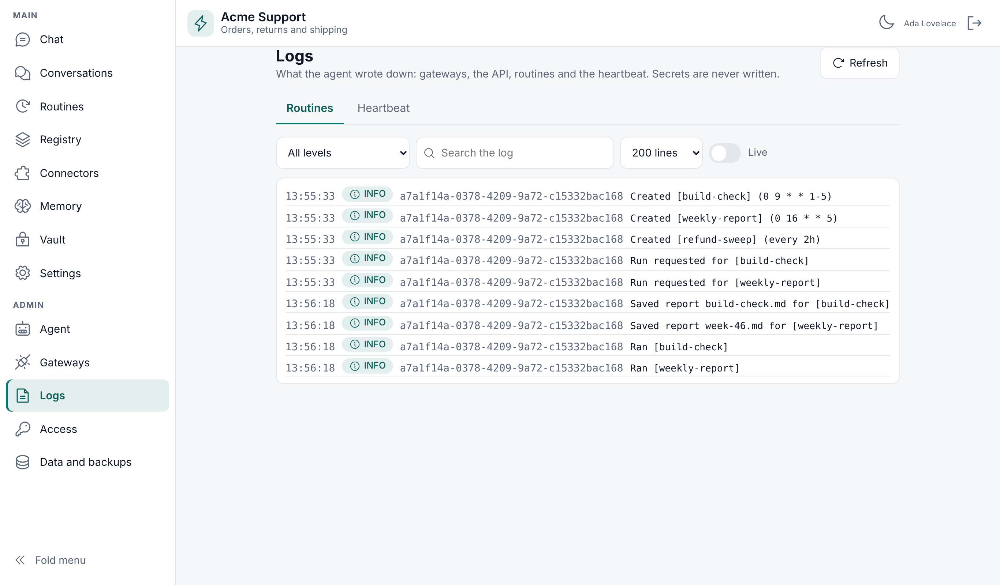

# Logs

An agent writes what it does, and what goes wrong, to log files in the `logs/` folder of its [data home](data.md). There is one file per area, so a broken gateway is not buried in the noise of a busy API:

```text
<data home>/logs/
  agent.log       startup, errors in a turn, tool failures
  gateways.log    every gateway: connect, disconnect, send failures. The gateway's name starts each line
  routines.log    routines: created, changed, run, skipped, failed, delivered
  heartbeat.log   each tick of the routine scheduler that did something
  api.log         refused calls and sign-in failures
```

A file appears when its first line is written. `routines.log` and `heartbeat.log` are written by [routines](routines.md).

A line looks like this:

```text
[2026-11-09T09:15:11,300] [main] [ERROR] [GATEWAYS] [my-agent] [telegram] Could not start: Telegram rejected the configured bot token: Unauthorized
```



## What is never written

A log is for finding out what happened, not for keeping what was said.

- No message from a person, and no token, password or key. Callers do not pass them, and every line is cleaned all the same: bearer tokens, Telegram, Slack, GitHub and OpenAI style tokens, and the value after a name such as `password`, `secret`, `api_key` or `access_token` are replaced by `***`.
- Writing a log never stops the work it describes. A log that cannot be written is skipped.

## Rotation

The logs are written with BoxLang's own logging, so BoxLang rolls and removes them by its own rules: by default a file rolls at 100 MB, files are kept for 90 days and all logs together are capped at 5 GB. Change that with the `logging` settings of the BoxLang runtime (`maxFileSize`, `maxLogDays`, `totalCapSize` in `boxlang.json`). BX Agents adds no settings of its own for it.

`backup` does not include the logs.

## Reading them

**In the terminal:**

```bash
bxAgents logs                                     # which logs there are and how big
bxAgents logs gateways                            # the last 100 lines of the gateways log
bxAgents logs gateways --tail=500 --level=warn --grep=telegram
bxAgents logs api --json
bxAgents logs gateways --follow --level=warn         # the last lines, then each new one as it is written
bxAgents logs --ui                                # a full-screen viewer: a tab per log, level, search, live lines
bxAgents logs gateways --follow --connect=https://agent.example.com --token=$ADMIN_TOKEN   # a deployed agent
```

`--level` shows that level and anything more serious (`debug`, `info`, `warn`, `error`), `--grep` keeps the lines that contain the text (case does not matter), and `--tail` is how many lines, up to 1000. Only the end of a log is read, so a big log is as quick as a small one.

`--follow` keeps printing new lines until Ctrl+C, and `--ui` opens a viewer with a tab per log, the level (`l`), a search (`/`), scrolling and live lines (keys in the [CLI reference](../cli-reference.md#logs)). `--connect=URL` reads a served agent's logs over its API with an admin token. In the terminal chat, `/logs` and `/logs <area>` print them too.

**In the web page**, for an admin, the menu has a **Logs** page and a **Gateways** page (see [the web UI](web-ui.md#logs-and-gateways)). A red count on the **Logs** item says how many sources logged an error since the app started.

**Over the API**, for an admin: `GET /logs` lists the logs and how many sources logged an error since the app started, and `GET /logs?area=gateways&tail=200&level=warn&q=text` gives lines. `GET /logs/stream?area=gateways&level=warn&q=text` follows one live: an event stream of `lines` frames (`{ area, lines }`, only lines written after it opened) and a `reset` frame when the file was rotated; the server looks at the file every second and ends the stream after ten minutes. The client has `logs()` and `logsStream( area, onEvent, level, q )`. See [the agent API](agent-bx.md).

## Gateways

`GET /gateways` (and **Gateways** in the web page) says, for each gateway the project names:

- whether it is **connected**, **stopped**, **failing** (stopped, with an error logged) or **not registered**;
- which of its credentials are set, by the name of the environment variable and set or not set, never the value;
- when it last had a conversation, and its last error.

The gateways themselves are still set up in `gateways/<name>.bx` and `.env`, and read when the app starts. See [gateways](gateways/index.md).
