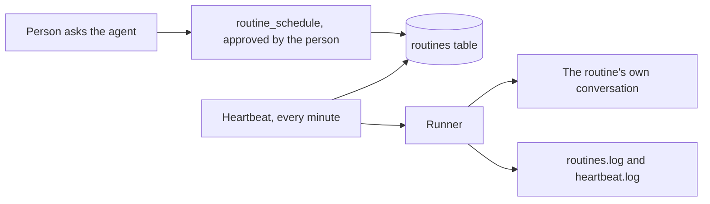

# Routines

A routine is a prompt the agent runs on a schedule, as the person who made it. "Every weekday at 9, check the build and tell me what broke" is a routine. A person makes it by asking the agent, and the agent keeps it in the chat database. The answer can go to a chat app, and a routine can keep reports as files.

Routines are not [schedulers](schedules.md). They are for the people who use the agent, not for the developer.

| | `schedules/*.bx` scheduler | Routine |
|---|---|---|
| Who makes it | The developer, in a file | Anyone, by asking the agent |
| Where it lives | In the project, shipped with the agent | In the chat database, per person |
| Runs as | The app | The person who made it, with their notes and volumes |
| Changed by | Editing the file and rebuilding | Asking the agent, while the app runs |
| Turned on by | Existing | `routines.enabled: true` |



## Turn it on

Routines are off by default, so a published agent never grows automated work by surprise.

```yaml
routines:
  enabled: true
  minInterval: 5m
  timezone: Europe/Madrid
```

With the feature off there are no routine tools, no heartbeat and no routines capability. The settings:

| Setting | Default | Meaning |
|---|---|---|
| `enabled` | `false` | Turns the feature on |
| `maxPerUser` | `20` | The most routines one person may have (1 to 200) |
| `minInterval` | `5m` | The shortest a routine may repeat (`1m` to `1d`) |
| `maxParallel` | `2` | How many routines the heartbeat starts in one beat (1 to 10) |
| `maxPromptLength` | `4000` | The longest prompt, in characters (200 to 20000). Longer instructions belong in a [skill](skills.md) |
| `approvalTimeout` | `24h` | How long a run waits for a person to approve a tool (`5m` to `7d`) |
| `timezone` | the server's | The time zone cron expressions are read in, an IANA name such as `Europe/Madrid` |
| `summaryLength` | `1500` | How many characters of an answer are sent to a chat app (200 to 4000) |
| `maxReportSize` | `256kb` | The largest report file a routine may save (`1kb` to `5mb`) |
| `maxReportFiles` | `500` | The most files in one routine's results folder (10 to 5000) |

A duration is a whole number with `m`, `h` or `d`, and a size a whole number with `kb` or `mb`. A bad value stops the build and `doctor` names it.

## Making one

Ask the agent: "every weekday at 9, check the build". The agent calls `routine_schedule` and a person approves it, as for any tool that needs approval. The answer says when it first runs.

A schedule is stored in one of two forms:

- a 5 field cron expression, `minute hour day-of-month month day-of-week`, such as `0 9 * * 1-5`
- an interval, `every 30m`, `every 2h` or `every 1d`

The model turns plain words into one of these, and the tools answer with the English reading ("weekdays at 09:00") and the next run time, so a mistake is seen straight away.

## The tools

Every tool the agent gets from BX Agents is named `{type}_{action}`, so permissions can match them by pattern later.

| Tool | Does | Needs a person's approval |
|---|---|---|
| `routine_schedule` | Makes a routine, and says where its answer goes | Yes |
| `routine_list` | Lists yours, with when each runs next and how the last run went | No |
| `routine_update` | Changes the schedule, the prompt, where the answer goes, or any of them | Yes |
| `routine_pause` | Stops one without deleting it | No |
| `routine_resume` | Starts a paused one again, and clears its failures | No |
| `routine_run` | Runs one at the next beat instead of waiting | No |
| `routine_delete` | Deletes one. Its conversation and reports stay | Yes |
| `report_save` | Saves a report file, for the routine that is running. Refused anywhere else | No |
| `report_list` | Lists a routine's report files | No |
| `report_read` | Reads one | No |

The tools act as the person in the conversation, never as an admin, and only the root agent has them. A routine's own run is refused the `routine_*` tools, so a routine cannot make or change routines. There is no tool that deletes a report.

## A run

Every minute the **heartbeat**, a scheduler the build adds, looks for routines that are due and starts them, at most `maxParallel` at once. Each run:

- is a normal turn as the person who owns the routine, so their notes, volumes and tool approvals all apply, and nothing extra is allowed
- happens in a conversation of its own, `routine-<name>-<id>`, which the person finds in their conversation list and reads like any other
- never overlaps itself: a routine still running is skipped, and the skip is logged
- stops for approval like any chat. The routine shows as waiting, the person answers in its conversation, and after `approvalTimeout` the run is cancelled and counts as a failure

Three failures in a row pause the routine. `routine_resume` starts it again. If the server was down when a routine was due, it runs once on start, never once per missed time.

An admin sees and manages every person's routines. Nobody else can see yours.

## Where the answer goes

Each routine has a destination, set when it is made:

| Destination | Meaning |
|---|---|
| nothing said | The chat app chat the person is writing in, if that is where they asked. Otherwise the routine's own conversation |
| `routine` | The routine's own conversation only |
| `gateway:telegram` (any chat app) | A chat on that [chat app](gateways/index.md) |

Chat apps belong to the person who runs the agent. A person writing from a chat app may send a routine's answer to their own chat there. Anyone else is limited to the routine's own conversation, and the local user can choose a chat app, naming the chat when it has talked to more than one. A chat app can only write to a chat it has already heard from, because that is when the agent learns its address (and for Teams, the address it needs to reply). If the chat app has talked to nobody, the agent tells the owner to message the bot once.

What is sent is a summary: the answer cut to `summaryLength` characters, headed `Routine <name>:`, and a last line naming the reports the run saved. The whole answer is in the routine's conversation. A message that cannot be sent (the chat app is not connected, the chat is unknown, the platform refuses) counts as a failed run, so three in a row pause the routine, and `routines.log` says why. The log never holds the text.

A run that stopped for an approval is not sent anywhere once a person answers: its answer is in its conversation.

## Reports

A routine can save what it found as files: `report_save( file, content )` while it runs. They go in `<data home>/routines/<name>-<id>/`, are never overwritten (a name already used becomes `report-2.md`), and are never deleted automatically.

- A file name is letters, digits, `.`, `_` and `-`, up to 80 characters, ending in `.md`, `.txt`, `.json`, `.csv` or `.html`.
- A file is at most `maxReportSize`, and a folder holds at most `maxReportFiles`; at the limit the agent is told a person has to clean up.
- The agent reads reports back with `report_list` and `report_read` for the person's own routines. A long file is cut when read.
- The reports are in a [backup](data.md).

## Logs

`routines.log` records each routine made, changed, run, skipped, failed, sent and paused, and each report saved (its name, never its text), and `heartbeat.log` the beats that started something. A prompt is never logged, only the routine's name and its owner. See [logs](logs.md).

## Managing routines

Making and changing a routine is usually asked of the agent, where a person sees it and approves it. The terminal, the API and the web page can also make and change one directly. Everything else can be done from each surface, and every surface goes through the same service, so they cannot disagree.

| Surface | Does |
|---|---|
| Chat: `/routines`, `/routine <name> [run \| pause \| resume \| delete confirm \| reports \| report <file>]` | List yours (an admin adds `all`), show one, run, pause, resume, delete (only with `confirm`), list and read reports |
| Terminal: `bxAgents routines list \| show \| add \| edit \| pause \| resume \| run \| delete \| reports \| report \| clean` | The same, as the local operator, so `--all` lists every owner's. See [the CLI reference](../cli-reference.md#routines) |
| [API](../guides/agent-api.md#routines) | `GET /routines` and the routes below, for your own program |
| [Web page](web-ui.md#routines) | A **Routines** item in the Settings menu: a list with run, pause, edit, delete, reports and clean-up |

`run` marks a routine due. It starts within a minute, by the heartbeat of a served app, so from a terminal that is not serving the app nothing starts until the app is running.

The `/routines` and `/routine` commands are for the terminal and the web page. They are not on [chat apps](gateways/index.md) yet: a person there asks the agent, which has the `routine_*` tools.

### Reports are removed by a person

Nothing in a chat deletes a file, and the agent has no tool for it. A person removes one report, or the old ones, from the terminal, the API or the web page:

- `bxAgents routines clean <name> --older-than=30d` (or `--all`) only says what it would remove. Add `--yes` to remove it.
- The API's `POST /routines/reports/clean` does the same, and removes only with `"apply": true`.
- The web page asks first how many files and bytes it would remove, then asks you to confirm.

Deleting a routine keeps its reports. The count of what a clean-up removed is logged in `routines.log`, never a name or text.

### Routes

| Route | Does |
|---|---|
| `GET /routines` (`all=1` for an admin) | List, with the schedule in words, status, next and last run, destination and the routine's `conversationId` |
| `GET /routines/get?name=` | One routine with its full prompt |
| `POST /routines` | Make one: `name`, `schedule`, `prompt`, optional `destination` and `chat` |
| `POST /routines/update` | Change `schedule`, `prompt` or `destination` |
| `POST /routines/pause`, `/resume`, `/run`, `/delete` | As the tools, with `name` |
| `GET /routines/reports?name=`, `GET /routines/report?name=&file=` | List and read reports |
| `POST /routines/reports/delete` | Remove one report (`name`, `file`) |
| `POST /routines/reports/clean` | `name`, `olderThanDays` or `all`; removes only with `apply` |

Every route answers `404` with "Routines are not turned on" when the feature is off. People see only their own routines, and an admin may act on anyone's by id, or by a name only one owner has. An admin may also send a routine's answer to a chat app, which the tools do not allow for a chat-scope person.
