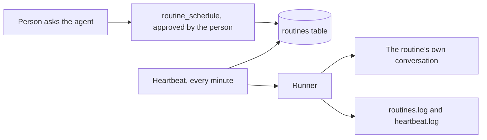

# Routines

A routine is a prompt the agent runs on a schedule, as the person who made it. "Every weekday at 9, check the build and tell me what broke" is a routine. A person makes it by asking the agent, and the agent keeps it in the chat database.

Routines are not [schedulers](schedules.md). They are for the people who use the agent, not for the developer.

| | `schedules/*.bx` scheduler | Routine |
|---|---|---|
| Who makes it | The developer, in a file | Anyone, by asking the agent |
| Where it lives | In the project, shipped with the agent | In the chat database, per person |
| Runs as | The app | The person who made it, with their notes and volumes |
| Changed by | Editing the file and rebuilding | Asking the agent, while the app runs |
| Turned on by | Existing | `routines.enabled: true` |



## Turn it on

Routines are off by default, so a published agent never grows automated work by surprise.

```yaml
routines:
  enabled: true
  minInterval: 5m
  timezone: Europe/Madrid
```

With the feature off there are no routine tools, no heartbeat and no routines capability. The settings:

| Setting | Default | Meaning |
|---|---|---|
| `enabled` | `false` | Turns the feature on |
| `maxPerUser` | `20` | The most routines one person may have (1 to 200) |
| `minInterval` | `5m` | The shortest a routine may repeat (`1m` to `1d`) |
| `maxParallel` | `2` | How many routines the heartbeat starts in one beat (1 to 10) |
| `maxPromptLength` | `4000` | The longest prompt, in characters (200 to 20000). Longer instructions belong in a [skill](skills.md) |
| `approvalTimeout` | `24h` | How long a run waits for a person to approve a tool (`5m` to `7d`) |
| `timezone` | the server's | The time zone cron expressions are read in, an IANA name such as `Europe/Madrid` |

A duration is a whole number with `m`, `h` or `d`. A bad value stops the build and `doctor` names it.

## Making one

Ask the agent: "every weekday at 9, check the build". The agent calls `routine_schedule` and a person approves it, as for any tool that needs approval. The answer says when it first runs.

A schedule is stored in one of two forms:

- a 5 field cron expression, `minute hour day-of-month month day-of-week`, such as `0 9 * * 1-5`
- an interval, `every 30m`, `every 2h` or `every 1d`

The model turns plain words into one of these, and the tools answer with the English reading ("weekdays at 09:00") and the next run time, so a mistake is seen straight away.

## The tools

Every tool the agent gets from BX Agents is named `{type}_{action}`, so permissions can match them by pattern later.

| Tool | Does | Needs a person's approval |
|---|---|---|
| `routine_schedule` | Makes a routine | Yes |
| `routine_list` | Lists yours, with when each runs next and how the last run went | No |
| `routine_update` | Changes the schedule, the prompt, or both | Yes |
| `routine_pause` | Stops one without deleting it | No |
| `routine_resume` | Starts a paused one again, and clears its failures | No |
| `routine_run` | Runs one at the next beat instead of waiting | No |
| `routine_delete` | Deletes one. Its conversation stays | Yes |

The tools act as the person in the conversation, never as an admin, and only the root agent has them. A routine's own run is refused them, so a routine cannot make or change routines.

## A run

Every minute the **heartbeat**, a scheduler the build adds, looks for routines that are due and starts them, at most `maxParallel` at once. Each run:

- is a normal turn as the person who owns the routine, so their notes, volumes and tool approvals all apply, and nothing extra is allowed
- happens in a conversation of its own, `routine-<name>-<id>`, which the person finds in their conversation list and reads like any other
- never overlaps itself: a routine still running is skipped, and the skip is logged
- stops for approval like any chat. The routine shows as waiting, the person answers in its conversation, and after `approvalTimeout` the run is cancelled and counts as a failure

Three failures in a row pause the routine. `routine_resume` starts it again. If the server was down when a routine was due, it runs once on start, never once per missed time.

An admin sees and manages every person's routines. Nobody else can see yours.

## Logs

`routines.log` records each routine made, changed, run, skipped, failed and paused, and `heartbeat.log` the beats that started something. A prompt is never logged, only the routine's name and its owner. See [logs](logs.md).

## Not yet

Sending a routine's answer to a chat app, a results folder for reports, the `/routines` command, `bxAgents routines`, the API routes and a Routines section in the web page come next. For now a person reads a routine's answer in its conversation.
