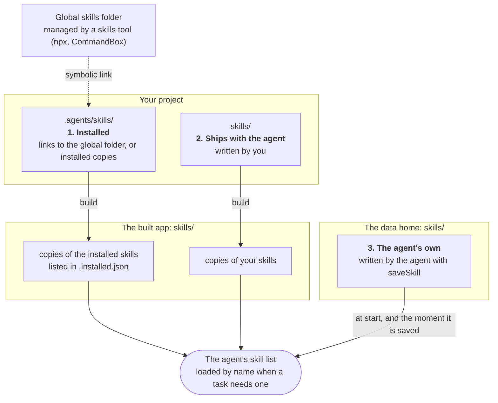

# skills/

Each immediate subfolder of `skills/` that contains a `SKILL.md` file is one skill, following the Claude Agent Skills convention: YAML frontmatter (`name`, `description`) followed by a body of freeform instructions.

```
skills/
└── greeting/
    └── SKILL.md
```

```markdown
---
name: greeting
description: How to greet people warmly.
---

Always greet the user warmly and use their name if known.
```

!!! tip
    `bxAgents add skill <name>` creates `skills/<name>/SKILL.md` with the frontmatter and a body to fill in. See [`add`](../cli-reference.md#add-skill).

## Naming

The skill's name is its frontmatter `name:` if present; otherwise it falls back to the folder name (`greeting/` with no frontmatter name would be discovered as `greeting` anyway, but an explicit `name:` always wins even if it differs from the folder). Two skills resolving to the same name fail validation with a duplicate-name error.

A folder without a `SKILL.md` inside it is not discovered as a skill at all - it's simply ignored (useful for scratch subfolders, assets kept alongside a skill under a different structure, etc., as long as they don't sit directly under `skills/` themselves without a `SKILL.md`).

## The three levels

An agent's skill list is made from three levels. The first two are built into the app; the third is written by the agent while it runs.



| Level | Where | Written by | `origin` in `/skills` |
|---|---|---|---|
| 1. Installed | `.agents/skills/` in the project. A skills tool links a skill from its global folder into it, or `bxAgents skills install` copies one there. It stays out of source control and is restored at build time | A skills tool or the registry | `installed` |
| 2. Ships with the agent | `skills/` in the project, and the skills [extensions](extensions.md) carry | You | `project` |
| 3. The agent's own | `skills/` in the [data home](data.md#skills-the-agent-saves) | The agent, with its `saveSkill` tool | `agent` |

The rules between the levels:

- **Yours wins over installed.** A skill in `skills/` and an installed one with the same name or folder: the one in `skills/` is used.
- **The agent never replaces the first two.** `saveSkill` refuses the name of an installed skill or one that ships with the agent. It can save over a skill it wrote itself, to improve it.
- **A link is followed.** The app gets a copy of what the link points at, so a deployed app does not depend on the global folder.
- **The app tells levels 1 and 2 apart** by `skills/.installed.json`, which the build writes beside the skills. `/skills` and `GET /skills` use it to show each skill's level.

Level 3 is described in [data and volumes](data.md#skills-the-agent-saves): approval of each save, the limits, and the `skills` setting in `Agent.yaml`.

## Skills from the registry

Skills from skills.boxlang.io are installed with `bxAgents skills install <owner/repo/skill>`, not copied by hand. They go in `.agents/skills/` (bx-ai's own default folder), out of source control; `.agents/skills.lock.json` is committed and `build` restores from it. Both folders go into the build, and a skill in `skills/` with the same name wins. A global skills tool can link its skills into `.agents/skills/` instead; a link is followed and the app gets a copy. See [`skills`](../cli-reference.md#skills).

## How it's wired at runtime

`skills/` is copied verbatim into the generated app (same wipe-then-write, dotfile-excluding copy as [`tools/`](tools.md)). The generated app always points bx-ai's own `skillsDirectory` module setting at `/skills`. It is written to `config/bxai-settings.json` (not `config/ColdBox.bx`, because ColdBox's `moduleSettings` does not reach bx-ai, a BoxLang module) and applied when the app starts:

```json
{ "skillsDirectory": "/skills" }
```

!!! info
    bx-ai's own default `skillsDirectory` is `/.agents/skills` - a different path than BxAgents' `skills/` convention. The generator always overrides it explicitly so the app's `skills/` folder is the one bx-ai actually loads from. Skills installed under your project's `.agents/skills/` are copied into it at build time; you never need to set this yourself.