# The web app

A `gateways/*.bx` entry with `exposes: "webui"` ships a complete web app for the agent: a left menu with [fourteen pages](#the-pages), a chat with streaming, reasoning, tool calls and human-in-the-loop approvals, per-visitor theming, and a real SQLite store behind it.

It lives under [gateways/](gateways/index.md) because that is where exposures are declared, but it is a subsystem in its own right, which is why it has its own page.

<video controls preload="metadata" poster="/assets/video/web-trailer-poster.png" style="max-width:100%">
  <source src="/assets/video/web-trailer.mp4" type="video/mp4">
  <source src="/assets/video/web-trailer.webm" type="video/webm">
  <track kind="captions" src="/assets/video/web-trailer.vtt" srclang="en" label="English" default>
</video>

*Just over three minutes through the whole web app, narrated: the left menu and every page. The answers come from a scripted demo model, so they are canned. Captions are on.*

```javascript
// gateways/chat.bx
class {
	function configure() {
		return {
			exposes     : "webui",
			path        : "/chat",
			apiKeyEnvVar: "CHAT_UI_API_KEY"   // optional - the agent API's shared secret, see Securing the API
		};
	}
}
```

That installs the web app at `<path>`: a ColdBox module (`bxagentsui`) with its own handlers, routes, layouts and views, copied into the generated app. The app is a client of the [agent API](agent-bx.md#the-always-on-agent-route) at `/__bxagents`, the same one the terminal chat and the gateways use, so there is no second API under `<path>`. The agent API must stay enabled (`agentApi.enabled: false` with a `webui` entry is a build error).

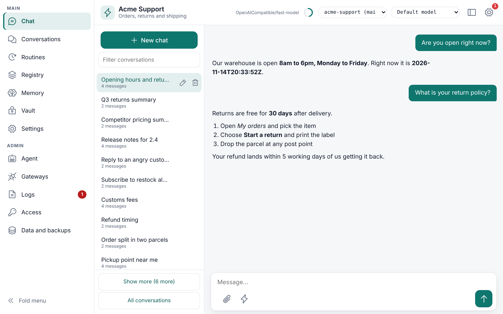

The screenshots on this page show the web app this repo ships, served from a demo project (Acme Support) with a scripted model, sub-agents, skills, notes, routines, vault entries and thirty conversations. Everything runs offline.

The app is written with [Alpine.js](https://alpinejs.dev) and Sass and built with Vite in this repository's `ui/` folder, and the build ships **inside the module** but is not committed: `./gradlew shadowJar` makes it (it needs Node 24 as well as Java), so the module you install already holds it, `bxAgents build` never runs `npm install`/`npm run build`, and a generated project never needs Node or npm installed at all. The build writes the module's settings (path, branding, theme, extension files) to `config/bxagentsui.json` in the generated app. Its scripts and styles are served from `/modules/bxagentsui/includes`, and it loads nothing from a CDN. To change the app itself, see [Working on the web app](#working-on-the-web-app).

That constraint is about the build, not about scope. The app is a full client: conversation sidebar, streaming with reasoning and tool calls, approvals, compaction, server-side theming. What is genuinely still missing is listed under [What is not here yet](#what-is-not-here-yet).

The page talks to the agent API at `/__bxagents` via `POST /__bxagents/stream` (`Accept: text/event-stream`), using `fetch()` + a manual `ReadableStream` reader - not the browser's `EventSource`, which can't `POST` or set custom headers, both needed here.

!!! warning
    **`toAi()` forwards each bx-ai chunk verbatim - it does not wrap it.** ColdBox's [AI Routing docs](https://coldbox.ortusbooks.com/the-basics/routing/routing-dsl/ai-routing) show the stream as `data: {"token":"..."}` lines, but its own source (`Router.cfc`, `toAi()`'s stream sub-route) does `emitter.send( chunk, "chunk" )` - so every frame carries the **full normalized bx-ai envelope**:

    ```text
    event: chunk
    data: {"object":"chat.completion.chunk","choices":[{"delta":{"role":"assistant","content":"Ray","reasoning":"...","tool_calls":[...]}}]}

    event: done
    data: [DONE]
    ```

    There is no `token` key anywhere. A client written against that docs page - including this UI's own first version - reads `undefined` and renders nothing at all. Read `choices[0].delta.content` instead.

Because the whole envelope arrives, **reasoning and tool calls are already on the wire** with no extra endpoint needed: `delta.reasoning` (normalized across every provider by bx-ai) renders as a collapsed "Thinking" strip, and `delta.tool_calls` as collapsed per-call chips. Tool-call arguments stream as partial JSON fragments keyed by `index`, so the page accumulates per index rather than assuming any single chunk holds a complete call.

## The pages

Every page has a **left menu** and a **header**. The menu has two groups, and each page is an address of its own under `<path>`, so you can bookmark one: `<path>/` is the chat, then `<path>/conversations`, `<path>/routines`, `<path>/logs/gateways?q=slack`, `<path>/access/people` and so on. A tab or a filter that matters is kept in the address too. An address under `<path>` that is none of the pages answers `404`.

| Group | Pages | Who sees it |
|---|---|---|
| Main | Chat, Conversations, Routines, Registry, Connectors, Memory, Vault, Settings | everyone who can sign in |
| Admin | Agent, Gateways, Embeds, Logs, Access, Data and backups | [admins](#admins-and-members) only |

A member never sees the Admin group: an Admin page answers `403` to a member who is signed in, and the API refuses the routes behind it anyway. The menu shows only the pages this person may use, from the capabilities `GET /agent` reports. It folds to icons (the choice is remembered in the browser) and becomes a drawer on a phone. The header holds the agent's icon and title, a light or dark switch, and either **Password** (an agent without accounts) or who is signed in and **Sign out**. Extensions can add to the Chat page with [slots](extensions.md#the-web-page-slots-and-web).


### Chat and Talk to

The page you land on. The conversations sidebar shows 25 at a time with a filter box and a **Show more** button, and the transcript streams the answer with reasoning, tool calls and approvals (see [What the page does](#what-the-page-does)). The bar above the conversation holds the **Talk to** and model pickers, the context ring, the extensions' status chips and the **Fork**, **Export** and **Compact** buttons. The **Talk to** menu lists the main agent and each [sub-agent](subagents.md). Pick one and the next message goes to it directly; a banner says who you are talking to, a conversation belongs to the agent it started with, and every agent keeps its own memory. In the terminal chat the same thing is `/agent`.

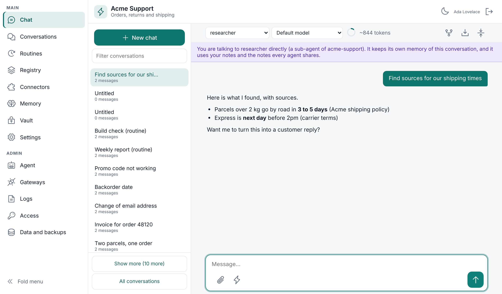

### Conversations

Every conversation you may see, in one table: title, agent, source (web page, terminal, a gateway, a routine), message count and last activity. Search the titles, narrow by agent and source (each chip shows its count), by dates, and page through the list. A row opens, renames, forks, exports as Markdown or deletes. An admin can switch from **Mine** to **Everyone** and also filter by owner.

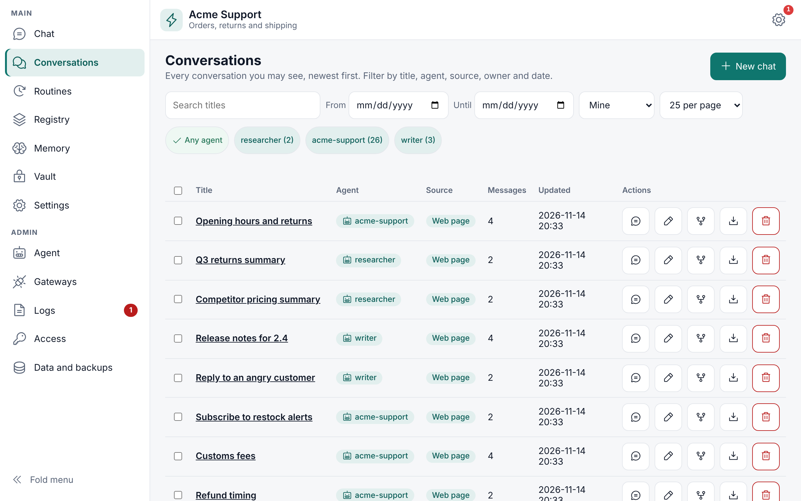

### Routines

When [routines](routines.md) are on. The table shows each routine's status in words, its schedule in words with the stored form, the next and last run and where its answer goes. **Run now**, **Pause**, **Resume**, **Edit**, **Reports**, the routine's own conversation and **Delete** are on each row; **New routine** opens the editor, which reads the schedule back to you in words before you save. Reports are the files a run saved; they can be read, deleted one by one or cleaned up by age (with a count first).

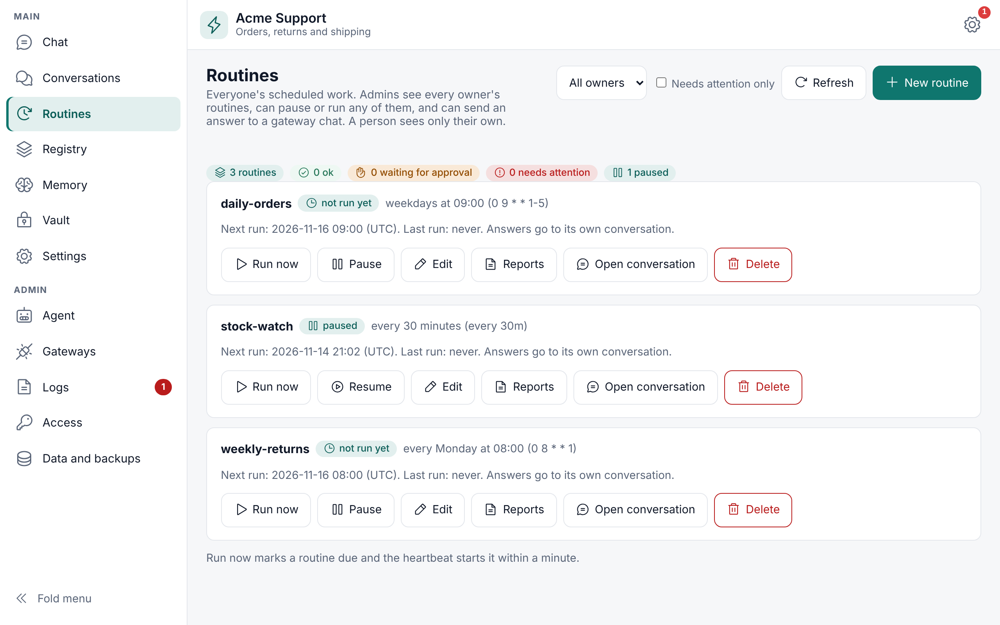

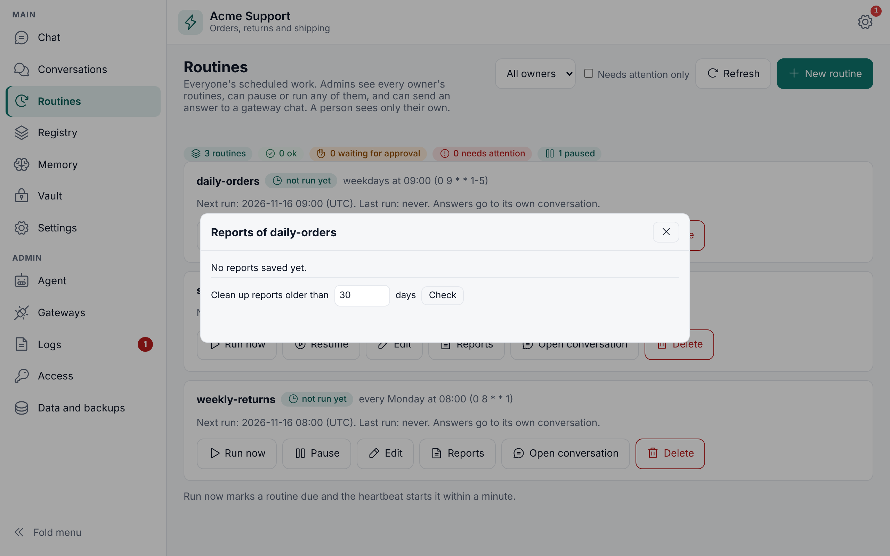

### Registry

What the agent can use, in three tabs. **Tools** lists every tool grouped by where it comes from and marks the ones that ask first. **Skills** lists each skill with its level (installed, shipped with the agent, or saved by the agent itself) and a **Read** button that opens its `SKILL.md`. **Volumes** lists the folders the agent may read or write, by name and mode, never by path.

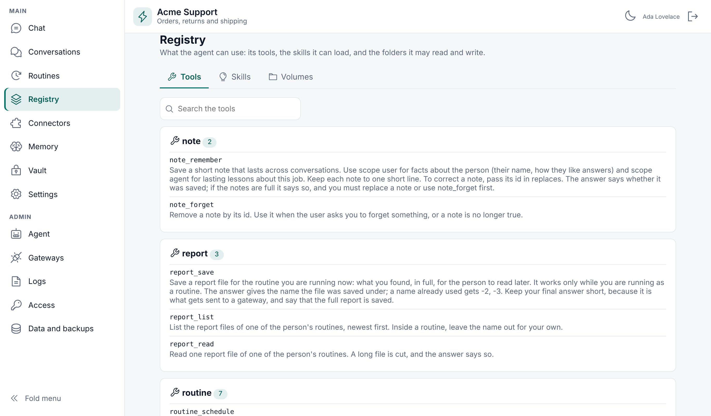

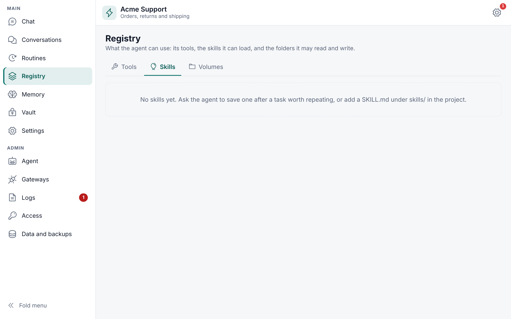

### Connectors

The [connectors](connectors.md) the agent offers, as cards, with tabs for **All**, **Connected**, **Needs attention** and **In Agent.yml** (the services written under `mcpServers`). **Connect** asks for a token or starts a sign in, and shows the risk first for medium and high risk connectors. **Tools** opens a drawer to turn single tools on or off. A banner warns when too many tools are on. Everyone connects their own account; only an admin can connect a local program such as Git.

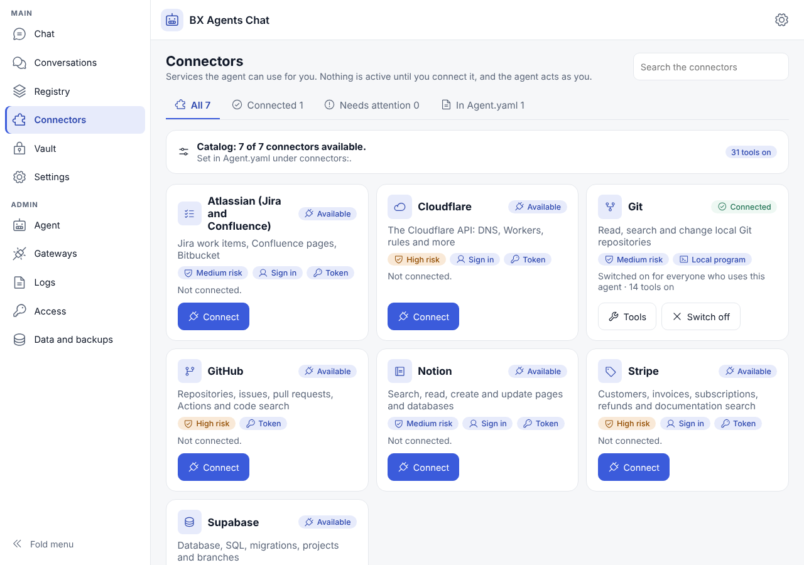

### Memory

Three things the agent remembers. **About you** holds your notes. **About the agent** holds the shared notes the agent keeps about its own work, the same for everyone who uses it. **Conversation memory** shows what the memory holds for conversations and clears it, for one of yours, or (admins only) for everyone's conversations of the agent shown, with the number of conversations and people it will affect, keeping the conversations themselves. Each note list shows how full it is and about how many tokens it adds to every conversation.

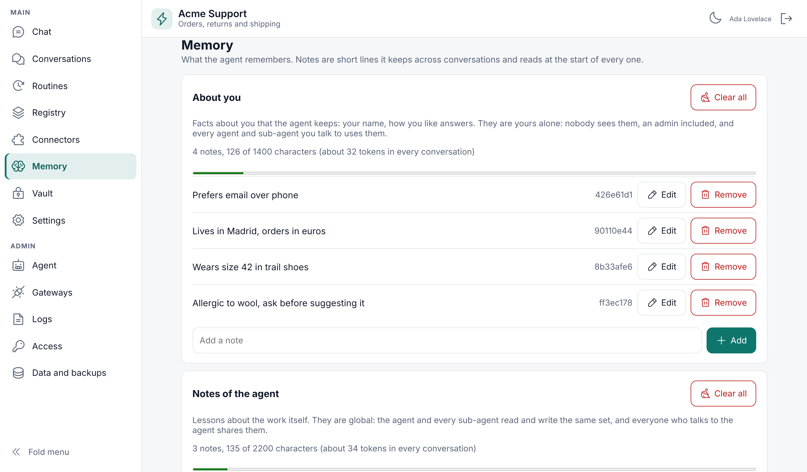

### Vault

The secrets the agent can use, by name, purpose and the hosts each may go to. A value is typed once into a hidden box, sealed in the database and never shown again. Your own secrets and the agent's are listed apart, and an admin also sees the key's status and an **Activity** list of recent use. See [vault](vault.md).

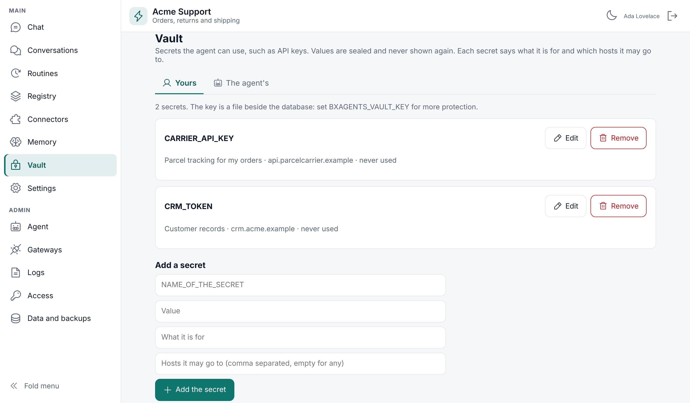

### Agent

For admins. **Composition** draws how the agent is put together: what reaches it (gateways, the API, schedules), the main agent and its sub-agents with their tools and skills, and what it reaches out to (models, MCP servers, vault, volumes), with the tools that ask first marked. **Files** shows the project's own definition files read only (`Agent.yml`, instructions, sub-agents, gateways); a key that looks like a secret is shown as stars. **Usage** shows tokens by day and by model once `usage: true` is set.

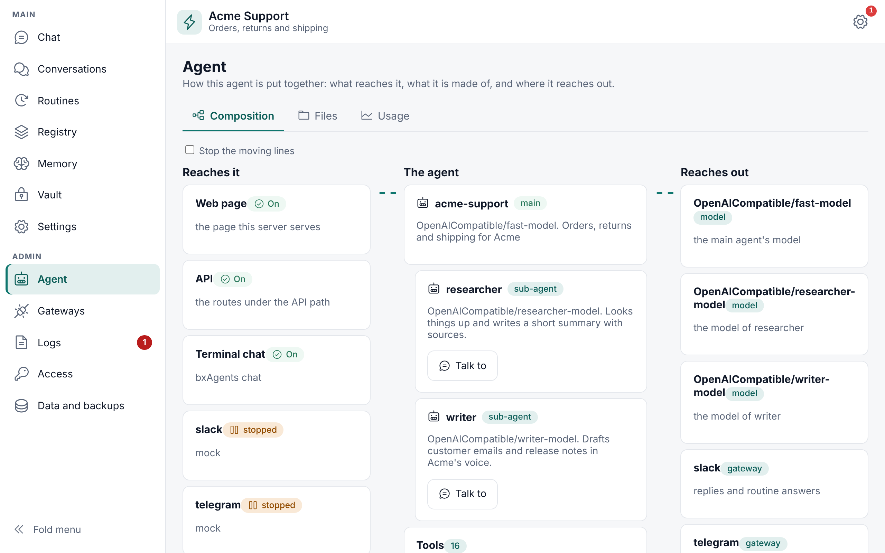

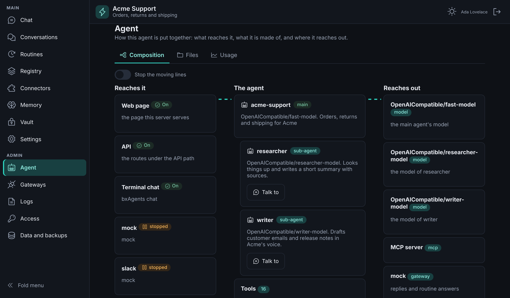

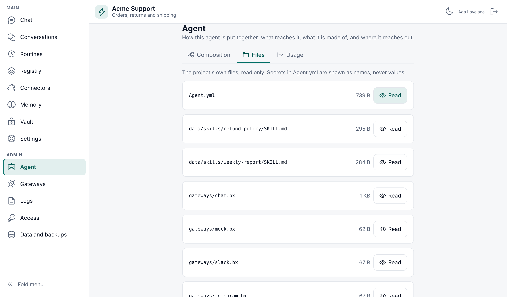

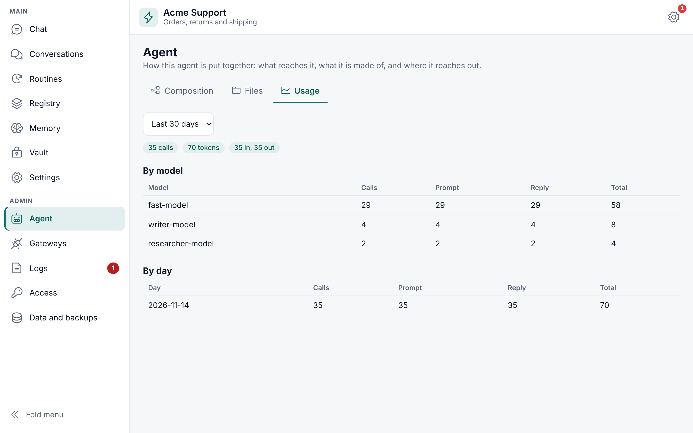

### Gateways

For admins. Each [gateway](gateways/index.md) with its state (connected, stopped, failing or not registered), which of its credentials are set (the names, never a value), when it last had a conversation, its last error and the chats it has talked to. **Reconnect** stops and starts one gateway in place, so a fixed credential does not need an app restart. A run already going is not cancelled.

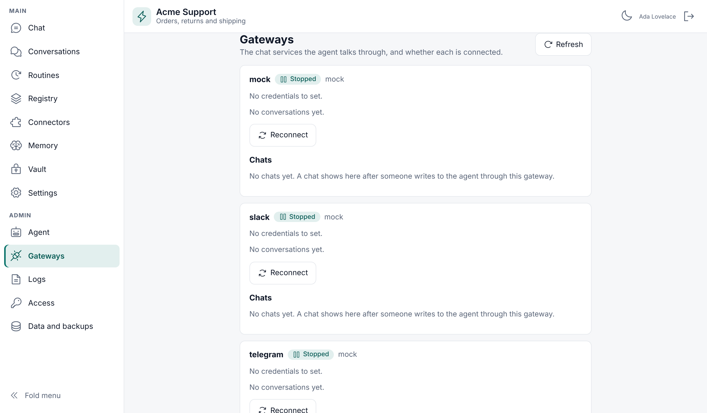

### Embeds

For admins, when the agent keeps its database. The agent on **another website**, for anonymous visitors: define it here, paste the snippet there. The page is a list of the [embeds](embeds.md) with a search (name and websites), a state filter (All, On, Off, Expired, each with its count), the state of each in words, a **switch** to turn it on or off at once, and **Edit** and **Delete** (which asks first and removes the embed for good). **New embed** and Edit open the same drawer, and saving a new embed keeps the drawer open as the edit of it. The drawer has a fieldset each for **Agent** (name, which agent answers, an optional model profile), **Look and text** (title, input placeholder, welcome message, up to three suggested questions, colour, position, theme), **What visitors can use** (the agent's tools as a checklist, everything unticked is off), **Allowed websites** (chips that refuse a wildcard, a path or anything that is not an origin, and at least one is required) and **Limits** (per visitor per minute, per day for the whole embed, longest message). A **preview** on the right is the real widget, drawn from the form as you type. For a saved embed the page also shows the **snippet** as HTML, iframe, web component and curl, each with a note and a **Copy** button, and the last seven days: messages, requests refused for a wrong website and requests refused for a limit, or "No visits yet" when nothing has happened. **Save**, **Disable** (it asks first; visitors are then answered as if the embed did not exist) and **Rotate key** (it asks first; every open visitor session ends) are under the form.

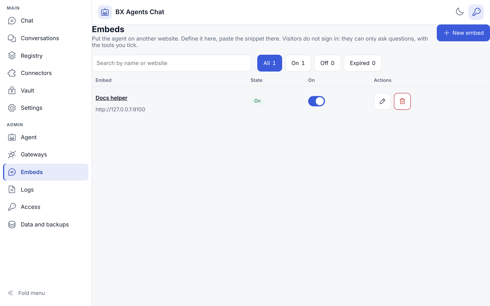

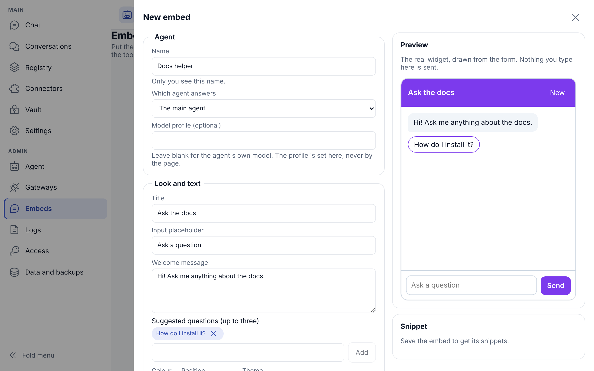

### Logs

For admins. A tab for each of the five [logs](logs.md) (agent, gateways, routines, heartbeat, API), each with a red chip when it logged errors since the app started, a level filter, a search box, a line count and a **Live** switch. With Live on, each new line shows as the agent writes it (over `GET /logs/stream`, with the same filters). The stream is opened again when the server ends it (after ten minutes) or it drops, and a server without that route is read every 5 seconds instead; the line under the log says which. New lines keep the view at the end unless you scrolled up. The tab and the search are in the address (`<path>/logs/gateways?q=slack`), which is how **Open log** on the Gateways page links to a gateway's lines. Secrets are never in a log. The same logs are in the terminal with `bxAgents logs --follow` and `bxAgents logs --ui`.

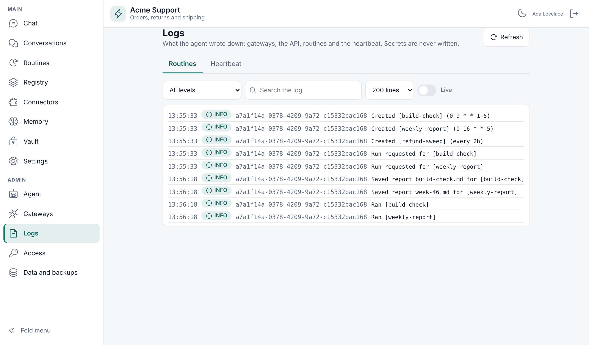

### Access

For admins. **Tokens** makes and revokes named [access tokens](agent-bx.md#access-tokens-for-a-deployed-agent) (the secret is shown once) with a `chat` or `admin` scope and an optional expiry. **People** lists the sign-in accounts and lets you make one an admin or a member; the last admin cannot be demoted.

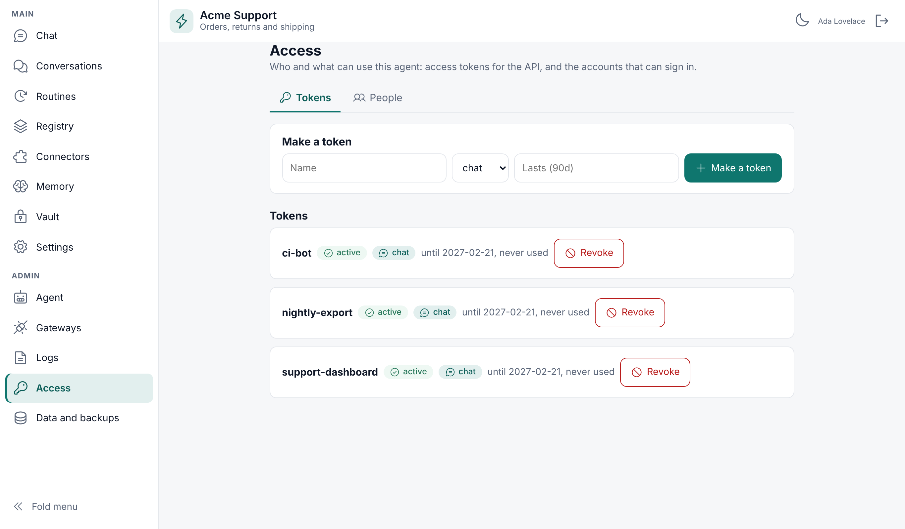

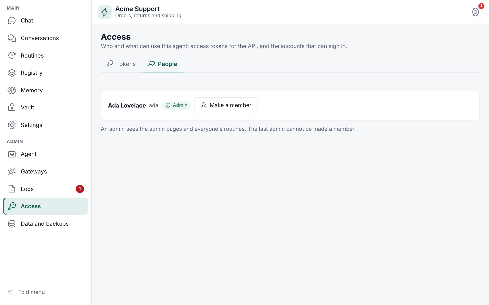

### Data and backups

For admins. Where the agent keeps everything (the [data home](data.md)) and how big each part is, the volumes and where each is, and the backups: **Make a backup**, **Download** one, or **Restore** one. A restore is applied the next time the app starts, and what was there is kept as `before-restore`.

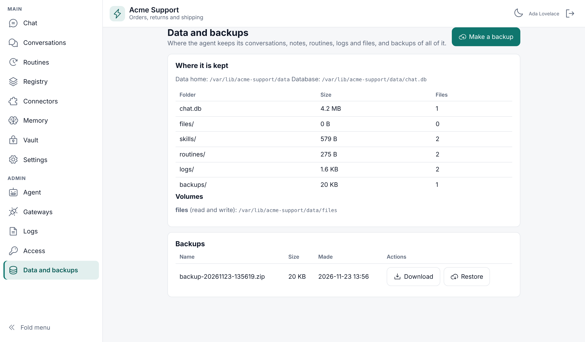

### Settings

**Appearance** (mode, accent colour, text size, density), **Model** (which profile answers, when the gateway lists `profiles`), **Account** (a link to the Connectors page, and **Sign out** with accounts), **Server** facts, and for admins the **Extensions** the app loaded.

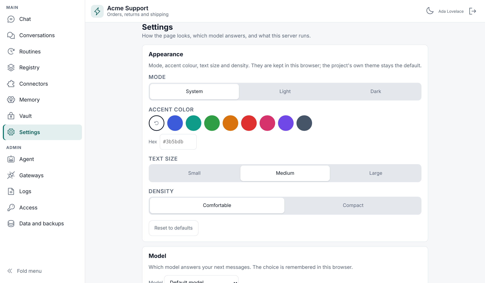

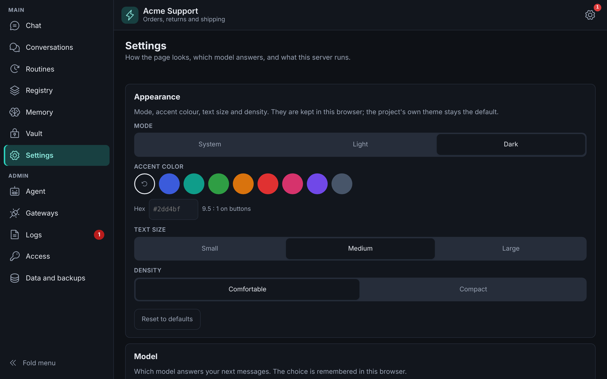

### Phone and accessibility

On a phone the menu becomes a drawer, the header gives way, and a table becomes a list. The page is built to be used without a mouse: a skip link comes first, the focus ring is always visible, targets are at least 44 by 44 pixels, the current page is marked with `aria-current`, status is said in words and icons as well as colour, text keeps a contrast of at least 4.5 to 1, `prefers-reduced-motion` stops every animation and transition, dialogs trap focus and give it back, and a row of tabs is one Tab stop that the arrow keys, Home and End move along. Every page is checked with [axe-core](https://github.com/dequelabs/axe-core) as an admin and as a member, light and dark, on a desktop and a phone, with its dialogs open, against WCAG 2.2 AA; a serious or critical finding fails the build.

::: columns
::: column
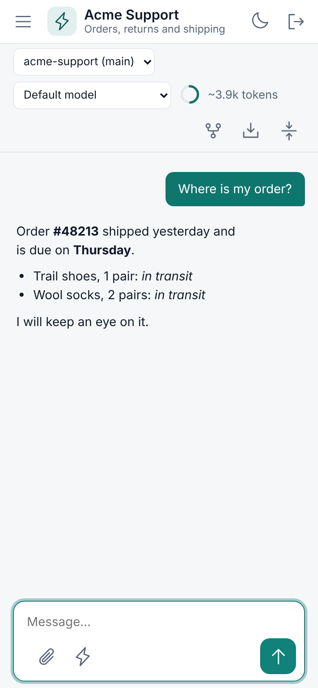
:::
::: column
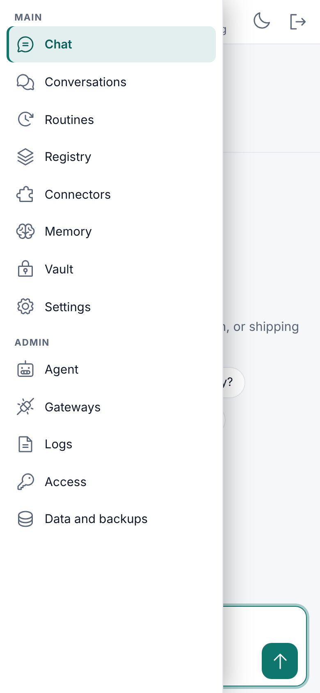
:::
:::

## Walkthrough

The [trailer at the top](#the-web-app) covers every page. These are the details of the chat page itself.

| | |
|---|---|
|  **Sign in.** Accounts come from [`users`](#users-and-sign-in). | 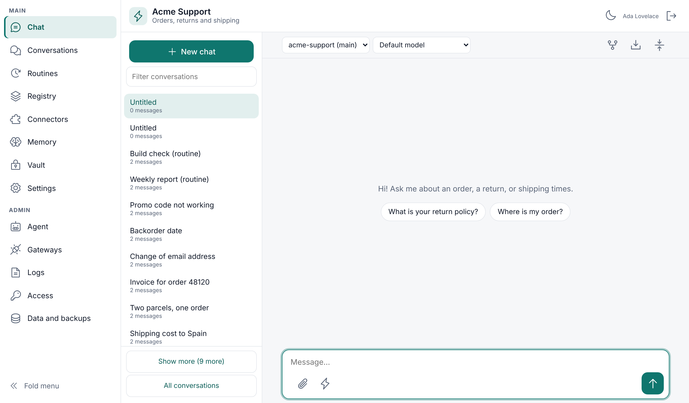 **Suggestions.** An empty conversation can offer [`suggestions`](#branding-and-theming) that send with one click. |
| 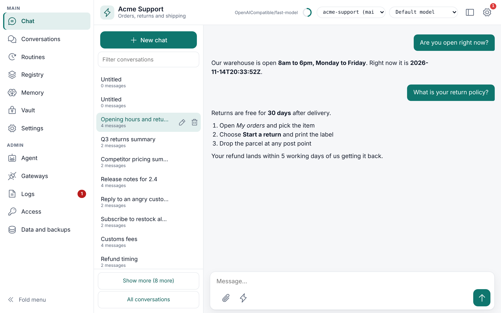 **Streaming.** Replies render Markdown as they arrive. |  **Model picker.** The pick is sent with each message, in the same conversation. |
| 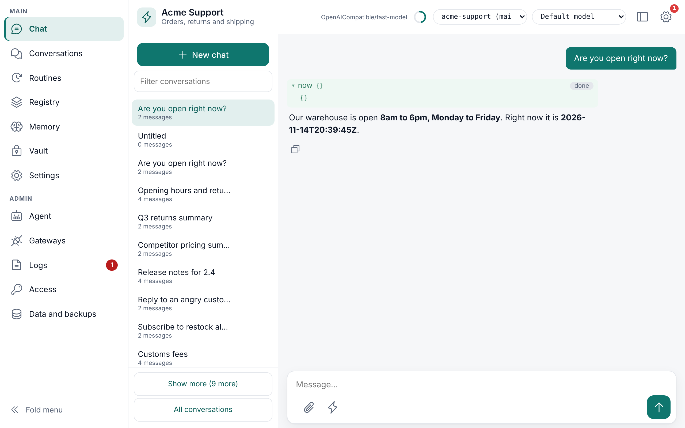 **Tools.** Each call shows its name and arguments. | 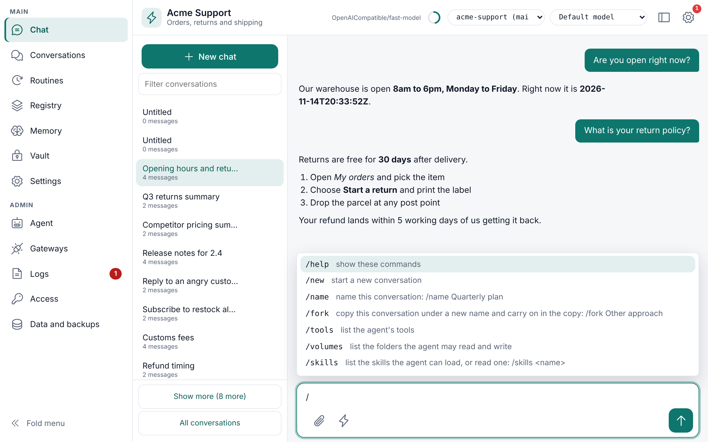 **Commands.** Type `/` for the menu. |
| 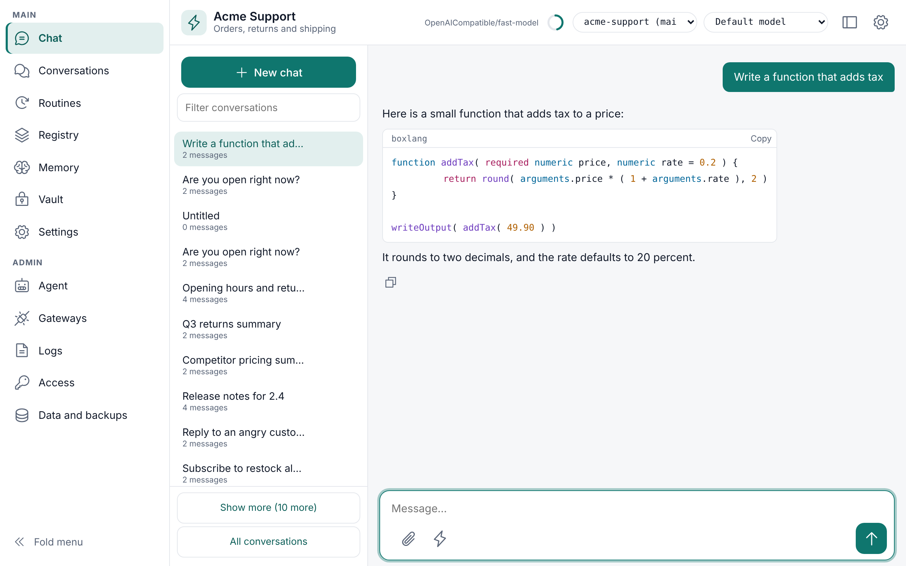 **Code.** Each block shows its language and copies the code itself. |  **Connectors.** Connect GitHub, Notion and more once; the agent then acts as you. |
| 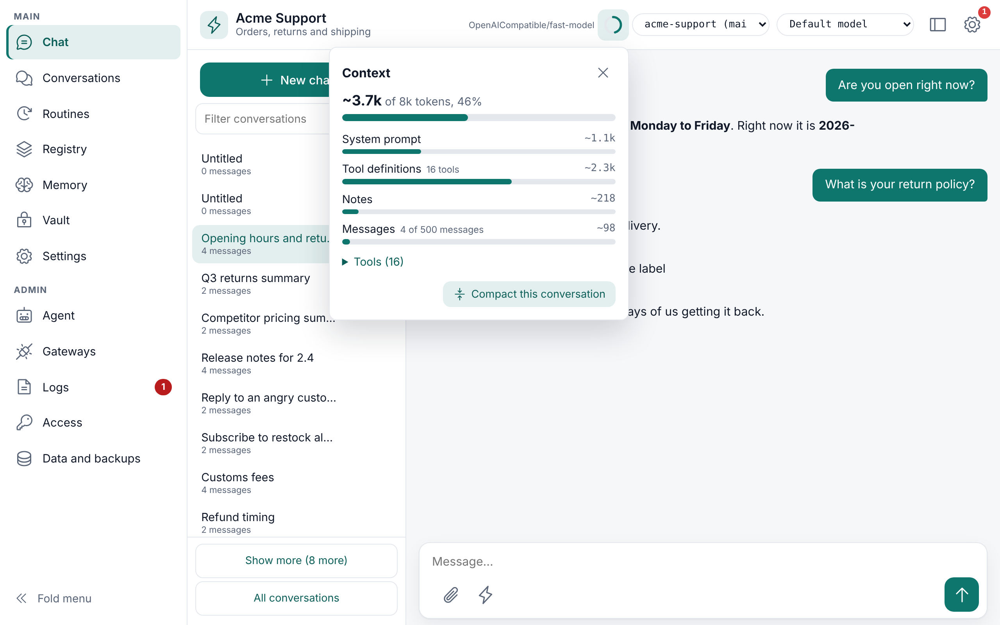 **Context.** The ring fills as the conversation grows; click it for the breakdown. |  **Header.** The light or dark switch, and Password or Sign out. |
|  **Appearance.** Mode, accent, text size and density, kept in this browser. |  **Theme.** Light or dark, remembered, with your `theme` accent. |

## What a streaming turn actually looks like

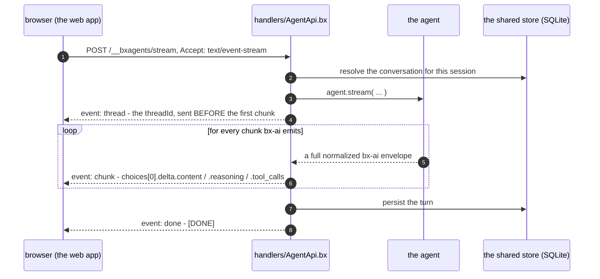

The `thread` event goes first because a response header cannot be read before the body starts arriving, and the page needs that `threadId` to be able to `POST /cancel` mid-turn.

## The API the page calls

The app has no API of its own. Under `<path>` it answers only its pages, the sign-in form and sign out, and the files of the extensions' `web/` folders (`<path>/ext/<name>/<file>`, see [extensions](extensions.md#files-in-web)). Everything else it does goes through the agent API's routes, documented under [The always-on agent route](agent-bx.md#the-always-on-agent-route): turns (`/stream`, `/cancel`, `/steer`, `/resume`, `/pending`), conversations (`/sessions`, `/history`, `/clear`, `/compact`, `/export`), `/preferences`, `/notes`, `/commands` and `/command`, and the capability routes (`/agent`, `/context`, `/status`, `/slots`, `/profiles`, `/tools`). Anything the page can do, a script can do with the same calls.

Each call carries three headers:

| Header | Why |
| --- | --- |
| `x-bxagents-source: web` | Marks conversations the page starts, so the API's `?source=` filter (`GET /__bxagents/sessions?source=web`) can tell them from terminal and gateway ones |
| `x-bxagents-token` | The password typed in the **Password** dialog (opened by the key button in the header, or by itself when the server answers `401`), when one is set (see [Securing the API](#securing-the-api)) |
| `x-bxagents-csrf: 1` | Sent on every request. A request made with the sign-in cookie that changes something must carry it, so another site cannot make your browser do it |

Identity is the API's: with no `users` the page is the one open `local` user, shared with the terminal chat on the same machine, and with `users` it is the signed-in account.

### Slash commands

Type `/` in the message box, or press the lightning button, and a menu of commands appears (arrow keys, `Tab` to complete, `Esc` to close). A command an [extension](extensions.md#commands) adds shows the extension's name as a badge. They are the same commands as in [the terminal chat](../cli-reference.md#the-same-commands-in-the-web-page-and-in-chat-apps): `/help`, `/new`, `/tools`, `/volumes`, `/skills`, `/routines`, `/routine`, `/sessions`, `/resume`, `/clear`, `/compact`, `/model`, `/info`, `/context`, `/remember`, `/notes`, `/name`, `/fork`, `/export`, `/ping` and `/keys`. Pressing Enter runs the line on the server with `POST /command` and draws the answer: text, a table, or buttons to pick from. `/new`, `/resume` and `/fork` move the page to the conversation they name, `/clear` reloads the transcript, and `/export [file] [--format=md|html]` hands the conversation to the browser to save (the **Fork** and **Export** buttons above the conversation run `/fork` and `/export`).

The reply is data, so any client can use it:

```json
{ "success": true, "conversationId": "...",
  "blocks": [ { "type": "table", "layout": "keyvalue", "rows": [ [ "Agent", "helper" ] ] } ],
  "effects": [ { "type": "conversation", "id": "..." } ] }
```

Blocks are `text`, `table`, `choose` (options, each with the command line to run), `transcript` and `file` (`{ name, mime, text }`, which the page saves); effects say what happened to the conversation (`reset`, `conversation`). `/info` leaves out where the database file is. A command that only makes sense on your own machine (`/copy`, `/record`, `/profile`) is not offered, and a server never switches the shared agent's model: the page picks a profile per message instead.

`threadId` is server-authoritative: taken from the request when supplied, minted otherwise, and always echoed back - as an `X-Thread-Id` response header on `/invoke` and `/batch`, and as a `thread` SSE event sent *before the first chunk* on `/stream` (a header can't be read before the body starts arriving). That's the same contract ColdBox 8.1's own `toAi()` adopted, so a client written against one works against the other.

!!! warning
    **Stop must go through `/cancel`, not just an aborted fetch.** Aborting the HTTP request only stops the browser listening - the server keeps running the turn, calling tools and spending tokens. The page therefore sends a `threadId` with every turn and posts it to `/cancel` before aborting, so `agent.cancelRun()` can signal the run at its next checkpoint.

`/clear` and `/compact` are both careful about scope. `/clear` goes through each memory's own `clear( userId, conversationId )` rather than `AiAgent.clearMemory()`, which takes no arguments and would wipe every visitor's history; `/compact` goes through `summarize( config, userId, conversationId )` for the same reason. Compaction replaces this conversation's older messages with an AI-written summary and keeps the most recent few, touching nothing outside the caller's `(userId, conversationId)` pair.

!!! info
    **`/compact` needs a summary model, and reports whether it has one.** `summarize()` is a silent no-op unless the memory has *both* `summaryProvider` and `summaryModel` configured, and also when the conversation is already at or under `keepRecent`. Neither is an error, so `/compact` returns `{ compacted, before, after }` and lets the caller see for itself, and `GET /agent`'s `capabilities.compact` reports whether a summary model is configured at all - so a page can hide a button that would do nothing rather than look broken.

    Only `keepRecent` is taken from the request. `summarize()` also honours `model`/`provider` overrides, but accepting those here would let any visitor aim a summarization call at a provider and model of their choosing on your credentials - the memory's own config decides that instead.

```yaml
# Agent.yml - what makes /compact functional
memory:
  type: cache
  summaryProvider: openai
  summaryModel: gpt-4o-mini
  summaryThreshold: 10
```

## Choosing the model

By default the page talks to the agent's own model and offers no choice. List [profiles](models.md#profiles) in the entry and the bar above the conversation gets a model select:

```javascript
// gateways/chat.bx
return { exposes : "webui", path : "/chat", profiles : [ "fast", "planner" ] };
```

- `GET /profiles` returns only the listed profiles: name, description, provider, model and which is the default. Never a key.
- The page sends the pick with each message as `options.profile` and remembers it in the browser. "Default model" sends none.
- A request that names any profile that is not listed is a `400`, whether or not `Agent.yml` declares it. A profile is a model your server pays for, so the browser never chooses one you did not offer. Without a list, every `options.profile` is refused.
- Each name must be a profile `Agent.yml` declares, or `default`. Web UI entries share one handler, so entries that list different profiles are a build error.
- An `agent` entry (a `toAi()` route) forwards the caller's own `params` and `options`, so it has no list to offer. The [always-on route](agent-bx.md#agentapi) has its own: `agentApi.profiles`.

## Users and sign-in

By default the web UI has **no accounts and no gate** - it is open, and every visitor is anonymous. That is the zero-ceremony `bxAgents serve` experience, and it is **not** a deployment posture. Declaring `users` on a `webui` entry turns on a real sign-in gate backed by [cbauth](https://forgebox.io/view/cbauth) and the same SQLite store everything else uses.

### Without accounts, the UI is one shared workspace

There is no per-visitor identity, on purpose. Every visitor to an accountless web UI reads and writes the **same** conversations, preferences and agent memory (the `local` user, which the terminal chat on that machine shares) - whoever can reach the page sees everything in it.

That is the point of running without accounts rather than an oversight: an open UI is a single shared tool (a laptop, a trusted internal box), not a multi-tenant service. Handing each browser its own slice would only fragment one workspace into per-browser copies nobody asked for, and any client-side id doing the fragmenting would be forgeable anyway.

!!! warning
    **An open UI has no privacy between visitors.** Anyone who can reach the URL sees every conversation in it, and can continue or delete any of them. If that is not what you want - anywhere the page is reachable by more than the people who should see the transcripts - declare `users`.

```javascript
// gateways/chatUi.bx
users : [
    { username: "ada",   passwordEnvVar: "ACME_ADA_PASSWORD", displayName: "Ada Lovelace" },
    { username: "grace", passwordHash: "pbkdf2$210000$...",   displayName: "Grace Hopper" }
]
```

### Passwords are never written in config

An account names the **environment variable** holding its password (`passwordEnvVar`), or carries an **already-hashed** value (`passwordHash`). A literal `password` key is a build error, not a warning - silently ignoring it would leave you believing you had set a password when you had only committed one.

A `passwordHash` is safe to commit precisely because it cannot be reversed. Generate one with the same hasher the app uses:

```text
bxAgents hash-password --password="<your-password>"
```

!!! danger
    **Hashed, not encrypted.** Encryption is reversible, and a stolen database file almost always travels with whatever could decrypt it - so a reversible scheme turns one file leak into every user's password, including any they reused elsewhere. Passwords here go through PBKDF2-HMAC-SHA256 with a per-user random salt and are never recoverable from the database. (BoxLang ships no bcrypt or argon2 BIF; PBKDF2 is the strongest primitive available without adding a dependency.)

    The iteration count is stored *inside* each hash (`pbkdf2$<iterations>$<salt>$<digest>`), so it can be raised later without invalidating anything already stored.

### What sign-in changes

Everything user-scoped re-keys to the real account. The agent API reads the signed-in account from cbsecurity (which wraps cbauth) in one place (`models/api/Authenticator`), and agent memory, the conversation index, preferences and pending-run ownership all key off the id it gives.

Accounts also close the API: with `users`, a request to `/__bxagents` needs the sign-in cookie or a token, whatever `agentApi.access` says. A page with accounts must never sit in front of an API anyone can call. A visitor who is not signed in is sent to the sign-in form at `<path>/login.html`, and a call refused later (the session ended) sends the page there too. Signing out is `<path>/logout`. Without accounts both addresses answer `404`.

The practical difference: conversations and preferences follow the person across browsers and devices, and clearing cookies no longer creates a brand-new "user".

| | No `users` | With `users` |
|---|---|---|
| Identity | One shared workspace | The signed-in account |
| Conversations visible to | Everyone who can reach the UI | Only their owner |
| Follows the person across browsers/devices | n/a - nothing is per-person | Yes |
| Reachable without signing in | Everything | Only the login form |

### Lifecycle

Accounts are reconciled from config on every boot, in this order: `ChatDb` migrates the schema, the seeder writes accounts, then the login gate starts enforcing.

- **Adding** a user to config creates them.
- **Changing** their password updates it. The seeder re-hashes only when the configured password no longer matches what is stored, so an unchanged password costs one verification rather than a fresh hash.
- **Removing** them from config **deactivates** the account rather than deleting it. Their conversations reference their id, so deleting the row would orphan that history instead of revoking access. They can no longer sign in; their data stays intact and returns if the account is restored.
- A `passwordEnvVar` whose variable is **unset** skips that account entirely and logs a warning to `webui-auth`. This fails closed on purpose - creating the account with an empty password would be far worse than it not existing.

### Admins and members

Every account is either an **admin** or a **member**. A member talks to the agent and sees only their own conversations, notes and preferences. An admin can also do what the operator of the app does: manage access tokens, see everyone's conversations, change the agent's own notes and secrets, see where the agent keeps its data (`GET /data`), and choose who else is an admin.

The flag is a boolean on the account:

```javascript
users : [
    { username: "ada",   passwordEnvVar: "ACME_ADA_PASSWORD", admin: true },
    { username: "grace", passwordEnvVar: "ACME_GRACE_PASSWORD" }
]
```

- **Config seeds it, the database keeps it.** `admin: true` sets the flag when the account is created, or when no account is an admin yet (how an account that existed before the flag gets its first admin). After that the database value wins, so a change made later survives a restart. Take `admin: true` out of config and the account stays an admin.
- **No admin set means no admin.** A server with accounts and none of them an admin has no one who can manage the others; the terminal and the server secret are still admins.
- **Changing it.** An admin can call `POST /users/admin` with `{ "username": "grace", "admin": true }`, list accounts with `GET /users`, or run [`bxAgents users`](../cli-reference.md#users). The last admin cannot be demoted. The change applies on the account's next request.
- The server secret (`agentApi.tokenEnvVar`), an issued token with `admin` scope and the terminal are admins as before; an open server with no accounts is one shared admin.

### What this is not

This is a fixed roster of operator-provisioned accounts, not a user-management system. There is no self-registration, no password reset, no roles beyond admin and member, and no per-user rate limiting or spend cap. If you need federated identity instead, edit `resolveUserId()` in the generated handler to return your own authenticated principal - the rest of the web UI neither knows nor cares where the id came from.

## Human-in-the-loop

When the agent pauses for approval, the stream emits a `middleware_stop` chunk that carries no detail. The page therefore asks `GET /pending?threadId=` what is being requested, renders it with **Approve** / **Reject**, and answers via `POST /resume` - which streams the *continuation of the same turn*, so the outcome lands in the conversation rather than starting a new one.

`decidedBy` is filled from the session server-side, never from the request body: who approved something is exactly the kind of claim a caller should not get to make about itself.

!!! warning
    **A suspended run belongs to the session that started it, and both routes enforce that.** Deriving `decidedBy` server-side only stops a caller lying about *who* decided - on its own it does nothing about *whose run* they are deciding on. Unlike every other action, `/pending` and `/resume` are addressed by `threadId` rather than by conversation, so without an ownership check a visitor holding someone else's `threadId` could read their pending tool calls and their arguments, and approve or reject on their behalf.

    The owner needs no extra bookkeeping: the handler stamps the session-derived `userId` into the run options, and the agent checkpoints those options alongside the suspension - so the saved state already knows who it belongs to. `/pending` answers as though nothing is pending when the caller is not the owner, so it cannot be used to probe whether a `threadId` exists at all; `/resume` refuses with a `403`.

## History and reload

The transcript lives in the DOM; the conversation lives in the agent's memory. Without rehydration a reload shows an empty screen while the agent still remembers everything - so the page would look blank and then answer follow-ups about messages the user cannot see. On load the page therefore calls `GET /__bxagents/history` and replays the stored messages (markdown and all), falling back to the welcome message when the conversation is empty or the fetch fails.

**New** starts a fresh `conversationId`. It does not delete anything - the previous conversation stays on the server under its own id and appears in the sidebar, which is what the conversations table exists for.

## What the page does

The Chat page is a real chat client, not a demo shell. The app reads `GET /agent` **first** and shapes itself to the capabilities the server reports, so a control only appears where the capability exists.

| Area | Behaviour |
| --- | --- |
| **Conversation sidebar** | Lists this visitor's conversations newest-first, with message counts. Switch, rename, delete, or start a new one with **New chat**. Titles render through `textContent` - a title is whatever the user typed first, so it is never parsed as markup |
| **Steer while streaming** | The composer stays live during a turn. **Send** becomes **Steer**, and the message splices into the run already in flight rather than starting a new one |
| **Stop** | Posts `/cancel` *before* aborting the fetch, so the server actually stops spending tokens, then keeps whatever already streamed |
| **Clear / Compact** | `/clear` empties this conversation; **Compact** appears only when a summary model is configured, and reports what it actually did (`Compacted 12 messages down to 3`, or `Nothing to compact yet`) |
| **Reasoning + tool calls** | Collapsed disclosures fed from `delta.reasoning` and `delta.tool_calls` on the same envelope |
| **Approvals** | A human-in-the-loop pause renders an Approve/Reject card from `GET /pending`, answered via `/resume`, which streams the continuation of the same turn |
| **Theme** | The light or dark switch (a moon, or a sun in the dark theme) in the header. Kept in this browser (`localStorage`) and also saved as the `theme` preference |
| **Model** | The model select in the bar above the conversation names each profile's model, with **Default model** first, when the gateway lists `profiles` |
| **Context size** | A ring in the bar above the conversation that fills as the context does (amber from 70 percent, red from 90), from `GET /context`, refreshed after each turn, command, clear, compaction, conversation switch and change to the notes. Click it for the breakdown: the total, each part with its share (system prompt, tool definitions, notes, messages), the tools, and a button to compact the conversation. The ring fills only when the model's [`contextWindow`](models.md#what-the-project-knows-about-a-model) is set; without it the panel still shows the sizes |
| **Attachments** | An **Attach** button (shown when `GET /agent` reports `capabilities.attachments`) picks pictures and text files; you can also paste a picture or drop files on the page. Chips show what waits, each with a remove button. Pictures go as base64 `attachments` of the stream request, text files are inlined in the message. At most 4 pictures, 5 MB each; `GET /agent` also reports `vision`, and a picture to a profile without it is refused with the reason |
| **Shortcuts** | Enter sends, Shift+Enter adds a line. `?` alone (or `/keys`) lists them |

**Recovery matters more than it sounds.** The last-opened conversation is remembered in `localStorage`, but the conversations themselves live on the server. If that id no longer exists - deleted in another tab, or a fresh store - the page falls back to the newest remaining conversation instead of rehydrating into an empty screen with no active row.

Narrow screens get a real layout rather than a squeezed one: under `40rem` the conversations sidebar overlays the transcript instead of stealing its width, the left menu is a drawer, and `prefers-reduced-motion` is honoured.


## The SQLite store

Every `webui` project gets a SQLite database. It isn't optional and there's no flag to turn it off.

The reason is a real gap, not a preference: **bx-ai's `IAiMemory` has no enumeration API.** It's a per-`(userId, conversationId)` bucket - you can read, write and clear one, but nothing in it answers *"which conversations does this user have."* A conversation list, per-user preferences, and anything else relational needs real storage alongside the memory, not inside it.

| Piece | What it is |
| --- | --- |
| `bx-sqlite` | The JDBC driver, bundled with BxAgents as a nested module |
| [`qb`](https://github.com/coldbox-modules/qb) | QueryBuilder for the sign-in accounts in `ChatDb` |
| `ChatStore` | In the BxAgents module, shared with the terminal chat. Owns the tables and their versions, in plain SQLite SQL |
| `models/ChatDb.bx` | Generated, only the sign-in accounts. Hands out query builders; its `migrate()` calls `ChatStore` |
| A start-up statement in the generated base class (`Application.bx`) | Generated. Builds `ChatDb` at boot so migration runs then, not on whichever request touches the database first |

The datasource is registered in the generated base class (`bxagents/Application.bx`) and the grammar is pinned in `config/Coldbox.bx`:

```javascript
// bxagents/Application.bx (generated)
this.datasources[ "bxagents" ] = {
	"driver"  : "sqlite",
	"database": databaseFile( "./data/chat.db" )   // BXAGENTS_DB, else the data home's chat.db, else this path
}
this.datasource = "bxagents"   // NOT this.defaultDatasource - see below

// config/Coldbox.bx (generated)
qb : {
	defaultGrammar : "SQLiteGrammar@qb",
	defaultOptions : { datasource : "bxagents" }
}
```

Both are optional to override, per entry:

| Key | What it does | Default |
| --- | --- | --- |
| `database.datasource` | The ColdBox datasource name | `bxagents` |
| `database.path` | The fallback database file, relative to the app root. It is used only when `BXAGENTS_DB` is not set and the agent has no name to make a [data home](data.md) from | `./data/chat.db` |

An absolute `database.path` **fails the build**: it's resolved with `expandPath()` inside the generated app, so an absolute path silently escapes the app directory and breaks a packaged `.bxa` deploy.

**One file for the web chat and the terminal chat.** `bxAgents serve` starts the app with the environment variable `BXAGENTS_DB` set to the `chat.db` of the agent's [data home](data.md) (`~/.bxagents/<agent name>/chat.db` by default, or where `BXAGENTS_HOME` or `data.home` says), and `bxAgents chat` opens the same file. The generated app uses `BXAGENTS_DB` when it is set. When it is not, as on a deployed app, it asks the data home itself, so the file is in the same place there. `database.path` is only the fallback for an agent with no name. To keep the file elsewhere, for example on a mounted volume, set `BXAGENTS_DB` or `BXAGENTS_HOME`. A fresh project has no `data/` folder of its own. The file is in WAL mode, so the terminal chat and a running server can use it at the same time.

**Schema is versioned and forward-only.** `ChatStore.migrate()` (called by `ChatDb.migrate()`) records what it has applied in a `bxagents_schema_version` table and applies only what's newer, so booting against an existing store is a no-op. v1 creates `conversations` and `preferences`; v2 adds `users`, v3 `tokens`, v4 `notes` and v5 `usage`; v6 adds where a conversation started, v7 the vault and v8 the admin flag of an account. Evolve it by adding a step to the store's migration list - never by editing a migration that has shipped, because **SQLite cannot modify or drop a column**. A database made by an earlier version of the generated app is recognised and left as it is.

!!! warning
    **Two things here are counter-intuitive, and both were established the hard way against a real ColdBox boot rather than read off a docs page.**

    **The default-datasource setting is `this.datasource`, not `this.defaultDatasource`.** The registration key is plural (`this.datasources[ "name" ]`), so the singular default reads like it should match - and BoxLang accepts `this.defaultDatasource` silently and does nothing with it. The failure it produces names the very datasource you are trying to select (`No default datasource defined in the application or globally or in the query options. Registered datasources are: [bxagents]`), which reads as a broken selection mechanism rather than a misspelled setting.

    **Name the datasource on every qb builder; do not rely on `moduleSettings.qb.defaultOptions`.** qb's `ModuleConfig.cfc` maps `QueryBuilder@qb` with `.initArg( name = "defaultOptions", value = settings.defaultOptions )` in `onLoad()`, so the setting *looks* like it covers you. It did not arrive in a real boot - the datasource was registered and the builder still had empty options. `ChatDb.query()` therefore calls `.mergeDefaultOptions( { datasource : static.DATASOURCE } )` on every builder it hands out.

    The `moduleSettings.qb` block is still generated - it is right for any other qb use in the app - but the generated store does not depend on it.

    If you extend `ChatDb`, name the datasource on whatever you add.

    One more, unchanged: the datasource must be a **named** datasource, never an inline struct - qb's own `appendSqlComments()` types that argument as `string`, so a struct throws before any SQL runs.

The store is SQLite. `ChatDb` reads and writes go through qb, but the tables are created by `ChatStore` with SQLite SQL, so another database later means a new `ChatStore`, not only a grammar change.

## Conversations and preferences

These are what the SQLite store exists for, and both are scoped by the same server-derived `userId` as everything else.

**Conversations.** Every turn through the agent API's `/invoke`, `/stream`, `/events` or `/batch` records itself against the index: the row is created on first use, `updatedAt` moves, and the first user message becomes the title (collapsed to one line, truncated to 60 characters) unless one is already set - so a rename is never silently undone by the next turn. `messageCount` is a **display counter**, bumped by two per turn; a turn that dies midway can leave it one high, and `/clear` resets it. The agent's own memory remains the authority on what was actually said.

`POST /sessions/delete` removes the index row *and* clears the agent's messages for that conversation. Dropping only the row would leave the conversation invisible while still sitting in the model's context the moment anyone reused the id.

!!! warning
    **Why `touchConversation()` is not a qb upsert.** An upsert targets the primary key alone, so a caller who guessed another visitor's `conversationId` would have their own `userId` written onto that row and take the conversation over. The store reads first and refuses when the row belongs to someone else. `setPreference()` *does* upsert, and safely - its target is the `(userId, prefKey)` composite key, so the caller's own identity is part of what it matches on.

**Preferences.** Server-side rather than `localStorage`, so they follow the identity instead of the browser. With `users` declared, a person's preferences follow them across browsers and devices.

## Branding and theming

The entry needs only `exposes` and `path`. All the other keys are optional. These are not about looks and are described elsewhere on this page:

| Key | What it does |
| --- | --- |
| `exposes` | `"webui"`. |
| `path` | Where the app is served, for example `/chat`. Rooted, plain segments, unique among the `gateways/` entries, not under the agent API's path, and not `/` itself (the app would answer every address, the agent API's too). |
| `apiKeyEnvVar` | The name of the variable holding the API's shared secret, see [Securing the API](#securing-the-api). |
| `users` | Named accounts, see [Users and sign-in](#users-and-sign-in). |
| `profiles` | The profiles people may pick, see [Choosing the model](#choosing-the-model). |
| `database` | `{ datasource, path }`, see [The SQLite store](#the-sqlite-store). |

These keys brand the page:

| Key | What it does |
| --- | --- |
| `title` | Browser title and header heading |
| `subtitle` | Small line under the heading |
| `icon` | An emoji (rendered into an inline-SVG favicon **and** the header) or an image URL/path (`/logo.svg`, `https://…`, `data:image/…`). With none, the header shows a robot. Or `phosphor:<name>` for an icon from the page's own set (`phosphor:lightning`, `phosphor:robot`, `phosphor:chat-circle-text`, ...), used for the header and the tab; a name the set does not have is shown as plain text. |
| `welcome` | Empty-state message shown before the first turn |
| `suggestions` | Up to four short texts shown as buttons under the welcome message on an empty conversation. One click sends it. |
| `placeholder` | Composer input placeholder |
| `footer` | Small note under the composer - disclaimers, links |
| `showReasoning` | Show the "Thinking" strip. Default `true` |
| `showToolCalls` | Show tool-call chips. Default `true` |
| `theme` | Design tokens - see below |
| `themeFile` | Path to a CSS override, relative to the project root. Default `resources/webui/theme.css` |

`theme` maps directly onto the page's CSS custom properties: `accent`, `accentFg`, `bg`, `fg`, `muted`, `border`, `surface`, `inputBg`, `bubbleUser`, `bubbleUserFg`, `bubbleAssistant`, `bubbleAssistantFg`, `bubbleError`, `reasoningFg`, `reasoningBg`, `toolFg`, `toolBg`, `radius`, `radiusSm`, `font`, `fontMono`, `fontSize`, `maxWidth`. `accent` also drives the page's tints and icon color (`--accent-soft`, `--accent-ink` and the focus glow are worked out from it), so one color is enough to brand the page. A nested `theme.dark` block overrides any of the same tokens for dark mode. An unknown token **fails the build** rather than being silently ignored, so a typo surfaces immediately instead of leaving you wondering why your brand color never showed up.

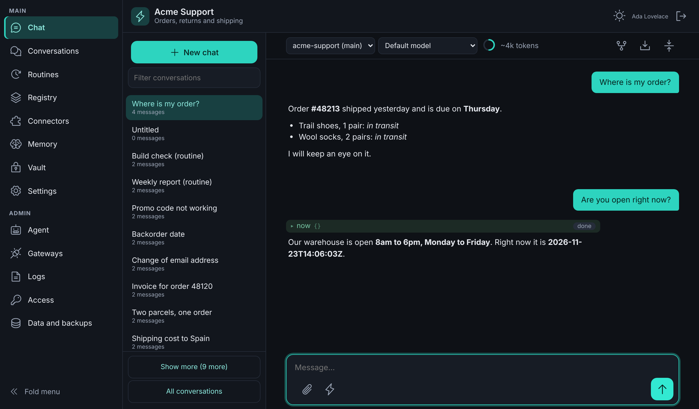

```javascript
// gateways/chat.bx
theme: {
	accent : "0f766e",
	radius : "10px",
	font   : "Inter, system-ui, sans-serif",
	dark   : { accent : "rgb(45, 212, 191)" }
}
```

!!! info
    **Write hex colors bare, with no leading hash.** BoxLang begins string interpolation at `#` in **both** single- and double-quoted strings, so a literal hex color in a `.bx` config is a parse error unless the hash is doubled - a footgun nobody remembers. The generator adds it back for you, so `"0f766e"` just works. `rgb()`, `hsl()` and named colors need nothing special either way.

For anything the tokens don't cover - custom fonts, layout, per-element rules - drop a `resources/webui/theme.css` into the project. It's inlined **last** into the page's `<style>`, so it beats both the shipped defaults and the `theme` tokens; and being a real `.css` file, ordinary `#rrggbb` hex works there normally. (A literal `</style` in that file fails the build, since it would terminate the page's style block early.)


## Securing the API

!!! warning
    **`apiKeyEnvVar` is a shared secret, not a login system.** It is the same thing as the agent API's `agentApi.tokenEnvVar` (a name in `Agent.yml` wins if both are set). Left unset, the API is open (fine on your own machine, not for a public deployment; `serve` warns when an open API listens on every interface). Set it, and every call to `/__bxagents` must carry a matching `x-bxagents-token` header, compared in constant time. **The app's pages (`<path>/`) are not gated by it**, because a browser's plain page navigation can't send a custom header; the page asks for it in a **Password** dialog. It opens by itself the first time a call is refused with `401` (once per page load, with "The server refused the password, or asks for one."), and any time from the key button in the header. **Save** keeps the password in `localStorage` and loads the page again; it is then sent on every call. **Forget it** removes it. For several people use [issued tokens](agent-bx.md#access-tokens-for-a-deployed-agent) or `users`.

## Logs and gateways

For an admin, the **Logs** and **Gateways** pages of the Admin group (see [The pages](#the-pages)) show how the app is doing. The **Logs** page has a tab for each log (agent, gateways, routines, heartbeat, API) with a red chip when it logged errors, a level filter, search, a line count and a **Live** switch that shows new lines as they are written. The **Gateways** page lists each gateway the project names with its state (connected, stopped, failing or not registered), which credentials are set (the names only, never a value), when it last had a conversation, its last error and a **Reconnect** button, and **Open log** goes to that gateway's lines on the Logs page. Gateways are still set up in `gateways/` and `.env`: the page shows how they are doing and starts one again in place. See [logs](logs.md); in the terminal the same logs are `bxAgents logs --follow` and `bxAgents logs --ui`.

## Settings and appearance

The header keeps the agent's icon and title, a light or dark switch, and **Password** or **Sign out**. What acts on a conversation (the **Talk to** and model pickers, the context ring, **Fork**, **Export** and **Compact**) is in the bar above it on the Chat page, and every other page is in the left menu.

The **Appearance** card of the **Settings** page is where a visitor picks, for this browser only:

| Setting | Choices |
|---|---|
| Mode | System, Light or Dark (the same choice as the switch in the header) |
| Accent color | The gateway's own accent (the **Default** swatch), eight presets, or any hex value. The panel shows the contrast of the button text on it and warns under 4.5 : 1 |
| Text size | Small, Medium or Large |
| Density | Comfortable or Compact |

The choice is stored in the browser (`localStorage`, key `bxagents_webui_appearance`) and **Reset to defaults** clears it. It never changes what the operator wrote in `theme`: that stays the default every visitor starts from. A picked accent also sets `--accent-fg` to white or near black, whichever reads better, and the tints and focus glow follow it. Extension styles that use the page's variables (`--accent`, `--accent-fg`, `--accent-soft`, `--accent-ink`, `--ring`, `--bg`, `--fg`, `--muted`, `--border`, `--surface` and the rest, see [extensions](extensions.md#theming)) follow the visitor's choice too.

## Conversation identity

**Every memory an agent holds is keyed by `(userId, conversationId)`** - and an agent can hold several at once (`AiAgent`'s `memories` is an array; `loadMemoryMessages()` iterates all of them with the same pair). `AiAgent.run()`/`.stream()` fall back to `""` for both when nothing supplies them, so a server-side identity has to come from somewhere.

The agent API supplies it on every turn route (`invoke`, `stream`, `events`, `batch`):

- **No `users` declared and an open API:** the one `local` user, as described in [Users and sign-in](#users-and-sign-in).
- **A shared secret:** `admin`. **An issued token:** the token's name.
- **`users` declared:** the signed-in account's id, read from cbsecurity (which wraps cbauth). A signed-out request is refused with a `401`.

Either way the id is derived on the server and never taken from the request body, so a caller cannot name themselves someone else. `conversationId` still comes from the client, and that's deliberate: it distinguishes several conversations belonging to the *same* identity - it's what the **New** button rotates. It is not the isolation boundary; the `userId` is.

A project with a `webui` exposure also gets **session management on** in the generated base `Application` - `this.sessionManagement = true`, `this.setClientCookies = true`, a 60-minute `sessionTimeout` - because the sign-in is session-backed. Cookies are load-bearing there: no cookie, no session. A project with no `webui` keeps sessions off - an API/gateway-only app has no browser to track, and a session there is overhead plus a cookie nobody asked for.

!!! info
    **Why not `toAi()`?** ColdBox 8.1's `toAi()` lets a **caller-supplied `userId` win** over the server-derived one, and ColdBox route middleware does not reach its routes. The agent API's own handler derives the identity server-side only and never looks at `body.userId`, and sits behind one gate.

No memory type is forced. Choose one (or several) per agent with a `memory` key on `Agent.yml`, same shape as `checkpointer`:

```yaml
# Agent.yml
memory:
  type: cache
  maxMessages: 50
```

## Reply rendering

Assistant replies render as full Markdown: headings, lists, tables, quotes, strikethrough, links and fenced code, with code coloured by language (BoxLang, CFML, Java, JavaScript, TypeScript, Python, Go, Rust, Kotlin, SQL, JSON, YAML, TOML, XML/HTML, CSS, shell, Dockerfile, diff and Markdown). The page carries its own copy of [marked](https://marked.js.org), [DOMPurify](https://github.com/cure53/DOMPurify) and [highlight.js](https://highlightjs.org), so it still works offline and loads nothing from a CDN. What the model writes is never trusted: raw HTML in an answer is escaped and shown as text, the result is sanitized, images are not loaded (a remote one would tell its server the page was opened), and a `javascript:` link is not turned into a link at all.


!!! info
    The composer is a `textarea` - **Enter** sends, **Shift+Enter** adds a newline, and it grows to about six lines before scrolling. A turn in flight can be halted with **Stop** (an `AbortController`), which keeps whatever already streamed rather than discarding it. The transcript only auto-scrolls when you're already at the bottom, so scrolling up to re-read something mid-stream doesn't yank you back down.

## Notes

When the agent has a [`notes`](agent-yaml.md#notes) block, the **Memory** page of the menu (`<path>/memory`) shows two lists, *About you* and *About the agent*, how full each is (characters of the limit, and about how many tokens that adds to every conversation), and the notes with their ids. Add, edit in place and remove work on your own notes. The page and the terminal chat share the same database, so a note added in one shows in the other.

- *About you* belongs to the same identity as your conversations: your account with [`users`](#users-and-sign-in), or the shared workspace without accounts.
- *About the agent* is shared by everyone who uses the agent, whichever agent or person is talking. Anyone using the page may add or edit one; removing one (or clearing the list) takes an admin, and `/notes/remove` answers `403` to anyone else. With an admin [token](agent-bx.md#access-tokens-for-a-deployed-agent) use the agent's own `/__bxagents/notes/remove` route, or `bxAgents notes remove --scope=agent` where the agent runs.
- Without a `notes` block the menu has no Memory page and the routes answer `404`: `GET /agent`'s `capabilities.notes` says which.

The Memory page also has **Conversation memory**: the messages the agent's memory keeps for each conversation. **Clear** forgets the messages of one conversation and keeps the conversation; an admin can clear every conversation, or those of one agent (`POST /memory/clear`, `/clear` in the terminal, `bxAgents sessions clear`).

## Connections

When an `mcpServers` entry has [`oauth`](connect.md), the [Connectors](#connectors) page has an **In Agent.yml** tab (`<path>/connectors/agent`; it shows only then, and `GET /agent`'s `capabilities.connections` says whether). It lists each service with its name, its address, *Connected* or *Not connected*, and a *Connect* or *Disconnect* button. *Connect* opens the provider's sign in in a new tab (a link is also shown, in case the browser blocks the tab) and the page checks again every two seconds until it works. The page never sees a token.


## Working on the web app

The app's source is in this repository: the module in `src/main/bx/bxagentsui` (handlers, routes, layouts, views and partials) and the scripts and styles in `ui/resources/assets` (Alpine.js components and stores, Sass). `ui/README.md` says how to run it and `ui/AGENTS.md` lists its conventions and building blocks.

```bash
cd ui
npm install
npm run dev     # a dev agent, a scripted model and the Vite dev server: edit, save, see it
npm run build   # builds only the web app, into src/main/bx/bxagentsui/includes/build (not committed; ./gradlew shadowJar does it too)
npm run e2e     # the browser tests (Playwright)
```

The dev agent is at http://127.0.0.1:8780/chat (`ada` or `bob`, password `demo-pass`). A built agent gets the build the module shipped with, so a change to a script or a style reaches it once `./gradlew shadowJar` has run (it builds the web app first). Building this repository needs Java and Node 24. [Work on the web app](../guides/ui-development.md) is the full guide: the layout, the conventions, adding a page, the linters and the tests.

## What is not here yet

The page is complete against its own API: every route it needs exists and is exercised. These are the gaps:

| Missing | Note |
| --- | --- |
| Retry / regenerate | A failed turn has to be re-sent by hand |
| Edit and resend | No editing a message already sent |
| Recall search | Searching the memory of past conversations is planned; the Memory page says so |

## Routines

When the server has [routines](routines.md) on, the **Routines** page of the menu (`<path>/routines`) shows:

- A row for each routine: its name, a status chip in words (ok, failed last time, paused, running, waiting for approval, not run yet), the schedule in words with the stored form beside it, the next and last run, and where its answer goes. A failed or auto-paused routine shows its last error and a **Resume** button.
- **Run now**, **Pause** or **Resume**, **Edit**, **Reports**, **Open conversation** (the routine's own, with its answers) and **Delete**, which asks first and keeps the reports. An admin gets **Show every owner's routines**.
- **New routine** and **Edit** share one dialog: name, schedule (five cron fields such as `0 9 * * 1-5`, or `every 30m`), what the agent should do, and where the answer goes. For an admin that includes a [gateway](gateways/index.md) when the project has one; a chat id is asked for when the gateway has talked to more than one chat. A bad schedule or a limit reached is answered in words in the dialog. The reading of the schedule in words comes back when you save.
- **Reports** lists a routine's files with their size and date, shows one, deletes one (after a confirmation), and **Clean up reports older than N days** first says how many files and bytes it would remove and asks before it removes them.

The panel works with the keyboard, in light and dark, and on a phone.
