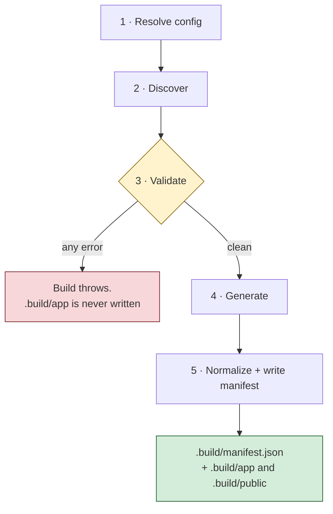

# Building Your Agent

With `Agent.yml` and `instructions.md` in place, build your project:

```bash
bxAgents build
```

This runs the full build pipeline - config resolution, discovery, validation, code
generation, manifest normalization - and writes a real ColdBox application to
`.build/`, laid out like the ColdBox BoxLang template (the code in `app/`, the web root
in `public/`), plus `.build/manifest.json`.

## The five phases, in order



1. **Resolve config** - loads `Agent.yml` (or a class-based `Agent.bx`, calling its
   `configure()`) and the active environment override, then deep-merges any `boxlang.json`/`boxlang-{env}.json`.
2. **Discover** - walks the project and enumerates every convention folder into raw
   entries. Pure discovery - no interpretation of file contents yet.
3. **Validate** - collects **every** error (never fails fast) plus warnings: duplicate
   tool/skill/model/subagent names, circular references, bad model/provider config,
   and more. If any errors were collected, the build throws here - `.build/app` is
   never written or touched.
4. **Generate** - only reached once validation is clean. Interceptors, gateways, MCP,
   the router, the agent API handler, the web UI (if any), the core app skeleton, a verbatim copy of
   `tools/`/`skills/`, the bundled ColdBox libraries, and the scheduler, in that order.
5. **Normalize + write the manifest** - produces the canonical `.build/manifest.json`.

## If your project fails validation

`build` fails with **every** collected error, not just the first one - a duplicate
tool name and an unknown model provider in the same project both get reported in one run.

## Idempotency

Rebuilding an unchanged project produces **byte-identical** output, down to the
manifest's per-file content hashes. This is the entire point of paying the assembly
cost once, at build time, instead of deferring it into every request.

## Useful flag: `--verbose`

```bash
bxAgents build --verbose
```

Prints one line per build phase live as it runs - what got resolved/discovered/
validated, per-phase counts, which agents ended up registered in `config/WireBox.bx`
and under which names, whether a scheduler was found, and a final timing line. Silent
otherwise, so it costs nothing when you don't need it.

## Try it

```bash title="Terminal 2"
cd ~/bxagents-course/acme-support
bxAgents build --verbose
```

```text title="You see"
...
Build succeeded: <anything>/acme-support/.build/app
```

You should see a `.build/` directory appear, with `app/` (the code) and `public/` (the only folder a server
serves), and a manifest describing exactly what went into it. Two commands check a project without running it:
`inspect` reports what the source says, and `doctor` checks the machine and the project:

```bash title="Terminal 2"
bxAgents doctor
```

```text title="You see"
[ OK ] BoxLang <anything>
[ OK ] bx-ai <anything>
[ OK ] Agent definition found at [<anything>]
[ OK ] Project structure validates cleanly
[ OK ] Data home [<anything>] (convention) can be written

Everything checks out.
```

`doctor` is the first thing to run when something does not work: it names a missing key, a bad `Agent.yml` or a
folder it cannot write. You'll talk to this built agent in the next lesson.

Full reference: [The Build Pipeline](../build-pipeline.md).

## Checkpoint

Nothing in the source changed; `acme-support/` is built.

Next: [Talking to Your Agent](08-talking-to-your-agent.md)
