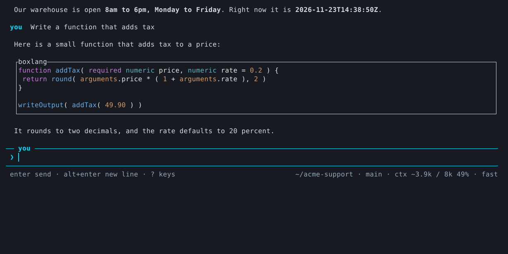

# Talking to Your Agent

Once you've built your project ([Building Your Agent](07-building-your-agent.md)), there are three ways in. They all
load the same generated agent and build the same agent tree, so they never diverge from each other.

| Way in | For | Needs |
|---|---|---|
| `bxAgents chat` | You, talking to it | A terminal |
| `bxAgents invoke` | A script, CI, a quick check | Nothing |
| `bxAgents serve` | A browser, a program, other people | `boxlang-miniserver` on the `PATH` |

## `chat`: the terminal chat

```bash
bxAgents chat                                  # local chat in an isolated runtime
bxAgents chat --server [--port=<port>]         # the full app, on its own throwaway server
bxAgents chat --connect=http://127.0.0.1:8791  # the full app, on a server you already run
bxAgents chat --no-tui                         # a plain line-by-line prompt
```

At a terminal this draws a full-screen chat, not a bare prompt (the whole tour is in
[The terminal UI](../guides/terminal-ui.md)). Finished turns are ordinary terminal text, so your scrollback and
search keep working. Answers stream in as formatted Markdown, tool calls show their arguments and how long they
took, and a run that needs approval asks in place.



What you can do in it:

- **Keys.** Enter sends, Alt+Enter adds a line, Up and Down walk your history, Esc stops the agent, and a message
  typed while it works steers it. `?` or `/keys` lists every key.
- **Slash commands.** Type `/` for a menu: `/help`, `/tools`, `/model`, `/info` and more. Every command is listed in
  [Slash commands](../guides/slash-commands.md). Later lessons use `/skills`, `/profile`, `/remember`, `/notes`,
  `/settings` and `/stats`.
- **Sessions.** Every chat is a conversation kept in the agent's data home (`~/.bxagents/acme-support/`), the same
  list the web app shows. `/sessions` lists them, `/resume` goes back to one, `/new` starts another, `/name` names
  it, `/fork` copies it and carries on in the copy, and `/export` saves it as Markdown or HTML. `bxAgents chat
  --continue` reopens the latest one.
- **Context.** The hint row under the box shows how much of the model's window is used, such as
  `ctx ~12.4k / 128k 9%`. `/context` shows what it is made of.
- **Files and pictures.** `@` lists files, and `@notes.md` puts a text file's content in your message.
- **Recording.** `bxAgents chat --record=demo.cast` saves the screen as an asciicast file.

The default mode starts a separate BoxLang process using the project's `.build/runtime/boxlang.json` and
`.build/runtime` home, then loads the generated factory directly: no server, but also no ColdBox (no scheduler,
no interceptors, no gateway registry). When those matter, `--server` boots a real miniserver and drives the chat
over HTTP against your project's agent API, and `--connect` does the same against a server you already have
running; both stream the reply and carry the conversation across turns. If the server wants a token
([Who Is Allowed](users-roles-and-tokens.md)), pass `--token=<token>` or set `BXAGENTS_TOKEN`.

Try it. Open the chat on the project and say hello, then ask for a command menu with `/` and look at `/model`.
Leave with `exit`:

<!-- course: manual -->
```bash title="Terminal 2"
cd ~/bxagents-course/acme-support
bxAgents chat
```

You see the screen above, with the scripted model's answer: *Hello from the practice model...* A terminal that
cannot draw, or a pipe, gets the plain prompt instead. It echoes what you type as you type it, so piped input
looks untidy, which is one more reason scripts use `invoke`:

```bash title="Terminal 2"
cd ~/bxagents-course/acme-support
printf 'hello\nexit\n' | bxAgents chat --no-tui
```

```text title="You see"
Chatting with the agent - type 'exit' or 'quit' to leave.
...
agent> Hello from the practice model. I am scripted: I only say what the course told me to say.
...
Chat session ended
```

The plain prompt sends everything, slash commands included, to the model. Slash commands belong to the full-screen
chat, the web app and the chat platforms.

## `invoke`: one turn, no screen

```bash title="Terminal 2"
bxAgents invoke --message=hello
bxAgents invoke --message=hello --json
```

```text title="You see"
Hello from the practice model. I am scripted: I only say what the course told me to say.
{"response":"Hello from the practice model. I am scripted: I only say what the course told me to say."}
```

`invoke` exists for scripting and CI, where `chat`'s terminal requirement is a hard blocker. By default it loads
the generated factory in the already-started BoxLang process, so there is no `serve` prerequisite. Unlike `chat`,
it does not start a separate process with the project's runtime config and home. `--json` prints
`{"response": "..."}`. Add `--server` to launch a real, throwaway `boxlang-miniserver` and send the message as a
genuine HTTP request to your project's agent API: it exercises the path a browser takes.

!!! warning "Flag values without spaces"
    With the BoxLang 1.19.0 launcher a quoted value with spaces is split at the spaces, so
    `--message="where is my order"` does not work yet; see
    [Quoting flag values](../cli-reference.md#quoting-flag-values). That is why this course writes `--message=refund`
    and the scripted model listens for single words.

## `serve`: a real HTTP server

```bash
bxAgents serve --port=8791
```

`serve` requires a prior `build` and `boxlang-miniserver` on the `PATH` ([Installing BxAgents](03-installing-bxagents.md)).
It launches a real server process that serves `.build/public` (the code in `.build/app` is not reachable from the
web), started in `.build` with its own `.build/runtime` BoxLang home, so each project's compiled-class cache stays
isolated and the BoxLang modules installed on your machine are not loaded into it. The agent API is at
`/__bxagents`, and the web app is the next lesson's subject.

The three ways share what the agent remembers: a conversation started in the terminal shows up in the web app's
list, and the other way round.

## Checkpoint

Nothing changed in `acme-support/`: this lesson was about ways in. From here on the agent gets abilities.

Full reference: [Quick Start](../getting-started/quick-start.md), [CLI Reference](../cli-reference.md).

Next: [Giving Your Agent Tools](09-giving-your-agent-tools.md)
