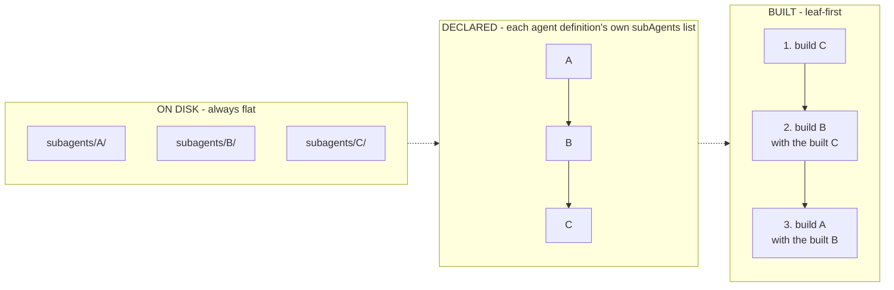
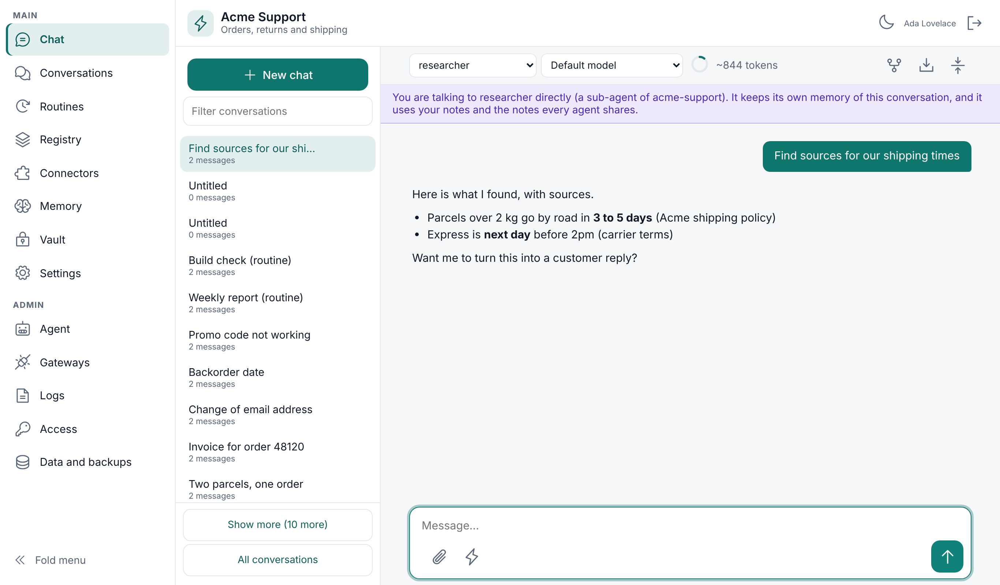

# Composing Subagents

`subagents/` holds nested agents - each an ordinary BxAgents project of its own, with
its own `Agent.yml` + `instructions.md`, and optionally its own `tools/`, `skills/`,
etc.

```text
my-agent/
├── Agent.yml            # subAgents: [ researcher ]
├── instructions.md
└── subagents/
    └── researcher/
        ├── Agent.yml
        └── instructions.md
```

A subagent is wired to its parent by name, declared in the parent's `Agent.yml`

- this is the `subagents/` **folder name**:

```yaml
subAgents: [ researcher ]
```

At build time, bx-ai's `addSubAgent()` wraps each built subagent instance as a
callable tool on the parent automatically - there's no separate tool-wrapping step to
write yourself.

## Flat on disk, a graph in config

Every subagent - no matter how deeply another subagent's own config references it -
lives directly under the **root** project's `subagents/` folder. A subagent's own
declared `subAgents` names reference **sibling** entries in that same root-level
folder, never a folder nested under itself.



A cycle in the declared graph (`A -> B -> A`) is rejected at validation, before
anything is generated. A diamond (two parents sharing one descendant) is fine.

## Two different names, two different jobs

- The **folder name** under `subagents/` is what `subAgents: [ "..." ]` references -
  purely a build-time wiring concern.
- The subagent's own **declared `name`** (its definition's `name` field) is what you
  retrieve it by at runtime - every agent in the tree is registered in
  `config/WireBox.bx` under this name, so a [`schedules/`](../conventions/schedules.md) scheduler
  (or anything else WireBox-aware) reaches it with `getInstance( "TheAgentName" )`.

These two names can differ, and often will. Because `name` is now also a WireBox
binding key, it must be unique across the whole project - `build` fails validation if
two agents share one.

## Try it

Acme support gets two helpers: a **researcher** that looks things up and a **writer** that words the final reply.
Each is a folder with its own `Agent.yml` and `instructions.md`, and each picks one of the profiles from
[Models and Profiles](12-named-model-configs.md). (`bxAgents add subagent researcher --profile=fast` writes the
same frame and wires it in for you.)

```yaml title="acme-support/subagents/researcher/Agent.yml"
name: researcher
description: Looks things up and writes a short summary with sources.
profile: fast
```

```markdown title="acme-support/subagents/researcher/instructions.md"
You research a question and answer with a short summary and the sources you used.
```

```yaml title="acme-support/subagents/writer/Agent.yml"
name: writer
description: Turns facts into a friendly reply for a customer.
profile: planner
```

```markdown title="acme-support/subagents/writer/instructions.md"
You write the final reply to a customer from the facts you are given. Be brief and friendly.
```

Wire them to the root agent, with the folder names, at the end of `Agent.yml`:

<!-- course: append -->
```yaml title="acme-support/Agent.yml"

subAgents: [ researcher, writer ]
```

Rebuild and look at what the root agent can use. Each subagent arrived as a tool called `delegate_to_<name>`:

```bash title="Terminal 2"
cd ~/bxagents-course/acme-support
bxAgents build
bxAgents invoke --message=capabilities
```

```text title="You see"
Build succeeded: <anything>/acme-support/.build/app
I can use these tools: <anything>delegate_to_researcher, delegate_to_writer<anything>
```

The scripted model has a rule for `research` and one for `write`: each delegates a task to that subagent. The
subagent answers with the model of *its* profile, which the default answer names, so you can see who did the work:

```bash title="Terminal 2"
bxAgents invoke --message=research
bxAgents invoke --message=write
```

```text title="You see"
The researcher answered: I can help with orders, returns and shipping. (Answered by fast-model.)
The writer answered: I can help with orders, returns and shipping. (Answered by planner-model.)
```

In the web app and in the terminal chat you can also talk to a subagent directly. The **Talk to** menu in the bar
above the conversation lists the main agent and each subagent; pick one and the next message goes to it, a banner
says who you are talking to, and every agent keeps its own memory. In the terminal the same thing is `/agent`.



## Checkpoint

`acme-support/subagents/` has `researcher/` and `writer/`, and `Agent.yml` ends with `subAgents: [ researcher, writer ]`.
`kit/resume.sh 11-composing-subagents` restores them; rebuild after.

Full reference: [subagents/](../conventions/subagents.md).

Next: [Routines and Reports](routines-and-reports.md)
