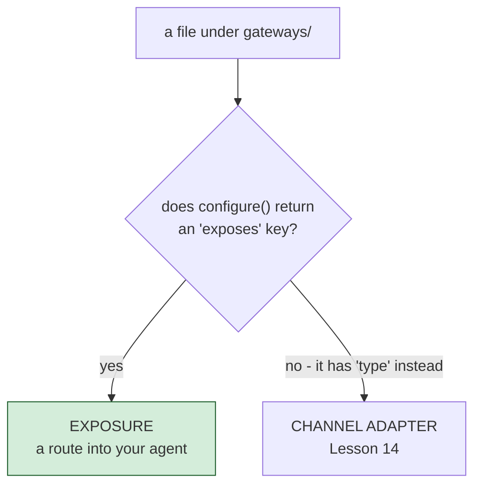

# Exposing Your Agent over HTTP and MCP

`gateways/*.bx` files cover two distinct, unrelated things - which kind an entry is
depends entirely on whether its `configure()` struct has an `exposes` key. This lesson
covers **exposure** (`exposes: "agent" | "mcp" | "webui"`); the next lesson covers the
other kind, channel adapters that connect to chat platforms.



## Exposing the agent itself

```javascript
// gateways/expose.bx
class {
	function configure() {
		return {
			exposes : "agent",
			path    : "/api/chat"
		};
	}
}
```

Generates, in `config/Router.bx`, four routes served by the agent API's handler:
`POST /api/chat/invoke`, `POST /api/chat/stream` (SSE), `POST /api/chat/batch`,
`GET /api/chat/info`. The bare `/api/chat` path itself is not routable. This is a plain
entry point under a path of your choosing; with `agentApi.access: token` it needs a token like
the rest of the agent API.

## Exposing a local MCP server

```javascript
class {
	function configure() {
		return {
			exposes : "mcp",
			path    : "/mcp/tools",
			target  : "local-server"   // must match an mcp/*.bx entry's file name
		};
	}
}
```

You'll write that `mcp/*.bx` entry in [Lesson 17](17-hosting-mcp-servers.md).

## Exposing the web chat UI

```javascript
// gateways/chat.bx
class {
	function configure() {
		return {
			exposes : "webui",
			path    : "/chat"
		};
	}
}
```

This one is big enough to earn its own lesson - see [Lesson 15](15-the-generated-web-chat-ui.md).

## The agent API that is always there

Every built agent also serves one HTTP API at `/__bxagents`, with no `gateways/` entry at all.
The web page, the terminal chat (`chat --server` and `--connect`) and the chat platforms use it
too, so anything they do, your program can do: run a turn (`invoke`, `stream`, `events`), stop or
steer a run, answer an approval, list and fork conversations, keep notes, run slash commands. It
describes itself: `GET /__bxagents/openapi` returns an OpenAPI document of the routes your server
really has. A BoxLang client, `bxModules.bxagents.models.api.AgentApiClient`, has one method per
route. The tour, with curl and BoxLang examples, is in [Call your agent from code](../guides/agent-api.md).

Who may call it is set under `agentApi` in `Agent.yaml`:

- **Open** (the default): anyone who can reach the port, all as one user, `local`. Fine on your
  own machine. `bxAgents serve` listens on `127.0.0.1` by default and warns if an open API
  listens on an address other machines can reach.
- **Behind tokens**: callers send an `x-bxagents-token` header. `tokenEnvVar: MY_SECRET` names an
  environment variable holding one shared secret (it acts as an admin). `tokens: true` also accepts
  tokens made per person or program with `bxAgents token create --name=laptop` (`--scope=chat` or
  `admin`, `--expires=90d`). A token is shown once and only a hash is kept, so `token revoke` works at
  once on a running server.
- **Guards**: `allowedIPs` lets only listed addresses and networks in at all, and `rateLimit:
  { requests, perSeconds }` caps calls per address. Both work open or closed.
- **Managing tokens over the API**: `manageTokens: true` (with `tokens: true`) lets an admin make
  and revoke tokens remotely, and shows a **Tokens** panel in the web page.
- **Moving it**: `path: /agent-api` serves the whole API somewhere else.

```yaml
agentApi:
  tokenEnvVar: AGENT_ADMIN_TOKEN   # the NAME of an environment variable
  tokens: true
  allowedIPs: [ "10.0.0.0/8" ]
  rateLimit: { requests: 60, perSeconds: 60 }
```

```bash
bxAgents token create --name=laptop --expires=90d
bxAgents chat --connect=https://agent.example.com --token=<the token>
```

Full list of settings: [Agent.bx](../conventions/agent-bx.md#the-always-on-agent-route).

## Validation

`exposes` must be `agent`, `mcp`, or `webui`; `path` is required and must be unique
across every exposure entry; an `mcp` exposure's `target` must match a real `mcp/*`
entry's file name.

## Try it

```bash
bxAgents build
bxAgents serve --port=8080
curl -X POST http://localhost:8080/api/chat/invoke \
  -H "Content-Type: application/json" \
  -d '{"input":"Hi there"}'
```

(Or skip `serve` entirely and reach for `bxAgents invoke --message="Hi there" --server`
from [Lesson 8](08-talking-to-your-agent.md), which exercises this exact route without
you having to manage the server process yourself.)

Full reference: [gateways/](../conventions/gateways/index.md).

Next: [Lesson 14 - Connecting Chat Platforms](14-connecting-chat-platforms.md)
