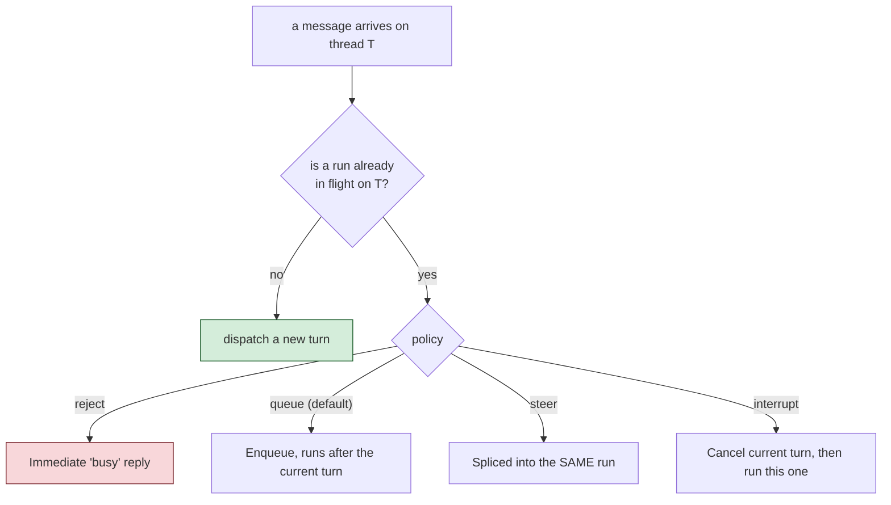

# Connecting Chat Platforms

The other kind of `gateways/*` entry - one with a `type` key instead of `exposes` -
registers a bx-ai `IGateway`, a channel adapter for external delivery or
human-in-the-loop approval. This is a real "chat bot" connection, distinct from the
REST exposure you built in [Lesson 13](13-exposing-http-and-mcp.md).

## Two request-driven types: `mock` and `cli`

`mock` is test-only. `cli` is bx-ai's own built-in human-in-the-loop **approval**
channel - a blocking stdin/stdout prompt, and what `HumanInTheLoopMiddleware` attaches
by default when no gateway is specified.

## `http` - your own webhook endpoint

```javascript
// gateways/slack.bx
class {
	function configure() {
		return {
			type         : "http",
			secretEnvVar : "SLACK_WEBHOOK_SECRET"
		};
	}
}
```

`secretEnvVar` names an environment variable holding the signing secret - **never the
secret value itself**. It's resolved live at server startup, so it's never present in
generated source or a packaged `.bxa` either. This gets real routes, from a single
`route( "/gateways" ).toAiGateway()` in the generated router:
`POST /gateways/:gateway/events`, `GET /gateways/:gateway/events` (the platform's URL
verification handshake), `GET /gateways/interactions/:requestID`, and
`POST /gateways/interactions/:requestID/decisions`.

## Nine push-style platforms

Telegram, Slack, Discord, Email, WhatsApp Business Cloud, Microsoft Teams, Twilio SMS,
GitHub, and Signal each hold their own connection (long-poll, websocket, webhook, or
SSE) and push inbound messages to your agent as they arrive:

```javascript
// gateways/telegramChannel.bx
class {
	function configure() {
		return {
			type          : "telegram",
			botTokenEnvVar: "TELEGRAM_BOT_TOKEN"
		};
	}
}
```

Every platform follows the same `secrets stay external` rule - every `*EnvVar` key
names an environment variable, resolved live, never a literal in generated code.

## One GatewaySession ties them together

Any project with at least one push-style gateway gets a generated start-up
statement in the generated base `Application` that builds a single bx-ai `GatewaySession`
bundling every push-style gateway, bound to your project's root agent:



Control the policy from `Agent.yaml`:

```yaml
gatewaySession:
  policy: queue        # both optional, these are the defaults
  maxQueueDepth: 50
```

!!! warning
    v1 limitation: exactly one `GatewaySession`, always bound to the project's root
    agent - a project with subagents can't yet route different gateways to different
    subagents.

## Every person has their own conversation

The agent is told who is writing (the platform and their id there, such as `slack:U123`) and
which conversation it is: the chat, plus its thread when the platform has them (a Telegram forum
topic, a Slack thread). So memory, `/notes`, `/remember` and the conversation list are kept apart
per person and per thread. Two people in one channel do not share a memory, and neither do two
chats on two platforms. The list is stored in the same `data/chat.db` the web page uses, marked
with the platform it started on; an admin can see it with `GET /__bxagents/sessions?all=1`.

## Commands in a chat

A message that is a slash command is answered by BxAgents and never reaches the model. A safe set
is on by default: `/help`, `/tools`, `/model`, `/info`, `/ping`, `/remember` and `/notes`. The
conversation commands (`/new`, `/clear`, `/compact`, `/sessions`, `/resume`) are off, because most
chats are one long conversation; turn them on with `conversation: true`. Each platform shows the
commands its own way (Telegram's `/` menu, Discord application commands, Slack slash commands,
buttons on WhatsApp, a numbered list on SMS).

```yaml
gatewaySession:
  commands:
    conversation: true       # also /new, /clear, /compact, /sessions, /resume
    prefixes: { slack: "!" } # a different one-character prefix for one gateway
```

Pictures and text files sent on Telegram, Discord, Slack, WhatsApp and Twilio MMS reach the agent
with the message (`gatewaySession.attachments: false` switches that off).

## Adding a platform, or your own

`bxAgents add gateway` adds a platform the way the `new` wizard does: it writes the
`gateways/` file, an empty `.env` line for each credential and the setup steps that happen
outside the project (a bot token, a public address). `bxAgents doctor` reports credentials that
are still not set. If a platform is not in the list, an [extension](18-interceptors-and-modules.md)
can bring a new gateway type.

## Try it

If you have a disposable Telegram bot token, add a `gateways/telegramChannel.bx` entry,
export `TELEGRAM_BOT_TOKEN`, and `bxAgents serve` - message your bot and watch it
reply. No token handy? Read through a couple of the platform sections in the full
reference below; the shape is consistent across all nine.

Full reference: [gateways/](../conventions/gateways/index.md).

Next: [Lesson 15 - The Generated Web Chat UI](15-the-generated-web-chat-ui.md)
