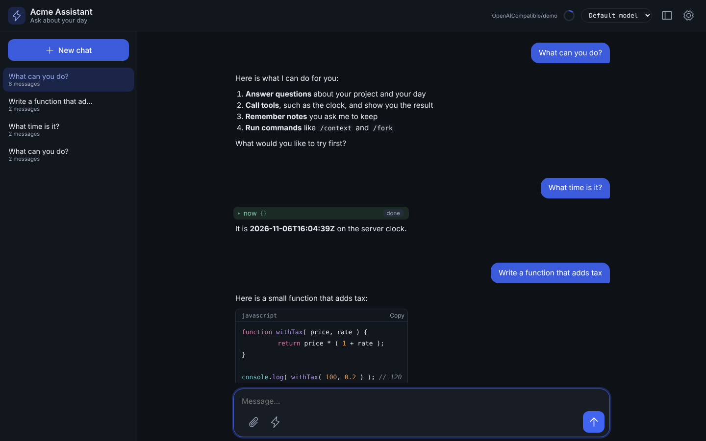

# The Generated Web Chat UI

A `gateways/*.bx` entry with `exposes: "webui"` ships a complete browser chat client
for your agent - a conversation sidebar, streaming with reasoning and tool calls,
human-in-the-loop approvals, per-visitor theming, and a real SQLite store behind it.

```javascript
// gateways/chat.bx
class {
	function configure() {
		return {
			exposes     : "webui",
			path        : "/chat",
			apiKeyEnvVar: "CHAT_UI_API_KEY"   // optional - see "Securing it" below
		};
	}
}
```

This generates a static `<path>/index.html` (served directly, no route needed) that calls the agent API
at `/__bxagents`. The page is dependency-free vanilla HTML/CSS/JS,
pre-built and vendored inside BxAgents itself - `bxAgents build` never runs `npm
install`, and a generated project never needs Node installed at all.



That's the real, unmodified generated page - this one branded with
[`examples/webui-agent`](https://github.com/ortus-boxlang/bx-agents/tree/development/examples/webui-agent)'s
`theme`/`title`/`icon` config from [Lesson 13](13-exposing-http-and-mcp.md)'s exposure
concept, taken further. `bxAgents build && bxAgents serve` in that example gets you the
same page for real.

## What the page can do

- **Conversation sidebar** - switch, rename, delete, or start a new conversation.
- **Steer while streaming** - the composer stays live during a turn; **Send** becomes
  **Steer**, splicing your message into the run already in flight.
- **Stop** - posts `/cancel` before aborting, so the server actually stops spending
  tokens rather than just abandoning the browser connection.
- **Reasoning + tool calls** - collapsed disclosures fed straight off the streamed
  response.
- **Approvals** - a human-in-the-loop pause renders an Approve/Reject card.
- **Rendered answers** - full Markdown, with code blocks that show their language and have a
  **Copy** button, and tool cards with a status chip and a one-line preview of the arguments.
- **Slash commands** - type `/` for a menu (or press the lightning button): `/new`, `/sessions`,
  `/fork`, `/export`, `/context` and more, the same ones as in the terminal. Commands an
  [extension](18-interceptors-and-modules.md) adds show the extension's name as a badge.
- **Suggestions** - set up to four `suggestions` on the entry and the empty conversation shows
  them as buttons that send on one click.
- **Pictures** - an Attach button, paste and drop send pictures with a message (refused when the
  model's profile says `vision: false`).
- **Context ring** - the header shows how much of the model's window is used; click it for the
  breakdown.
- **Model picker** - when the entry lists `profiles`, visitors can choose one per message.

### The Settings menu

The header keeps only what you use every minute: the **Chats** button, the context ring, the model
picker and a **Settings** gear. The gear opens one menu in three groups. An item the server does
not offer, and a group with nothing in it, is left out.

| Group | Items |
|---|---|
| Conversation | Fork this conversation, Export as Markdown, Clear messages, Compact older messages |
| You | Notes (what the agent keeps about you and about its own work), Appearance, light or dark theme |
| Server | Password, Access tokens |

**Appearance** lets each visitor pick light, dark or system, an accent color, the text size and the
density, saved in their own browser. It never changes your `theme`, which stays the default.
**Access tokens** lists, creates and revokes tokens for admins, when the server sets
`agentApi.manageTokens: true` ([Lesson 13](13-exposing-http-and-mcp.md)).

## Without accounts: one shared workspace

By default the UI has **no accounts and no gate** - every visitor is anonymous, and
every visitor reads and writes the **same** conversations, preferences and agent
memory. This is the zero-ceremony local-dev experience, not a deployment posture.

!!! warning
    An open UI has no privacy between visitors. Declare `users` if the page is
    reachable by more than the people who should see the transcripts.

```javascript
users : [
    { username: "ada", passwordEnvVar: "ACME_ADA_PASSWORD", displayName: "Ada Lovelace" }
]
```

An account names the **environment variable** holding its password, or carries an
already-hashed value - a literal `password` key is a build error, not a warning.
Generate a hash with:

```bash
bxAgents hash-password --password="<your-password>"
```

## Branding it

Every key is optional:

```javascript
theme: {
	accent : "0f766e",
	radius : "10px",
	font   : "Inter, system-ui, sans-serif",
	dark   : { accent : "rgb(45, 212, 191)" }
}
```

!!! info
    Write hex colors bare, with no leading `#` - BoxLang begins string interpolation
    at `#` in both quote styles, so the generator adds it back for you.

`title`, `subtitle`, `icon`, `welcome`, `placeholder`, `footer` and `suggestions` are also
available, plus a `themeFile` for anything the tokens don't cover. `icon` can be an emoji, an
image address or `phosphor:<name>` (a Phosphor icon built into the page).

## Securing it

`apiKeyEnvVar` is the agent API's shared secret - not a full login system. Left unset,
the API is open (fine for local dev). Set it, and every call to `/__bxagents` must carry
a matching `x-bxagents-token` header. The static shell itself is deliberately **not**
gated, since a browser's plain page navigation can't send a custom header: the page asks for the
secret in a **Password** form that opens by itself when the server answers `401`, and says when
the password was not accepted. For several people, use issued tokens or list `users`
([Lesson 13](13-exposing-http-and-mcp.md) covers tokens, `allowedIPs` and `rateLimit`).

## Try it

```bash
bxAgents build
bxAgents serve --port=8080
```

Open `http://localhost:8080/chat` in a browser and talk to your agent - the same one
you've been building tools, skills and subagents onto since [Lesson 9](09-giving-your-agent-tools.md).

Full reference: [The web chat UI](../conventions/web-ui.md).

Next: [Lesson 16 - Scheduling Background Work](16-scheduling-background-work.md)
