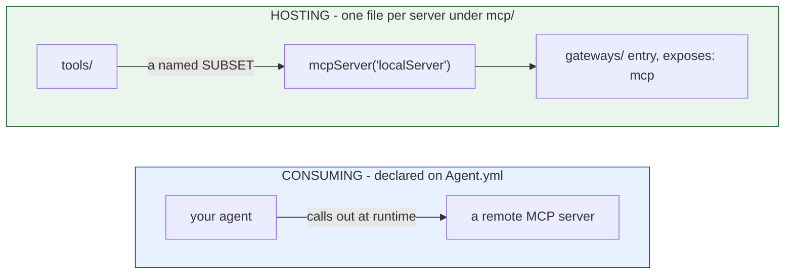
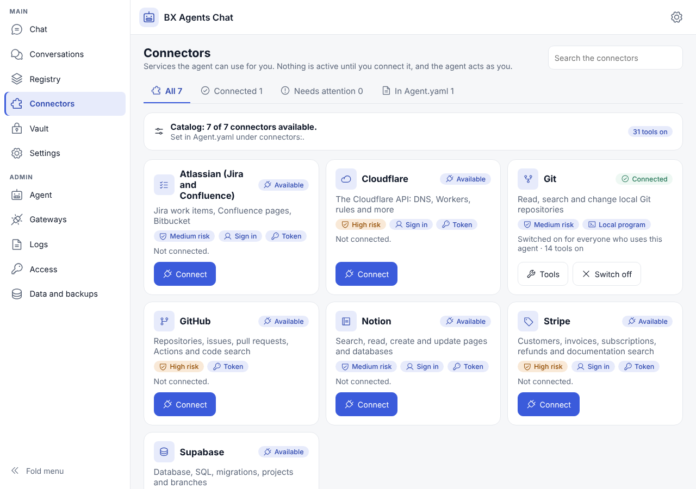

# Hosting and Consuming MCP Servers

Model Context Protocol (MCP) works in two directions in a BxAgents project, and
nothing links them - an agent consuming remote servers need not host one, and a hosted
server is only reachable if a `gateways/` entry exposes it (see
[Exposing Your Agent over HTTP and MCP](13-exposing-http-and-mcp.md)).



## Consuming a remote server

Declared directly in `Agent.yml` via `mcpServers` - not a file under `mcp/`:

```yaml
mcpServers:
  - https://example.com/mcp
  - url: https://other.com/mcp
    name: other
```

A server can need a sign-in: write it as a `${env.NAME}` placeholder (`token: "${env.GITHUB_PERSONAL_ACCESS_TOKEN}"`),
never the secret itself. An entry can also start a program on the agent's machine
(`command: [uvx, mcp-server-git]`) instead of a web address, and `toolFilter` limits which tools the
agent gets. `bxAgents add mcp client` writes such an entry for you (a catalog name such as GitHub
or Notion, or `--url`), with an empty stub for the key in `.env`; the [`new` wizard](../guides/new-wizard.md)
offers the same catalog. See [mcp/](../conventions/mcp.md) for every option.

**No network connection is ever attempted at build time** - reachability is a runtime
concern, so an unreachable server at build time is not a build error. Subagents can
declare their own `mcpServers` independently.

## Hosting a local server

Each `mcp/*.bx` file is a local MCP server your project hosts, exposing a named subset
of your `tools/` (from [Giving Your Agent Tools](09-giving-your-agent-tools.md)) as MCP tools:

```javascript
// mcp/localServer.bx
class {
	function configure() {
		return {
			description : "Internal tools MCP server",
			version     : "1.0.0",
			cors        : "*",             // optional
			tools       : [ "sayHello" ]   // function names of @AITool tools already under tools/
		};
	}
}
```

The entry's discovered name is its **filename** (`localServer.bx` -> `localServer`),
not any `name` inside `configure()`. At build time the file is copied verbatim, and a
registration statement is emitted at startup.

## Exposing it over HTTP

A local server isn't reachable on its own - pair it with the `gateways/` exposure
entry you saw in [Exposing Your Agent over HTTP and MCP](13-exposing-http-and-mcp.md):

```javascript
// gateways/expose-mcp.bx
class {
	function configure() {
		return {
			exposes : "mcp",
			path    : "/mcp/tools",
			target  : "localServer"
		};
	}
}
```

## Connectors: ready-made servers, signed in per person

Consuming a server by writing its address in `Agent.yml` is for services you choose. BxAgents also ships a catalog
of **connectors**: ready-made connections to seven services (GitHub, Stripe, Notion, Atlassian, Cloudflare, Supabase
and Git). Every agent offers them, and none is connected until a person connects *their own* account; the token is
sealed in [the vault](the-vault.md) and locked to the service's host, and the model never sees it.



`bxAgents connectors list` shows the catalog, and `bxAgents connect github` (or the **Connectors** page of the web app)
connects one. `connectors: { only: [ github ] }` in `Agent.yml` limits what the agent offers. See
[connectors](../conventions/connectors.md) and [connect](../conventions/connect.md).

## Try it

Acme's `orderStatus` tool from [Giving Your Agent Tools](09-giving-your-agent-tools.md) should be usable by other
agents too. Host it as its own MCP server. `add mcp server` writes the `mcp/` file with the tools it finds and the
`gateways/` entry that serves it (the description has no spaces, because of the launcher rule):

```bash title="Terminal 2"
cd ~/bxagents-course/acme-support
bxAgents add mcp server tools --description=Acme-tools --yes
bxAgents connectors list
```

```text title="You see"
+ Created  mcp/tools.bx
+ Created  gateways/toolsMcp.bx
...
ID           NAME                              HOW IN              RISK    VERIFIED
...
github<anything>
...
7 connectors. Nothing is active until a person connects one. bxAgents connectors show <id> says more.
```

`mcp/tools.bx` lists `tools: [ "orderStatus" ]` (a tool added later has to be added there), and
`gateways/toolsMcp.bx` serves it at `/mcp/tools` once the app runs. That route has no authentication of its own: keep
it off public networks or put it behind a proxy that checks a credential. Check the wiring without serving:

```bash title="Terminal 2"
bxAgents build
bxAgents inspect --section=mcp
```

```text title="You see"
Build succeeded: <anything>/acme-support/.build/app
...
  hosts tools<anything>Acme-tools
```

Any outside MCP client can now list and call `orderStatus`, independent of your agent's own chat interface.

## Checkpoint

`acme-support/` has `mcp/tools.bx` and `gateways/toolsMcp.bx`. `kit/resume.sh 17-hosting-mcp-servers` restores them;
rebuild after.

Full reference: [mcp/](../conventions/mcp.md).

Next: [Who Is Allowed](users-roles-and-tokens.md)
