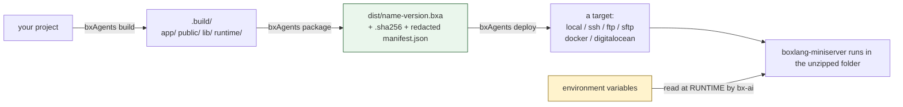

# Packaging, Deploying, and Wrapping Up

You've built Acme support: an agent with tools, skills, subagents, an HTTP route, a web app, routines, people and
tokens, a vault, a test suite and a backup. This lesson ships it.

## The chain, end to end



Secrets never enter the artifact at any step - `.env`/dotfiles are excluded from the
zip unconditionally, and the manifest is redacted on top of never carrying one. Every
API key, token and password is resolved from a real environment variable, live, at
runtime.

## Package

```bash
bxAgents package --version=1.0.0
```

Zips the built app (`app/`, `lib/`, `public/`, `runtime/`, `boxlang_modules/` and
`miniserver.json` of `.build/`) into `dist/{agentName}-{version}.bxa`, a `.sha256` checksum, and a
redacted `manifest.json`. Packaging twice over the same build produces byte-identical
zip bytes - useful for verifying a CI-built artifact matches a locally-built one. An
optional `.bxaignore` (one glob per line) excludes extra paths.

## Deploy

```bash
bxAgents deploy --destination=/path/to/somewhere   # local, no deploy/ folder needed
bxAgents deploy --name=production                  # any target, via deploy/production.bx
```

Six pluggable targets: `local` (copy the newest `.bxa`), `ssh` (scp + optional
restart), `docker` (build/push an image), `digitalocean` (App Platform), and
`ftp`/`sftp`. Every target resolves credentials from environment variables only - never
from `deploy/*` config itself.

```javascript
// deploy/production.bx
class {
	function configure() {
		return {
			target       : "digitalocean",
			appName      : "my-agent",
			registry     : { type : "docr", repository : "myorg/my-agent" },
			envs         : [ { key : "OPENAI_API_KEY", scope : "RUN_TIME", type : "SECRET" } ]
		};
	}
}
```

## Seeing how the agent is composed

`bxAgents inspect` prints a report of your agent straight from its source - it does not need a build:

```bash
bxAgents inspect
bxAgents inspect --section=tools,env
bxAgents inspect --json
```

You get the agent and subagent tree with each model, the tools and skills, what the project is exposed through, the schedule, and every environment variable it needs with a marker for the ones that are not set (names only, never values). `--md` writes the same thing as Markdown for a pull request. See the [CLI Reference](../cli-reference.md#inspect) for every section.

## What every build recorded: the manifest

Every `build` also writes `.build/manifest.json`, a hash-stamped record of exactly what went into the build - agent name, model,
environment, and one entry per discovered file with a SHA-256 content hash. This is
what makes rebuilding an unchanged project byte-identical, the idea you first met back
in [What Is BxAgents?](02-what-is-bxagents.md). Open it in any editor; `inspect` shows its version and file count in the `build` section.

## Cleaning up

```bash
bxAgents clean
```

Removes only `.build/` and `dist/` - your source conventions are never touched.

## Running it for other people

A deployed agent is no longer on your own machine, so decide who may call it. The agent API is open
by default, which is right on a laptop and wrong on the internet. Before you deploy, set `agentApi`
in `Agent.yml` ([Exposing Your Agent over HTTP and MCP](13-exposing-http-and-mcp.md)): a shared secret in an environment
variable, `tokens: true` for per-person tokens, and `allowedIPs` or `rateLimit` where they fit.
Run `token` where the agent's database is (on the server), make one for each person or program,
and talk to the deployment from your own terminal:

```bash
bxAgents token create --name=laptop --expires=90d
bxAgents chat --connect=https://agent.example.com --token=<the token>
```

The conversations, notes and tokens live in one SQLite file, `chat.db` in the agent's data home
(`~/.bxagents/<agent name>/` by default, the same place in development and when deployed; `BXAGENTS_DB` can name another file). `bxAgents sessions list` and
`bxAgents notes list` read it from a shell, and `bxAgents stats` shows what the model calls used when
`usage: true` is set.

## What travels, and what does not

A deployed agent is the package plus three things that stay outside it:

| Stays outside | Why | How it gets there |
|---|---|---|
| **Environment variables** (`OPENAI_API_KEY`, `ACME_ADA_PASSWORD`, `BXAGENTS_VAULT_KEY`) | Secrets never enter the artifact | Set on the server, or by the deploy target's `envs` |
| **The data home** (`~/.bxagents/acme-support/`) | Conversations, notes, tokens, routines and the sealed vault are *state*, not code | `bxAgents backup` on the old machine, `bxAgents restore` on the new one |
| **The vault key** | The vault is sealed with it, and a backup is no use without it | Set `BXAGENTS_VAULT_KEY` yourself, kept apart from the backup |

So moving to a new machine is: install BoxLang and BxAgents there, unpack the `.bxa`, set the variables, `restore` the
backup, start the server. The [vault lesson](the-vault.md) says why a secret is not written in `.env` for the model to
use, and [Logs, Usage and Backups](operating-it.md) makes and restores a backup.

## Try it

Build, package and deploy Acme support to a folder (the `local` target needs no server):

```bash title="Terminal 2"
cd ~/bxagents-course/acme-support
bxAgents build
bxAgents package --version=1.0.0
ls dist
bxAgents deploy --destination=$HOME/acme-deploy
ls ~/acme-deploy
```

```text title="You see"
Build succeeded: <anything>/acme-support/.build/app
Packaged: <anything>/dist/acme-support-1.0.0.bxa
acme-support-1.0.0.bxa
acme-support-1.0.0.bxa.sha256
manifest.json
Deployed acme-support-1.0.0.bxa to <anything>
acme-support-1.0.0.bxa
```

The `.sha256` lets a server check the artifact it received, and the redacted `manifest.json` records what went in.
Packaging the same build twice gives the same bytes. Nothing of your `.env`, your data home or your vault is in the
`.bxa`.

## Checkpoint

Nothing in the project changed (`dist/` is output, and `.gitignore` ignores it).

## Every verb, in one place

You've now used `new`, `build`, `test`, `chat`, `invoke`, `serve`, `package`, `deploy`,
`inspect`, `clean` and `hash-password` across this course. The rest, all in the
[CLI Reference](../cli-reference.md):

- `add` adds one piece to a project that already exists: a tool, skill, subagent, gateway,
  schedule, interceptor, MCP client or server, profile, provider, capability or extension.
- `doctor` is the one you'll reach for when something *isn't* working - it checks your BoxLang
  version, whether `bx-ai` is loaded, whether the project validates and which environment
  variables are not set, without needing a prior `build`.
- `models` lists the models a project can talk to and tests that they answer (`models test`).
- `token`, `notes`, `sessions` and `stats` manage access tokens, the notes the agent keeps, the
  saved conversations and the usage counts.
- `skills` installs skills from skills.boxlang.io, and `extensions` lists, installs and links
  extensions.

## Where to go from here

::: cards
::: card title="Conventions" icon="phosphor-duotone:cube" href="../conventions/agent-yaml.md"
The full reference for every convention folder this course walked through.
:::
::: card title="The Build Pipeline" icon="phosphor-duotone:factory" href="../build-pipeline.md"
Exactly what `build` does, in order, in more depth than Building Your Agent covered.
:::
::: card title="Deployment & Secrets" icon="phosphor-duotone:lock-key" href="../deployment-and-secrets.md"
The full packaging and secrets story from this lesson, in depth.
:::
:::

One lesson is left: [Ship Acme Support](capstone.md) runs the whole agent end to end and shows the one-line swap to a
real model.

Next: [Ship Acme Support](capstone.md)
