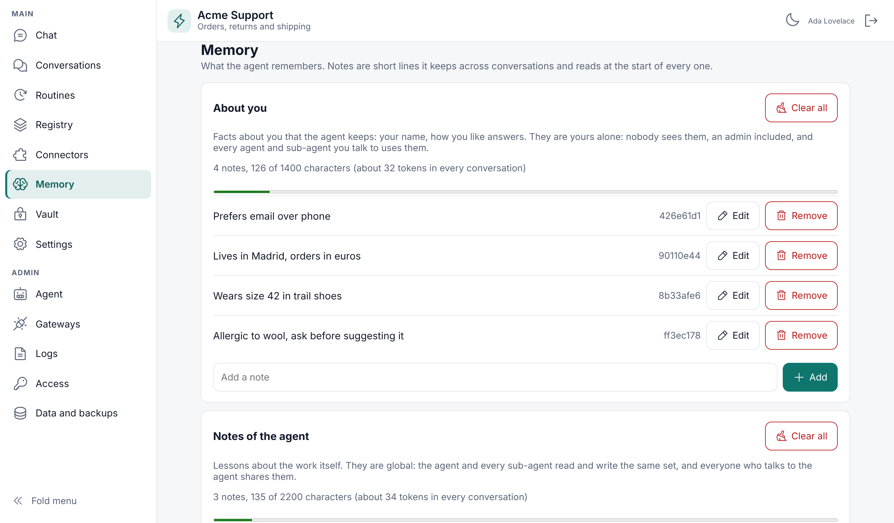

# What It Remembers, and for Whom

"Does it remember me?" has three answers, and an agent that mixes them up is either forgetful or creepy. This lesson
separates them and gives Acme support the ones it needs.

!!! info "What you will build"
    `notes` turned on; one note about a person, one note shared by everyone, and a look at how a second person
    stays apart. About 20 minutes.

## The three kinds

| What | Belongs to | Lasts | Where you manage it |
|---|---|---|---|
| **Conversation memory** | One person and one conversation | As long as the conversation, up to `memory.maxMessages` messages (500 by default) | The Conversations page, `/sessions`, `/clear`, `/compact` |
| **Notes about a person** (*user* scope) | One person | Across conversations | The Memory page, `/remember` and `/notes`, `bxAgents notes` |
| **Notes about the work** (*agent* scope) | The agent, so everyone | Across conversations | The same, and removing one needs an admin |

Conversation memory is on for every agent: the terminal, the web app and the API share one list of conversations in
the agent's data home, so the person finds the same conversation from any of them. Notes are off until you ask. They
are short lines the agent reads at the start of **each conversation**, so a note saved now shows from the next
conversation, not the current one.

## 1. Turn notes on

Add this at the end of `Agent.yml` (`notes: {}` turns them on with the defaults: 1400 characters of notes per
person, 2200 for the agent, and the agent gets `note_remember` and `note_forget` tools):

<!-- course: append -->
```yaml title="acme-support/Agent.yml"

notes: {}
```

```bash title="Terminal 2"
cd ~/bxagents-course/acme-support
bxAgents build
bxAgents notes list
```

```text title="You see"
Build succeeded: <anything>/acme-support/.build/app
Notes about local: 0 of 1400 characters, 0 notes
  (none yet)
Agent notes (acme-support): 0 of 2200 characters, 0 notes
  (none yet)
```

`local` is who you are on your own machine: the terminal and an open server both call the person `local`. Once
there are tokens or accounts ([Who Is Allowed](users-roles-and-tokens.md)), the person is the token's name or the
account.

## 2. Add notes yourself

A person manages their notes from a shell. The agent's notes use `--scope=agent`. (The values have no spaces because
of the launcher rule from [A Model That Needs No Key](practice-model.md); in a chat you would write whole
sentences.)

```bash title="Terminal 2"
bxAgents notes add --text=Prefers-short-answers
bxAgents notes add --text=Orders-ship-from-Leeds --scope=agent
bxAgents notes list
```

```text title="You see"
Noted (user).
Noted (agent).
Notes about local: 21 of 1400 characters, 1 note
  <anything>  Prefers-short-answers
Agent notes (acme-support): 22 of 2200 characters, 1 note
  <anything>  Orders-ship-from-Leeds
```

Now a second person. Their user notes are their own, and the agent's notes are the same for both:

```bash title="Terminal 2"
bxAgents notes list --user=ada
```

```text title="You see"
Notes about ada: 0 of 1400 characters, 0 notes
  (none yet)
Agent notes (acme-support): 22 of 2200 characters, 1 note
  <anything>  Orders-ship-from-Leeds
```

In the terminal chat the same person is chosen with `bxAgents chat --user=ada`, and inside the chat `/remember <text>`
and `/notes` do what `notes add` and `notes list` do.

## 3. Let the agent keep one

The agent can save a note itself with `note_remember`, with a scope of `user` or `agent` and a note of one short
line. The scripted model has a rule for the word `remember`. Serve the app (Terminal 3, after stopping the previous
server) and ask through the API, as the open server's one user, `local`:

<!-- course: background name=serve ready-url=http://127.0.0.1:8791/chat -->
```bash title="Terminal 3"
cd ~/bxagents-course/acme-support
bxAgents serve --port=8791
```

```bash title="Terminal 2"
curl -s -H 'Content-Type: application/json' -d '{"input":"remember"}' http://127.0.0.1:8791/__bxagents/invoke
echo
bxAgents notes list --scope=user
```

```text title="You see"
{"output":"Noted. I will keep my answers short.","threadId":"<anything>","success":true}
Notes about local: 42 of 1400 characters, 2 notes
  <anything>  Prefers-short-answers
  <anything>  Prefers short answers
```

!!! warning "`invoke` in the terminal does not save to `local`"
    `bxAgents invoke` runs the agent in this process, and a note the agent saves there is not saved under `local`.
    To exercise the agent's note tool, go through a server (this lesson's curl), or `invoke --server`.

Saving a note needs no approval. Forgetting one does, by default (`approveForget: true`, see
[The Agent Asks First](approvals.md)), so an agent cannot quietly erase what a person wrote.

## 4. The Memory page

Open `http://127.0.0.1:8791/chat/memory`. The page has three parts: **About you** (your user notes, which you can add
to, edit and remove), **About the agent** (the shared notes; a member can add and edit, only an admin removes) and
**Conversation memory** (clear the messages of one conversation, or of all).



The notes also go over the API (`GET /__bxagents/notes`), which is what the page uses.

## What goes where

- **The data home.** Conversations and notes live in `chat.db` of the agent's data home
  (`~/.bxagents/acme-support/`), not in the project. `kit/resume.sh` never touches them, and
  [Logs, Usage and Backups](operating-it.md) backs them up.
- **Limits.** A note is one line of at most 500 characters. A note that does not fit the limit is refused, and the
  agent is told how full the notes are so it can replace or forget an older one. Nothing is dropped silently.
- **Compacting.** `/compact` in the chat summarizes the older messages of a conversation and keeps the recent ones
  (`memory.keepRecent`), and needs a summary model to do it.

## Checkpoint

`Agent.yml` has `notes: {}`. In your data home there is a note about `local` and one about the agent, which a
checkpoint cannot hold. `kit/resume.sh memory-and-notes` restores the project files.

Full reference: [Notes](../conventions/agent-yaml.md#notes), the [CLI reference](../cli-reference.md#notes) and
[the web app's Memory page](../conventions/web-ui.md#memory).

Next: [Composing Subagents](11-composing-subagents.md)
