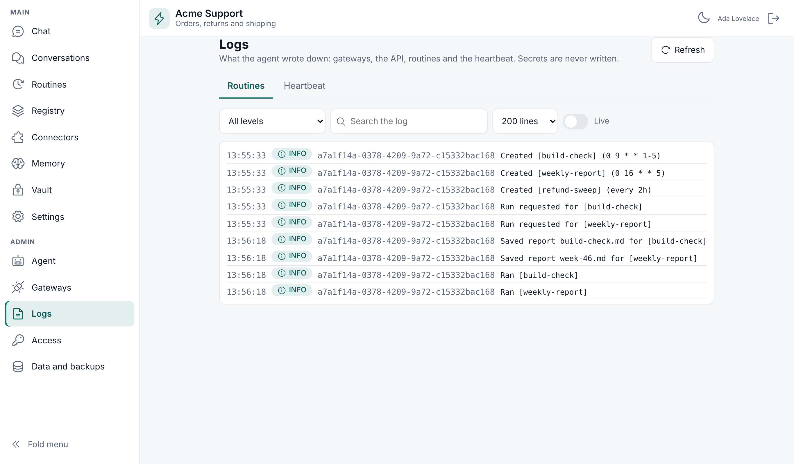
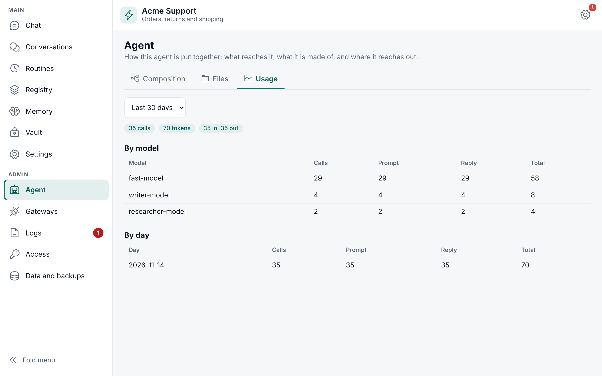
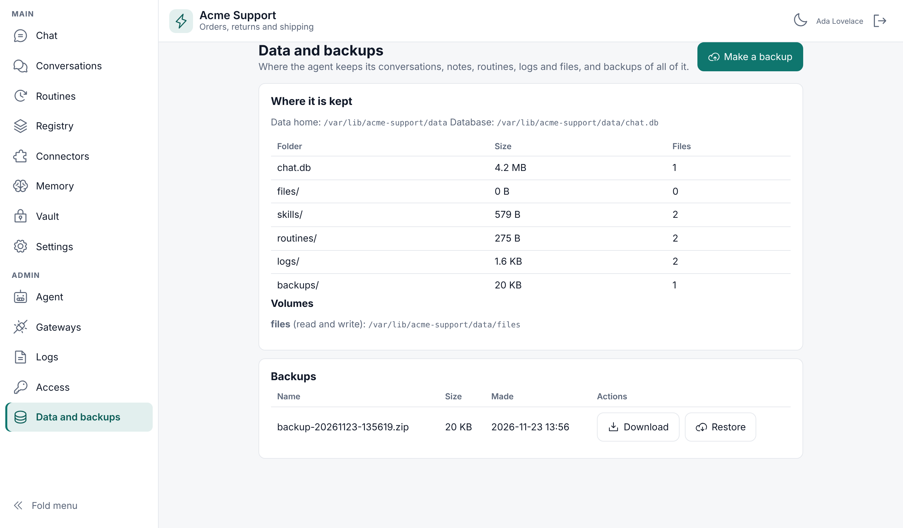

# Logs, Usage and Backups

An agent that someone else depends on raises three questions. *What is it doing?* *What does it cost?* *If the disk
dies, what do I lose?* BxAgents answers them from one place, the agent's **data home**, with a command for each.

!!! info "What you will do"
    Read the usage the model calls left, look at what the data home holds and at the logs, then back it up, lose a
    note on purpose and restore it. About 20 minutes.

## The data home

Everything an agent *keeps* lives outside the project, in `~/.bxagents/<agent name>/` (set `BXAGENTS_HOME`, or `data.home`
in `Agent.yml`, to put it elsewhere). The project is what you ship; the data home is what accumulated while it ran.
`bxAgents data` shows where it is and how big each part is:

```bash title="Terminal 2"
cd ~/bxagents-course/acme-support
bxAgents data
```

```text title="You see"
Data home: <anything>/.bxagents/acme-support  (the convention, ~/.bxagents/<agent name>)
Database:  <anything>/chat.db

  chat.db<anything>
  files/<anything>
  skills/<anything>
  routines/<anything>
  logs/<anything>
  backups/<anything>

Volumes:
  files<anything>read and write<anything>
```

| Part | Holds |
|---|---|
| `chat.db` | Conversations, notes, access tokens, accounts, routines, the sealed vault and the usage record |
| `files/` | What the agent writes with its file tools (the `files` volume) |
| `skills/` | Skills the agent saved for itself |
| `routines/` | The reports of every routine |
| `logs/` | The logs below (not part of a backup) |
| `backups/` | The backups you make |

Volumes, the folders of your machine you let the agent use, are named in `Agent.yml` and are *not* in the data home or in a
backup.

## What is it doing: logs

An agent writes what it does, and what goes wrong, to one log per area: `agent`, `gateways`, `routines`, `heartbeat`
and `api`. Without an area `logs` lists them; with one it prints the last lines:

```bash title="Terminal 2"
bxAgents logs
bxAgents logs routines --tail=3
```

```text title="You see"
...
```

(What you see depends on what has run: a log file appears when its first line is written.) `--level=warn` and
`--grep=text` filter, `--follow` keeps printing new lines, and `--ui` opens a viewer with a tab per log. An admin sees the
same in the web app on the **Logs** page, with a **Live** switch, and over the API with `--connect=<url> --token=<admin
token>`. **A log never holds what a person said, nor a token, password or key** (they are replaced by `***`), and a log
that cannot be written never stops the work it describes.



## What does it cost: usage

Set `usage: true` and each model call leaves a row of counts: the time, who asked, the provider, the model and the
tokens in and out. You did that in [The Agent Definition](05-agent-bx.md), so there is already a record:

Make one more call, so there is something to count, and read the record:

```bash title="Terminal 2"
bxAgents invoke --message=hello > /dev/null
bxAgents stats
```

```text title="You see"
Last 30 days: <anything> call<anything>, <anything> tokens (<anything> in, <anything> out)

By model<anything>calls<anything>in<anything>out<anything>total
...
Counts only the calls whose provider reported usage.
```

The scripted model reports one token in and one out for every call, so these numbers are small and the same every
time, but the command is the one you would use with a real provider. `--by=provider|day|user` regroups, `--days=7`
narrows, `--user=bo` shows one person's. Only counts are kept, never what was said, and cost in money is not worked out,
because prices change too often to ship a table. The same numbers are on the **Agent** page of the web app (the Usage
tab) and in the chat as `/stats`.



## Can I get it back: backup and restore

`backup` zips the database (copied whole, so it is safe while a server is running), `files/`, `skills/` and `routines/`.
It does not hold the logs, the volumes, or your **vault key**: keep `BXAGENTS_VAULT_KEY` somewhere safe on its own, because
a backup of sealed secrets is useless without the key.

Prove it works. Add two notes, back up, lose one, and restore:

```bash title="Terminal 2"
bxAgents notes add --text=Prefers-short-answers
bxAgents notes add --text=Loses-this-note
bxAgents backup
```

```text title="You see"
Noted (user).
Noted (user).
Backed up <anything> to <anything>/backups/backup-<anything>.zip
```

```bash title="Terminal 2"
ID=$(bxAgents notes list --scope=user | grep Loses-this-note | awk '{print $1}')
bxAgents notes remove --id=$ID
bxAgents notes list --scope=user | grep -c Loses-this-note || true
```

```text title="You see"
Removed.
0
```

Now put the backup back. `restore` stops when a server or a chat looks to have the database open, and SQLite leaves a
`-wal` file behind that looks like one, so when you are sure nothing is running, say so with `--force`. What was there is
kept for one restore as `chat.db.before-restore`:

```bash title="Terminal 2"
BACKUP=$(ls -t ~/.bxagents/acme-support/backups/*.zip | head -1)
bxAgents restore $BACKUP --force
bxAgents notes list --scope=user | grep -c Loses-this-note
```

```text title="You see"
Restored chat.db<anything> into <anything>
Kept what was there as chat.db.before-restore<anything>. The next restore replaces them.
1
```

The note is back. In the web app the **Data and backups** page (admins only) makes, downloads and schedules the
restore of a backup, and shows the volumes.



## When something is wrong: doctor

`bxAgents doctor` checks the BoxLang version, that `bx-ai` is loaded, that the project validates, which environment
variables it needs are not set, and that the data home can be written. Run it first, before you read logs.

```bash title="Terminal 2"
bxAgents doctor
```

```text title="You see"
[ OK ] BoxLang <anything>
...
0 problem(s), <anything>
```

(In this shell it warns that `ACME_ADA_PASSWORD` and `ACME_BO_PASSWORD` are not set: you exported them only for the
server's run in [Who Is Allowed](users-roles-and-tokens.md). That is `doctor` doing its job, naming a variable the
project needs.)

## Checkpoint

Nothing in the project changed. In the data home there is a backup, and a note you lost and got back.
Nothing to restore with `kit/resume.sh`.

Full reference: [data and volumes](../conventions/data.md), [logs](../conventions/logs.md) and the
[CLI reference](../cli-reference.md#data-backup-and-restore) for `data`, `backup`, `restore`, `logs`, `stats` and `doctor`.

Next: [Interceptors and Module Dependencies](18-interceptors-and-modules.md)
