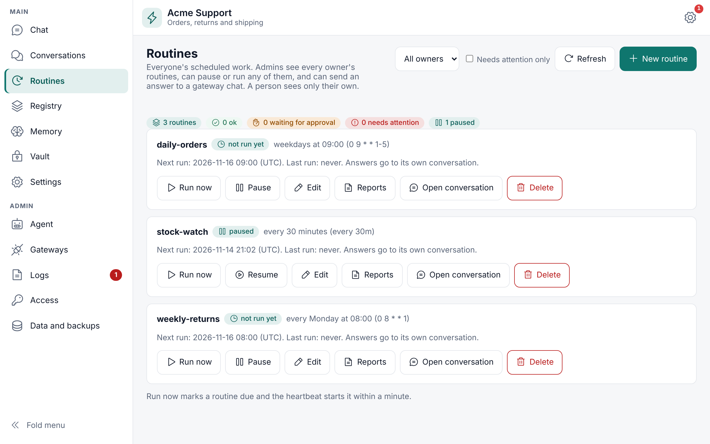
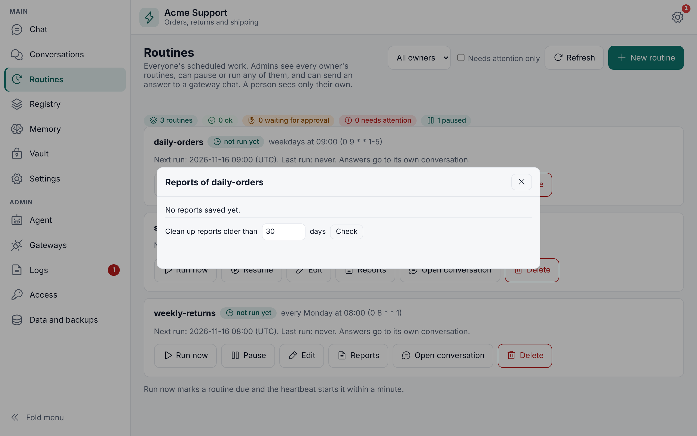

# Routines and Reports

A **routine** is a prompt the agent runs on a schedule, as the person who made it. "Every weekday at 9, check the
build and tell me what broke" is a routine. Nobody writes a file: a person asks the agent, approves the tool
call, and the agent keeps the routine in the chat database. A run can save what it found as a **report**, a file you
read later.

!!! info "What you will build"
    A routine that runs while the app is served, a report it saves, and the ways to read both. About 25 minutes.
    It continues from [The Agent Asks First](approvals.md), where you made the routine `weekly-report`.

## Routines are not schedulers

BoxLang has its own scheduler, and BxAgents lets a developer use it from `schedules/*.bx` (the next lesson). A routine
is for the people who use the agent:

| | `schedules/*.bx` | Routine |
|---|---|---|
| Who makes it | The developer, in a file | Anyone, by asking the agent |
| Lives | In the project, shipped with the agent | In the chat database, per person |
| Runs as | The app | The person who made it, with their notes and approvals |
| Changed by | Editing the file and rebuilding | Asking the agent, while the app runs |

## 1. The routine from the last lesson

```bash title="Terminal 2"
cd ~/bxagents-course/acme-support
bxAgents routines list
```

```text title="You see"
weekly-report         every 5 minutes           not run yet           next <anything>
```

A schedule is stored as a 5-field cron expression (`0 9 * * 1-5`) or an interval (`every 30m`, `every 2h`), and
every answer reads it back in words, so a mistake is seen straight away. The prompt it will run is `report`; the
scripted model answers a routine run by saving a report (its rule listens for the sentence every run starts with,
"This is a scheduled routine").

## 2. Run it

Routines are started by a **heartbeat**: a scheduler BxAgents adds to the app that wakes every minute, looks for
routines that are due, and starts them. That heartbeat only exists in a served app. Serve it (Terminal 3):

<!-- course: background name=serve ready-url=http://127.0.0.1:8791/chat -->
```bash title="Terminal 3"
cd ~/bxagents-course/acme-support
bxAgents serve --port=8791
```

Instead of waiting five minutes, mark the routine due. `run` does not run anything itself; it makes the routine due
at the next heartbeat:

```bash title="Terminal 2"
bxAgents routines run weekly-report
```

```text title="You see"
...
Marked due routine weekly-report. Next run <anything>
It starts at the next minute of a served app, not from this command.
```

Wait up to a minute. The server's output (Terminal 3) shows the routine start, save a report and finish, and the
run is a normal turn of the agent as you, in a conversation of its own:

<!-- course: wait name=serve until="Ran [weekly-report]" seconds=150 -->
```bash title="Terminal 2"
bxAgents routines list
```

```text title="You see"
weekly-report<anything>every 5 minutes<anything>ok<anything>
```

!!! tip "Not served, not run"
    From a terminal that is not serving the app, `routines run` marks the routine and nothing starts it. If a
    routine never runs, check that the app is running (and `bxAgents logs heartbeat`).

## 3. Read the report

A routine saves what it found with the `report_save` tool. Reports go in the data home under
`routines/<name>-<id>/`, are never overwritten (a name already used becomes `report-2.md`) and are never deleted
by the agent, only by a person:

```bash title="Terminal 2"
bxAgents routines reports weekly-report
bxAgents routines report weekly-report weekly.md
```

```text title="You see"
weekly.md<anything>62 bytes<anything>
# Weekly report

No open orders. Returns are free for 30 days.
```

The run's conversation is in the list too, named `routine-weekly-report-<id>`, and reads like any other. Open the
web app's **Routines** page for the same things with buttons: each row shows the status in words, the schedule in
words, the next and last run, and **Run now**, **Pause**, **Edit**, **Reports** and **Delete**.





## 4. Make, pause and delete one from a script

Asking the agent is the usual way, and it needs your approval. A program, and the web page's **New routine**, can
make one directly through the API, as the same person. (The CLI's `routines add --schedule="every 1h"` does not work on
the BoxLang 1.19.0 launcher yet, because the schedule has a space; see
[Quoting flag values](../cli-reference.md#quoting-flag-values).)

```bash title="Terminal 2"
curl -s -H 'Content-Type: application/json' -d '{"name":"daily-check","schedule":"every 1h","prompt":"report"}' http://127.0.0.1:8791/__bxagents/routines > /dev/null
bxAgents routines pause daily-check
bxAgents routines list
```

```text title="You see"
...
Paused routine daily-check. Next run <anything>
daily-check<anything>every hour<anything>paused<anything>
weekly-report<anything>every 5 minutes<anything>ok<anything>
```

```bash title="Terminal 2"
bxAgents routines delete daily-check --yes
bxAgents routines list
```

```text title="You see"
...
Deleted routine.
weekly-report<anything>every 5 minutes<anything>ok<anything>
```

Deleting a routine keeps its conversation and its reports.

## What the heartbeat guarantees

- **Runs as the person.** The run uses their notes and their approvals. A routine cannot make or change routines (a
  run is refused the `routine_*` tools).
- **No overlap.** A routine still running is skipped, and the skip is logged.
- **Three failures in a row pause it.** `routines resume <name>` (or the Resume button) starts it again and clears
  the failures. A run that stops for an approval shows as *waiting for approval*; after `approvalTimeout` it is
  cancelled and counts as a failure.
- **Catch-up is once.** If the server was down when a routine was due, it runs once on start, never once per
  missed time.
- **Where the answer goes.** By default into the routine's own conversation. A routine made from a chat platform can
  send a summary back to that chat, and a person can name a gateway (`gateway:telegram`).

The settings (`maxPerUser`, `minInterval`, `timezone`, `maxReportSize` and the rest) are in the
[routines reference](../conventions/routines.md#turn-it-on). `routines.log` and `heartbeat.log` record each
routine made, changed, run, skipped and failed, never the prompt or the text of a report; the
[operating lesson](operating-it.md) reads them.

## Checkpoint

Nothing in the project changed in this lesson. In the data home there is one routine, `weekly-report`, and one report.

Full reference: [routines](../conventions/routines.md) and [the CLI reference](../cli-reference.md#routines).

Next: [Scheduling Background Work](16-scheduling-background-work.md)
