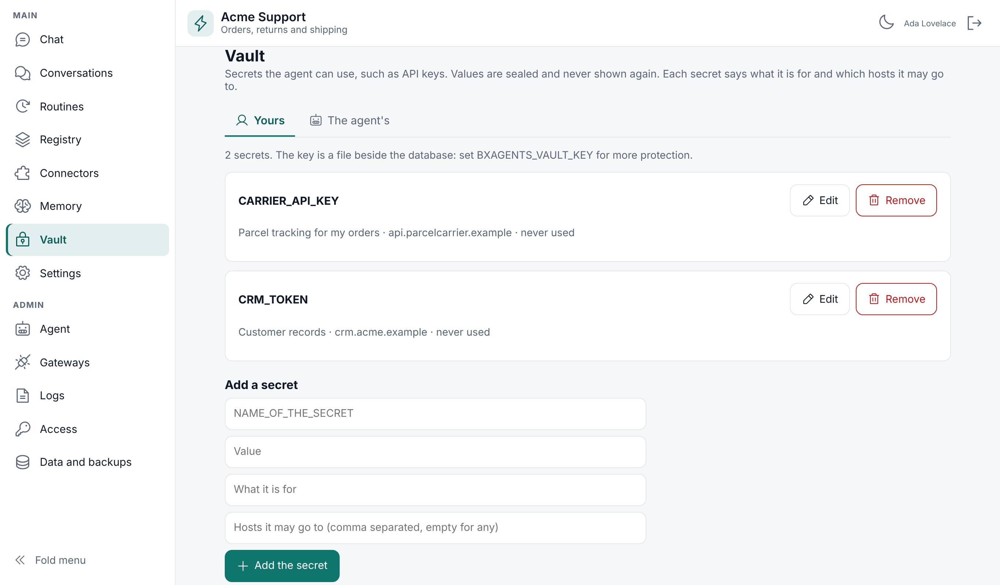

# Secrets the Agent May Use

Acme's orders system wants an API key. Where does it go? Not in `Agent.yml` or a tool (they are committed and
packaged), and not in a chat message (it would sit in a transcript). The **vault** is the place for secrets that
people hand to a *running* agent: sealed in the agent's database, used by a tool or an MCP server at the moment it
needs one, and never shown to the model.

!!! info "What you will build"
    A secret sealed in the vault with one allowed host, a tool that uses it without ever returning it, and the audit
    list that records the use. About 20 minutes.

## Vault, `.env` or `Agent.yml`?

| Where | For | Changes by |
|---|---|---|
| **`.env` and environment variables** | Deploy-time settings and the model provider's key (`OPENAI_API_KEY`) | Redeploying or restarting |
| **`Agent.yml`** | Only the *name* of a variable or secret (`${env.NAME}`, `${vault.NAME}`), never a value | Rebuilding |
| **The vault** | Secrets people give a running agent: they change, differ per person, and should not need a redeploy | A person, while the agent runs |

There are two scopes. A **user** secret belongs to one person (their name as the server knows them) and nobody else
can see or use it. An **agent** secret is shared by everyone who talks to the agent, and an admin manages it. Asking
for a name finds the person's own first, then the agent's; a run with no person behind it (a scheduler) finds the
agent's only.

## 1. Turn it on and look at it empty

A `vault:` block gives the agent two tools (`vault_list`, names only, and `vault_request`, which asks a person to add
a secret) and makes the runtime scrub every vault value out of tool results before the model sees them. Add it at the
end of `Agent.yml` and rebuild:

<!-- course: append -->
```yaml title="acme-support/Agent.yml"

vault: {}
```

```bash title="Terminal 2"
cd ~/bxagents-course/acme-support
bxAgents build
bxAgents vault status
```

```text title="You see"
Build succeeded: <anything>/acme-support/.build/app
Secrets:  0
Key:      none yet (made when the first secret is saved)
Database: <anything>/chat.db
```

## 2. Add a secret

A value is **never a flag and never typed in a chat message**. From a terminal `vault add` asks for it in a hidden
prompt; in a script it reads a pipe with `--stdin`. A secret can list the `--hosts` it may be sent to, and is refused
anywhere else:

```bash title="Terminal 2"
printf 'demo-secret-value' | bxAgents vault add --name=ORDERS_TOKEN --description=Orders-API --hosts=orders.acme.test --stdin
bxAgents vault list
```

```text title="You see"
Saved agent secret [ORDERS_TOKEN]. It is sealed and cannot be shown again.
NAME<anything>SCOPE<anything>OWNER<anything>HOSTS<anything>LAST USED<anything>ABOUT
ORDERS_TOKEN<anything>agent<anything>orders.acme.test<anything>never<anything>Orders-API
```

Each value is sealed with AES-256-GCM, and the sealed value is tied to its row, so copying it onto another row does not
open it. The key is made the first time a secret is saved, in a file beside the database. Read the warning
`vault status` prints now:

```bash title="Terminal 2"
bxAgents vault status
```

```text title="You see"
Secrets:  1
Key:      a key file next to the database
Database: <anything>/chat.db

The key file sits beside the data it protects: anyone who copies the data folder gets both.
Set BXAGENTS_VAULT_KEY to a key you keep elsewhere (`bxAgents vault key` makes one).
```

For a real deployment set `BXAGENTS_VAULT_KEY` where the agent runs and keep a copy somewhere safe. **If the key is
lost the secrets cannot be recovered**, and BxAgents never makes a new key while secrets exist.

## 3. Use it from a tool

A tool asks the vault for a value by name, passing its own `arguments` (which carry the run, so a person's own secret
is found before the agent's) and the host the value is about to go to. This tool only reports that the key is set and
how long it is. It never returns the key, and if it did, the scrubbing would take it out:

```javascript title="acme-support/tools/OrdersApi.bx"
class {

	@AITool( "Check that the orders API key is set, without showing it." )
	function ordersApiKey() {
		var key = vault( "ORDERS_TOKEN", arguments, "orders.acme.test" )
		return { set : true, length : len( key ) }
	}

}
```

Rebuild, and ask the scripted model, which has a rule for the word `vault`. Then read the audit list: every add,
change, removal and use, with who, from where and which host, and never a value:

```bash title="Terminal 2"
bxAgents build
bxAgents invoke --message=vault
bxAgents vault audit
```

```text title="You see"
Build succeeded: <anything>/acme-support/.build/app
The key check says: {set:true,length:17}
WHEN<anything>ACTION<anything>NAME<anything>SCOPE<anything>WHO<anything>VIA<anything>RESULT
<anything>use<anything>ORDERS_TOKEN<anything>agent<anything>tool<anything>ok
<anything>add<anything>ORDERS_TOKEN<anything>agent<anything>cli<anything>ok
```

The same secret could sit in an MCP server's header: write `token: ${vault.ORDERS_TOKEN}` in an `mcpServers` entry
of `Agent.yml`. It is resolved when the app starts, never at build time, so the value is not in the project, the build
or a package. Only the agent's secrets can be used there, because the app starts once for everyone.

## 4. The Vault page

In the web app the **Vault** page lists the secrets you can use, adds one into a hidden password field (sent once, the
field cleared) and, for an admin, shows the key's status and the same activity list. The terminal chat has `/vault`
for the same.



## Limits worth knowing

- A static key or token only. OAuth sign-in and token refresh are not in the vault (the
  [connectors](17-hosting-mcp-servers.md) use their own sealed sign-ins, stored the same way).
- A secret used in `Agent.yml` is read when the app starts: change it and restart.
- Protect the door as well as the safe: on an open server anyone who can reach the page is the admin, which is why
  [Who Is Allowed](users-roles-and-tokens.md) comes first.

## Checkpoint

`Agent.yml` ends with `vault: {}` and `tools/OrdersApi.bx` exists. The secret itself is in your data home, sealed.
`kit/resume.sh the-vault` restores the project files; rebuild after.

Full reference: [the vault](../conventions/vault.md) and [`vault`](../cli-reference.md#vault).

Next: [Each Person's Own Settings](layered-settings.md)
