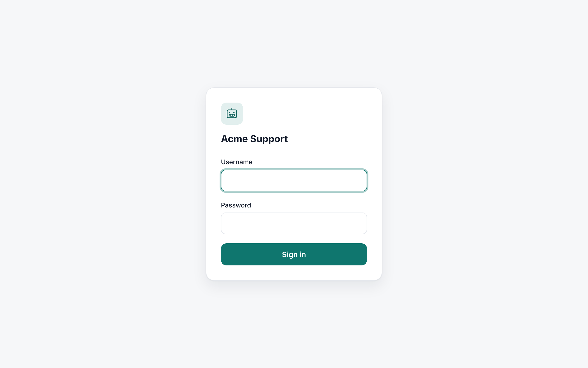
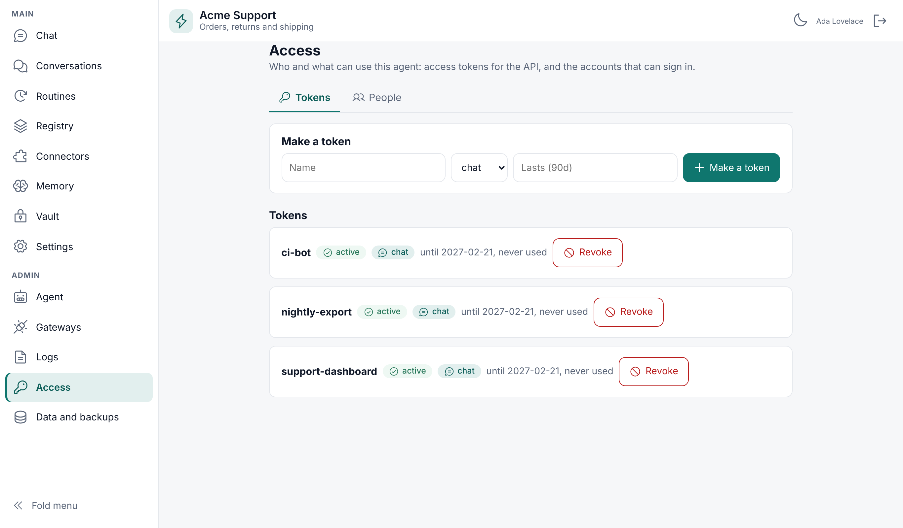

# Who Is Allowed

So far the agent has been open: anyone who could reach port 8791 was `local`, and `local` could do everything. That is
right on your own machine and wrong on a network. This lesson closes it, in two ways that fit two kinds of caller:
**people** sign in to the web app with an account, and **programs** (a script, the terminal chat on another machine,
CI) send an access **token**.

!!! info "What you will build"
    The web app with two accounts, `ada` (an admin) and `bo` (a member), the agent API behind tokens, and a token
    for a laptop, a script and a phone, one of which you revoke. About 25 minutes.

## What changes when it is closed

| | Open (so far) | With accounts and tokens |
|---|---|---|
| Who the caller is | `local`, always | The signed-in account, or the token's name |
| Conversations and notes | One shared set | Each person's own |
| The agent API | Anyone who can reach the port | A sign-in cookie or an `x-bxagents-token` header, else `401` |
| Admin pages and routes | Everyone | Admins only (`403` to the rest) |

There are two roles. A **member** talks to the agent and sees only their own conversations, notes and preferences. An
**admin** can also do what the operator of the app does: see everyone's conversations, manage access tokens, change
the agent's own notes and the secrets, see where the agent keeps its data. The terminal on the server and an admin
token are admins too.

## 1. Two accounts

Accounts are written in the web gateway. A password is never written in the file: an account names the *environment
variable* that holds it (or carries an already-hashed value; `bxAgents hash-password` makes one). Replace the gateway
file from [The Web App](15-the-generated-web-chat-ui.md) with this one:

```javascript title="acme-support/gateways/web.bx"
class {

	function configure() {
		return {
			exposes : "webui",
			path    : "/chat",
			users   : [
				{ username : "ada", passwordEnvVar : "ACME_ADA_PASSWORD", displayName : "Ada Lovelace", admin : true },
				{ username : "bo",  passwordEnvVar : "ACME_BO_PASSWORD",  displayName : "Bo Park" }
			]
		};
	}

}
```

An account whose variable is not set is skipped, with a warning in the `webui-auth` log: it fails closed on purpose,
because an account with an empty password would be far worse than none.

## 2. Tokens for programs

Tokens are made and kept by the agent itself. Turn them on, and let an admin manage them over the API too, with these
lines at the end of `Agent.yml` (`agentApi` is the agent's HTTP API, [the one you called](13-exposing-http-and-mcp.md)
from curl):

<!-- course: append -->
```yaml title="acme-support/Agent.yml"

agentApi:
  tokens: true
  manageTokens: true
```

Rebuild and serve it (Terminal 3), after stopping the old server. The two `export` lines give the accounts their
passwords for this run only; use your own words for a real deployment:

```bash title="Terminal 2"
cd ~/bxagents-course/acme-support
bxAgents build
```

```text title="You see"
Build succeeded: <anything>/acme-support/.build/app
```

<!-- course: background name=serve ready-url=http://127.0.0.1:8791/chat/login.html -->
```bash title="Terminal 3"
cd ~/bxagents-course/acme-support
export ACME_ADA_PASSWORD=ada-demo-pw ACME_BO_PASSWORD=bo-demo-pw
bxAgents serve --port=8791
```

The agent API has stopped being open. A call with no credentials is refused, and the accounts exist:

```bash title="Terminal 2"
B=http://127.0.0.1:8791/__bxagents
curl -s -o /dev/null -w '%{http_code}\n' $B/whoami
bxAgents users list
```

```text title="You see"
401
USERNAME<anything>ROLE<anything>STATUS<anything>NAME
ada<anything>admin<anything>active<anything>Ada Lovelace
bo<anything>member<anything>active<anything>Bo Park
```

`admin: true` in the file made `ada` an admin when her account was created. After that the database keeps the flag,
and `bxAgents users admin --name=bo` or `users member --name=bo` changes it (the last admin cannot be demoted).

Now make a token. It is printed **once**, and only a hash is stored:

```bash title="Terminal 2"
bxAgents token create --name=laptop
```

```text title="You see"
Token for [laptop] (chat, never expires):

  bxa_<anything>

Copy it now: it is not stored and cannot be shown again. A caller sends it in the x-bxagents-token header;
...
```

A token has a **scope**, `chat` (talk to the agent, the default) or `admin`, and may expire (`--expires=90d`). Make one of
each, call the API with them, and see what the scope allows. The token's *name* is who the caller is, so it is also
the owner of the conversations and notes it creates:

```bash title="Terminal 2"
B=http://127.0.0.1:8791/__bxagents
ADMIN=$(bxAgents token create --name=desk --scope=admin | grep -o 'bxa_[A-Za-z0-9_-]*')
CHAT=$(bxAgents token create --name=phone | grep -o 'bxa_[A-Za-z0-9_-]*')
curl -s -H "x-bxagents-token: $ADMIN" $B/whoami
echo
curl -s -H "x-bxagents-token: $CHAT" $B/whoami
echo
for T in $CHAT $ADMIN; do curl -s -o /dev/null -w '%{http_code} ' -H "x-bxagents-token: $T" $B/logs; done
echo
```

```text title="You see"
{<anything>"scope":"admin"<anything>"id":"desk"<anything>}
{<anything>"scope":"chat"<anything>"id":"phone"<anything>}
403 200
```

The `logs` route is for admins: the chat token gets `403`, the admin token `200`. Take a token back, and it stops at
once, on the running server. `token list` shows each token's name, scope, status and when it was last used, never the
token itself:

```bash title="Terminal 2"
B=http://127.0.0.1:8791/__bxagents
PHONE=$(bxAgents token create --name=old-phone | grep -o 'bxa_[A-Za-z0-9_-]*')
curl -s -o /dev/null -w '%{http_code}\n' -H "x-bxagents-token: $PHONE" $B/whoami
bxAgents token revoke --name=old-phone
curl -s -o /dev/null -w '%{http_code}\n' -H "x-bxagents-token: $PHONE" $B/whoami
bxAgents token list
```

```text title="You see"
200
Revoked [old-phone]. It stops working at once.
401
NAME<anything>SCOPE<anything>STATUS<anything>CREATED<anything>LAST USED<anything>EXPIRES
...
old-phone<anything>chat<anything>revoked<anything>
...
laptop<anything>chat<anything>active<anything>
```

Use a token with the terminal chat on another machine:

<!-- course: manual -->
```bash title="Terminal 2"
bxAgents chat --connect=http://127.0.0.1:8791 --token=<the token>
```

## 3. Sign in as a person

Open `http://127.0.0.1:8791/chat` in a browser. You are sent to the sign-in form. Sign in as `bo` with `bo-demo-pw`:
the chat works, the menu has the Main group only, and an address under the Admin group answers `403`. Sign out (the
header) and sign in as `ada`: the **Admin** group appears, and the **Access** page lists the tokens you made (a
**Tokens** tab, because `manageTokens` is on) and the accounts (**People**).





A conversation `bo` starts is invisible to `ada`'s own list (an admin can switch to **Everyone**), and `bo`'s notes are
`bo`'s. A run that stops for an [approval](approvals.md) belongs to whoever started it: `ada` cannot approve `bo`'s
pending routine from her own session.

## What to remember

- **Passwords are never in the file**, only the name of a variable or a hash. A password in a command line stays in
  your shell history, which is why `bxAgents hash-password --password=...` is for throwaway passwords or a hash you
  paste once.
- **Accounts close the API too.** With `users`, `/__bxagents` needs the sign-in cookie or a token, whatever `agentApi`
  says. The rest of the course therefore sends a token when it calls the API.
- **Tokens are secrets.** Shown once, kept as a hash, revocable, optionally expiring. `agentApi.tokenEnvVar` adds one
  shared secret that acts as an admin, for a deployment you manage through an environment variable.
- **It is a fixed roster.** No self-registration, no password reset and no roles beyond admin and member; for your
  own identity system see [the web app reference](../conventions/web-ui.md#what-this-is-not).

## Checkpoint

`gateways/web.bx` has the two accounts and `Agent.yml` ends with the `agentApi` block. The tokens are in your data
home. `kit/resume.sh users-roles-and-tokens` restores the project files; rebuild after.

Full reference: [Users and sign-in](../conventions/web-ui.md#users-and-sign-in), [access tokens](../conventions/agent-bx.md#access-tokens-for-a-deployed-agent)
and [`token`](../cli-reference.md#token), [`users`](../cli-reference.md#users) and [`hash-password`](../cli-reference.md#hash-password).

Next: [Secrets the Agent May Use](the-vault.md)
