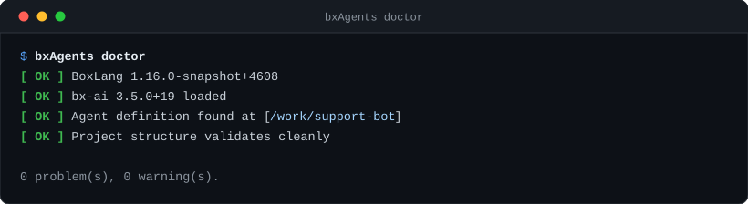

# CLI Reference

```
Usage: boxlang module:bxAgents <verb> [options]
```

(or the shorter `bxAgents <verb> [options]` form - see [Installation](getting-started/installation.md).)

## Global flags

These are handled before verb dispatch and never reach a verb.

| Flag | Effect |
|---|---|
| `-h`, `--help`, `help` | Print usage (every verb + description) and exit 0. Accepted in **any** position, so `bxAgents clean --help` prints usage rather than running `clean`. Also printed (exit 1) if no verb is given at all. |
| `-v`, `--version` | Print `bxAgents v{version}` and exit 0. Only meaningful as the very first token, so it never collides with `package --version=1.0.0`. |

## Every verb accepts

`--projectRoot=<path>` (or a bare positional path as the first non-flag argument) to target a project other than the current directory. Precedence: `--projectRoot` flag > first positional argument > current working directory.

## Argument syntax

Follows BoxLang's own documented CLI conventions:

| Form | Result |
|---|---|
| `--option` | `true` |
| `--option=value` / `--option="quoted value"` | `value` (surrounding quotes stripped) |
| `-o=value` | short form with a value |
| `-o` | short form, `true` |
| `-abc` | combined shorthand: `a`, `b`, `c` all `true` |
| `--!option` / `--no-option` | negation, `false` |
| anything else | a positional (the first becomes the project-root fallback) |

Repeated options: last one wins.

Note the first row: a bare `--option` is a **boolean**, not a way to pass the next token as its value. A flag that requires a value (`--model`, `--message`, `--password`, `--environment`, `--port`, ...) is therefore rejected with an error when written bare, rather than silently becoming `true`:

```
$ bxAgents new my-agent --model openai/gpt-5
Error: --model requires a value - write it as `--model=<value>`.
```

Always use the `--flag=value` form. The space-separated form is not supported.

## Tab completion

`completions/` holds ready-made completion scripts for bash, fish and PowerShell. See [Installation](getting-started/installation.md#tab-completion) for the one-line setup of each.

## Verbs

::: cards
::: card title="new" icon="phosphor-duotone:sparkle" href="#new"
Scaffold a new agent project.
:::
::: card title="add" icon="phosphor-duotone:plus-circle" href="#add"
Add a tool to an existing project.
:::
::: card title="build" icon="phosphor-duotone:hammer" href="#build"
Run the full build pipeline.
:::
::: card title="test" icon="phosphor-duotone:test-tube" href="#test"
Run your project's own tests/specs via TestBox.
:::
::: card title="serve" icon="phosphor-duotone:broadcast" href="#serve"
Launch a real boxlang-miniserver process.
:::
::: card title="chat" icon="phosphor-duotone:terminal-window" href="#chat"
Interactive REPL against the built agent.
:::
::: card title="invoke" icon="phosphor-duotone:paper-plane-tilt" href="#invoke"
One non-interactive turn - for scripting/CI.
:::
::: card title="package" icon="phosphor-duotone:package" href="#package"
Package a built project into a .bxa.
:::
::: card title="deploy" icon="phosphor-duotone:cloud-arrow-up" href="#deploy"
Ship to a real deployment target.
:::
::: card title="hash-password" icon="phosphor-duotone:key" href="#hash-password"
Hash a plaintext password for a webui users entry.
:::
::: card title="inspect" icon="phosphor-duotone:magnifying-glass" href="#inspect"
Report how the agent is composed, from its source.
:::
::: card title="clean" icon="phosphor-duotone:broom" href="#clean"
Remove a project's .build/ and dist/ output.
:::
::: card title="doctor" icon="phosphor-duotone:stethoscope" href="#doctor"
Diagnose the runtime and project before build/serve surprise you.
:::
:::

### `new`

Create a new agent project one of three mutually exclusive ways: scaffold it (answering questions at a terminal, or with flags), clone a GitHub repo, or install a ForgeBox package.

```bash
# At a terminal: answer questions (see the new wizard guide)
bxAgents new my-agent

# Scaffold from flags (default template: minimal)
bxAgents new my-agent --model=openai/gpt-5 [--template=minimal|webui-chat|slack-bot|telegram-bot|github-bot|mcp-server|scheduled|multi-agent] [--name=...] [--description=...] [--class] [--skipInstall]

# The same, adding what the wizard would have offered
bxAgents new my-agent --model=claude --with=time,search --search=brave --mcp=github --channels=web,telegram --guard=flag

# Clone an existing GitHub repo
bxAgents new my-agent --repo=owner/repo-name

# Install a ForgeBox package
bxAgents new my-agent --forgebox=some-package-slug
```

- With no `--model`, no `--repo` and no `--forgebox`, at a terminal, `new` runs the [wizard](guides/new-wizard.md). `--no-wizard` or `--yes` turns it off, `--wizard` turns it on even with a `--model`, and `--no-tui` asks the same questions as numbered lines. A `--model` on its own never starts it, since scripts have always had to pass one. The wizard's flags (`--with`, `--search`, `--files`, `--files-dir`, `--memory`, `--mcp`, `--channels`, `--web-auth`, `--guard`, `--deploy` and the deploy details) are listed in the [wizard guide](guides/new-wizard.md#without-the-wizard); a bad value names the flag and what it accepts. They need `Agent.yaml`, so they cannot be combined with `--class`.
- `--template`, `--repo`, and `--forgebox` name three different project SOURCES - exactly one applies. Combining any two of them is an error.
- **`--template` mode** (the default when no source flag is passed at all - `minimal`):
  - `--model` is **required** when no questions are asked - a `provider/model` slug (see [the model slug](conventions/agent-bx.md#the-model-slug)).
  - `--name` defaults to the target directory's own basename.
  - Refuses to run if the target already contains an `Agent.yaml` or an `Agent.bx`.
  - Creates [`Agent.yaml`](conventions/agent-yaml.md), `instructions.md`, every convention folder (empty), a root [`box.json`](conventions/box-json.md) (`testbox` as a development dependency, installed into `lib/testbox`), a ready-to-run [`tests/`](conventions/testing.md) folder (`tests/specs/AgentSpec.bx`), a `.env` declaring `BOXLANG_HOME=.build/runtime` (matching `serve`'s own scoped runtime home), a `.gitignore` (`.env`, `.build/`, `dist/`, `lib/`, `boxlang_modules/`, editor files), and the standard dotfiles `.editorconfig`, `.gitattributes`, `.bxlint.json`, `.markdownlint.json` and a `.boxlang.json` listing every bx-ai setting at its default (the BoxLang runtime reads it when run from the project root; edit the values there). Never overwrites a file that already exists. BoxLang and `boxlang-miniserver` load a `.env` from the project root themselves, so the file also works for your API keys; BxAgents never reads, copies or packages it.
  - `--class` (a bare boolean flag, like the others described above) writes the class-based [`Agent.bx`](conventions/agent-bx.md) instead of the default `Agent.yaml`, for agents whose definition needs code (hooks, dynamic instructions). It applies to the root and to any subagents a template scaffolds, and only to `--template` mode - not to `--repo`/`--forgebox`.
  - `--template` picks one of 8 built-in starters, each layering a bit of pre-wired content on top of the base skeleton above (see [Agent Templates](agent-templates.md) for every generated file in full, plus how `--repo`/`--forgebox` sources work and how to publish your own):
    - `minimal` - the bare skeleton, nothing extra.
    - `webui-chat` - adds a `gateways/webui.bx` exposing the [web chat UI](conventions/gateways/index.md) at `/chat`.
    - `slack-bot` - adds a `gateways/slack.bx` channel adapter, plus matching `SLACK_BOT_TOKEN`/`SLACK_APP_TOKEN` stub lines in `.env`.
    - `telegram-bot` - adds a `gateways/telegram.bx` channel adapter, plus a matching `TELEGRAM_BOT_TOKEN` stub line in `.env`.
    - `github-bot` - adds a `gateways/github.bx` channel adapter, plus matching `GITHUB_TOKEN`/`GITHUB_WEBHOOK_SECRET`/`GITHUB_BOT_NAME` stub lines in `.env`.
    - `mcp-server` - adds an example `mcp/exampleServer.bx` tool server and a `gateways/mcpExpose.bx` entry exposing it as an MCP server at `/mcp`.
    - `scheduled` - adds a real [`schedules/Scheduler.bx`](conventions/schedules.md) calling the agent on a daily timer.
    - `multi-agent` - adds a `subAgents` list to the root `Agent.yaml` declaring two [subagents](conventions/subagents.md) (`researcher`, `writer`), each scaffolded as its own real `subagents/<name>/Agent.yaml` + `instructions.md`.
  - Also runs `box install` in the new project root, so `bxAgents test` works immediately with no separate install step. This is best-effort: if `box` isn't on `PATH` or the install fails, `new` still succeeds - the message just tells you to run it yourself. Pass `--skipInstall` to opt out of this step entirely.
- **`--repo` mode** (`--repo=owner/repo-name` or a full URL): clones the repo via a bundled [JGit](https://www.eclipse.org/jgit/) dependency - no `git` binary needs to be installed. Always clones shallow (depth 1) and always strips the resulting `.git` folder afterward, so the new project starts with a clean history rather than staying tied to the template repo's own remote. Refuses to run into a directory that already exists and is non-empty, and fails clearly if no `Agent.yaml` or `Agent.bx` is found in the cloned repo.
- **`--forgebox` mode** (`--forgebox=<slug>`): installs a [ForgeBox](https://www.forgebox.io) package by talking to ForgeBox's own REST API directly (no `box` CLI required). Fails clearly if the slug doesn't exist, the download fails, or the installed package has no `Agent.yaml` or `Agent.bx` at its root (unwrapping one level of nesting first, since many ForgeBox archives wrap their contents in a single top-level folder).
- Only `--template` mode needs `--model`; `--repo`/`--forgebox` never require it, since the source project already defines its own.
- `--name`/`--description` are ignored (with a warning in the output) when `--repo`/`--forgebox` is used - the cloned/installed project defines its own.
- The `box install` convenience step (and `--skipInstall`) only ever apply to `--template` mode - a cloned/installed project's own `box.json` (if it has one at all) is left untouched.

### `add`

Add one thing to a project that already exists, asking the same questions `new` asks. Today that is a `tool`.

```bash
bxAgents add                        # pick what to add
bxAgents add tool                   # asks for the name, function, description and arguments
bxAgents add tool WeatherTools --function=getWeather --description="Get the weather for a city" --args="city, days:numeric"
bxAgents add tool Pinger --agent=researcher     # into subagents/researcher/tools/
bxAgents add tool Pinger --dry-run              # show the file, write nothing
```

- The positional arguments are the kind and the name, so the project is found by `--projectRoot=<path>` or the current folder only.
- At a terminal, whatever is not given as a flag is asked, in the full-screen UI (or numbered lines with `--no-tui`). With `--yes`, in a pipe or in CI nothing is asked: flags and defaults are used, and a required answer that is missing names the flag to pass.
- Questions end on a review of the files that will be written. Cancelling, with Esc or Ctrl+C, changes nothing.
- **Nothing is overwritten.** If a file already exists none are written and the error names it; `--force` replaces it.
- `--dry-run` prints each file with its text and writes nothing.

#### `add tool`

Creates `tools/<Name>.bx` with one `@AITool` function in the shape [bx-ai documents](conventions/tools.md): a docblock describing each argument, the annotation carrying the description the model reads, and typed `required` arguments from which bx-ai builds the tool's schema.

| Flag | Meaning |
|---|---|
| `--name=<Name>` | The file name, or the second positional. Letters, digits and underscores, starting with a letter. |
| `--agent=<subagent>` | Whose tool it is. Asked only when the project has subagents; `.` (the default) is the root agent. |
| `--function=<name>` | The function the model calls. Defaults to the file name with a lower-case first letter. |
| `--description=<text>` | What the tool does. The model reads it to decide when to call the tool. Without it, and with nothing to ask, the file gets a `TODO` description and the output reminds you to replace it. |
| `--args=<list>` | Comma separated, each `name` or `name:type` (`string` by default; `numeric`, `boolean`, `array`, `struct`, `date` and `any` also work). |

A tool belongs to the agent whose folder it is in and is attached to that agent automatically. Two tool files of one agent may not share a name, even in different subfolders, so a clash is refused here instead of at the next `build`. Check the result with `bxAgents inspect --section=tools`.

### `build`

Run the full [build pipeline](build-pipeline.md).

```bash
bxAgents build [--environment=production] [--verbose] [--generatorVersion=1.0.0]
```

Writes `.build/app/` and `.build/manifest.json`. Fails with every collected validation error if the project is invalid.

- `--verbose` prints one line per build phase live as it runs - what got resolved/discovered/validated, per-phase counts (models, tools, gateways, warnings, etc.), which agents ended up registered in `config/WireBox.bx` and under which names, whether a `schedules/Scheduler.bx` was found, and a final `Build completed in Xms` timing line. Useful for debugging a slow or unexpectedly-behaving build. Silent otherwise - `--verbose` costs nothing when not passed.
- `--generatorVersion` overrides the string stamped into `manifest.json`'s `generator.version` (see [The Manifest](manifest.md)) - defaults to `"dev"` when omitted. Exists for tooling that builds against a specific released version of this module and wants that recorded in the manifest, rather than the local dev default.

### `test`

Run your project's own [`tests/specs`](conventions/testing.md) via TestBox.

```bash
bxAgents test
```

- Requires TestBox installed in `lib/testbox` (`box install` in the project root; `tests/testbox` is also found).
- Builds your agent against the `mock` provider by default (the `test` environment override in `Agent.yaml`, or `test()` in a class-based `Agent.bx`) - no API key or network access needed.
- Prints pass/fail/error/skipped counts plus one line per failure, and exits non-zero if anything failed.

### `serve`

Launch a real [`boxlang-miniserver`](https://boxlang.ortusbooks.com/getting-started/running-boxlang/miniserver) process pointed at `.build/app`.

```bash
bxAgents serve [--port=8080] [--host=127.0.0.1]
```

- Requires a prior `build` - fails clearly if `.build/app` doesn't exist.
- Fails clearly if `boxlang-miniserver` isn't found on `PATH`.
- Always serves the agent at `/__bxagents` (`POST /invoke`, `POST /stream`, `POST /batch`, `GET /info`), whatever the project declares in [`gateways/`](conventions/gateways/index.md) - see [the always-on agent route](conventions/agent-bx.md#the-always-on-agent-route) for how to require a token on it, or turn it off.
- **Binds to `127.0.0.1` by default.** A generated app is not authenticated unless you configured it to be (the web UI's API-key gate and sign-in are both opt-in), so the default keeps a development server off the network. Pass `--host=0.0.0.0` to bind all interfaces deliberately - the startup line tells you which of the two you got.
- `--port` must be an integer in 1-65535; anything else fails immediately rather than inside the server process.
- Writes `.build/miniserver.json` (rewrites enabled, `rewriteFileName: "index.bxm"`, health check on) before launching, and `.build/runtime/config/boxlang.json`, which turns off whitespace compression (it would collapse the blank lines that end each SSE frame) and points the app at the installed BxAgents module and the modules bundled inside it.
- Scopes the server's own BoxLang runtime home to `.build/runtime` (via `serverHome`) rather than the shared `~/.boxlang` default, so each project's compiled-class cache and config overrides are isolated - and `clean` sweeps it for free, since it already wipes `.build` wholesale. `invoke --server` gets this too, since it reuses `serve` internally. This does **not** extend to `chat`/`build`/`test`/default `invoke`.

### `chat`

A chat with the built agent, in a terminal screen that keeps your scrollback: finished turns are printed as ordinary terminal text (select, search and scroll them as usual) and only the message box and the answer being written are redrawn. `--no-tui` (and any terminal that is not interactive) uses a plain line-by-line REPL instead, built on BoxLang's own `MiniConsole`.

```bash
bxAgents chat                                  # fast, in-process
bxAgents chat --no-tui                         # plain line-by-line REPL
bxAgents chat --server [--port=<port>]         # full app, own throwaway server
bxAgents chat --connect=http://127.0.0.1:8080  # full app, server you already run
```

In the screen:

| Key | Does |
|---|---|
| Enter | Send the message |
| Alt+Enter, Ctrl+J, or `\` then Enter | New line in the message |
| Up / Down | Earlier messages (from the first or last line of the box) |
| Esc | Stop the agent. It stops at its next step, not mid-word |
| Enter while the agent works | Steer it: your message is added to the run (in-process only) |
| Ctrl+C | Clear the box; on an empty box, leave. Ctrl+D leaves too |

Type `/` for the commands: `/help`, `/new` (a fresh conversation), `/tools`, `/copy` (the last answer to the clipboard, using the OSC 52 escape most terminals honor), `/save [file]` (the conversation as Markdown), `/record [file]` and `/record stop` (see below) and `/exit`.

#### Recording a chat

`--record` saves what the screen shows as an [asciicast](https://docs.asciinema.org/manual/asciicast/v2/) `.cast` file, for demos and bug reports. `--record` alone writes `chat-YYYYMMDD-HHMMSS.cast` in the current folder, and `--record=demo.cast` names the file. Inside the chat, `/record` starts a recording (`/record demo.cast` names it) and `/record stop` finishes it. A red `● rec` shows on the hint line while it is on, and the file is finished when you leave.

```bash
bxAgents chat --record=demo.cast
asciinema play demo.cast             # replay it in a terminal
agg demo.cast demo.gif               # turn it into a GIF (agg is a separate tool)
```

The file holds the screen's output, so it shows what you typed in the message box and everything the agent printed, including tool arguments. Keystrokes themselves are not recorded. A recording started with `/record` begins at that moment, so earlier lines are not in it. It needs the terminal screen: `--no-tui` and non-interactive runs record nothing.


The answer is shown as it streams and printed as formatted Markdown (headings, lists, code blocks) when it is complete. In the default mode each tool call is shown with its arguments and how long it took, and the model's thinking is shown while it works but never kept. A run that stops for [human approval](conventions/gateways/index.md) asks you in place: approve once, approve for the conversation, or reject. Over HTTP the stream carries only the text, so there are no tool lines, no thinking and no steering, and an approval is answered at the server.

Three modes, one chat:

| Mode | What it talks to | Use it when |
|---|---|---|
| default | The generated agent factory, loaded directly in this process | You just want to talk to the agent. Fastest, no server. |
| `--server` | A throwaway `boxlang-miniserver` it boots and tears down | You need real application semantics - `models/`, interceptors, the scheduler, gateways. |
| `--connect=<url>` | A server that is already running | You have a `serve` open in another terminal, or want to talk to a deployment. |

- Requires a prior `build` - except with `--connect`, which talks to a server someone else is running and so needs nothing built locally.
- **Default**: loads `GeneratedAgentFactory.bx` directly (no ColdBox/WireBox container involved) and calls `buildAgent()` once per session - the exact same factory `serve`'s HTTP routes use, so the agent itself never diverges. What *does* differ is everything ColdBox brings: no `models/`, no scheduler, no interceptors, no gateway registry. When that matters, use `--server`.
- **`--server`**: boots a real miniserver (needs `boxlang-miniserver` on `PATH`, like `serve`) on an ephemeral loopback port and drives the REPL over HTTP against the project's [always-on `/__bxagents` route](conventions/agent-bx.md#the-always-on-agent-route), shutting it down on exit. `--port` pins the port instead of taking a free one.
- **`--connect`**: drives the same REPL against a running server, starting and stopping nothing. The URL is the server root (`http://host:port`), not the agent path - `chat` appends that itself.
- `--server` and `--connect` are mutually exclusive: one says "start a server for me", the other "don't". Passing both fails immediately rather than silently honoring one.
- Both HTTP modes **stream** the reply: the answer appears token by token as the agent produces it, over the route's `/stream` (SSE) sub-route, rather than arriving all at once when the turn ends. If the stream cannot be opened (an older server without a `/stream` sub-route, or a proxy that won't pass `text/event-stream`) it falls back to `/invoke` and you get the whole reply at the end instead of an error.
- Both HTTP modes carry the server's `threadId` across turns, so a session is one conversation rather than a series of unrelated first messages.
- A turn that pauses for a [human-in-the-loop](conventions/gateways/index.md) decision says so instead of appearing to answer with silence, and points at the `/gateways/interactions/` endpoint where the decision is submitted.
- If the route is gated behind [`agentApi.tokenEnvVar`](conventions/agent-bx.md#agentapi), these modes get a clear `401` error rather than a confusing timeout - they send no token.
- Type `/exit` to leave (`exit` and `quit` work in the plain REPL).
- Needs a real interactive terminal. Piped or non-interactive, it falls back to the plain REPL, which needs one too (`MiniConsole` shells out to `stty` for raw mode). Use [`invoke`](#invoke) for scripting.

### `invoke`

A single, non-interactive turn against the built agent: submit one message, print the response, exit. Exists for scripting/CI, where `chat`'s TTY requirement is a hard blocker.

```bash
bxAgents invoke --message="What's the weather in Boston?" [--json]
bxAgents invoke --message="..." --server [--port=<port>]
```

- Requires a prior `build`.
- **Default (no `--server`)**: loads `GeneratedAgentFactory.bx` directly (no ColdBox container, no HTTP) and calls the agent once - the same in-process path `chat` uses internally, just without the REPL loop. No `serve`/gateway prerequisite at all.
- **`--server`**: launches a real, throwaway `boxlang-miniserver` process (same as `serve`, so it needs the binary on `PATH`), sends the message as a real HTTP request to the project's [always-on `/__bxagents` route](conventions/agent-bx.md#the-always-on-agent-route), then shuts the server back down. Exercises the actual served path (ColdBox routing, interceptors, gateways) rather than the in-process shortcut. Needs no `gateways/*` entry of any kind - the reserved route is emitted on every build, so a freshly scaffolded project that exposes nothing publicly still works. `--port` defaults to a free ephemeral port so it never collides with an already-running `serve`.
- `--json` prints `{"response": "..."}` instead of the plain-text response.

### `package`

Package a built project into a `.bxa`.

```bash
bxAgents package [--version=1.0.0]
```

- Requires a prior `build` - reads `.build/manifest.json`; fails clearly if it's missing.
- `--version` defaults to `1.0.0`.
- Writes `dist/{agentName}-{version}.bxa`, a sibling `.sha256`, and a redacted `manifest.json` copy. See [Deployment & Secrets](deployment-and-secrets.md).

### `deploy`

Ship a built/packaged project to a real deployment target via the pluggable [`deploy/`](conventions/deploy.md) convention.

```bash
bxAgents deploy --name=production
# or, the flag-only shorthand (local only):
bxAgents deploy --destination=/path/to/somewhere [--target=local]
```

- `--name=<entry>` dispatches to whatever target the named `deploy/<entry>.bx`/`.json` entry declares (`local`, `ssh`, `ftp`, `sftp`, `docker`, or `digitalocean`).
- The flag-only form (`--target=local --destination=...`, or no `--target` at all) works with no `deploy/` folder present - only `local` supports it; every other target requires a named entry, since it needs more configuration than a couple of flags can carry.
- `local`/`ssh`/`ftp`/`sftp` require a prior `package`; `docker`/`digitalocean` require a prior `build` (they build straight from `.build/app`).
- `ftp`/`sftp` use the [`bx-ftp`](https://github.com/ortus-boxlang/bx-ftp) module, which BxAgents bundles.

### `hash-password`

Turn a plaintext password into the `passwordHash` value a `webui` entry's [`users`](conventions/web-ui.md) block accepts.

```bash
bxAgents hash-password --password="<your-password>"
```

- `--password` is **required**.
- Prints the hash to stdout - `pbkdf2$<iterations>$<salt>$<derivedKey>`, PBKDF2-HMAC-SHA256, salted per call. Safe to commit: it's one-way, and hashing the same password twice yields two different (both valid) hashes.
- Kept deliberately identical to the hasher the generated web UI itself uses to verify a sign-in - a hash produced here always verifies there.

### `inspect`

A report of how the agent is composed: the agents and subagents with their models, tools, skills and MCP servers, what the project is exposed through, its schedule, and the environment variables it needs. It reads your project's **source**, the same discovery, resolve and validate phases `build` and `doctor` run, so it works before you have ever run `build` and it generates nothing.

```bash
bxAgents inspect                        # the report
bxAgents inspect --section=tools,env    # only some sections
bxAgents inspect --json                 # the whole report as JSON, for scripts
bxAgents inspect --md                   # Markdown, to paste into a pull request
bxAgents inspect --md=AGENT.md          # write the Markdown to a file in the project
bxAgents inspect --environment=production
```

```
● advanced-agent   Agent.bx · development
  /home/me/advanced-agent

  3 agents · 3 tools · 1 skill · 2 gateways

── Agents ──────────────────────────────────────────────────────────────────────
● advanced-agent  fast → mock/mock-model
  instructions: instructions.md · 2 tools · 1 skill · 2 subagents
├─● ResearchBot  mock/mock-model
│   instructions: instructions.md · 1 tool
└─● WriterBot  mock/mock-model
    instructions: instructions.md

── Tools ───────────────────────────────────────────────────────────────────────
  advanced-agent
    getStockQuote    Get the latest stock quote for a ticker …  tools/Finance.bx
    convertCurrency  Convert an amount from one currency to a…  tools/Finance.bx
```

The report has these sections, in this order. `--section` takes any of the names in the first column, comma separated.

| Section | Shows |
|---|---|
| `agents` | The root agent and its subagents as a tree: model (and what a [`models/`](conventions/models.md) name resolves to), where the instructions come from, and a count of tools, skills, MCP servers, plus memory and the prompt-injection guard when set. |
| `tools` | Per agent: each `@AITool` function in `tools/` with its description and file, then the module tools it lists (`now@bxai`) and which modules have `toolOptions`. |
| `skills` | The skills each agent has. |
| `mcp` | The MCP servers each agent uses (URLs are shown without a user name or query string, and with the environment variables they need) and the MCP servers the project hosts. |
| `gateways` | Every `gateways/` entry: its kind (`agent`, `mcp`, `webui` with its auth mode, or a chat platform) and path. |
| `schedule` | `schedules/Scheduler.bx` and the names of its `task()` calls. |
| `models` | The named [`models/`](conventions/models.md) entries and what they point at. |
| `interceptors`, `modules`, `deploy` | Interceptors with their scope, declared modules, and `deploy/` entries with their target. |
| `env` | Every environment variable the project reads: gateway credentials, MCP tokens, each model provider's API key, `agentApi.tokenEnvVar`. |
| `checks` | What `build` would reject. Errors and warnings are listed here; `inspect` still exits `0`, use [`doctor`](#doctor) for a pass or fail. |
| `build` | Whether `.build/manifest.json` exists, and its manifest version, generator and file count. |

- A section with nothing in it is left out. Name it with `--section` and it says `none`.
- **Environment variables are shown by name, never by value.** `▲` means the variable is not set right now, `✔` that it is; the text after it says where it is used. This is the same check `doctor` makes of gateway variables, widened to the whole project.
- A class-based `Agent.bx` whose model or instructions are set in code is shown as `model set in code` or `instructions in code`; `inspect` reads what is declared, it does not run the agent.
- Color is used only at an interactive terminal. `NO_COLOR`, `TERM=dumb` and `--no-color` turn it off, a pipe or a file gets plain text, and `TERM=dumb` or `--ascii` also swaps the box-drawing characters for plain ones. Lines are fitted to `COLUMNS` (80 when it is not exported).
- `--json` is the report itself, not the manifest. The manifest is a plain file at `.build/manifest.json`, described in [The Manifest](manifest.md).
- `--md=FILE` is the only thing `inspect` ever writes. A relative file is created inside the project.
- A folder with no `Agent.yaml` or `Agent.bx` is an error.

### `clean`

Remove a project's `.build/` and `dist/` output.

```bash
bxAgents clean [--force]
```

- Only ever removes `.build` and `dist` - source conventions (`Agent.yaml`, `tools/`, etc.) are never touched.
- **Refuses to run unless the directory looks like a BxAgents project** (an `Agent.yaml`, an `Agent.bx` or a `.build/manifest.json`). `dist/` is a common build-output name across the wider ecosystem, so this stops a `clean` in the wrong directory from deleting something unrelated. `--force` skips the check when you genuinely mean it.
- Prints the absolute path of each directory before removing it.
- Reports "Nothing to clean" if neither directory exists.

### `doctor`



Diagnose the runtime and your project - read-only, never builds or writes anything.

```bash
bxAgents doctor [--json]
```

- Reports the running BoxLang version, and warns if it is older than this module's own declared minimum.
- Confirms `bx-ai` is loaded (always required).
- Runs the exact same discovery/resolve/validate phases `build` runs, without generating anything - every validation error/warning `build` would hit shows up here first.
- Checks every `*EnvVar`-suffixed config value across `gateways/*` (bot tokens, webhook secrets, IMAP credentials, web UI account passwords, API keys) against the real environment right now, and warns about any that aren't set. Nothing else checks this - `build` only checks that an env var name was *declared*, never that it's actually populated, so a missing one otherwise fails silently at runtime (a gateway that never sends, a web UI account that can't sign in).
- Does not check for `qb`, `cbsecurity`, `cbauth` or `cbmailservices`: they ship inside BxAgents and are copied into every built app.
- `--json` prints the raw findings as a JSON array (`[{ status, message }, ...]`) instead of the human-readable report - useful for scripting.
- Exits `1` if any check failed, `0` otherwise - warnings alone don't fail it.
