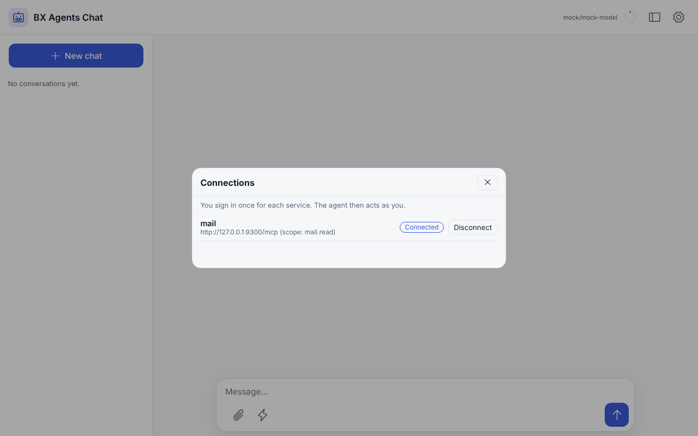
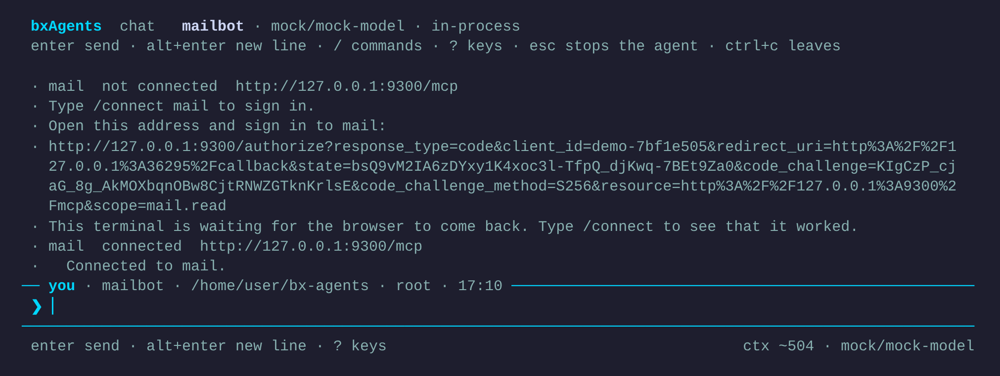

# Connect: services that ask each person to sign in

Some [MCP servers](mcp.md) do not take a fixed key. Mail, calendars and ticket systems ask **each person** to sign in with OAuth, and then accept a token that expires and is renewed. Add `oauth` to the server's entry in `Agent.yaml` and BX Agents does the rest: the person signs in once, their tokens are **sealed in the chat database** with the [vault](vault.md) key, and the agent uses **their** tokens when it acts for them. The model never sees a token.

```yaml
# Agent.yaml
mcpServers:
  - name: mail
    url: https://mail.example.com/mcp
    oauth:
      scopes: [ mail.read ]
```

`oauth: true` is enough for a server that tells us what we need. The entry needs a `name`, because people type it.

<video controls preload="metadata" poster="/assets/video/connect-poster.png" style="max-width:100%">
  <source src="/assets/video/connect.mp4" type="video/mp4">
  <source src="/assets/video/connect.webm" type="video/webm">
  <track kind="captions" src="/assets/video/connect.vtt" srclang="en" label="English" default>
</video>

The sign in above is real, against a small fake mail service ([`tools/demo/fake-oauth-mcp.bxs`](https://github.com/ortus-boxlang/bx-agents/tree/development/tools/demo)); the agent's first answer is scripted.



## What you write

| Key under `oauth` | Meaning |
|---|---|
| `scopes` | A list of scopes to ask for. Left out: what the server asks for, else everything it supports |
| `clientId`, `clientSecret` | A client you registered with the provider yourself. Left out: the client registers itself. `clientSecret` must be an `${env.NAME}` or `${vault.NAME}` placeholder: a secret written in the file is a build error |
| `clientMetadataUrl` | The `https` address of your Client ID Metadata Document, for providers that support them |
| `clientName` | The name shown on the sign in page when the client registers itself |
| `redirectUri` | Where the provider sends the person back. Left out: your public address, the [API path](../guides/agent-api.md) and `/connect/callback` |

A server with `oauth` cannot also have `token`, `user` or `password`. Everything is checked when the project is built.

## Signing in

Each way asks the same questions of the same place, so they never disagree about who is connected.

| Where | How |
|---|---|
| Web page | **Connections** in the settings menu: a row per service with *Connect* or *Disconnect*. The sign in opens in a new tab; the page notices when it worked |
| Terminal chat | `/connect` lists the services, `/connect mail` prints an address and waits for the browser in the background, `/connect mail remove` forgets it |
| Command line | `bxAgents connect` lists, `bxAgents connect mail` signs in, `bxAgents connect mail --remove` forgets. See [`connect`](../cli-reference.md#connect) |
| Chat platforms | `/connect mail` sends an address that works once, for ten minutes. Open it in a browser and sign in |
| HTTP | `GET /connect`, `POST /connect`, `POST /connect/remove` on the [agent API](../guides/agent-api.md) |



When a person has not signed in to a service, the agent is told which one and how to connect, in one short line, so it can say so instead of "I cannot read your mail". The tools of a service appear in the same running agent once somebody has signed in; there is no restart.

## Where the browser comes back to

After the person signs in, the provider sends their browser to an address you register with it.

- **A served agent** receives it at `<your public address><API path>/connect/callback`, for example `https://agent.example.com/__bxagents/connect/callback`. Set `BXAGENTS_PUBLIC_URL` to the address people reach the server at, and register that callback with the provider.
- **The terminal** has no public address. `bxAgents connect` and `/connect` open a small listener on `127.0.0.1`, on a free port, for a few minutes, catch the one redirect and close it. Providers that follow RFC 8252 accept any port on the loopback address. For one that does not, give the port you registered: `bxAgents connect mail --port=8765`.

The callback is the one public route of the connect routes. It is safe because it carries no person: the **single use `state`** that the sign in started with says who it was for, and it is used once and expires after ten minutes. Nothing in the address names anyone.

## Whose tokens

A turn runs as the person who asked, so the agent uses that person's tokens. A person never uses another's. A run with nobody behind it, such as a [schedule](schedules.md), finds no tokens and gets no tools from that service.

The list of a service's tools is the same for everyone, so when the app starts it is asked for as **the person who signed in last**. If nobody has, the agent starts without those tools and gets them when the first person signs in.

!!! note
    Signing in on the web page does not sign the same human in on a chat platform: each place knows the person by its own id (`local`, a Slack user id), so each is its own sign in. Say so to the people who use both.

## Where the tokens are

Tokens, the client registration and a sign in waiting for its callback are rows of the `oauth_records` table, each **sealed with the vault key** (AES-256-GCM) and bound to its row, so a value copied onto another row does not open. The key is the vault's: `BXAGENTS_VAULT_KEY`, or the key file beside the database. Losing the key means everyone signs in again, and a changed key is reported by name. `bxAgents vault status` says where it comes from.

bx-ai's own token stores keep tokens as plain text; this is why BX Agents brings its own.

## Limits

- OAuth is for web servers (HTTP). A server that runs as a program takes its credentials from its environment.
- A link sent in a group chat can be used by anyone in it: ask people to use `/connect` in a private chat with the bot.
- The sign in follows the [MCP authorization specification](https://modelcontextprotocol.io/specification/latest/basic/authorization): PKCE (S256) is required, and a provider that does not offer it is refused.
