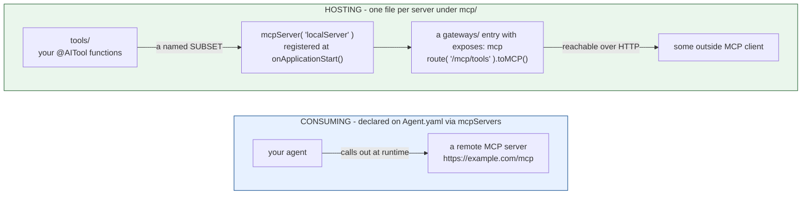

# mcp/

MCP (Model Context Protocol) works two directions - consuming remote servers, and hosting your own.



Nothing links the two: an agent consuming remote servers need not host one, and a hosted server is reachable only if a `gateways/` entry exposes it.

!!! tip
    `bxAgents add mcp client github` adds a server to `Agent.yaml` with its credential as an environment placeholder, and `bxAgents add mcp server` writes the `mcp/` file and the `gateways/` entry that serves it. See [`add`](../cli-reference.md#add-mcp).

## Consuming remote servers

Declared directly on `Agent.yaml` (not a file under `mcp/`), via `mcpServers`:

```yaml
# Agent.yaml
name: my-agent
model: openai/gpt-5
mcpServers:
  - https://example.com/mcp
  - url: https://other.com/mcp
    name: other
```

Each entry is either a bare URL string or a mapping. A mapping can carry the credentials the server wants:

```yaml
mcpServers:
  - name: github
    url: https://api.githubcopilot.com/mcp/
    token: ${env.GITHUB_PERSONAL_ACCESS_TOKEN}
  - url: https://other.com/mcp
    headers:
      X-Api-Key: ${env.OTHER_API_KEY}
    timeout: 20000
```

| Key | Meaning |
|---|---|
| `url` | Required. The server's address |
| `name` | A label for the file. It is not sent to the server |
| `token` | A bearer token. Must be an `${env.NAME}` placeholder: a token written in the file is a build error |
| `password`, `user` | Basic authentication. `password` must be an `${env.NAME}` placeholder |
| `headers` | Extra request headers. Values can use `${env.NAME}` |
| `timeout` | Milliseconds |

Placeholders are replaced with the environment variable **when the app starts**, never at build time, so a secret stays out of the project and out of a packaged `.bxa`. A variable that is not set fails the agent at startup and names it; one that is set but empty lets the agent start, the server refuses the connection, and bx-ai logs that and carries on without that server's tools. Any other key is a build error that lists the valid ones.

The entries are passed into the generated `aiAgent(mcpServers: [...])` call. **No network connection is ever attempted at build time** - reachability is a runtime concern; an unreachable server at build time is not a build error. This is for servers reached over the web. Servers that run as a local program are not supported by the bx-ai bundled with this release.

[`bxAgents new`](../guides/new-wizard.md#mcp-servers) offers GitHub, Stripe, Notion, Atlassian, Cloudflare and Supabase and writes the entry and the `.env` stub for you.

Subagents can declare their own `mcpServers` independently - each node in the agent tree gets its own resolved list.

## Hosting a local server

Each `mcp/*.bx` file is a local MCP server your project hosts, exposing a subset of your `tools/` as MCP tools:

```javascript
// mcp/localServer.bx
class {

	function configure() {
		return {
			description : "Internal tools MCP server",
			version     : "1.0.0",
			cors        : "*",             // optional - CORS origin(s) allowed to call this server; omit for none
			tools       : [ "sayHello" ]   // names of tools already declared under tools/
		};
	}

}
```

The entry's discovered name is its **filename** (`localServer.bx` → `localServer`), not any `name` field inside its own `configure()` struct - a project may still set one for documentation, but it's ignored for naming/registration purposes.

`cors` is optional and defaults to an empty string (no CORS header) when omitted - passed straight through as `mcpServer()`'s 4th positional argument.

At build time, the file is copied verbatim into the generated app's `mcp/` folder, and a registration statement is emitted into `Application.bx`'s `onApplicationStart()`:

```javascript
mcpServer( "localServer", "Internal tools MCP server", "1.0.0", "*" )
	.registerTool( aiToolRegistry().get( "sayHello" ) )
```

`mcpServer(name, ...)` is a global, name-keyed singleton getter in bx-ai - registering it once at startup is all that's needed; there's no WireBox mapping involved (unlike the agent-exposure singleton used by `toAi()`).

## Exposing a local server over HTTP

A local `mcp/*` server isn't reachable over HTTP on its own - pair it with a [`gateways/`](gateways/index.md) exposure entry naming it as the `target`:

```javascript
// gateways/expose-mcp.bx
class {
	function configure() {
		return {
			exposes : "mcp",
			path    : "/mcp/tools",
			target  : "localServer"
		};
	}
}
```

## Validation

- A remote `mcpServers` entry (struct form) missing `url` fails validation.
- A remote `mcpServers` entry that's neither a non-empty string nor a `{url, ...}` struct fails validation.
- A `gateways/` entry with `exposes: "mcp"` and a `target` that doesn't match any discovered `mcp/*` entry fails validation.