# The web chat UI

A `gateways/*.bx` entry with `exposes: "webui"` ships a complete browser chat client for the agent - a conversation sidebar, streaming with reasoning and tool calls, human-in-the-loop approvals, per-visitor theming, and a real SQLite store behind it.

It lives under [gateways/](gateways/index.md) because that is where exposures are declared, but it is a subsystem in its own right, which is why it has its own page.

```javascript
// gateways/chat.bx
class {
	function configure() {
		return {
			exposes     : "webui",
			path        : "/chat",
			apiKeyEnvVar: "CHAT_UI_API_KEY"   // optional - the agent API's shared secret, see Securing the API
		};
	}
}
```

That generates a static `<path>/index.html` (served directly - no route needed). The page is a client of the [agent API](agent-bx.md#the-always-on-agent-route) at `/__bxagents`, the same one the terminal chat and the gateways use, so there is no second API under `<path>`. The agent API must stay enabled (`agentApi.enabled: false` with a `webui` entry is a build error).

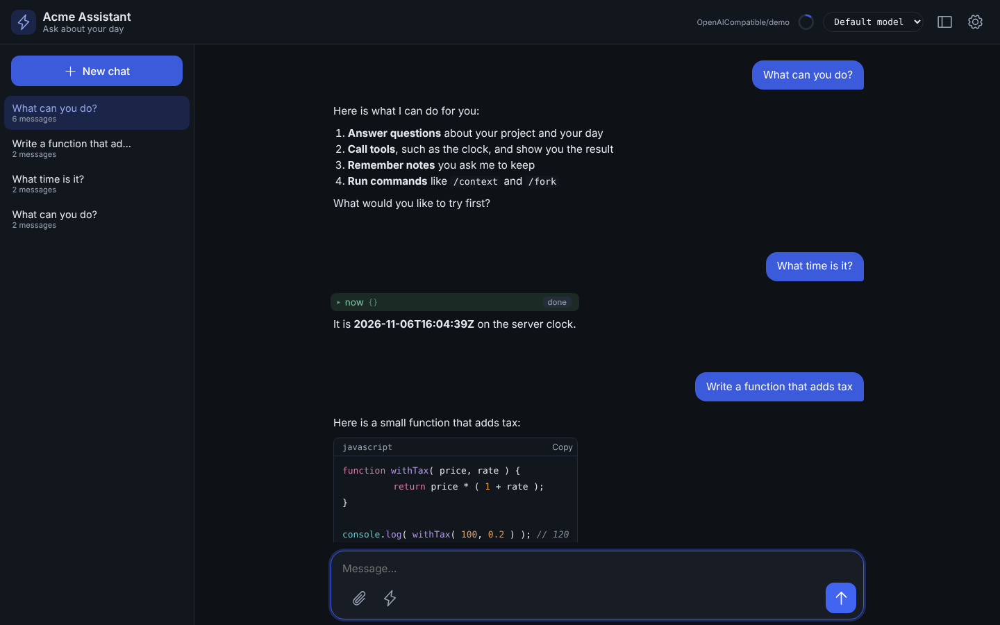

The screenshot above is the actual generated page - the real, unmodified template this repo ships - branded with [`examples/webui-agent`](https://github.com/ortus-boxlang/bx-agents/tree/development/examples/webui-agent)'s own `theme`/`title`/`icon` config and populated with example conversation content for illustration; `bxAgents build && bxAgents serve` in that example reproduces it.

The UI is dependency-free vanilla HTML/CSS/JS - no Bootstrap, AlpineJS or Vite build step - and is **pre-built and vendored inside BxAgents itself**: `bxAgents build` never runs `npm install`/`npm run build`, and a generated project never needs Node or npm installed at all. Everything the page needs is inlined into the single generated `index.html`.

That constraint is about the build, not about scope. The page is a full client: conversation sidebar, streaming with reasoning and tool calls, approvals, compaction, server-side theming. What is genuinely still missing is listed under [What is not here yet](#what-is-not-here-yet).

The page talks to the agent API at `/__bxagents` via `POST /__bxagents/stream` (`Accept: text/event-stream`), using `fetch()` + a manual `ReadableStream` reader - not the browser's `EventSource`, which can't `POST` or set custom headers, both needed here.

!!! warning
    **`toAi()` forwards each bx-ai chunk verbatim - it does not wrap it.** ColdBox's [AI Routing docs](https://coldbox.ortusbooks.com/the-basics/routing/routing-dsl/ai-routing) show the stream as `data: {"token":"..."}` lines, but its own source (`Router.cfc`, `toAi()`'s stream sub-route) does `emitter.send( chunk, "chunk" )` - so every frame carries the **full normalized bx-ai envelope**:

    ```
    event: chunk
    data: {"object":"chat.completion.chunk","choices":[{"delta":{"role":"assistant","content":"Ray","reasoning":"...","tool_calls":[...]}}]}

    event: done
    data: [DONE]
    ```

    There is no `token` key anywhere. A client written against that docs page - including this UI's own first version - reads `undefined` and renders nothing at all. Read `choices[0].delta.content` instead.

Because the whole envelope arrives, **reasoning and tool calls are already on the wire** with no extra endpoint needed: `delta.reasoning` (normalized across every provider by bx-ai) renders as a collapsed "Thinking" strip, and `delta.tool_calls` as collapsed per-call chips. Tool-call arguments stream as partial JSON fragments keyed by `index`, so the page accumulates per index rather than assuming any single chunk holds a complete call.

## Walkthrough

<video controls preload="metadata" poster="/assets/video/webui-walkthrough-poster.png" style="max-width:100%">
  <source src="/assets/video/webui-walkthrough.mp4" type="video/mp4">
  <track kind="captions" src="/assets/video/webui-walkthrough.vtt" srclang="en" label="English" default>
</video>

A minute and a half through the whole page: sign in, streaming, the model picker, a tool call, the context ring and its breakdown, the `/` command menu, saved conversations, notes and the dark theme. The music and the mix were made with [bx-audio](https://github.com/ortus-boxlang/bx-audio) and the voice with [Kokoro](https://github.com/thewh1teagle/kokoro-onnx) (an Apache 2.0 model), and the page is the demo app in [`tools/demo/webui`](https://github.com/ortus-boxlang/bx-agents/tree/development/tools/demo/webui), which `capture.js` there drives with Playwright. It talks to a scripted model, so every answer is the same each time.

| | |
|---|---|
|  **Sign in.** Accounts come from [`users`](#users-and-sign-in). | 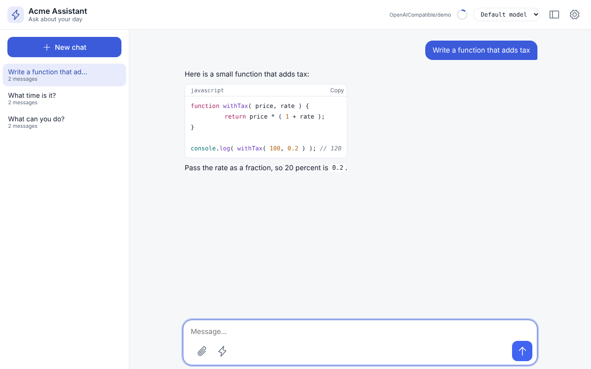 **The header.** Icon buttons with tooltips. The picker shows when the entry lists [`profiles`](#choosing-the-model). |
| 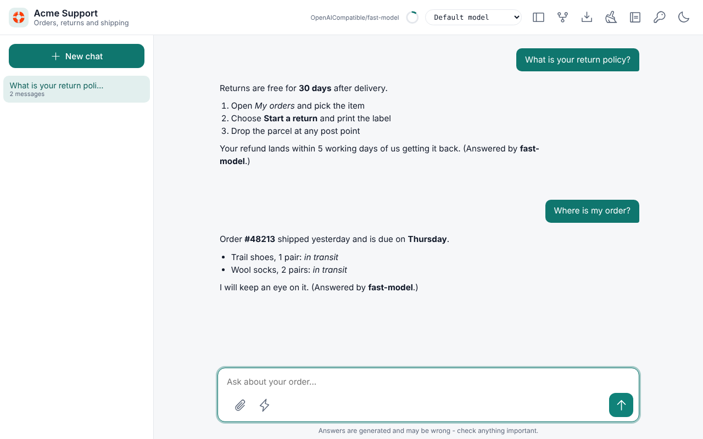 **Streaming.** Replies render Markdown as they arrive. | 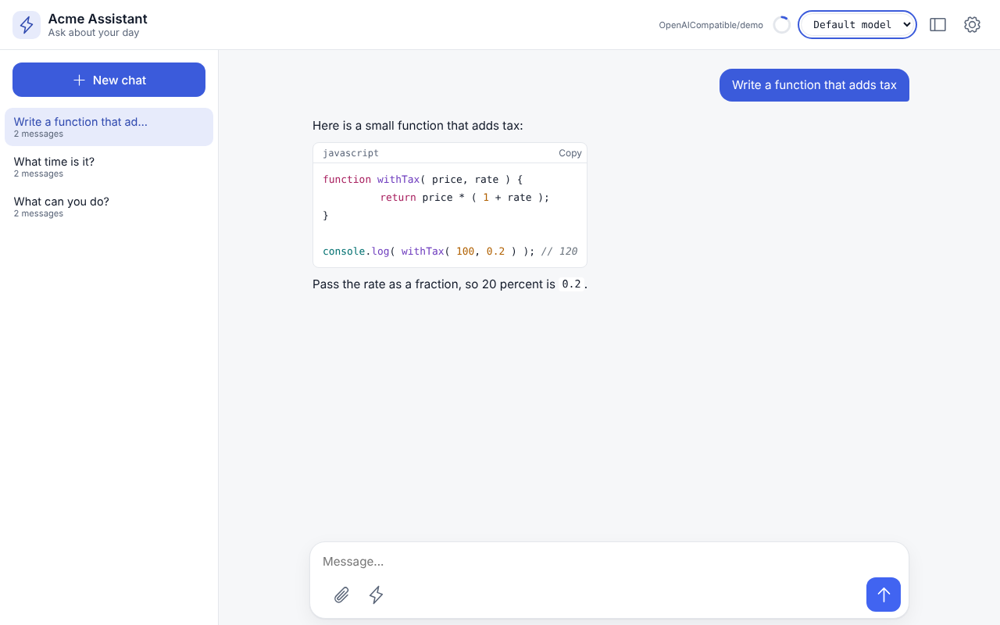 **Model picker.** The pick is sent with each message, in the same conversation. |
| 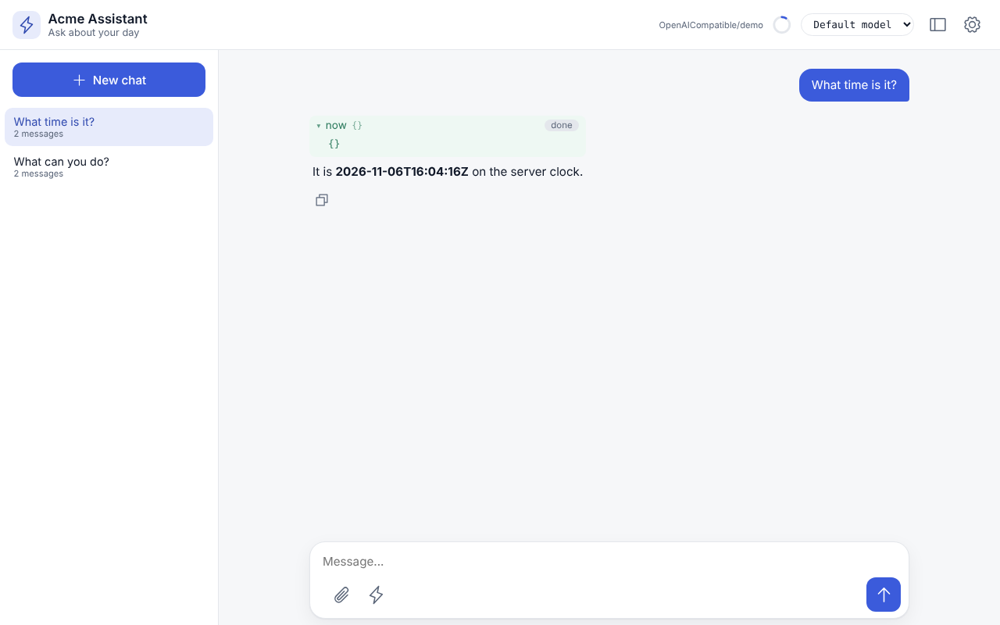 **Tools.** Each call shows its name and arguments. |  **Conversations.** Saved per account, and still there after a reload. |
| 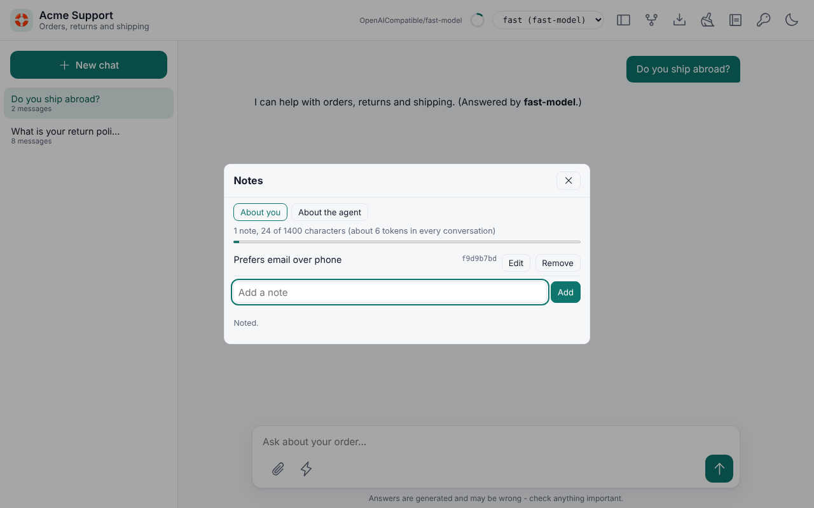 **Notes.** What the agent should remember, with the size it adds. | 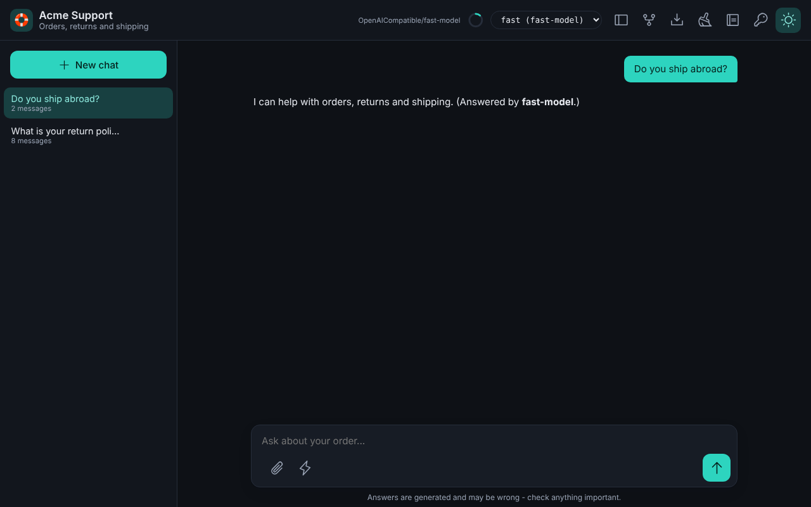 **Theme.** Light or dark, remembered, with your `theme` accent. |
| 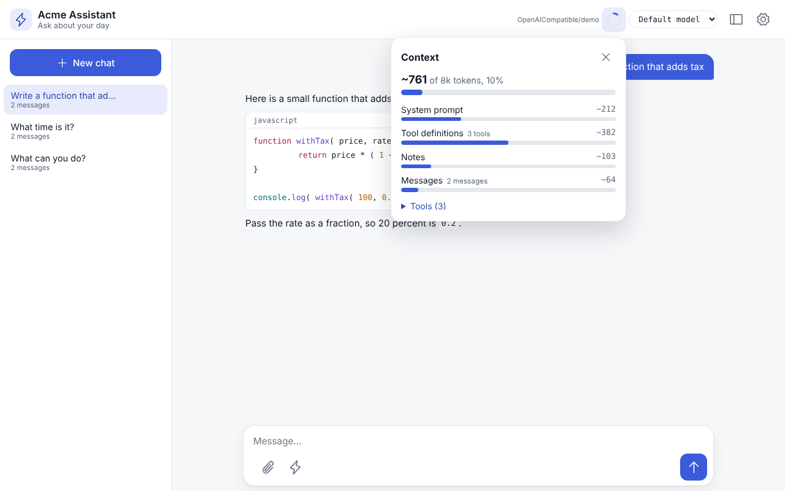 **Context.** The ring fills as the conversation grows; click it for the breakdown. | 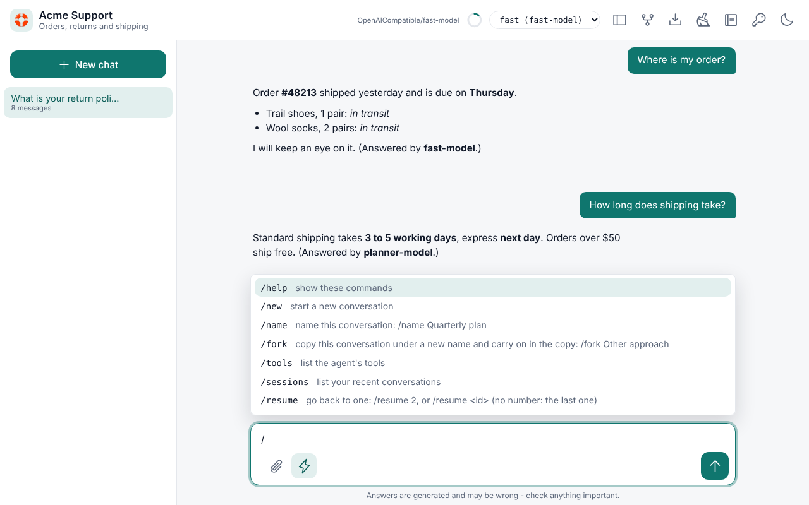 **Commands.** Type `/` for the menu. |

## What a streaming turn actually looks like

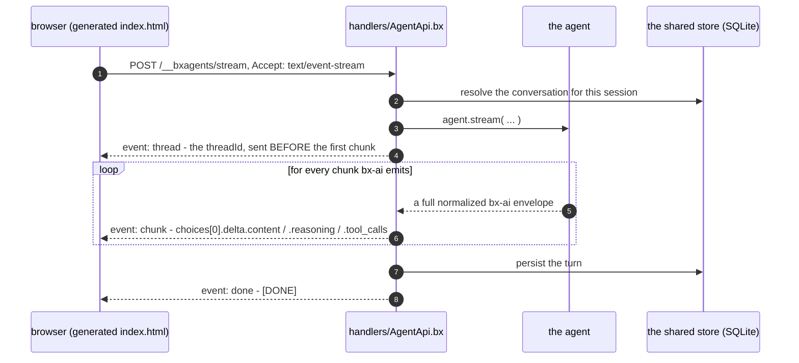

The `thread` event goes first because a response header cannot be read before the body starts arriving, and the page needs that `threadId` to be able to `POST /cancel` mid-turn.

## The API the page calls

The page has no API of its own. Everything it does goes through the agent API's routes, documented under [The always-on agent route](agent-bx.md#the-always-on-agent-route): turns (`/stream`, `/cancel`, `/steer`, `/resume`, `/pending`), conversations (`/sessions`, `/history`, `/clear`, `/compact`, `/export`), `/preferences`, `/notes`, `/commands` and `/command`, and the capability routes (`/agent`, `/context`, `/status`, `/slots`, `/profiles`, `/tools`). Anything the page can do, a script can do with the same calls.

Each call carries three headers:

| Header | Why |
| --- | --- |
| `x-bxagents-source: web` | Marks conversations the page starts, so `bxAgents sessions list --source=web` and the API's `?source=` filter can tell them from terminal and gateway ones |
| `x-bxagents-token` | The password from the key button's form, when one is set (see [Securing the API](#securing-the-api)) |
| `x-bxagents-csrf: 1` | Sent on every request. A request made with the sign-in cookie that changes something must carry it, so another site cannot make your browser do it |

Identity is the API's: with no `users` the page is the one open `local` user, shared with the terminal chat on the same machine, and with `users` it is the signed-in account.

### Slash commands

Type `/` in the message box and a menu of commands appears (arrow keys, `Tab` to complete, `Esc` to close). They are the same commands as in [the terminal chat](../cli-reference.md#the-same-commands-in-the-web-page-and-in-chat-apps): `/help`, `/new`, `/tools`, `/sessions`, `/resume`, `/clear`, `/compact`, `/model`, `/info`, `/context`, `/remember`, `/notes`, `/name`, `/fork`, `/export`, `/ping` and `/keys`. Pressing Enter runs the line on the server with `POST /command` and draws the answer: text, a table, or buttons to pick from. `/new`, `/resume` and `/fork` move the page to the conversation they name, `/clear` reloads the transcript, and `/export [file] [--format=md|html]` hands the conversation to the browser to save (the **Fork** and **Export** buttons in the header run `/fork` and `/export`).

The reply is data, so any client can use it:

```json
{ "success": true, "conversationId": "...",
  "blocks": [ { "type": "table", "layout": "keyvalue", "rows": [ [ "Agent", "helper" ] ] } ],
  "effects": [ { "type": "conversation", "id": "..." } ] }
```

Blocks are `text`, `table`, `choose` (options, each with the command line to run), `transcript` and `file` (`{ name, mime, text }`, which the page saves); effects say what happened to the conversation (`reset`, `conversation`). `/info` leaves out where the database file is. A command that only makes sense on your own machine (`/copy`, `/record`, `/profile`) is not offered, and a server never switches the shared agent's model: the page picks a profile per message instead.

`threadId` is server-authoritative: taken from the request when supplied, minted otherwise, and always echoed back - as an `X-Thread-Id` response header on `/invoke` and `/batch`, and as a `thread` SSE event sent *before the first chunk* on `/stream` (a header can't be read before the body starts arriving). That's the same contract ColdBox 8.1's own `toAi()` adopted, so a client written against one works against the other.

!!! warning
    **Stop must go through `/cancel`, not just an aborted fetch.** Aborting the HTTP request only stops the browser listening - the server keeps running the turn, calling tools and spending tokens. The page therefore sends a `threadId` with every turn and posts it to `/cancel` before aborting, so `agent.cancelRun()` can signal the run at its next checkpoint.

`/clear` and `/compact` are both careful about scope. `/clear` goes through each memory's own `clear( userId, conversationId )` rather than `AiAgent.clearMemory()`, which takes no arguments and would wipe every visitor's history; `/compact` goes through `summarize( config, userId, conversationId )` for the same reason. Compaction replaces this conversation's older messages with an AI-written summary and keeps the most recent few, touching nothing outside the caller's `(userId, conversationId)` pair.

!!! info
    **`/compact` needs a summary model, and reports whether it has one.** `summarize()` is a silent no-op unless the memory has *both* `summaryProvider` and `summaryModel` configured, and also when the conversation is already at or under `keepRecent`. Neither is an error, so `/compact` returns `{ compacted, before, after }` and lets the caller see for itself, and `/info`'s `capabilities.compact` reports whether a summary model is configured at all - so a page can hide a button that would do nothing rather than look broken.

    Only `keepRecent` is taken from the request. `summarize()` also honours `model`/`provider` overrides, but accepting those here would let any visitor aim a summarization call at a provider and model of their choosing on your credentials - the memory's own config decides that instead.

```yaml
# Agent.yaml - what makes /compact functional
memory:
  type: cache
  summaryProvider: openai
  summaryModel: gpt-4o-mini
  summaryThreshold: 10
```

## Choosing the model

By default the page talks to the agent's own model and offers no choice. List [profiles](models.md#profiles) in the entry and the header gets a model picker:

```javascript
// gateways/chat.bx
return { exposes : "webui", path : "/chat", profiles : [ "fast", "planner" ] };
```

- `GET /profiles` returns only the listed profiles: name, description, provider, model and which is the default. Never a key.
- The page sends the pick with each message as `options.profile` and remembers it in the browser. "Default model" sends none.
- A request that names any profile that is not listed is a `400`, whether or not `Agent.yaml` declares it. A profile is a model your server pays for, so the browser never chooses one you did not offer. Without a list, every `options.profile` is refused.
- Each name must be a profile `Agent.yaml` declares, or `default`. Web UI entries share one handler, so entries that list different profiles are a build error.
- An `agent` entry (a `toAi()` route) forwards the caller's own `params` and `options`, so it has no list to offer. The [always-on route](agent-bx.md#agentapi) has its own: `agentApi.profiles`.

## Users and sign-in

By default the web UI has **no accounts and no gate** - it is open, and every visitor is anonymous. That is the zero-ceremony `bxAgents serve` experience, and it is **not** a deployment posture. Declaring `users` on a `webui` entry turns on a real sign-in gate backed by [cbauth](https://forgebox.io/view/cbauth) and the same SQLite store everything else uses.

### Without accounts, the UI is one shared workspace

There is no per-visitor identity, on purpose. Every visitor to an accountless web UI reads and writes the **same** conversations, preferences and agent memory (the `local` user, which the terminal chat on that machine shares) - whoever can reach the page sees everything in it.

That is the point of running without accounts rather than an oversight: an open UI is a single shared tool (a laptop, a trusted internal box), not a multi-tenant service. Handing each browser its own slice would only fragment one workspace into per-browser copies nobody asked for, and any client-side id doing the fragmenting would be forgeable anyway.

!!! warning
    **An open UI has no privacy between visitors.** Anyone who can reach the URL sees every conversation in it, and can continue or delete any of them. If that is not what you want - anywhere the page is reachable by more than the people who should see the transcripts - declare `users`.

```javascript
// gateways/chatUi.bx
users : [
    { username: "ada",   passwordEnvVar: "ACME_ADA_PASSWORD", displayName: "Ada Lovelace" },
    { username: "grace", passwordHash: "pbkdf2$210000$...",   displayName: "Grace Hopper" }
]
```

### Passwords are never written in config

An account names the **environment variable** holding its password (`passwordEnvVar`), or carries an **already-hashed** value (`passwordHash`). A literal `password` key is a build error, not a warning - silently ignoring it would leave you believing you had set a password when you had only committed one.

A `passwordHash` is safe to commit precisely because it cannot be reversed. Generate one with the same hasher the app uses:

```
bxAgents hash-password --password="<your-password>"
```

!!! danger
    **Hashed, not encrypted.** Encryption is reversible, and a stolen database file almost always travels with whatever could decrypt it - so a reversible scheme turns one file leak into every user's password, including any they reused elsewhere. Passwords here go through PBKDF2-HMAC-SHA256 with a per-user random salt and are never recoverable from the database. (BoxLang ships no bcrypt or argon2 BIF; PBKDF2 is the strongest primitive available without adding a dependency.)

    The iteration count is stored *inside* each hash (`pbkdf2$<iterations>$<salt>$<digest>`), so it can be raised later without invalidating anything already stored.

### What sign-in changes

Everything user-scoped re-keys to the real account. The agent API reads the signed-in account from cbsecurity (which wraps cbauth) in one place (`models/api/Authenticator`), and agent memory, the conversation index, preferences and pending-run ownership all key off the id it gives.

Accounts also close the API: with `users`, a request to `/__bxagents` needs the sign-in cookie or a token, whatever `agentApi.access` says. A page with accounts must never sit in front of an API anyone can call. A visitor who is not signed in is sent to `<path>/login.html`.

The practical difference: conversations and preferences follow the person across browsers and devices, and clearing cookies no longer creates a brand-new "user".

| | No `users` | With `users` |
|---|---|---|
| Identity | One shared workspace | The signed-in account |
| Conversations visible to | Everyone who can reach the UI | Only their owner |
| Follows the person across browsers/devices | n/a - nothing is per-person | Yes |
| Reachable without signing in | Everything | Only the login form |

### Lifecycle

Accounts are reconciled from config on every boot, in this order: `ChatDb` migrates the schema, the seeder writes accounts, then the login gate starts enforcing.

- **Adding** a user to config creates them.
- **Changing** their password updates it. The seeder re-hashes only when the configured password no longer matches what is stored, so an unchanged password costs one verification rather than a fresh hash.
- **Removing** them from config **deactivates** the account rather than deleting it. Their conversations reference their id, so deleting the row would orphan that history instead of revoking access. They can no longer sign in; their data stays intact and returns if the account is restored.
- A `passwordEnvVar` whose variable is **unset** skips that account entirely and logs a warning to `webui-auth`. This fails closed on purpose - creating the account with an empty password would be far worse than it not existing.

### What this is not

This is a fixed roster of operator-provisioned accounts, not a user-management system. There is no self-registration, no password reset, no roles or permissions, and no per-user rate limiting or spend cap. If you need federated identity instead, edit `resolveUserId()` in the generated handler to return your own authenticated principal - the rest of the web UI neither knows nor cares where the id came from.

## Human-in-the-loop

When the agent pauses for approval, the stream emits a `middleware_stop` chunk that carries no detail. The page therefore asks `GET /pending?threadId=` what is being requested, renders it with **Approve** / **Reject**, and answers via `POST /resume` - which streams the *continuation of the same turn*, so the outcome lands in the conversation rather than starting a new one.

`decidedBy` is filled from the session server-side, never from the request body: who approved something is exactly the kind of claim a caller should not get to make about itself.

!!! warning
    **A suspended run belongs to the session that started it, and both routes enforce that.** Deriving `decidedBy` server-side only stops a caller lying about *who* decided - on its own it does nothing about *whose run* they are deciding on. Unlike every other action, `/pending` and `/resume` are addressed by `threadId` rather than by conversation, so without an ownership check a visitor holding someone else's `threadId` could read their pending tool calls and their arguments, and approve or reject on their behalf.

    The owner needs no extra bookkeeping: the handler stamps the session-derived `userId` into the run options, and the agent checkpoints those options alongside the suspension - so the saved state already knows who it belongs to. `/pending` answers as though nothing is pending when the caller is not the owner, so it cannot be used to probe whether a `threadId` exists at all; `/resume` refuses with a `403`.

## History and reload

The transcript lives in the DOM; the conversation lives in the agent's memory. Without rehydration a reload shows an empty screen while the agent still remembers everything - so the page would look blank and then answer follow-ups about messages the user cannot see. On load the page therefore calls `GET /__bxagents/history` and replays the stored messages (markdown and all), falling back to the welcome message when the conversation is empty or the fetch fails.

**New** starts a fresh `conversationId`. It does not delete anything - the previous conversation stays on the server under its own id and appears in the sidebar, which is what the conversations table exists for.

## What the page does

The shipped page is a real chat client, not a demo shell. It reads `GET /info` **first** and shapes itself to what the server actually reports, so a control only appears where the capability exists.

| Area | Behaviour |
| --- | --- |
| **Conversation sidebar** | Lists this visitor's conversations newest-first, with message counts. Switch, rename (✎), delete (×), or start a new one. Titles render through `textContent` - a title is whatever the user typed first, so it is never parsed as markup |
| **Steer while streaming** | The composer stays live during a turn. **Send** becomes **Steer**, and the message splices into the run already in flight rather than starting a new one |
| **Stop** | Posts `/cancel` *before* aborting the fetch, so the server actually stops spending tokens, then keeps whatever already streamed |
| **Clear / Compact** | Clear empties this conversation; Compact appears only when a summary model is configured, and reports what it actually did (`Compacted 12 messages down to 3`, or `Nothing to compact yet`) |
| **Reasoning + tool calls** | Collapsed disclosures fed from `delta.reasoning` and `delta.tool_calls` on the same envelope |
| **Approvals** | A human-in-the-loop pause renders an Approve/Reject card from `GET /pending`, answered via `/resume`, which streams the continuation of the same turn |
| **Theme** | Stored server-side in `preferences`, so it follows the identity rather than the browser. `localStorage` keeps a local copy so the choice survives a failed request |
| **Model** | `/info`'s model name sits in the header, so it is always clear what answered |
| **Context size** | A ring in the header that fills as the context does (amber from 70 percent, red from 90), from `GET /context`, refreshed after each turn, command, clear, compaction, conversation switch and change to the notes. Click it for the breakdown: the total, each part with its share (system prompt, tool definitions, notes, messages), the tools, and a button to compact the conversation. The ring fills only when the model's [`contextWindow`](models.md#what-the-project-knows-about-a-model) is set; without it the panel still shows the sizes |
| **Attachments** | An **Attach** button (shown when `/info` reports `capabilities.attachments`) picks pictures and text files; you can also paste a picture or drop files on the page. Chips show what waits, each with a remove button. Pictures go as base64 `attachments` of the stream request, text files are inlined in the message. At most 4 pictures, 5 MB each; `/info` also reports `vision`, and a picture to a profile without it is refused with the reason |
| **Shortcuts** | Enter sends, Shift+Enter adds a line. `?` alone (or `/keys`) lists them |

**Recovery matters more than it sounds.** The last-opened conversation is remembered in `localStorage`, but the conversations themselves live on the server. If that id no longer exists - deleted in another tab, or a fresh store - the page falls back to the newest remaining conversation instead of rehydrating into an empty screen with no active row.

Narrow screens get a real layout rather than a squeezed one: under `40rem` the sidebar overlays the transcript instead of stealing its width, and `prefers-reduced-motion` is honoured.

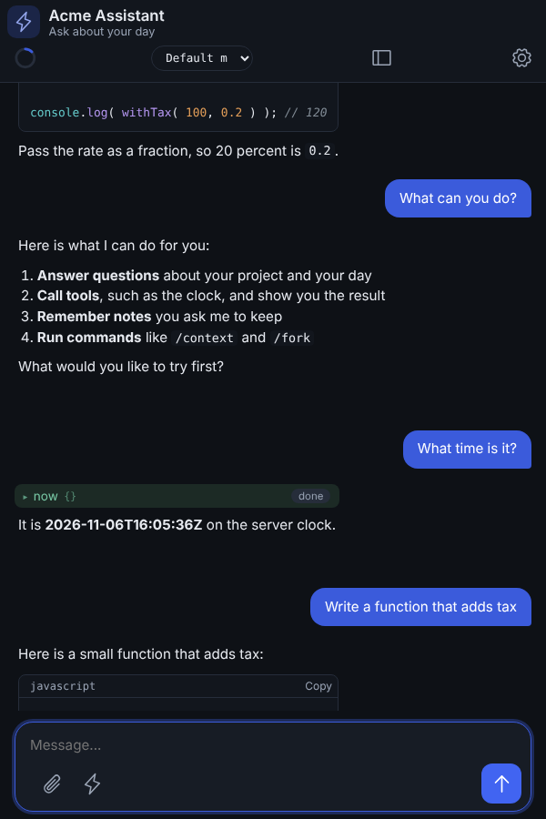

## The SQLite store

Every `webui` project gets a SQLite database. It isn't optional and there's no flag to turn it off.

The reason is a real gap, not a preference: **bx-ai's `IAiMemory` has no enumeration API.** It's a per-`(userId, conversationId)` bucket - you can read, write and clear one, but nothing in it answers *"which conversations does this user have."* A conversation list, per-user preferences, and anything else relational needs real storage alongside the memory, not inside it.

| Piece | What it is |
| --- | --- |
| `bx-sqlite` | The JDBC driver, bundled with BxAgents as a nested module |
| [`qb`](https://github.com/coldbox-modules/qb) | QueryBuilder for the sign-in accounts in `ChatDb` |
| `ChatStore` | In the BxAgents module, shared with the terminal chat. Owns the tables and their versions, in plain SQLite SQL |
| `models/ChatDb.bx` | Generated, only the sign-in accounts. Hands out query builders; its `migrate()` calls `ChatStore` |
| A start-up statement in the generated base `Application` | Generated. Builds `ChatDb` at boot so migration runs then, not on whichever request touches the database first |

The datasource is registered in the generated base `Application` (`bxagents/Application.bx`) and the grammar is pinned in `config/ColdBox.bx`:

```javascript
// bxagents/Application.bx (generated)
this.datasources[ "bxagents" ] = {
	"driver"  : "sqlite",
	"database": expandPath( "./data/chat.db" )
}
this.datasource = "bxagents"   // NOT this.defaultDatasource - see below

// config/ColdBox.bx (generated)
qb : {
	defaultGrammar : "SQLiteGrammar@qb",
	defaultOptions : { datasource : "bxagents" }
}
```

Both are optional to override, per entry:

| Key | What it does | Default |
| --- | --- | --- |
| `database.datasource` | The ColdBox datasource name | `bxagents` |
| `database.path` | The database file, relative to the app root | `./data/chat.db` |

An absolute `database.path` **fails the build**: it's resolved with `expandPath()` inside the generated app, so an absolute path silently escapes the app directory and breaks a packaged `.bxa` deploy.

**One file for the web chat and the terminal chat.** On a developer's machine, `bxAgents serve` starts the app with the environment variable `BXAGENTS_DB` set to `data/chat.db` in the project folder, and `bxAgents chat` opens the same file. The generated app uses `BXAGENTS_DB` when it is set and `database.path` otherwise, so a deployed app keeps its file inside the app unless you set `BXAGENTS_DB` there too (for example to a mounted volume). New projects git-ignore `data/chat.db*`. The file is in WAL mode, so the terminal chat and a running server can use it at the same time.

**Schema is versioned and forward-only.** `ChatStore.migrate()` (called by `ChatDb.migrate()`) records what it has applied in a `bxagents_schema_version` table and applies only what's newer, so booting against an existing store is a no-op. v1 creates `conversations` and `preferences`; v2 adds `users`, v3 `tokens`, v4 `notes` and v5 `usage`. Evolve it by adding a step to the store's migration list - never by editing a migration that has shipped, because **SQLite cannot modify or drop a column**. A database made by an earlier version of the generated app is recognised and left as it is.

!!! warning
    **Two things here are counter-intuitive, and both were established the hard way against a real ColdBox boot rather than read off a docs page.**

    **The default-datasource setting is `this.datasource`, not `this.defaultDatasource`.** The registration key is plural (`this.datasources[ "name" ]`), so the singular default reads like it should match - and BoxLang accepts `this.defaultDatasource` silently and does nothing with it. The failure it produces names the very datasource you are trying to select (`No default datasource defined in the application or globally or in the query options. Registered datasources are: [bxagents]`), which reads as a broken selection mechanism rather than a misspelled setting.

    **Name the datasource on every qb builder; do not rely on `moduleSettings.qb.defaultOptions`.** qb's `ModuleConfig.cfc` maps `QueryBuilder@qb` with `.initArg( name = "defaultOptions", value = settings.defaultOptions )` in `onLoad()`, so the setting *looks* like it covers you. It did not arrive in a real boot - the datasource was registered and the builder still had empty options. `ChatDb.query()` therefore calls `.mergeDefaultOptions( { datasource : static.DATASOURCE } )` on every builder it hands out.

    The `moduleSettings.qb` block is still generated - it is right for any other qb use in the app - but the generated store does not depend on it.

    If you extend `ChatDb`, name the datasource on whatever you add.

    One more, unchanged: the datasource must be a **named** datasource, never an inline struct - qb's own `appendSqlComments()` types that argument as `string`, so a struct throws before any SQL runs.

The store is SQLite. `ChatDb` reads and writes go through qb, but the tables are created by `ChatStore` with SQLite SQL, so another database later means a new `ChatStore`, not only a grammar change.

## Conversations and preferences

These are what the SQLite store exists for, and both are scoped by the same server-derived `userId` as everything else.

**Conversations.** Every turn through the agent API's `/invoke`, `/stream`, `/events` or `/batch` records itself against the index: the row is created on first use, `updatedAt` moves, and the first user message becomes the title (collapsed to one line, truncated to 60 characters) unless one is already set - so a rename is never silently undone by the next turn. `messageCount` is a **display counter**, bumped by two per turn; a turn that dies midway can leave it one high, and `/clear` resets it. The agent's own memory remains the authority on what was actually said.

`POST /sessions/delete` removes the index row *and* clears the agent's messages for that conversation. Dropping only the row would leave the conversation invisible while still sitting in the model's context the moment anyone reused the id.

!!! warning
    **Why `touchConversation()` is not a qb upsert.** An upsert targets the primary key alone, so a caller who guessed another visitor's `conversationId` would have their own `userId` written onto that row and take the conversation over. The store reads first and refuses when the row belongs to someone else. `setPreference()` *does* upsert, and safely - its target is the `(userId, prefKey)` composite key, so the caller's own identity is part of what it matches on.

**Preferences.** Server-side rather than `localStorage`, so they follow the identity instead of the browser. With `users` declared, a person's preferences follow them across browsers and devices.

## Branding and theming

Every key below is optional - the entry works with just `exposes` and `path`.

| Key | What it does |
| --- | --- |
| `title` | Browser title and header heading |
| `subtitle` | Small line under the heading |
| `icon` | An emoji (rendered into an inline-SVG favicon **and** the header) or an image URL/path (`/logo.svg`, `https://…`, `data:image/…`). With none, the header shows a robot |
| `welcome` | Empty-state message shown before the first turn |
| `placeholder` | Composer input placeholder |
| `footer` | Small note under the composer - disclaimers, links |
| `showReasoning` | Show the "Thinking" strip. Default `true` |
| `showToolCalls` | Show tool-call chips. Default `true` |
| `theme` | Design tokens - see below |
| `themeFile` | Path to a CSS override, relative to the project root. Default `resources/webui/theme.css` |

`theme` maps directly onto the page's CSS custom properties: `accent`, `accentFg`, `bg`, `fg`, `muted`, `border`, `surface`, `inputBg`, `bubbleUser`, `bubbleUserFg`, `bubbleAssistant`, `bubbleAssistantFg`, `bubbleError`, `reasoningFg`, `reasoningBg`, `toolFg`, `toolBg`, `radius`, `radiusSm`, `font`, `fontMono`, `fontSize`, `maxWidth`. `accent` also drives the page's tints and icon color (`--accent-soft`, `--accent-ink` and the focus glow are worked out from it), so one color is enough to brand the page. A nested `theme.dark` block overrides any of the same tokens for dark mode. An unknown token **fails the build** rather than being silently ignored, so a typo surfaces immediately instead of leaving you wondering why your brand color never showed up.

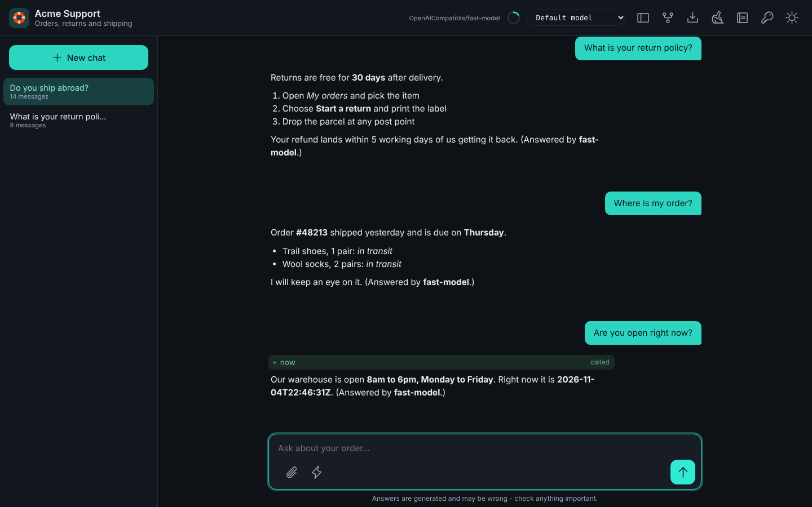

```javascript
// gateways/chat.bx
theme: {
	accent : "0f766e",
	radius : "10px",
	font   : "Inter, system-ui, sans-serif",
	dark   : { accent : "rgb(45, 212, 191)" }
}
```

!!! info
    **Write hex colors bare, with no leading hash.** BoxLang begins string interpolation at `#` in **both** single- and double-quoted strings, so a literal hex color in a `.bx` config is a parse error unless the hash is doubled - a footgun nobody remembers. The generator adds it back for you, so `"0f766e"` just works. `rgb()`, `hsl()` and named colors need nothing special either way.

For anything the tokens don't cover - custom fonts, layout, per-element rules - drop a `resources/webui/theme.css` into the project. It's inlined **last** into the page's `<style>`, so it beats both the shipped defaults and the `theme` tokens; and being a real `.css` file, ordinary `#rrggbb` hex works there normally. (A literal `</style` in that file fails the build, since it would terminate the page's style block early.)


## Securing the API

!!! warning
    **`apiKeyEnvVar` is a shared secret, not a login system.** It is the same thing as the agent API's `agentApi.tokenEnvVar` (a name in `Agent.yaml` wins if both are set). Left unset, the API is open (fine on your own machine, not for a public deployment; `serve` warns when an open API listens on every interface). Set it, and every call to `/__bxagents` must carry a matching `x-bxagents-token` header, compared in constant time. **The static shell (`<path>/index.html`) is not gated**, because a browser's plain page navigation can't send a custom header; the page asks for it in a form: a **Password** box that opens by itself when the server answers `401` and again from the key button at the top. The password is kept in `localStorage` and sent on every call; a wrong one shows "That password was not accepted." For several people use [issued tokens](agent-bx.md#access-tokens-for-a-deployed-agent) or `users`.

## Appearance

The palette icon in the header opens the **Appearance** panel, where a visitor picks, for this browser only:

| Setting | Choices |
|---|---|
| Mode | System, Light or Dark (the same choice as the Theme button, and it follows the account when the page has preferences) |
| Accent color | The gateway's own accent (the **Default** swatch), eight presets, or any hex value. The panel shows the contrast of the button text on it and warns under 4.5 : 1 |
| Text size | Small, Medium or Large |
| Density | Comfortable or Compact |

The choice is stored in the browser (`localStorage`, key `bxagents_webui_appearance`) and **Reset to defaults** clears it. It never changes what the operator wrote in `theme`: that stays the default every visitor starts from. A picked accent also sets `--accent-fg` to white or near black, whichever reads better, and the tints and focus glow follow it. Extension scripts and styles can rely on `--accent`, `--accent-fg`, `--accent-soft`, `--accent-ink`, `--ring`, `--bg`, `--fg`, `--muted`, `--border` and `--surface` and so follow the visitor's choice too.

## Conversation identity

**Every memory an agent holds is keyed by `(userId, conversationId)`** - and an agent can hold several at once (`AiAgent`'s `memories` is an array; `loadMemoryMessages()` iterates all of them with the same pair). `AiAgent.run()`/`.stream()` fall back to `""` for both when nothing supplies them, so a server-side identity has to come from somewhere.

The agent API supplies it on every turn route (`invoke`, `stream`, `events`, `batch`):

- **No `users` declared and an open API:** the one `local` user, as described in [Users and sign-in](#users-and-sign-in).
- **A shared secret:** `admin`. **An issued token:** the token's name.
- **`users` declared:** the signed-in account's id, read from cbsecurity (which wraps cbauth). A signed-out request is refused with a `401`.

Either way the id is derived on the server and never taken from the request body, so a caller cannot name themselves someone else. `conversationId` still comes from the client, and that's deliberate: it distinguishes several conversations belonging to the *same* identity - it's what the **New** button rotates. It is not the isolation boundary; the `userId` is.

A project with a `webui` exposure also gets **session management on** in the generated base `Application` - `this.sessionManagement = true`, `this.setClientCookies = true`, a 60-minute `sessionTimeout` - because the sign-in is session-backed. Cookies are load-bearing there: no cookie, no session. A project with no `webui` keeps sessions off - an API/gateway-only app has no browser to track, and a session there is overhead plus a cookie nobody asked for.

!!! info
    **Why not `toAi()`?** ColdBox 8.1's `toAi()` lets a **caller-supplied `userId` win** over the server-derived one, and ColdBox route middleware does not reach its routes. The agent API's own handler derives the identity server-side only and never looks at `body.userId`, and sits behind one gate.

No memory type is forced. Choose one (or several) per agent with a `memory` key on `Agent.yaml`, same shape as `checkpointer`:

```yaml
# Agent.yaml
memory:
  type: cache
  maxMessages: 50
```

## Reply rendering

Assistant replies render as full Markdown: headings, lists, tables, quotes, strikethrough, links and fenced code, with code coloured by language (BoxLang, CFML, Java, JavaScript, TypeScript, Python, Go, Rust, Kotlin, SQL, JSON, YAML, TOML, XML/HTML, CSS, shell, Dockerfile, diff and Markdown). The page carries its own copy of [marked](https://marked.js.org), [DOMPurify](https://github.com/cure53/DOMPurify) and [highlight.js](https://highlightjs.org), so it still works offline and loads nothing from a CDN. What the model writes is never trusted: raw HTML in an answer is escaped and shown as text, the result is sanitized, images are not loaded (a remote one would tell its server the page was opened), and a `javascript:` link is not turned into a link at all.

!!! info
    The composer is a `textarea` - **Enter** sends, **Shift+Enter** adds a newline, and it grows to about six lines before scrolling. A turn in flight can be halted with **Stop** (an `AbortController`), which keeps whatever already streamed rather than discarding it. The transcript only auto-scrolls when you're already at the bottom, so scrolling up to re-read something mid-stream doesn't yank you back down.

## Notes

When the agent has a [`notes`](agent-yaml.md#notes) block, the header shows a **Notes** button. It opens a panel with two tabs, *About you* and *About the agent*, how full each is (characters of the limit, and about how many tokens that adds to every conversation), and the notes with their ids. Add, edit in place and remove work on your own notes. The page and the terminal chat share the same database, so a note added in one shows in the other.

- *About you* belongs to the same identity as your conversations: your account with [`users`](#users-and-sign-in), or the shared workspace without accounts.
- *About the agent* is shared by everyone who uses the agent, so anyone using the page may add or edit one, but the page has no Remove button for it and `/notes/remove` answers `403`. Removing a note of the agent takes an admin [token](agent-bx.md#access-tokens-for-a-deployed-agent) on the agent's own `/__bxagents/notes/remove` route, or `bxAgents notes remove --scope=agent` where the agent runs.
- Without a `notes` block the button is not shown and the routes answer `404`: `/info`'s `capabilities.notes` says which.

## What is not here yet

The page is complete against its own API - every route it needs exists and is exercised. These are the gaps:

| Missing | Note |
| --- | --- |
| Retry / regenerate | A failed turn has to be re-sent by hand |
| Edit and resend | No editing a message already sent |
| Token / cost display | The page shows none. `usage: true` in `Agent.yaml` records tokens for `bxAgents stats`, and `/stats` shows them in the terminal chat only |
