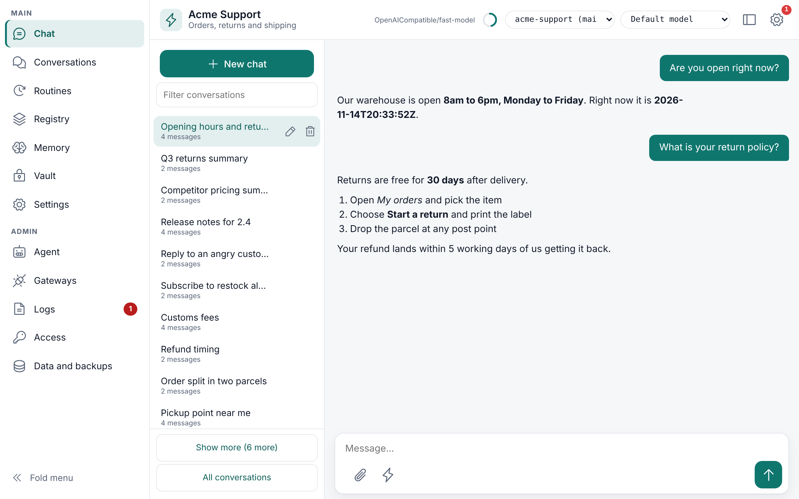
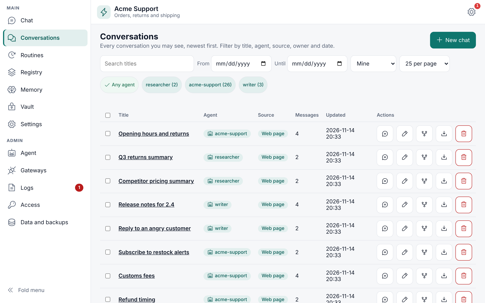
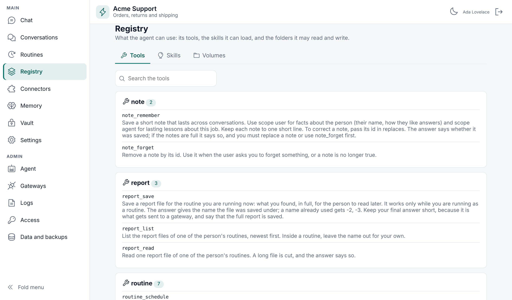

# The Web App

A `gateways/*.bx` entry with `exposes: "webui"` gives your agent a complete web app: a chat with streaming,
reasoning, tool calls and approvals, and thirteen pages around it (your conversations, routines, what the agent
can use, its memory, its settings, and for admins its logs, access and backups). It is a ColdBox module that calls
the agent API at `/__bxagents`, built ahead of time and shipped inside BxAgents, so `bxAgents build` never runs
`npm install` and a project never needs Node.

!!! info "What you will build"
    A running Acme support web app on port 8791, talked to from a browser and from a script. About 20 minutes.

## 1. Add the web gateway and serve it

`bxAgents add gateway web` writes `gateways/web.bx` for you. `--auth=open` means no sign-in, fine on your own
machine (the [users lesson](users-roles-and-tokens.md) closes it):

```bash title="Terminal 2"
cd ~/bxagents-course/acme-support
bxAgents add gateway web --auth=open --yes
bxAgents build
```

```text title="You see"
+ Created  gateways/web.bx
...
Build succeeded: <anything>/acme-support/.build/app
```

Open Terminal 3 and serve it. Port 8080 is taken by the scripted model, so the course uses 8791:

<!-- course: background name=serve ready-url=http://127.0.0.1:8791/chat -->
```bash title="Terminal 3"
cd ~/bxagents-course/acme-support
bxAgents serve --port=8791
```

```text title="You see"
Serving [<anything>] (the app is in [<anything>]) on http://127.0.0.1:8791 - bound to 127.0.0.1 only
...
```

`serve` runs a real `boxlang-miniserver` on `.build/public`, the only folder it serves, and is bound to
`127.0.0.1`: nobody else on your network can reach it. The first start takes a few seconds. Stop it with Ctrl+C,
and start it again after every `build`, because it loaded the app that was built when it started.

## 2. Talk to it

Open `http://127.0.0.1:8791/chat` in a browser (the bare address redirects there) and type `hello`. The scripted
model answers, and the answer streams in word by word. Ask `refund` and `48213` too: the second shows a tool call as
a card with its arguments and result.



The same thing from a script. The agent API is under `/__bxagents`; `invoke` runs one turn and answers JSON:

```bash title="Terminal 2"
curl -s -H 'Content-Type: application/json' -d '{"input":"hello"}' http://127.0.0.1:8791/__bxagents/invoke
```

```text title="You see"
{"output":"Hello from the practice model. I am scripted: I only say what the course told me to say.","threadId":"<anything>","success":true}
```

## What the chat can do

- **Conversation sidebar** - switch, rename, delete, or start a new conversation.
- **Steer while streaming** - the composer stays live during a turn; **Send** becomes
  **Steer**, splicing your message into the run already in flight.
- **Stop** - posts `/cancel` before aborting, so the server actually stops spending
  tokens rather than just abandoning the browser connection.
- **Reasoning + tool calls** - collapsed disclosures fed straight off the streamed
  response.
- **Approvals** - a human-in-the-loop pause renders an Approve/Reject card.
- **Rendered answers** - full Markdown, with code blocks that show their language and have a
  **Copy** button, and tool cards with a status chip and a one-line preview of the arguments.
- **Slash commands** - type `/` for a menu (or press the lightning button): `/new`, `/sessions`,
  `/fork`, `/export`, `/context` and more, the same ones as in the terminal. Commands an
  [extension](18-interceptors-and-modules.md) adds show the extension's name as a badge.
- **Suggestions** - set up to four `suggestions` on the entry and the empty conversation shows
  them as buttons that send on one click.
- **Pictures** - an Attach button, paste and drop send pictures with a message (refused when the
  model's profile says `vision: false`).
- **Context ring** - the bar above the conversation shows how much of the model's window is used; click it for the
  breakdown.
- **Model picker** - when the entry lists `profiles`, visitors can choose one per message.

## The pages and the header

The app is more than the chat. A left menu lists its pages, and each page is an address of its own under the
gateway's `path` (`/chat/conversations`, `/chat/routines`, `/chat/settings`), so you can bookmark one. The menu shows
only what this person may use. An address under `/chat` that is no page answers `404`.

| Group | Pages |
|---|---|
| Main | Chat, Conversations, Routines, Registry, Connectors, Memory, Vault, Settings |
| Admin | Agent, Gateways, Logs, Access, Data and backups |

Take the tour with what you already built:

- **Conversations** lists every conversation you may see, from the web, the terminal and (later) gateways and
  routines, with a search and filters.
- **Registry** has three tabs: **Tools** lists `orderStatus` and `now`, grouped by where they come from, and marks
  the ones that ask first; **Skills** lists `refund-policy` and the six shipped ones, with a **Read** button;
  **Volumes** lists the folders the agent may use.
- **Settings** has **Appearance** (light or dark, an accent color, text size, density, kept in your browser) and your
  own per-person settings, the subject of [Each Person's Own Settings](layered-settings.md).
- **Routines**, **Memory** and **Vault** each get a lesson of their own, and the Admin group comes with
  [Who Is Allowed](users-roles-and-tokens.md) and [Logs, Usage and Backups](operating-it.md).





The header holds the agent's icon and title, a light or dark switch, and **Password** (an agent without accounts)
or who is signed in and **Sign out**.

## Without accounts: one shared workspace

By default the app has **no accounts and no gate**: every visitor is anonymous, and every visitor reads and writes
the **same** conversations, preferences and agent memory. That is the zero-ceremony local experience, not a
deployment posture.

!!! warning
    An open app has no privacy between visitors. Declare `users` (or tokens) if the page is reachable by more than
    the people who should see the transcripts. [Who Is Allowed](users-roles-and-tokens.md) does it step by step.

## Branding it

Every key is optional:

```javascript
theme: {
	accent : "0f766e",
	radius : "10px",
	font   : "Inter, system-ui, sans-serif",
	dark   : { accent : "rgb(45, 212, 191)" }
}
```

!!! info
    Write hex colors bare, with no leading `#` - BoxLang begins string interpolation
    at `#` in both quote styles, so the generator adds it back for you.

`title`, `subtitle`, `icon`, `welcome`, `placeholder`, `footer` and `suggestions` are also
available, plus a `themeFile` for anything the tokens don't cover. `icon` can be an emoji, an
image address or `phosphor:<name>` (a Phosphor icon built into the page).

## Checkpoint

`acme-support/` has `gateways/web.bx`. `kit/resume.sh 15-the-generated-web-chat-ui` restores it (add `serve` again
after a rebuild).

Full reference: [The web app](../conventions/web-ui.md). To change the app itself, see
[Work on the web app](../guides/ui-development.md).

Next: [The Agent Asks First](approvals.md)
