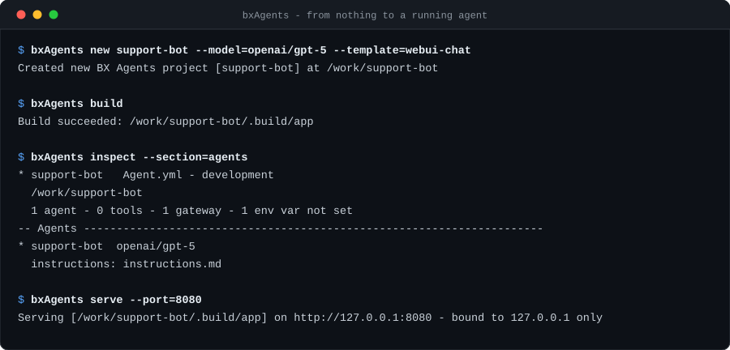
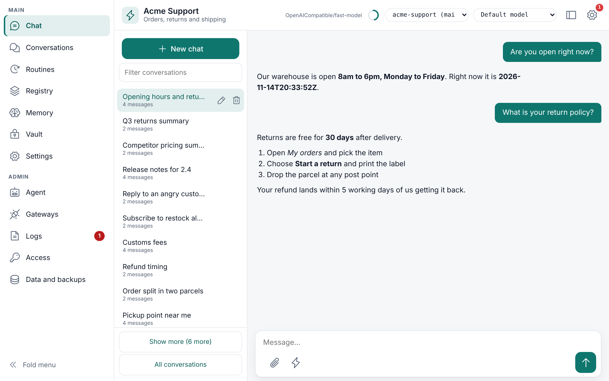

# Quick Start




By the end you will have an agent you can chat with in the terminal and serve over HTTP. This walks through the full lifecycle of a BxAgents project: scaffold, edit, build, run.

Before you start you need BoxLang and the module installed (see [Installation](installation.md)) and an API key for the model provider you pick (`OPENAI_API_KEY` for `openai/gpt-5`). To run `bxAgents test` you also need [CommandBox](https://commandbox.ortusbooks.com) (the `box` command) on your `PATH`: `new` runs `box install` once to fetch TestBox. Without `box` the project is still created, `new` prints a warning with the command to run later, and `--skipInstall` leaves the step out.

## 1. Scaffold a project

```bash
bxAgents new my-agent
```

At a terminal this asks what the agent should do (its model, tools, MCP servers (outside tool servers that speak the Model Context Protocol), channels, how people reach it, where it deploys) and writes the project to match; see [the new wizard](../guides/new-wizard.md). It ends by printing the one-line command that builds the same project without questions. To skip the questions, pass a model:

```bash
bxAgents new my-agent --model=openai/gpt-5
```

`--model` is a `provider/model` slug (written to `Agent.yml` as separate `provider:` and `model:` lines) - see [the model slug](../conventions/agent-bx.md#the-model-slug) for how it's parsed. `--name` and `--description` are optional; `--name` defaults to the target directory's own name.

This creates:

```text
my-agent/
├── Application.bx
├── Agent.yml
├── instructions.md
├── tools/
├── skills/
├── subagents/
├── gateways/
├── schedules/
├── mcp/
├── interceptors/
├── modules/
├── box.json
└── tests/
    └── specs/
        └── AgentSpec.bx
```

Plus a root [`Application.bx`](../conventions/application-bx.md) that extends the class every build generates (add your own settings and hooks there), a `.env` (secrets live here, so put your provider API keys in it and keep it out of source control), a `.gitignore` and a few dotfiles (`.editorconfig`, `.gitattributes`, `.bxlint.json`, `.markdownlint.json`, `.boxlang.json`). BoxLang loads the `.env` from the project root itself. The root `box.json` lists `testbox` as a development dependency.

This is the `minimal` starter - the default when `--template` is omitted. A template is a preset: the wizard (and flags such as `--with`, `--channels` and `--deploy`) add tools, channels and a deploy target on top of it. `new` can also scaffold one of 7 other built-in starters (`--template=webui-chat|slack-bot|telegram-bot|github-bot|mcp-server|scheduled|multi-agent`), each adding a bit of pre-wired content (a gateway, a scheduler) on top of the same skeleton, or skip scaffolding entirely and create the project from an existing GitHub repo (`--repo=owner/repo`) or a ForgeBox package (`--forgebox=<slug>`) instead - see the [CLI Reference](../cli-reference.md#new) for the full list and how each one works. The agent is defined by an `Agent.yml` by default; pass `--class` to scaffold the advanced, class-based `Agent.bx` instead (see [Agent.bx](../conventions/agent-bx.md)).

`Agent.yml` looks like this (`--description` adds a `description:` line):

```yaml
# Your agent. Most agents need nothing more than this file and instructions.md.
# For code in the definition (hooks, dynamic instructions), scaffold with --class.
name: my-agent
provider: openai
model: gpt-5

environments:
  # `bxAgents test` builds against this override by default (see
  # BaseAgentSpec.bx) so a fresh project's tests need no API key or
  # network access - swap the model to test against a real provider.
  test:
    model: mock/mock-model
```

The agent is just this file plus `instructions.md`. See [Agent.yml](../conventions/agent-yaml.md) for every key.

Every convention folder (a folder whose name tells BxAgents what its files are, such as `tools/` or `gateways/`) is created empty - add files to the ones your agent actually needs and delete (or just ignore) the rest.

## 2. Edit

Open `instructions.md` and write the agent's system prompt, and adjust `name`, `description` or `model` in `Agent.yml` as you like. Add a tool:

```javascript
// tools/Greeter.bx
class {

	@AITool( "Say hello to someone by name." )
	function sayHello( name ) {
		return "Hello, " & arguments.name & "!";
	}

}
```

See the [Conventions](../conventions/agent-yaml.md) section for every other folder (`skills/`, `subagents/`, `gateways/` (a gateway is a door into the agent: a chat platform, a web page or an HTTP path), `schedules/`, `mcp/`, `interceptors/`, `modules/`). You do not have to write them by hand: `bxAgents add <kind>` (`tool`, `skill`, `subagent`, `gateway`, `schedule`, `interceptor`, `mcp`, `profile` (a named model setup you can switch to in a chat), `provider`, `capability`, `extension`) asks a few questions and writes the files, and `--dry-run` shows them first.

## 3. Test it

```bash
box install        # once, to fetch testbox into lib/testbox (`new` already tried this for you)
bxAgents test
```

The scaffolded `tests/specs/AgentSpec.bx` passes out of the box - it builds your agent against the `mock` provider (no API key or network needed) and asserts on a scripted response. See [tests/](../conventions/testing.md) for `mockResponses()` and the custom matchers (`toHaveCalledTool`, etc.) available to your own specs.

## 4. Build

```bash
bxAgents build
```

Runs the full [build pipeline](../build-pipeline.md) - config resolution, discovery, validation, code generation, manifest normalization - and writes a real ColdBox application to `.build/` (the code in `app/`, the web root in `public/`), plus `.build/manifest.json`. Run `bxAgents build --environment=production` to build against an `Agent.yml` environment override (see [Agent.yml](../conventions/agent-yaml.md#environments)).

If your project fails validation (duplicate tool names, an unknown model provider, a gateway entry with a bad path, ...) `build` fails with every collected error - not just the first one.

## 5. Run it

Two ways to talk to the built agent - both load the exact same `GeneratedAgentFactory.bx` and build the exact same agent tree, so they never diverge:

**Interactively, from the terminal:**

Put your provider key in `.env` first (the file has a commented `OPENAI_API_KEY=sk-...` line to uncomment and fill in). Without it the model call fails with the provider's "You didn't provide an API key" error.

```bash
bxAgents chat
```

At a terminal this is a full-screen chat that keeps your scrollback: answers stream in as formatted Markdown, tool calls show as they run, Esc stops the agent, and typing `/` lists the commands (`/sessions`, `/resume`, `/name`, `/fork`, `/export`, `/notes`, `/context` and more). Type `@` to attach a file, or `@picture.png` to send a picture. Conversations are listed in the `chat.db` of the agent's [data home](../conventions/data.md) (`~/.bxagents/<agent name>/` by default; the messages last as long as the agent's memory does), so `bxAgents chat --continue` can pick up where you left off. See [the terminal UI](../guides/terminal-ui.md) and [Slash commands](../guides/slash-commands.md). To chat against the full app (schedulers, interceptors, gateways), use `bxAgents chat --server`, or `--connect=<url>` for a server that is already running (add `--token=<token>` if it wants one).

**Over HTTP**, via a real [`boxlang-miniserver`](https://boxlang.ortusbooks.com/getting-started/running-boxlang/miniserver) process:

```bash
bxAgents serve --port=8080
```

Every served agent has an HTTP API at `/__bxagents` (open on your own machine, behind tokens when you share it), and the web page, the terminal chat and chat platforms all use it. See [Call your agent from code](../guides/agent-api.md). The root address, `http://localhost:8080/`, redirects to the web page when the project has one, and otherwise points at `/__bxagents/health`.

If your project also has a `gateways/*` entry with `{ exposes: "agent", path: "/api/chat" }`, the agent is reachable at `POST http://localhost:8080/api/chat/invoke` (and `/stream`, `/batch`, `/info` - see [gateways/](../conventions/gateways/index.md)). An `exposes: "webui"` entry adds the browser chat page.

### See the web app

If you scaffolded with `--template=webui-chat`, `bxAgents serve` also serves the web app at `/chat`. This is the whole of it, in three minutes:

<video controls preload="metadata" poster="/assets/video/web-trailer-poster.png" style="max-width:100%">
  <source src="/assets/video/web-trailer.mp4" type="video/mp4">
  <source src="/assets/video/web-trailer.webm" type="video/webm">
  <track kind="captions" src="/assets/video/web-trailer.vtt" srclang="en" label="English" default>
</video>



Each page has its own address under `/chat` (`/chat/routines`, `/chat/settings`, ...), and an address there that is no page answers `404`. Every page is described in [the web app guide](../conventions/web-ui.md#the-pages).

## 6. Inspect, package, deploy

```bash
bxAgents doctor               # runtime, modules, project checks and unset environment variables
bxAgents inspect              # how the agent is composed: agents, tools, env vars, checks
bxAgents package --version=1.0.0   # writes dist/my-agent-1.0.0.bxa + .sha256 (a .bxa is the built agent as one portable file)
bxAgents deploy --destination=/path/to/somewhere   # copies the newest .bxa there
```

See [The Manifest](../manifest.md) and [Deployment & Secrets](../deployment-and-secrets.md).

## 7. Clean up

```bash
bxAgents clean
```

Removes `.build/` and `dist/` only - your source conventions (`Agent.yml`, `tools/`, etc.) are never touched.

## Next steps

- Build one agent end to end, with no account and no key, in the [Introduction to BxAgents](../course/index.md) course.
- Walk through every convention folder in [Conventions](../conventions/agent-yaml.md).
- Look at the working sample projects in [`examples/`](https://github.com/ortus-boxlang/bx-agents/tree/development/examples).
- See every verb's flags in [CLI Reference](../cli-reference.md).
