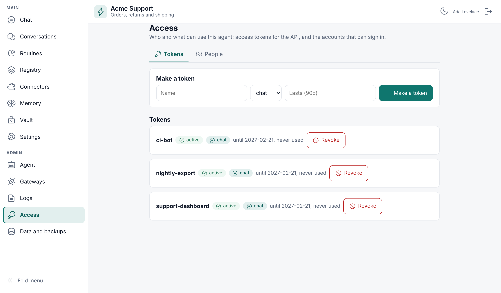

# Call your agent from code

Every built agent serves one HTTP API at `/__bxagents`. The web chat page, the terminal chat and the gateways use the same one, so anything they do, your program can do. This guide is the tour; every route, with its request and answer, is in the [OpenAPI document](#the-openapi-document) the server hands out, and the settings are in [agentApi](../conventions/agent-bx.md#the-always-on-agent-route).

<video controls preload="metadata" poster="/assets/video/api-tour-poster.png" style="max-width:100%">
  <source src="/assets/video/api-tour.mp4" type="video/mp4">
  <source src="/assets/video/api-tour.webm" type="video/webm">
  <track kind="captions" src="/assets/video/api-tour.vtt" srclang="en" label="English" default>
</video>

*Two and a half minutes: open mode and its startup warning, token mode, the guards, the BoxLang client, the OpenAPI document, the web page, the terminal chat and gateway sessions. The agent answers are canned (the mock provider), and the gateway part runs the gateway session tests.*

The project in [`examples/api-agent/`](https://github.com/ortus-boxlang/bx-agents/tree/development/examples/api-agent) runs everything below.

## Open or behind a token

Two ways to run, chosen by `agentApi` in `Agent.yml`.

| | Settings | Who may call |
|---|---|---|
| Open (the default) | nothing | Anyone who can reach the port. Everyone is one user, `local`. Keep it on `127.0.0.1`; `serve` prints a warning when an open API listens on every interface. |
| Token | `tokenEnvVar: MY_SECRET`, and/or `tokens: true` | Callers that send `x-bxagents-token`. The shared secret is an admin; issued tokens are `chat` or `admin`. Everything else gets `401`. |

You can also narrow who may call with `allowedIPs` and cap how often with `rateLimit`; both work open or closed.

```yaml
agentApi:
  tokenEnvVar: TOKEN_FOR_ADMIN   # the NAME of an environment variable
  tokens: true                   # also accept tokens made with `bxAgents token create`
  manageTokens: true             # an admin may make and revoke tokens over the API
```

## Connections

When an `mcpServers` entry has `oauth` ([connect](../conventions/connect.md)), the API has the sign in routes. They act for the caller: nothing a caller sends can name somebody else.

| Route | |
|---|---|
| `GET /connect` | The services, and whether the caller is connected to each. Never a token |
| `POST /connect` | `{ "name": "mail" }` starts a sign in and answers `{ "authorizationUrl" }` to send the caller to |
| `POST /connect/remove` | `{ "name": "mail" }` forgets the caller's sign in |
| `GET /connect/callback` | Where the provider sends the browser back. **Open**, because the single use `state` says who it is. Shows a small page |

## With curl

```bash
export T="x-bxagents-token: $TOKEN_FOR_ADMIN"

curl -H "$T" http://127.0.0.1:8080/__bxagents/whoami

curl -H "$T" -H "Content-Type: application/json" \
     -d '{"input":"What can you do?"}' \
     http://127.0.0.1:8080/__bxagents/invoke
```

`invoke` answers `{ "success": true, "output": "...", "threadId": "..." }`. Send `conversationId` to carry on a conversation; the agent remembers it for you.

## With BoxLang

```javascript
import bxModules.bxagents.models.api.AgentApiClient;

agentClient = new AgentApiClient( url = "http://127.0.0.1:8080", token = getSystemSetting( "TOKEN_FOR_ADMIN" ) );

first = agentClient.invoke( "What can you do?" );
println( first.output );

// the text as it is written
agentClient.stream( "Say it shorter.", ( text ) => print( text ), first.threadId );
```

Build the client with named arguments. There is one method for each route: `invoke`, `stream`, `events`, `resume`, `cancel`, `steer`, `sessions`, `history`, `export`, `notes`, `preferences`, `command`, `tokens` and the rest. A bad request comes back as `{ success: false, error, code }`; a refused token, a missing route or a server failure is thrown. Pass `path` when the server moved the API with `agentApi.path`, and `source` to name your program in the conversation list.

## What a turn accepts

Besides `input`, `conversationId`, `threadId` and `attachments`, a turn request may carry two structs:

| Field | What is used |
|---|---|
| `options` | `profile` only: the name of an [offered profile](../conventions/agent-bx.md#agentapi) (`GET /profiles`). Any other name is a `400` `bad_profile`. |
| `params` | Everything the model accepts (`temperature`, `top_p`, `max_tokens`, `stop`, `seed`, `response_format`, reasoning settings and so on), except `model`, `messages`, `contents`, `system` and `tools`, and any key that starts with `_` at any depth. |

Everything else is dropped without an error, and the server logs the names it ignored (never the values). This is a security rule. A key such as `options._resumeContext` would make the model library run tool calls the request supplies without asking for approval, and `options.apiKey` would swap the server's key. In `params`, `model` would pick a model the server did not offer, `messages` or `contents` would replace the conversation, `system` could set the prompt, and `tools` would add tools the agent was not given. The person, thread and conversation come from the token and the request, never from `options`.

Pictures go in `attachments`, as `[ { "name": "a.png", "mime": "image/png", "data": "<base64>" } ]`. A request has no `images` field: it holds paths to files on the server, so the server ignores it (and logs that it did) and reads no file; only the terminal that runs the agent in its own process attaches files by path.

## Streams

`stream` and `events` answer server-sent events: each frame is `event: <name>` then `data: <json>`.

| Frame | Meaning |
|---|---|
| `thread` | First frame: the run's id, for `cancel`, `steer` and `resume`. |
| `chunk` | A piece of what the model is saying. |
| `tool` | A tool call started (`running`) or finished (`ok`). `events` only. |
| `suspended` | The run paused for approval. Answer with `resume`. `events` only. |
| `error` | The run failed. |
| `done` | Last frame. |

`stream` carries `thread`, `chunk` and `done`. `events` carries all of them, and the client turns them into events for your callback: `thread`, `delta`, `reasoning`, `tool`, `suspended`, `error`.

## Run control

The thread id from a run's first frame is what `cancel` and `steer` take. A run belongs to the caller that started it, so the same id from another caller reaches nothing (`cancelled: false`, `steered: false`), and two callers can use the same thread id without sharing a run. A paused run can only be resumed by the caller who started it.

| Call | Does |
|---|---|
| `cancel( threadId )` | Stops it. |
| `steer( threadId, input )` | Adds a message to a run that is going. |
| `pending( threadId )` and `resume( threadId, decision )` | Approve, reject or edit what a paused run wants to do. |

## Conversations, notes and settings

Conversations belong to the caller too: `sessions()` lists them, newest first (an admin may pass `all = true` for everyone's), and `createSession`, `renameSession`, `forkSession`, `deleteSession`, `history` and `export` work on one. `notes()` and `preferences()` keep what the agent should remember about the caller. `command( "/context" )` runs any [slash command](slash-commands.md) the caller may use.

## Routines

When the app has [routines](../conventions/routines.md) on, `capabilities.routines` is `true` in `GET /agent`, and the client has `routines()`, `routine( name )`, `createRoutine()`, `updateRoutine()`, `pauseRoutine()`, `resumeRoutine()`, `runRoutine()`, `deleteRoutine()`, `routineReports()`, `routineReport()`, `deleteRoutineReport()` and `cleanRoutineReports()`. The routes are `/routines`, `/routines/get`, `/routines/update`, `/routines/pause`, `/routines/resume`, `/routines/run`, `/routines/delete`, `/routines/reports`, `/routines/report`, `/routines/reports/delete` and `/routines/reports/clean`, all in the [OpenAPI document](#the-openapi-document) under **Routines**. People see their own routines; an admin adds `all=1` (or `all=true`) to list everyone's, and anyone else who asks for it gets `403 forbidden`, as on `/sessions`. A clean-up removes nothing unless the request says `"apply": true`. `capabilities.admin` says whether the caller is an admin.



## Access tokens over the API

With `manageTokens: true` an admin can make tokens without a shell on the server:

```javascript
made = agentClient.createToken( name = "ci", scope = "chat", expires = "90d" );
println( made.token );        // shown once; the server keeps only a fingerprint
agentClient.revokeToken( "ci" );
```

The same list, create and revoke are on the **Tokens** tab of the [web app](../conventions/web-ui.md)'s Access page (`<path>/access/tokens`, shown to admins on a server that allows it). A `chat` token gets `403`. Leave `manageTokens` off and the routes do not exist.

## Every route

Every path is under `/__bxagents` (or your `agentApi.path`). The table was written from the one list in `ApiContract.bx` that the build makes the routes and the OpenAPI document from; the document a running server hands out at `GET /openapi` is the authority, and it also has the request and answer shapes. **Admin** routes answer `403` to a caller who is not an admin; **Open** routes need no token even on a closed API.

There are 88 routes (97 verb and path pairs); the token routes are there only with `manageTokens: true`.

### Turns

| Route | Who | Does |
|---|---|---|
| `POST /invoke` | Caller | One whole turn: the agent's answer once it is done. |
| `POST /stream` | Caller | One turn as a stream of thread, chunk and done frames (the small subset of events). |
| `POST /batch` | Caller | Several inputs, one after another, in one conversation. |
| `POST /events` | Caller | One turn as the full stream: thread, chunk, tool, suspended, error and done frames. |

### About the agent

| Route | Who | Does |
|---|---|---|
| `GET /info` | Caller | What is served: name, model and the routes of the agent. |
| `GET /tools` | Caller | The tools the agent has. |
| `GET /health` | Open | Is the server up. |
| `GET /profiles` | Caller | The models a caller may ask for with options.profile. |
| `GET /whoami` | Caller | Who the server takes the caller to be: id, scope and where the call came from. |
| `GET /volumes` | Caller | The folders the agent may use, by name and mode. |
| `GET /logs/stream` | Admin | One log, live: lines frames with what is written from now on, and reset when the file was rotated. Ends after ten minutes. |
| `GET /logs` | Admin | The agent's logs: which there are, or the last lines of one. |
| `POST /gateways/reconnect` | Admin | Stops and starts one gateway in place, so a fixed credential or a dropped connection does not need an app restart. |
| `GET /gateways` | Admin | The gateways and the state of each: connected, which credentials are set (never their values), last activity, last error and the chats each has talked to (ids and when, never text). |
| `GET /skills/read` | Caller | One skill's SKILL.md text with its origin, size and when it was saved. |
| `GET /skills` | Caller | The skills the agent can load: name, description and whether the project or the agent wrote it. |
| `GET /agent/composition` | Admin | How the agent is put together in one call: what comes in, its parts, the agent tree, what goes out and the tools that ask first. |
| `GET /agent/files` | Admin | The project's own files that are safe to show (Agent.yml, instructions, tools, skills, subagents, gateways), by relative path and size. |
| `GET /agent/file` | Admin | One of those files as text, read only; secrets in Agent.yml are shown as stars and a long file is cut. |
| `GET /agent` | Caller | The agent in full: model, window, tools, the agent tree (agents, each sub-agent a caller may talk to directly) and what this server can do (capabilities). |
| `GET /usage` | Admin | Tokens by day and by model: a small snapshot, off until usage is turned on (then enabled is false). |
| `GET /data/backups` | Admin | The backups of the data home, newest first, and the restore waiting for the next start. |
| `POST /data/backup` | Admin | Makes a backup of the data home now. |
| `GET /data/backup` | Admin | Downloads one backup as a zip. |
| `POST /data/restore` | Admin | Schedules a backup to be put back the next time the app starts; what is there is kept as before-restore. |
| `POST /extensions/reload` | Admin | Loads the extensions again, as /reload does in the terminal. |
| `GET /extensions` | Admin | The extensions this app loaded, with what each adds and what went wrong. |
| `GET /data` | Admin | Where the agent keeps everything, how big each part is, and where each volume is. |
| `POST /ping` | Caller | Asks a model for one word to see that it answers. |
| `GET /context` | Caller | What the next turn would send, by part, against the model's window. |
| `GET /status` | Caller | The status items extensions show. |
| `GET /slots` | Caller | What extensions put in the page's slots. |
| `GET /openapi` | Caller | This description of the API, as an OpenAPI 3 document. |

### Runs

| Route | Who | Does |
|---|---|---|
| `POST /cancel` | Caller | Stops a run. |
| `POST /steer` | Caller | Adds a message to a run that is going. |
| `POST /resume` | Caller | Carries on a run that paused for approval, as a stream. |
| `GET /pending` | Caller | What a paused run is waiting to have approved. |

### Conversations

| Route | Who | Does |
|---|---|---|
| `POST /sessions/rename` | Caller | Names one of the caller's conversations. |
| `POST /sessions/fork` | Caller | Copies a conversation under a new name. |
| `POST /sessions/delete` | Caller | Deletes a conversation and its messages. |
| `POST /sessions` | Caller | Starts a conversation, for the main agent or one named in agent. |
| `GET /sessions` | Caller | A page of the caller's conversations, newest first, with the total that match. |
| `GET /export` | Caller | One conversation as a file, Markdown or a page of HTML. |
| `GET /history` | Caller | The messages of one conversation, and `agent`, the agent it belongs to (the one it started with). |
| `POST /clear` | Caller | Deletes the messages of a conversation, keeps the conversation. |
| `POST /compact` | Caller | Summarizes the older messages and keeps the recent ones. |
| `POST /memory/clear` | Caller | Forgets the messages of conversations and keeps the conversations: one of the caller's (conversationId), or with all (an admin) every conversation, or those of one agent. |

### Routines

| Route | Who | Does |
|---|---|---|
| `POST /routines/reports/clean` | Caller | Removes the reports of a routine older than some days, or all of them. |
| `POST /routines/reports/delete` | Caller | Removes one report file of a routine. |
| `GET /routines/reports` | Caller | The report files of a routine, newest first. |
| `GET /routines/report` | Caller | One report file of a routine as text; a long one is cut and says so. |
| `POST /routines/update` | Caller | Changes a routine's schedule, prompt or where its answer goes. |
| `POST /routines/pause` | Caller | Stops a routine from running until it is resumed. |
| `POST /routines/resume` | Caller | Starts a paused routine again and forgets its failures. |
| `POST /routines/run` | Caller | Makes a routine due now; the heartbeat starts it within a minute. |
| `POST /routines/delete` | Caller | Deletes a routine. |
| `GET /routines/schedule` | Caller | What a schedule means before it is saved: the stored form, the reading in words and the next run. |
| `GET /routines/get` | Caller | One routine in full, with its prompt. |
| `POST /routines` | Caller | Makes a routine. |
| `GET /routines` | Caller | The caller's routines with the schedule in words, status, next and last run and where the answer goes. |

### Vault

| Route | Who | Does |
|---|---|---|
| `GET /vault/activity` | Admin | The vault's key status and its recent audit lines: what was used, by whom and when. |
| `POST /vault/update` | Caller | Changes a secret: its value, description or hosts. |
| `POST /vault/remove` | Caller | Removes a secret. |
| `POST /vault` | Caller | Stores a secret. |
| `GET /vault` | Caller | The secrets the caller can use, by name, never a value: their own and the agent's. |

### Accounts

| Route | Who | Does |
|---|---|---|
| `POST /users/admin` | Admin | Makes an account an admin, or takes that away. |
| `GET /users` | Admin | The sign-in accounts and whether each is an admin. |

### Preferences

| Route | Who | Does |
|---|---|---|
| `POST /preferences/set` | Caller | Keeps one setting of the caller. |
| `POST /preferences/delete` | Caller | Forgets one setting of the caller. |
| `GET /preferences` | Caller | The caller's settings. |

### Commands

| Route | Who | Does |
|---|---|---|
| `GET /commands` | Caller | The slash commands this caller may run. |
| `POST /command` | Caller | Runs one slash command. |

### Connections

| Route | Who | Does |
|---|---|---|
| `GET /connect/callback` | Open | Where a provider sends the person back after they sign in. |
| `POST /connect/remove` | Caller | Forgets the caller's sign in to one server. |
| `POST /connect` | Caller | Starts a sign in for the caller and answers with the address to send them to. |
| `GET /connect` | Caller | The servers that ask people to sign in, and which the caller has connected. |

### Connectors

The [built-in connectors](../conventions/connectors.md). Every route answers for the caller only and never returns a token.

| Route | Who | Does |
|---|---|---|
| `GET /connectors` | Caller | The connectors the agent offers, the state of each for the caller, and how many tools the caller has on. |
| `POST /connectors/connect` | Caller | Connects one: a token (checked with the service, then sealed in the vault), a sign in (answers with the address to send them to) or a local program (an admin, when served). Medium and high risk connectors need `confirm`. |
| `POST /connectors/disconnect` | Caller | Disconnects one. The caller's tool switches and options are kept. |
| `POST /connectors/options` | Caller | Changes the caller's option values for one connector. |
| `GET /connectors/tools` | Caller | The tools a connected connector brings and which the caller has on. |
| `POST /connectors/tools` | Caller | Switches tools: one, all of them, or only the ones that read. |

### Notes

| Route | Who | Does |
|---|---|---|
| `POST /notes/clear` | Caller | Removes every note of one scope and says how many: the caller's own (user) or the agent's (agent, which takes an admin). |
| `POST /notes/update` | Caller | Changes a note. |
| `POST /notes/remove` | Caller | Removes a note. |
| `POST /notes` | Caller | Adds a note. |
| `GET /notes` | Caller | The notes about the caller and about the agent's own work. |

### Embeds

| Route | Who | Does |
|---|---|---|
| `GET /embeds/get` | Admin | One embed, never its key. |
| `POST /embeds/update` | Admin | Changes an embed (the fields not sent keep their value); enabled false turns it off. |
| `POST /embeds/rotate` | Admin | Gives an embed a new signing key: every open visitor session stops working. |
| `GET /embeds/snippets` | Admin | The text to paste on the other website (HTML, iframe, web component, curl). |
| `GET /embeds/usage` | Admin | What an embed did in the last 7 days: messages, requests refused for a wrong origin, requests refused for a limit. |
| `POST /embeds` | Admin | Makes an embed. |
| `GET /embeds` | Admin | The embeds, never a key, and the names of the tools an embed may list. |

These are the admin side. See [Embeds](../conventions/embeds.md) for what visitors use.

### Tokens

| Route | Who | Does |
|---|---|---|
| `POST /tokens/revoke` | Admin | Stops a token working. |
| `POST /tokens` | Admin | Makes an access token. |
| `GET /tokens` | Admin | The access tokens, never a secret. |

## Errors

Every error is `{ "success": false, "error": "text for people", "code": "machine_code" }`.

| Status | Codes |
|---|---|
| 400 | `bad_request`, `bad_profile`, `bad_attachment` |
| 401 | `unauthorized` |
| 403 | `forbidden`, `csrf`, `not_your_run` |
| 404 | `not_found`, `no_notes` |
| 405 | `method_not_allowed` |
| 409 | `busy` (a run is already going in that conversation) |
| 429 | `rate_limited` from a token check; the `rateLimit` guard (cbSecurity's Throttle) answers `{ "error": true, "messages": [...] }` with a `Retry-After` header |

## The OpenAPI document

```bash
curl -H "$T" http://127.0.0.1:8080/__bxagents/openapi > agent-api.json
```

It is an OpenAPI 3 document of the routes this server really has: every route, what it takes and answers, the token header on a closed API, and the stream frames. Feed it to a client generator or an API tool such as Swagger UI or Postman. The routes, the document and the BoxLang client are all made from one list, and a test fails when they disagree.
