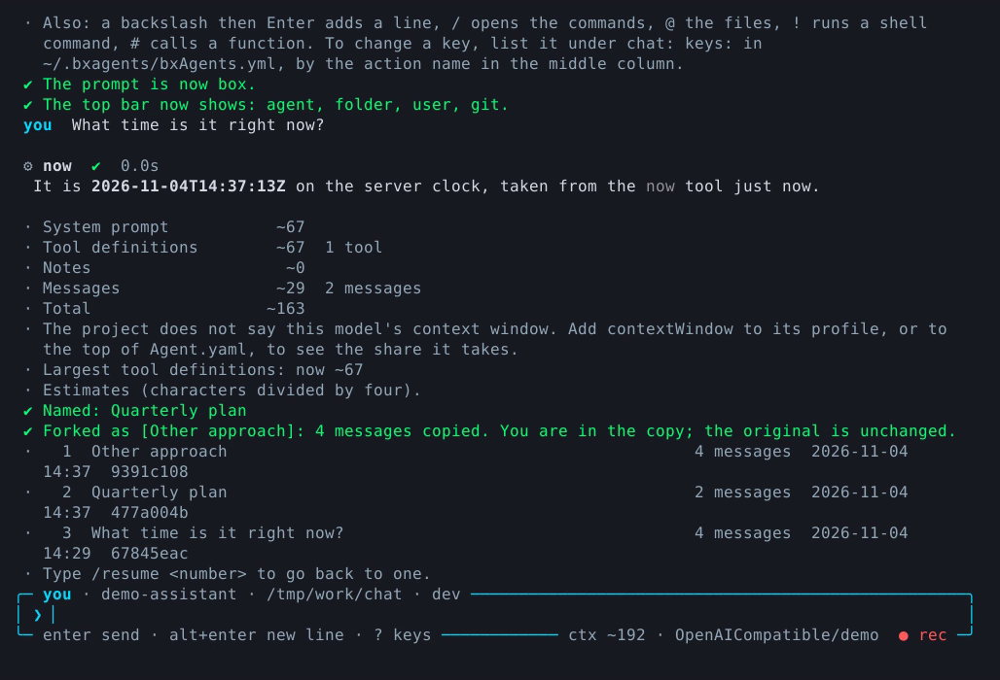

# Chat walkthroughs

Five short sessions, each about two minutes. They assume an agent you have already built; if you have not, start with the [quick start](../getting-started/quick-start.md). Every key and command used here is listed in [The terminal UI](terminal-ui.md) and [Slash commands](slash-commands.md).

<video controls preload="metadata" poster="../assets/video/chat-tour-poster.png" style="max-width:100%">
  <source src="../assets/video/chat-tour.mp4" type="video/mp4">
  <source src="../assets/video/chat-tour.webm" type="video/webm">
</video>

*The keys, prompt styles, context, name, fork and sessions in one run. The answers in these recordings come from a scripted demo model, so they are canned. Everything else is the real screen.*

## 1. Your first conversation

```bash
bxAgents build
bxAgents chat
```

1. Type a question and press **Enter**. The answer streams in; any tool the agent calls is shown with its arguments and how long it took.
2. Press **Alt+Enter** for a second line before sending.
3. Type `/` and look at the menu, or `?` for the keys. Type `/tools` to see what the agent can call.
4. Press **Esc** while the agent is working to stop it at its next step. Type while it works to **steer** it: your message is added to the run.
5. `/exit`, or **Ctrl+C** on an empty box, to leave.

Scroll up afterwards: the conversation is ordinary terminal text.

## 2. Pick a conversation up again

```bash
bxAgents chat --continue          # the latest one, with its history
```

Inside a chat:

1. `/name Quarterly plan` names this conversation.
2. `/fork Other approach` copies it, messages and all, and carries on in the copy. The original stays as it was.
3. `/sessions` lists your conversations, numbered. `/resume 2` goes back to number 2 and shows what was said.
4. `/export plan.html` saves the conversation as a page. A `.md` name saves Markdown.



*After `/name` and `/fork`: three conversations, numbered, with their message counts.*

Messages are kept in the agent's [memory](../conventions/agent-yaml.md#settings), so a conversation can be picked up again only as far as that memory lasts. The default `cache` memory is lost when the process ends; a `file` or `jdbc` memory is not.

## 3. Try another model

Needs more than one [profile](../conventions/models.md#profiles) in the project.

1. `/model` shows the model in use.
2. `/profile` lists the profiles; pick one with the arrows. Or `/profile fast` goes straight to it. The conversation, tools and instructions stay; only the model changes.
3. `/ping` checks the model answers, and says how long it took or why it did not.
4. `/default` goes back to the app's default.

## 4. Notes the agent keeps

Needs a [`notes`](../conventions/agent-yaml.md#notes) block in `Agent.yaml`.

1. `/remember I prefer short answers` keeps a note about you. The agent sees it in every conversation.
2. `/notes` opens the notes screen. **a** adds, **e** edits, **d** removes (after a yes), **Tab** switches between your notes and the agent's, **Esc** goes back.
3. `/notes stats` shows how many characters you use of the limit and the rough tokens they add to every conversation.

## 5. Show it a file or a picture

1. Type `@` and a list of files under your folder opens. Keep typing to narrow it; **Tab** takes one. The file's content goes with your message.
2. `@diagram.png` sends a picture. The profile needs `vision: true`, or the chat refuses it with a message instead of a provider error.
3. **Ctrl+V** pastes a picture from the clipboard.
4. `!git diff --stat` runs a command on your machine and sends what it printed along with your next message. `!!` shows it without sending.
5. `/context` shows what is attached and how big the context is.

## The wizard in the same style

<video controls preload="metadata" poster="../assets/video/wizard-poster.png" style="max-width:100%">
  <source src="../assets/video/wizard.mp4" type="video/mp4">
  <source src="../assets/video/wizard.webm" type="video/webm">
</video>

*The `new` wizard from the name to the finished project.*


`bxAgents new my-agent` is the other screen. Arrow keys or `j`/`k` move, **Space** ticks, **Enter** confirms, **Esc** goes back one question and **Ctrl+C** cancels without creating anything. The last screen prints the one-line command that would build the same project with no questions. The full tour is in [the new wizard](new-wizard.md).
