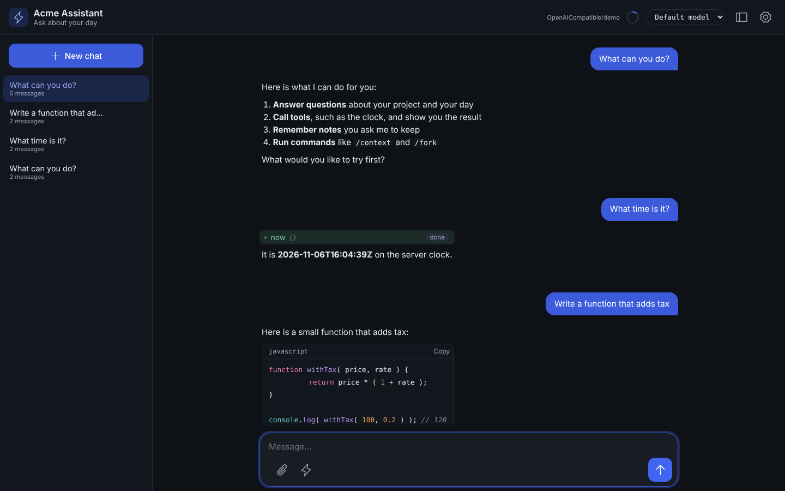
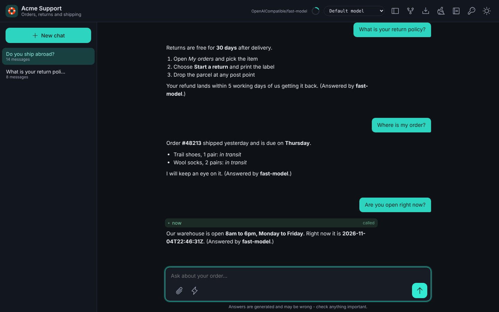
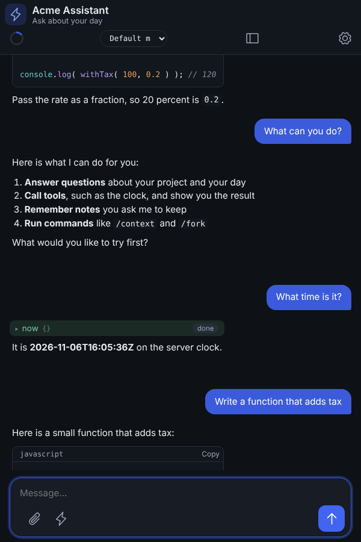
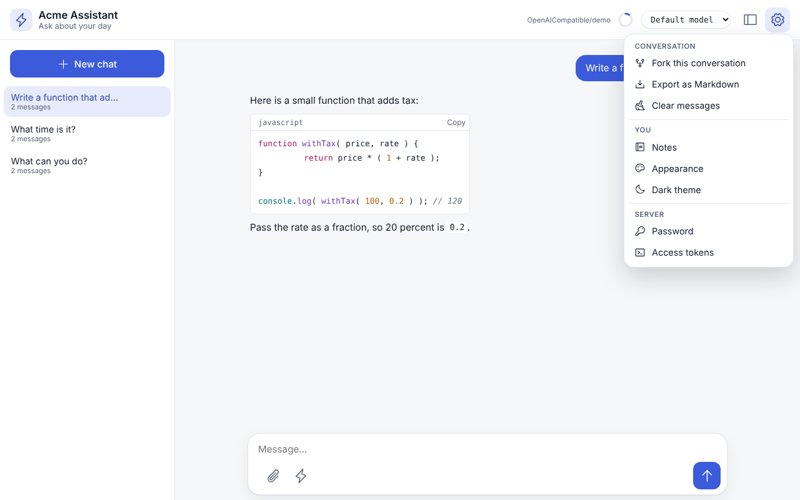
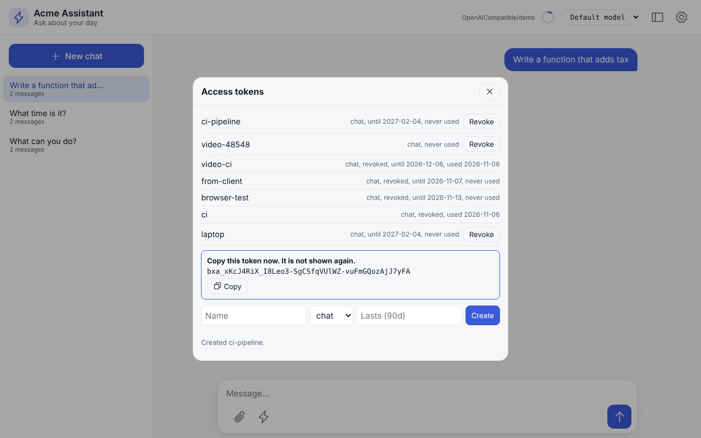

# Example: Building a Web Chat Agent

[`examples/webui-agent/`](https://github.com/ortus-boxlang/bx-agents/tree/development/examples/webui-agent) generates a complete, themed browser chat page for an agent from a single `gateways/*` entry with `exposes: "webui"` - the [v1 web chat UI](../conventions/web-ui.md). No frontend code to write, no Node/npm in the build, no separate deploy step for a SPA - the page is a real file BxAgents writes into the generated app.

This is the one example in this guide series with real screenshots, because it's the one kind of BxAgents example whose output is actually a browser page. The images below show the current page layout, captured from a demo app (title "Acme Assistant", blue accent), so the title, tagline and colors differ from this example's own config. The page is the same: only the branding comes from the gateway file.

## The project

```
webui-agent/
├── Agent.yaml
├── instructions.md
├── gateways/
│   └── chat.bx
└── resources/
    └── webui/
        └── theme.css
```

`Agent.yaml` is the same shape as every other example:

```yaml
name: webui-agent
description: An agent reachable through the v1 web chat UI via gateways/.
model: mock/mock-model
```

## The gateway: branding and theme, all in config

`gateways/chat.bx` is where the actual page comes from - `exposes: "webui"` is the trigger, and everything else is optional branding:

```javascript
class {

	function configure() {
		return {
			exposes     : "webui",
			path        : "/chat",
			apiKeyEnvVar: "CHAT_UI_API_KEY",   // optional - omit entirely to leave the agent API open (dev-mode)

			// ---------------------------------------------------------------
			// Branding
			// ---------------------------------------------------------------
			title      : "Acme Support",
			subtitle   : "Orders, returns and shipping",
			icon       : "🛟",                 // an emoji, an image URL/path ("/logo.svg", "https://..."), or "phosphor:<name>" ("phosphor:lightning")
			welcome    : "Hi! Ask me about an order, a return, or shipping times.",
			placeholder: "Ask about your order...",
			footer     : "Answers are generated and may be wrong - check anything important.",

			// ---------------------------------------------------------------
			// Stream detail - both default to true
			// ---------------------------------------------------------------
			showReasoning: true,   // the model's thinking, as a collapsed "Thinking" strip
			showToolCalls: true,   // each tool call as a collapsed chip (name + arguments)

			// ---------------------------------------------------------------
			// Theme - every key maps to a CSS custom property on the page.
			// ---------------------------------------------------------------
			theme: {
				accent  : "0f766e",
				accentFg: "ffffff",
				radius  : "10px",
				font    : "Inter, system-ui, sans-serif",
				maxWidth: "68%",

				dark: {
					accent  : "2dd4bf",
					accentFg: "05201c"
				}
			}
		};
	}

}
```

Other branding keys you can add: `suggestions` (up to four short texts, shown as buttons under the welcome message on an empty conversation; one click sends it) and `icon: "phosphor:<name>"` for an icon from the page's own set. With no `icon` the header shows a robot.

```javascript
suggestions: [ "Where is my order?", "How do I return something?" ],
```

Colors are written as bare hex with no leading `#` (`"0f766e"`, not `"#0f766e"`) - BoxLang starts string interpolation at a hash in both single- and double-quoted strings, so a literal one has to be doubled to parse at all. Bare hex sidesteps that entirely; see the comment in the file itself for the full reasoning, and [The web chat UI](../conventions/web-ui.md) for anything the theme tokens don't cover (that goes in `resources/webui/theme.css`, inlined last and wins).

## Build and run

```bash
cd examples/webui-agent
bxAgents build
bxAgents serve --port=8080
```

Open **http://localhost:8080/chat/index.html**. You get the conversation sidebar on the left, the streaming transcript in the middle, and a header and composer in the colors of your `theme`:



### Dark mode

The `theme.dark` overrides (`accent`/`accentFg`) apply automatically when the page switches to dark, from **Settings** or by following the system - everything else is the same generated CSS, just re-tokened:



### Narrow screens

The page is responsive with no separate mobile build - at a narrow viewport, the transcript keeps its full width and the conversation sidebar becomes an overlay instead of squeezing the content:



## The header and the Settings menu

The header keeps what you use every minute: **Chats** (shows or hides the sidebar), the context ring (click it for what is sent to the model), the model picker (only when the gateway lists `profiles`) and a **Settings** gear. The gear opens one menu with three groups. An item the server does not offer, and a group with nothing in it, is left out.

| Group | Items |
|---|---|
| **Conversation** | Fork this conversation, Export as Markdown, Clear messages, Compact older messages |
| **You** | Notes (when the agent has a `notes` block), Appearance (mode, accent color, text size, density, saved in your browser), Dark or Light theme |
| **Server** | Password, Access tokens |



In the message box, the paperclip attaches a picture or a text file (you can also paste or drop them), the lightning button opens the `/` commands menu, and the arrow sends. While the agent works the arrow steers the run and a stop button appears.

## The optional API key

This example ships `apiKeyEnvVar` **set**. It is the agent API's shared secret, so every call to `/__bxagents` must carry a matching `x-bxagents-token` header - the static shell (`/chat/index.html`) itself stays reachable regardless, since a browser's plain page navigation can't send a custom header, and the shell is exactly what prompts you for the key:

```bash
export CHAT_UI_API_KEY="a-real-secret"
bxAgents build
bxAgents serve --port=8080
```

The page loads fine either way, but a call without the matching key gets a 401 and the page opens its **Password** form by itself - type `a-real-secret` and choose **Save**. A wrong password shows "That password was not accepted". The form is also under **Settings**, **Password**, where **Forget it** removes the saved value. The password is kept in the browser's `localStorage` until you forget it. Delete the `apiKeyEnvVar` line entirely to leave the UI open instead (fine for local dev, never for a public deployment).

## Access tokens for administrators

With `agentApi: { tokens: true, manageTokens: true }` in `Agent.yaml`, a caller with an `admin` token sees **Settings**, **Access tokens**. The panel lists tokens, creates one (a name, a scope of `chat` or `admin`, and how long it lasts, such as `90d`), shows the secret once for you to copy, and revokes tokens. `manageTokens` is off by default and a `chat` token gets `403`. The same thing from a shell is `bxAgents token create|list|revoke`.



## One API for the page, the terminal and the gateways

`path: "/chat"` is only where the static shell is served. The page calls the agent API at `/__bxagents`, which derives the visitor's identity **server-side only**, rather than trusting a caller-supplied `userId` the way ColdBox's `toAi()` does, and which the terminal chat and the gateways use too. See [Conversation identity](../conventions/web-ui.md#conversation-identity) for the full reasoning.

## What's proven, and what isn't

The generator output itself - the static shell, the templated placeholders, the sign-in pieces when there are accounts, its registration from `Application.bx` - is proven by real generator specs and confirmed to compile and instantiate. Over real HTTP, `runColdBoxIntegrationTests.bxs` proves `/__bxagents/health` and, further, the shared-preferences round trip (`/__bxagents/preferences/set` + `/__bxagents/preferences`) between two independent callers. The screenshots above were captured from the real generated page, not a hand-built mockup - but do at least one real `bxAgents serve` + browser check of your own theme/branding choices before depending on them in production.

## Where to go next

- [The web chat UI](../conventions/web-ui.md) for the full picture - human-in-the-loop approvals, compaction, steer-while-streaming, the SQLite-backed conversation store.
- [Example: A Minimal Agent](example-minimal-agent.md) if you haven't seen the base project shape yet.
- [Example: Building a Slack Bot](example-slack-bot.md) for an agent reachable on a chat platform instead of a browser.
