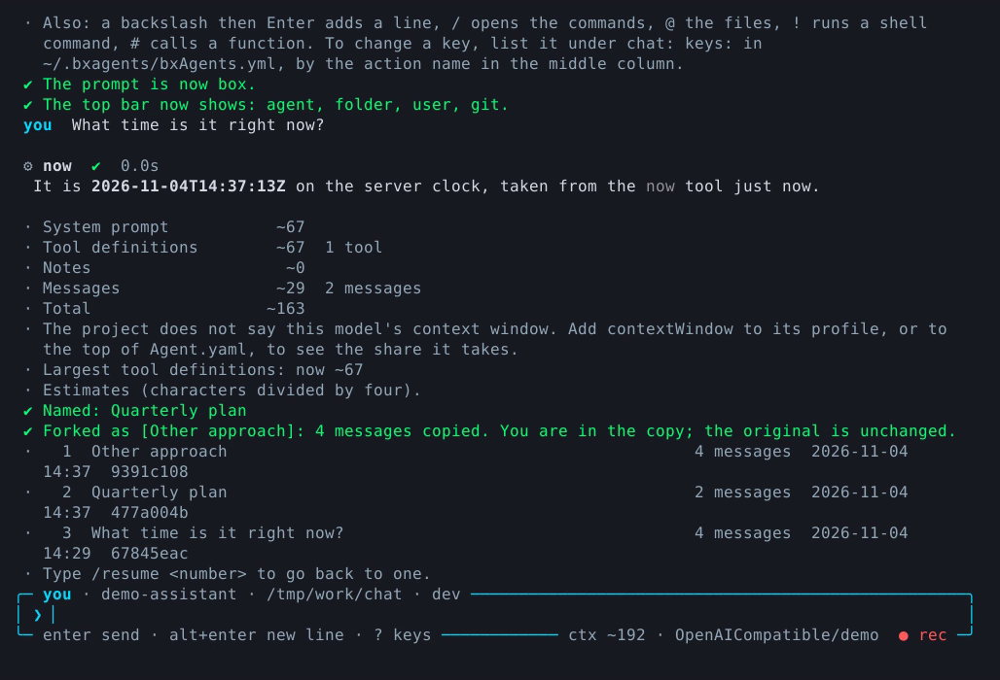

# Slash commands

Type `/` in the terminal chat or the [web chat](../conventions/web-ui.md#slash-commands) to see the commands. Each one is written once, as a small class that answers with data, and every surface draws that answer its own way. In [chat platforms](../conventions/gateways/index.md#commands-in-a-gateway) type the command as a message; the default prefix is `/` and a gateway can change it.

**Where** is `T` terminal, `W` web page, `G` chat platforms. A command marked `G` still needs to be in the gateway's `allow` list; the default list is `help`, `info`, `tools`, `model`, `ping`, `notes` and `remember`.

*`/name`, `/fork` and `/sessions` in a real chat.*

## Conversations

| Command | Where | Does | Example |
|---|---|---|---|
| `/new` | T W G | Start a new conversation. The old one stays in the list | `/new` |
| `/sessions` | T W G | List your recent conversations, numbered | `/sessions` |
| `/resume [number or id]` | T W G | Go back to one and show what was said. No argument: the most recent | `/resume 2` |
| `/name <name>` | T W | Name this conversation | `/name Quarterly plan` |
| `/fork [name]` | T W | Copy this conversation, messages and all, and carry on in the copy | `/fork Other approach` |
| `/clear` | T W G | Forget this conversation's messages, keep the conversation | `/clear` |
| `/compact` | T W G | Replace older messages with a summary. Needs a summary model on the agent's memory | `/compact` |
| `/export [file] [--format=md\|html]` | T W | Save the conversation. The file name decides the format unless `--format` says | `/export plan.html` |
| `/exit` (alias `/quit`) | T | Leave the chat | `/exit` |

On a gateway, `/new`, `/clear`, `/compact`, `/sessions` and `/resume` are off until the gateway sets `commands.conversation: true`.

## Know what is going on

| Command | Where | Does | Example |
|---|---|---|---|
| `/help` | T W G | List the commands you can run here | `/help` |
| `/info` | T W G | Agent, model, conversation, message count, notes and database | `/info` |
| `/tools` | T W G | List the agent's tools | `/tools` |
| `/context` | T W | How big the context is and what it is made of. Worked out locally, no model call | `/context` |
| `/stats [days] [--by=model\|provider\|day\|user]` | T | Tokens the model calls used. `/stats enable` turns usage recording on | `/stats 7 --by=day` |
| `/keys` | T W | Which key does what, with the action name of each. `?` alone does the same | `/keys` |

## Models

| Command | Where | Does | Example |
|---|---|---|---|
| `/model` | T W G | Show the model in use, its profile, context window and vision support | `/model` |
| `/profile [name]` | T | Pick a [profile](../conventions/models.md#profiles) from a list, or switch straight to one. The conversation is kept | `/profile fast` |
| `/default` | T | Go back to the app's default model | `/default` |
| `/ping [profile]` | T W G | Test that the model answers, with one tiny question. Says how long it took, or why it did not | `/ping fast` |

Over `--connect` or `--server`, `/profile` can only switch among the profiles the server lists in [`agentApi.profiles`](../conventions/agent-bx.md#agentapi).

## Notes

| Command | Where | Does | Example |
|---|---|---|---|
| `/remember <text>` | T W G | Keep a note about you | `/remember I prefer short answers` |
| `/notes` | T W G | Open the notes screen (terminal) | `/notes` |
| `/notes list` | T W G | Print your notes and the agent's, with how full each is | `/notes list` |
| `/notes add [agent] <text>` | T W G | Add a note about you, or with `agent` about the agent's work | `/notes add agent Use metric units` |
| `/notes edit <id> <text>` | T W G | Change a note; the id is the short code in the list | `/notes edit a3f New text` |
| `/notes remove <id>` | T W G | Remove a note. Removing the agent's needs an `admin` token over `--connect` | `/notes remove a3f` |
| `/notes stats` | T W G | Characters used against the limit, and the rough tokens they add | `/notes stats` |

## Your terminal

These act on your own machine or your own session, so they stay in the terminal (`/extensions` also works in the web page).

| Command | Where | Does | Example |
|---|---|---|---|
| `/extensions [name]` | T W | List the extensions the chat loads and what each added; with a name, one in detail | `/extensions` |
| `/reload` | T | Load the extensions and their settings again. Admin only | `/reload` |
| `/prompt [style]` | T | Show or change the message box look for this chat | `/prompt box`, `/prompt top +git -clock` |
| `/copy` | T | Copy the last answer to the clipboard (OSC 52, honoured by most terminals) | `/copy` |
| `/record [file]`, `/record stop` | T | Record the screen as a `.cast` file | `/record demo.cast` |

## Add your own

`/extensions` and `/reload` come with the [extension](../conventions/extensions.md) support. An extension adds commands such as `/deploy` or `/roll 2d6` to the chat, and [a first extension](first-extension.md) walks through one. The commands over HTTP are `GET /__bxagents/commands` and `POST /__bxagents/command`, see [Run control](../conventions/agent-bx.md#run-control).
