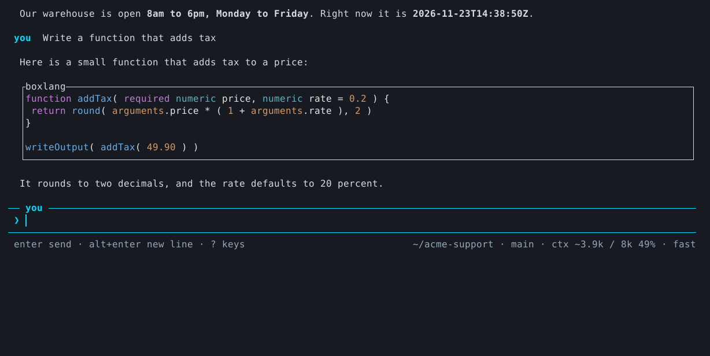
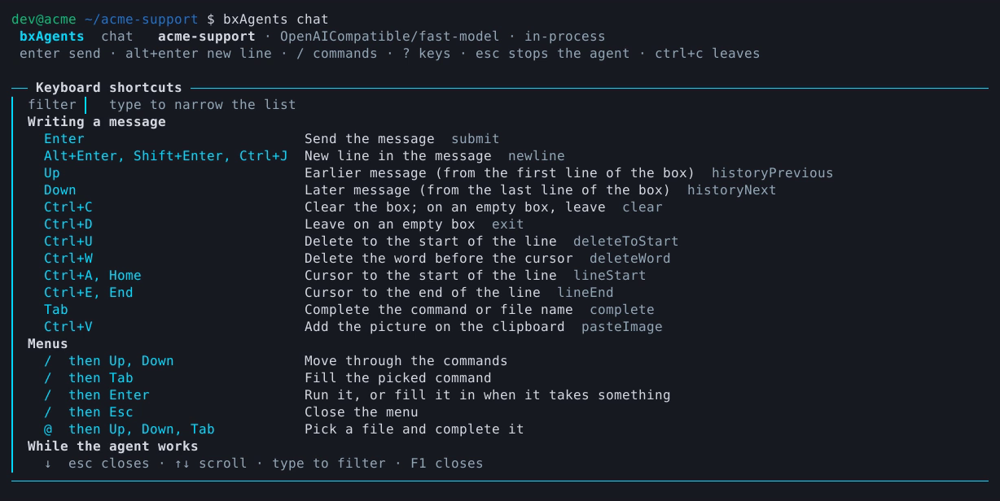
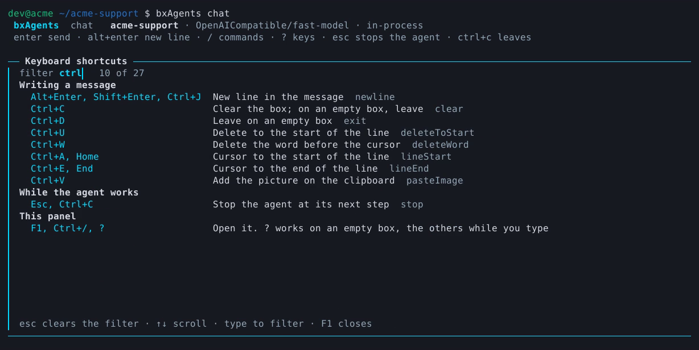
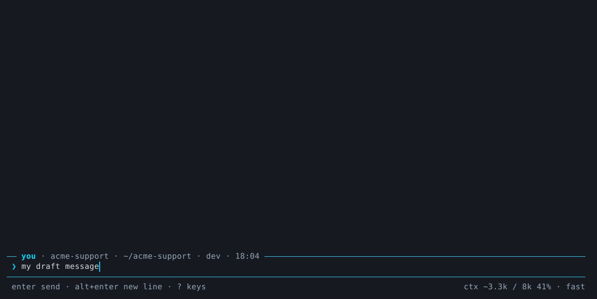
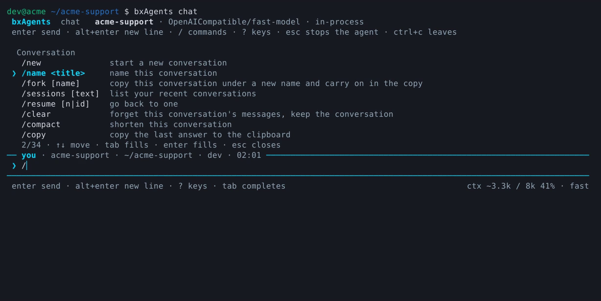
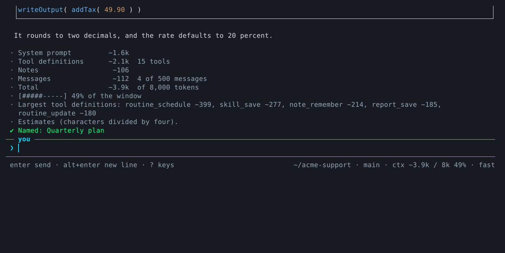
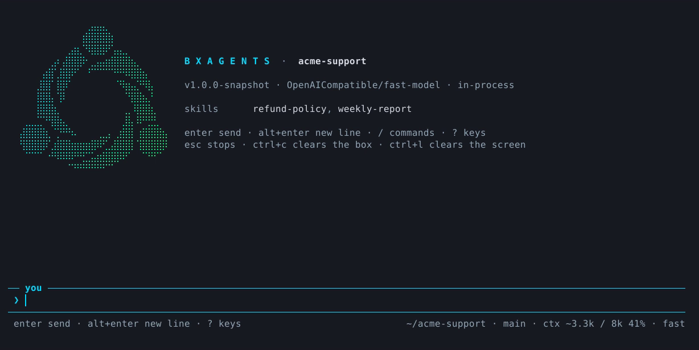
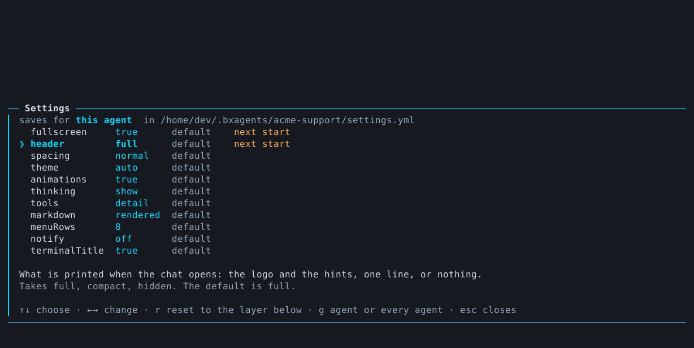

# The terminal UI

Two commands draw a full terminal screen: [`bxAgents chat`](../cli-reference.md#chat), where you talk to your agent, and [`bxAgents new`](new-wizard.md), where you answer questions and get a project. This page is the tour. Every command and flag is in the [CLI reference](../cli-reference.md); every slash command is in [Slash commands](slash-commands.md); a guided first session is in [Chat walkthroughs](chat-walkthrough.md).

<video controls preload="metadata" poster="/assets/video/terminal-trailer-poster.png" style="max-width:100%">
  <source src="/assets/video/terminal-trailer.mp4" type="video/mp4">
  <source src="/assets/video/terminal-trailer.webm" type="video/webm">
  <track kind="captions" src="/assets/video/terminal-trailer.vtt" srclang="en" label="English" default>
</video>

*The trailer, about two minutes, narrated, with captions: the chat, the commands, the keys, conversations, files, models, prompt styles, settings, notes and the vault, export and record, and the wizard. The answers come from a scripted demo model, so they are canned.*

<video controls preload="metadata" poster="/assets/video/chat-terminal-poster.png" style="max-width:100%">
  <source src="/assets/video/chat-terminal.mp4" type="video/mp4">
  <source src="/assets/video/chat-terminal.webm" type="video/webm">
</video>

*A chat session: slash commands, a tool call and a formatted answer. The answers in these recordings come from a scripted demo model, so they are canned. Everything else is the real screen.*

## Start a chat

```bash
bxAgents build          # chat needs a built agent (not with --connect)
bxAgents chat
```

| Run | Talks to | Use it when |
|---|---|---|
| `bxAgents chat` | The agent, loaded in this process | You want to talk to the agent. Fastest. |
| `bxAgents chat --server` | A throwaway local server | You need interceptors, schedules or gateways to be real |
| `bxAgents chat --connect=<url> [--token=<t>]` | A server that is already running | You want to talk to a deployment |
| `bxAgents chat --no-tui` | Same as the first, in a plain line-by-line prompt | A terminal that cannot draw, or you just prefer it |

`--continue` reopens your latest conversation, `--session=<number or id>` a particular one, `--user=<name>` chooses whose conversations and notes you see. `--inline` keeps the message box right under the last line instead of at the bottom of a cleared screen, and `--fullscreen` does the opposite of a saved choice, for one run. Every other way to choose is in [Settings](#settings).

## The screen

Finished turns are printed as ordinary terminal text, so **your scrollback, search and copy keep working**. Only two things are redrawn: the message box at the bottom and the answer being written.

- **Answers** stream in as they are produced and are printed as formatted Markdown when complete: headings, lists, tables with rounded borders, and code blocks coloured by language.
- **Tool calls** are shown with their arguments and how long they took.
- **Thinking** is shown while the model works and is never kept.
- **Approvals.** When a run stops for a [human-in-the-loop](../conventions/gateways/index.md) decision, the screen asks in place: approve once, approve for the conversation, or reject.
- **The hint row** under the box lists the keys and starts with the size of the context, such as `ctx ~12.4k / 128k 9%`. It is an estimate (characters divided by four), refreshed before every prompt.



*Finished turns are ordinary terminal text. The answer is formatted Markdown, with the tool call above it and the message box below.*

## Keys

| Key | Does |
|---|---|
| Enter | Send the message |
| Shift+Enter, Ctrl+J, or `\` then Enter | New line |
| Up / Down | Earlier and later messages, from the first or last line of the box |
| Tab | Complete a `/command` or an `@file` |
| Ctrl+A / Home, Ctrl+E / End | Start and end of the line |
| Ctrl+U, Ctrl+W | Delete to the start of the line, delete the word before the cursor |
| Ctrl+Shift+V | Add the picture on the clipboard |
| Ctrl+L, or `/cls` | Clear the screen above the box and the scrollback. The conversation and what you typed stay |
| Ctrl+C | Clear the box. On an empty box, leave. While the agent works, stop it |
| Ctrl+D | Leave, on an empty box (otherwise delete the character under the cursor) |
| Esc | While the agent works, stop it at its next step (not mid-word) |
| Enter while the agent works | **Steer**: your message is added to the run |
| F1, Ctrl+/, or `?` alone, or `/keys` | Open the shortcuts panel: every key as bound right now. F1 and Ctrl+/ work while you type, and what you typed stays in the box |
| Up / Down, Tab, Enter, Esc while the `/` menu is open | Move, fill, run or fill, close: the menu keys are in the Commands section below. The `@` menu takes Up / Down and Tab |

### The shortcuts panel



*F1 opens a panel in place of the message box. Everything you can press is in it, in sections: writing a message, the menus, while the agent works, the prefixes and the keys your extensions add. The grey word after a key is the name to use for it in `Agent.yml`.*

Type to narrow the list: `ctrl` shows the keys with Ctrl, `newline` the key that adds a line.



| Key | Does in the panel |
|---|---|
| Type, Backspace | Narrow the list by the keys, by what they do, by their name or by the section |
| Up, Down, PgUp, PgDn | Scroll |
| Esc | Clear the filter; with no filter, close the panel |
| F1, Ctrl+/ | Close it |

A key you changed in `Agent.yml` shows what it was, as `(was Shift+Enter, Ctrl+J)`. Some terminals do not pass Ctrl+/ through, which is why F1 is the one to count on.

<video controls preload="metadata" poster="/assets/video/keys-panel-poster.png" style="max-width:100%">
  <source src="/assets/video/keys-panel.mp4" type="video/mp4">
</video>

*Opening the panel over a half typed message, narrowing it, scrolling, closing it, and opening it again with `/keys`.*

### Change a key

Keys live in a file that belongs to you, not to any project: `~/.bxagents/Agent.yml` (set `BXAGENTS_USER_CONFIG` to use another file).

```yaml
chat:
  keys:
    newline: [ ctrl+n, shift+enter ]
    stop: ctrl+x
```

Actions you can change: `submit`, `newline`, `historyPrevious`, `historyNext`, `clear`, `exit`, `deleteToStart`, `deleteWord`, `lineStart`, `lineEnd`, `complete`, `pasteImage`, `clearScreen` and `stop`. Keys are written the way people say them: `enter`, `alt+enter`, `shift+enter`, `ctrl+j`, `esc`, `tab`, `up`, `down`, `home`, `end`, or a letter with `ctrl` or `alt`.

A typo never leaves you stuck. An unknown action, an unreadable key, or a key another action in the same place already uses is reported when the chat starts, and that action keeps its default keys.

## Clear the screen

Ctrl+L (the `clearScreen` action) or `/cls` clears the screen above the message box and the terminal's scrollback. The conversation, the agent's memory and what you typed in the box stay as they were. `/clear` is different: it forgets the conversation's messages.



*After Ctrl+L the screen above the box is empty and the half typed message is still there. The box stays at the bottom of the terminal.*

## Commands: type `/`

A `/` at the start of the box opens a menu of every command, under a heading for each group: Conversation, Agent, Model, Screen and Memory, and one for each extension. It shows eight at a time and scrolls, with a counter such as `10/36`.

| Key | Does in the menu |
|---|---|
| Up / Down | Move the pick, wrapping at both ends |
| Type | Narrow the list. Names that start with what you typed come first, then names that contain it, then, from three letters on, descriptions that contain it: `/ctx` finds nothing, `/text` finds `/context` |
| Tab | Fill the picked command into the box, followed by a space |
| Enter | Run the picked command when it takes nothing (`/new`), or fill it in, with a space after the name, when it takes something (`/resume`) so you can add the rest. Text you typed in full is sent as it is |
| Esc | Close the menu until you type something else |



*Type `/` and every command is there, grouped. The picked row is marked, and the last line gives the position and the keys.*

<video controls preload="metadata" poster="/assets/video/slash-menu-poster.png" style="max-width:100%">
  <source src="/assets/video/slash-menu.mp4" type="video/mp4">
</video>

*Browsing the menu, narrowing it with `ses`, filling `/sessions`, then running `/new`.*

Each row shows what the command takes after its name, such as `/resume [n|id]`, and a short description. Up and Down walk your earlier messages again once the menu is closed. All of the commands are listed in [Slash commands](slash-commands.md); the ones you will use first are `/help`, `/new`, `/sessions`, `/resume`, `/context`, `/model` and `/exit`. `/stats` shows the tokens the model calls used, once `usage: true` is set in `Agent.yml`.

## Conversations

Every chat is a conversation, kept in the project's shared chat database next to the web page's own.

| Do | How |
|---|---|
| Start where you left off | `bxAgents chat --continue`, or `--session=<number or id>` |
| See the list | `/sessions` (numbered, newest first) |
| Go back to one | `/resume 2`; with no number, the most recent |
| Name or copy one | `/name Quarterly plan`, `/fork Other approach` |
| Save one | `/export plan.html` (or `.md`); `--format=md\|html` overrides the file name |
| Start a clean one | `/new`, or `/clear` to empty this one |

From a shell, `bxAgents sessions list|rename|fork|delete` does the same. A step by step run is in [Chat walkthroughs](chat-walkthrough.md#2-pick-a-conversation-up-again).

## Extensions

Extensions in the project's `extensions/` folder, in your own `~/.bxagents/extensions/` and in installed modules add commands, keys and status text to this screen. `/extensions` lists what loaded and what went wrong; `/reload` loads them again after an edit (admins, which you are in your own terminal). Keys an extension adds show in `/keys` and can be rebound under `chat: keys:` like any other. See [Write your first extension](first-extension.md).

## Files, pictures and your own machine

| Type | Does |
|---|---|
| `@` | Lists the files under the folder you started in. Keep typing to narrow it |
| `@path/to/file` | Sends a text file's content with the message |
| `@picture.png` | Sends a picture (png, jpg, gif, webp) as an image part. Up to 4 per message, 5 MB each. Refused when the profile says `vision: false` |
| `!command` | Runs a shell command **on your machine**; its output goes with your next message so the agent sees what you saw |
| `!!command` | Same, shown on screen only |
| `#function( args )` | Calls one BoxLang built-in, such as `#dateFormat( now(), 'yyyy-MM-dd' )`; the result goes with your next message |
| `##function( args )` | Same, shown on screen only |

`!` and `#` run locally even when the chat is connected to a server. Switch them off, or narrow them, in the same user file:

```yaml
chat:
  shell: false                       # or a shell: "bash -c", "pwsh -Command"
  bifs: [ dateFormat, listLen ]      # or false to switch # off
```



*`/context` shows what the context is made of. It is worked out locally, no model is called.*

Details and limits: [CLI reference](../cli-reference.md#files-and-pictures-in-the-message).

## Settings

How the chat looks and behaves is a short list of settings, the same in every file that can hold them. The chat opens full screen by default: it clears the screen, draws the header at the top and keeps the message box and the footer at the bottom. Your scrollback is kept, and finished turns still go into it.



*The header at the top: the bxAgents icon drawn in braille characters, the way the BoxLang installers draw the BoxLang mark, with the name and the agent beside it, the version and model, a line each for what the agent has: `skills`, `extensions`, `connectors`, `gateways` and `mcp` (a line with nothing in it is left out, a list that does not fit ends with how many more there are, an extension that failed to load is marked, and a connector that is signed in has a check mark), and the keys. The skills that bxAgents ships are counted as `6 from bxAgents`, so yours come first. The message box and the footer are at the bottom. On a terminal too small for the icon (under about 80 columns or 21 rows), the header is one line. The footer has the folder and branch, the context and the model on the right, so the top bar of the box only says who is writing.*

| Setting | Values (default first) | What it does |
|---|---|---|
| `fullscreen` | `true`, `false` | Clear the screen when the chat opens and keep the message box at the bottom. `false` keeps the box right under the last line |
| `header` | `full`, `compact`, `hidden` | What is printed when the chat opens: the icon with the agent, what it loaded and the hints, one line, or nothing |
| `spacing` | `normal`, `compact` | A blank line between the turns of the conversation, or none |
| `theme` | `auto`, `dark`, `light` | The colours: for a dark or a light terminal, or by what the terminal says it supports (`COLORFGBG`) |
| `animations` | `true`, `false` | The spinner and the other motion while the agent works. `false` shows a still marker |
| `thinking` | `show`, `hide` | Show the model's thinking while it works, or only that it is working |
| `tools` | `detail`, `summary`, `hidden` | Tool calls with their arguments and time, with only the name and result, or not at all |
| `markdown` | `rendered`, `source` | Answers drawn with headings, lists, tables and coloured code, or as the text the model wrote |
| `menuRows` | `8` (3 to 20) | How many commands or files the `/` and `@` menus show at once |
| `notify` | `off`, `bell`, `system` | Tell you when an answer that took more than ten seconds is done: nothing, the terminal bell, or a desktop notification |
| `terminalTitle` | `true`, `false` | Put the agent's name in the terminal's title while the chat is open |

The message box's own look, `prompt` and `widgets`, is set in the same block, see [The look of the message box](#the-look-of-the-message-box).

<video controls preload="metadata" poster="/assets/video/tui-settings-poster.png" style="max-width:100%">
  <source src="/assets/video/tui-settings.mp4" type="video/mp4">
</video>

*The chat opens with the header at the top and the box at the bottom, then `/settings` changes `tools`, `thinking` and the rest, and the next answer follows them.*

### Where a setting comes from

The first of these that has a value for a setting wins:

1. **The flag of one run:** `--inline` (same as `fullscreen: false`) or `--fullscreen`.
2. **The agent's own file**, in its data home: `~/.bxagents/<agent name>/Agent.yml` (see [the data home](../conventions/data.md#the-data-home)). It is yours, for that agent on this machine.
3. **Your file for every agent**, `~/.bxagents/Agent.yml`. This is the fallback for an agent that has no setting of its own.
4. **The project's `Agent.yml`**, which is the author's suggestion.
5. **The default** in the table above.

The same block, with the same names, goes in all three files:

```yaml
# ~/.bxagents/support-bot/Agent.yml, or ~/.bxagents/Agent.yml, or Agent.yml
tui:
  fullscreen: false
  header: compact
  tools: summary
```

These are the same files that layer every other setting of the agent, not only `tui:`: see [layered settings](../conventions/layered-settings.md).

A value a setting does not take is reported when the chat starts, and the layer below it applies. A chat over `--connect` talks to an agent somewhere else, so it has no agent file: only the flag, your file and the defaults apply.

### Change them with /settings

`/settings` opens a panel with every setting, its value, and which layer the value comes from.



| Key | Does |
|---|---|
| Up, Down | Choose a setting |
| Left, Right, Enter | Change the value. It is saved at once, and the chat uses it from then on |
| `r` | Take this agent's value out, so the layer below applies again |
| `g` | Switch between saving for this agent and for every agent |
| Esc | Close |

The first time you save to a file in a chat, the panel asks. `fullscreen` and `header` are about how the chat opens, so they apply the next time.

From the message box: `/settings header` shows one setting, `/settings header compact` saves it for this agent, `/settings header compact --global` saves it for every agent, and `/settings header reset` takes the agent's own value out. Only the `tui:` lines of the file change, so everything else in it stays as you wrote it.

## The look of the message box

Five styles, each with a top bar that carries a label and small facts (widgets):

| Style | Look |
|---|---|
| `bars` (default) | A bar above and below the box, hints and bottom widgets under the lower bar |
| `bars-hints` | The same two bars, hints and bottom widgets inside the lower one |
| `rule` | One coloured rule above, hints below |
| `box` | A rounded box |
| `panel` | A tinted panel with a thick left bar. Drawn as `rule` without 256 or true colour |

The default is no widget in the top bar and `folder`, `git`, `ctx` and `profile` at the bottom, so the top bar only says who is writing. Widgets: `agent`, `profile`, `folder`, `user`, `clock`, `machine`, `git`, `date`, `session`, `elapsed`, `ctx`. A widget with nothing to show (`git` outside a repository) is left out, and the last ones drop off when the line is too narrow.

Set the start for the project in `Agent.yml`:

```yaml
tui:
  prompt: bars
  widgets:
    top: []
    bottom: [ folder, git, ctx, profile ]
```

Or change it for one chat: `/prompt box`, `/prompt top +git -clock`, `/prompt bottom none`.

## Notes screen

`/notes` opens a screen with the notes the agent keeps about you and about its own work: `a` add, `e` or Enter edit, `d` remove, `t` or Tab switch between yours and the agent's, `s` stats, Esc back. Needs a [`notes`](../conventions/agent-yaml.md#notes) block in `Agent.yml`.

## Record it

`bxAgents chat --record=demo.cast` (or `/record demo.cast` inside the chat, `/record stop` to finish) saves the screen as an [asciicast](https://docs.asciinema.org/manual/asciicast/v2/). Replay with `asciinema play demo.cast`. Keystrokes are not recorded, but what you typed in the box and everything the agent printed is, tool arguments included. It needs the terminal screen.

## Colours and fallbacks

- **True colour, 256 colours or 16 colours** depending on `COLORTERM` and `TERM`.
- **`NO_COLOR`** set, or `TERM=dumb`: no colour at all.
- **Not an interactive terminal** (a pipe, CI): the chat falls back to the plain REPL. For scripts use [`invoke`](../cli-reference.md#invoke).
- **`bxAgents new`** asks its questions only in a terminal and without `--model`. Pass `--model` (a script is calling) and it uses flags and defaults; without a terminal it needs `--model`. See [the new wizard](new-wizard.md).

## Troubleshooting

| You see | Cause and fix |
|---|---|
| The chat cannot find the agent | Run `bxAgents build` first, or use `--connect` |
| A key does nothing | Run `/keys` to see what is bound, and rebind in `Agent.yml` if your terminal keeps that key for itself |
| Colours look wrong | Set `COLORTERM=truecolor`, or `NO_COLOR=1` to switch colour off |
| `--connect` says 401 | The server wants a token: `--token=<token>` or `BXAGENTS_TOKEN` |
| A picture is refused | The profile sets `vision: false`, or the file is not png, jpg, gif or webp, or is over 5 MB |
| `/export` writes to an unexpected place | Without a name the file is dated and written to the folder you started in |
