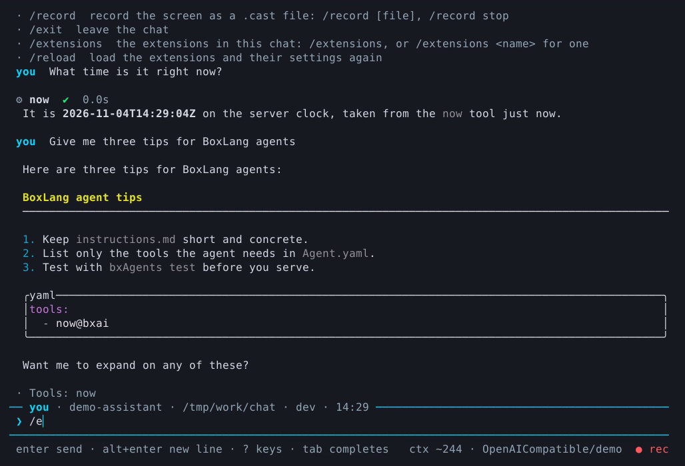
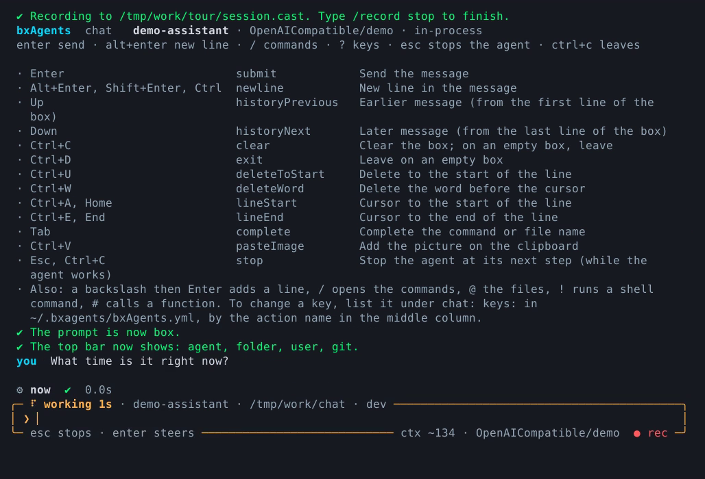
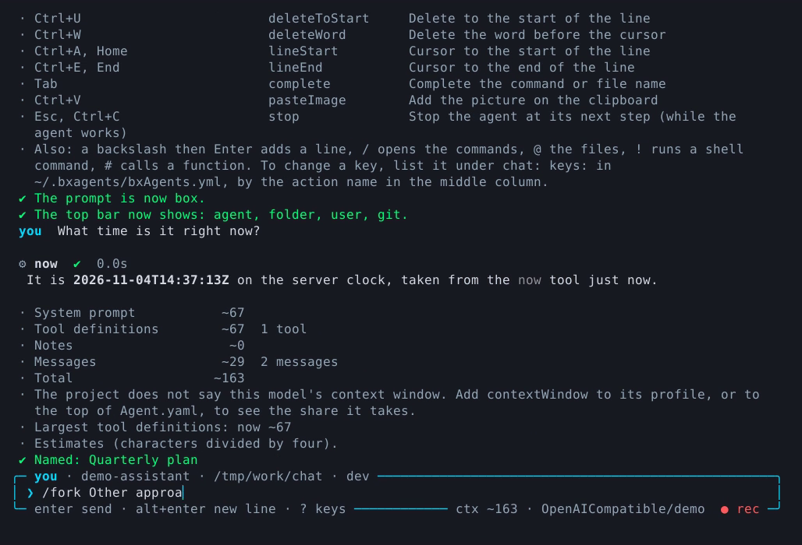

# The terminal UI

Two commands draw a full terminal screen: [`bxAgents chat`](../cli-reference.md#chat), where you talk to your agent, and [`bxAgents new`](new-wizard.md), where you answer questions and get a project. This page is the tour. Every command and flag is in the [CLI reference](../cli-reference.md); every slash command is in [Slash commands](slash-commands.md); a guided first session is in [Chat walkthroughs](chat-walkthrough.md).

<video controls preload="metadata" poster="../assets/video/chat-terminal-poster.png" style="max-width:100%">
  <source src="../assets/video/chat-terminal.mp4" type="video/mp4">
  <source src="../assets/video/chat-terminal.webm" type="video/webm">
</video>

*A chat session: slash commands, a tool call and a formatted answer. The answers in these recordings come from a scripted demo model, so they are canned. Everything else is the real screen.*

## Start a chat

```bash
bxAgents build          # chat needs a built agent (not with --connect)
bxAgents chat
```

| Run | Talks to | Use it when |
|---|---|---|
| `bxAgents chat` | The agent, loaded in this process | You want to talk to the agent. Fastest. |
| `bxAgents chat --server` | A throwaway local server | You need interceptors, schedules or gateways to be real |
| `bxAgents chat --connect=<url> [--token=<t>]` | A server that is already running | You want to talk to a deployment |
| `bxAgents chat --no-tui` | Same as the first, in a plain line-by-line prompt | A terminal that cannot draw, or you just prefer it |

`--continue` reopens your latest conversation, `--session=<number or id>` a particular one, `--user=<name>` chooses whose conversations and notes you see.

## The screen

Finished turns are printed as ordinary terminal text, so **your scrollback, search and copy keep working**. Only two things are redrawn: the message box at the bottom and the answer being written.

- **Answers** stream in as they are produced and are printed as formatted Markdown when complete: headings, lists, tables with rounded borders, and code blocks coloured by language.
- **Tool calls** are shown with their arguments and how long they took.
- **Thinking** is shown while the model works and is never kept.
- **Approvals.** When a run stops for a [human-in-the-loop](../conventions/gateways/index.md) decision, the screen asks in place: approve once, approve for the conversation, or reject.
- **The hint row** under the box lists the keys and starts with the size of the context, such as `ctx ~12.4k / 128k 9%`. It is an estimate (characters divided by four), refreshed before every prompt.



*Finished turns are ordinary terminal text. The answer is formatted Markdown, with the tool call above it and the message box below.*

## Keys

| Key | Does |
|---|---|
| Enter | Send the message |
| Alt+Enter, Shift+Enter, Ctrl+J, or `\` then Enter | New line |
| Up / Down | Earlier and later messages, from the first or last line of the box |
| Tab | Complete a `/command` or an `@file` |
| Ctrl+A / Home, Ctrl+E / End | Start and end of the line |
| Ctrl+U, Ctrl+W | Delete to the start of the line, delete the word before the cursor |
| Ctrl+V | Add the picture on the clipboard |
| Ctrl+C | Clear the box. On an empty box, leave. While the agent works, stop it |
| Ctrl+D | Leave, on an empty box |
| Esc | While the agent works, stop it at its next step (not mid-word) |
| Enter while the agent works | **Steer**: your message is added to the run |
| `?` alone, or `/keys` | Show the keys as bound right now |



*`/keys` lists every key, the action name to use in `bxAgents.yml`, and what it does.*

### Change a key

Keys live in a file that belongs to you, not to any project: `~/.bxagents/bxAgents.yml` (set `BXAGENTS_USER_CONFIG` to use another file).

```yaml
chat:
  keys:
    newline: [ ctrl+n, alt+enter ]
    stop: ctrl+x
```

Actions you can change: `submit`, `newline`, `historyPrevious`, `historyNext`, `clear`, `exit`, `deleteToStart`, `deleteWord`, `lineStart`, `lineEnd`, `complete`, `pasteImage` and `stop`. Keys are written the way people say them: `enter`, `alt+enter`, `shift+enter`, `ctrl+j`, `esc`, `tab`, `up`, `down`, `home`, `end`, or a letter with `ctrl` or `alt`.

A typo never leaves you stuck. An unknown action, an unreadable key, or a key another action in the same place already uses is reported when the chat starts, and that action keeps its default keys.

## Commands: type `/`

A `/` at the start of the box opens a menu of commands. Keep typing to narrow it, Tab or Enter to take one. All of them are listed in [Slash commands](slash-commands.md); the ones you will use first are `/help`, `/new`, `/sessions`, `/resume`, `/model` and `/exit`.

## Files, pictures and your own machine

| Type | Does |
|---|---|
| `@` | Lists the files under the folder you started in. Keep typing to narrow it |
| `@path/to/file` | Sends a text file's content with the message |
| `@picture.png` | Sends a picture (png, jpg, gif, webp) as an image part. Up to 4 per message, 5 MB each. The profile needs `vision: true` |
| `!command` | Runs a shell command **on your machine**; its output goes with your next message so the agent sees what you saw |
| `!!command` | Same, shown on screen only |
| `#function( args )` | Calls one BoxLang built-in, such as `#dateFormat( now(), 'yyyy-mm-dd' )`; the result goes with your next message |
| `##function( args )` | Same, shown on screen only |

`!` and `#` run locally even when the chat is connected to a server. Switch them off, or narrow them, in the same user file:

```yaml
chat:
  shell: false                       # or a shell: "bash -c", "pwsh -Command"
  bifs: [ dateFormat, listLen ]      # or false to switch # off
```



*`/context` shows what the context is made of. It is worked out locally, no model is called.*

Details and limits: [CLI reference](../cli-reference.md#files-and-pictures-in-the-message).

## The look of the message box

Five styles, each with a top bar that carries a label and small facts (widgets):

| Style | Look |
|---|---|
| `bars` (default) | A bar above and below the box, hints and bottom widgets under the lower bar |
| `bars-hints` | The same two bars, hints and bottom widgets inside the lower one |
| `rule` | One coloured rule above, hints below |
| `box` | A rounded box |
| `panel` | A tinted panel with a thick left bar. Drawn as `rule` without colour |

Widgets: `agent`, `profile`, `folder`, `user`, `clock`, `machine`, `git`, `date`, `session`, `elapsed`, `ctx`. A widget with nothing to show (`git` outside a repository) is left out, and the last ones drop off when the line is too narrow.

Set the start for the project in `Agent.yaml`:

```yaml
tui:
  prompt: bars
  widgets:
    top: [ agent, folder, user, clock ]
    bottom: [ ctx, profile ]
```

Or change it for one chat: `/prompt box`, `/prompt top +git -clock`, `/prompt bottom none`.

## Notes screen

`/notes` opens a screen with the notes the agent keeps about you and about its own work: `a` add, `e` or Enter edit, `d` remove, `t` or Tab switch between yours and the agent's, `s` stats, Esc back. Needs a [`notes`](../conventions/agent-yaml.md#notes) block in `Agent.yaml`.

## Record it

`bxAgents chat --record=demo.cast` (or `/record demo.cast` inside the chat, `/record stop` to finish) saves the screen as an [asciicast](https://docs.asciinema.org/manual/asciicast/v2/). Replay with `asciinema play demo.cast`. Keystrokes are not recorded, but what you typed in the box and everything the agent printed is, tool arguments included. It needs the terminal screen.

## Colours and fallbacks

- **True colour, 256 colours or 16 colours** depending on `COLORTERM` and `TERM`.
- **`NO_COLOR`** set, or `TERM=dumb`: no colour at all.
- **Not an interactive terminal** (a pipe, CI): the chat falls back to the plain REPL. For scripts use [`invoke`](../cli-reference.md#invoke).
- **`bxAgents new`** asks its questions only in a terminal and without `--model`. Pass `--model` (a script is calling) and it uses flags and defaults; without a terminal it needs `--model`. See [the new wizard](new-wizard.md).

## Troubleshooting

| You see | Cause and fix |
|---|---|
| The chat cannot find the agent | Run `bxAgents build` first, or use `--connect` |
| A key does nothing | Run `/keys` to see what is bound, and rebind in `bxAgents.yml` if your terminal keeps that key for itself |
| Colours look wrong | Set `COLORTERM=truecolor`, or `NO_COLOR=1` to switch colour off |
| `--connect` says 401 | The server wants a token: `--token=<token>` or `BXAGENTS_TOKEN` |
| A picture is refused | The profile does not set `vision: true` |
| `/export` writes to an unexpected place | Without a name the file is dated and written to the folder you started in |
