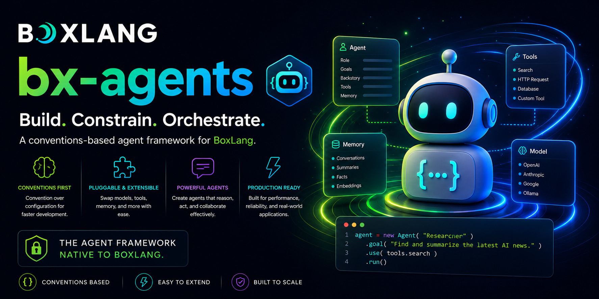
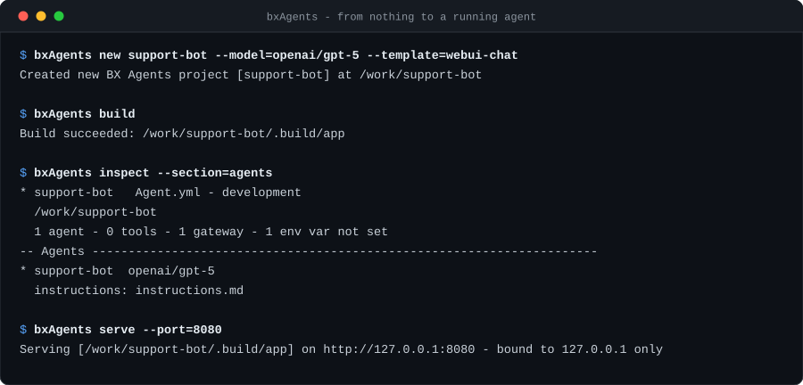
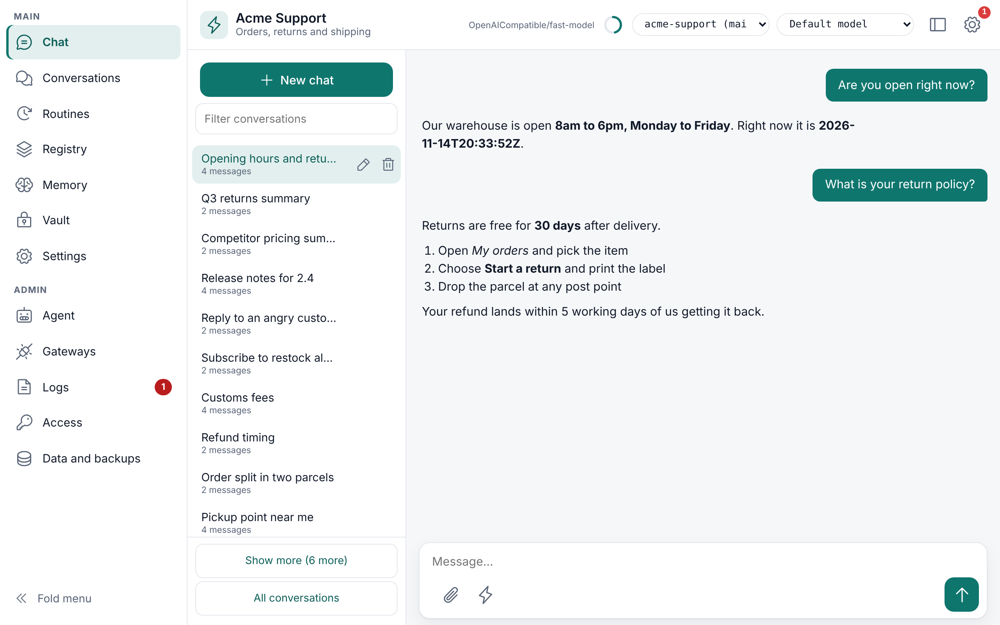
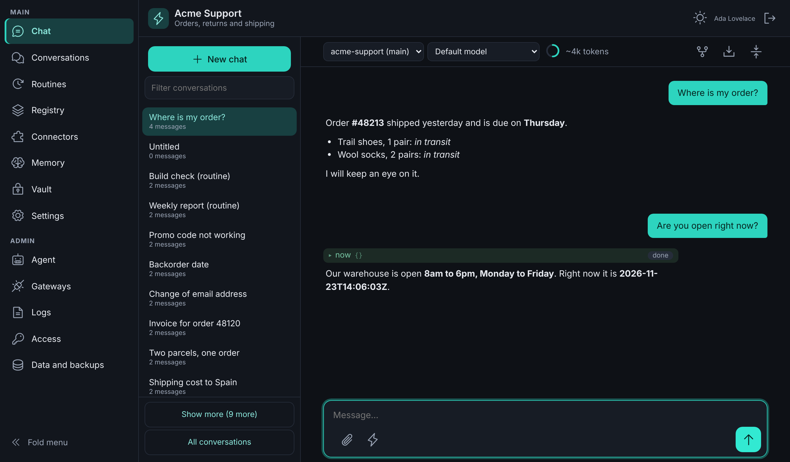
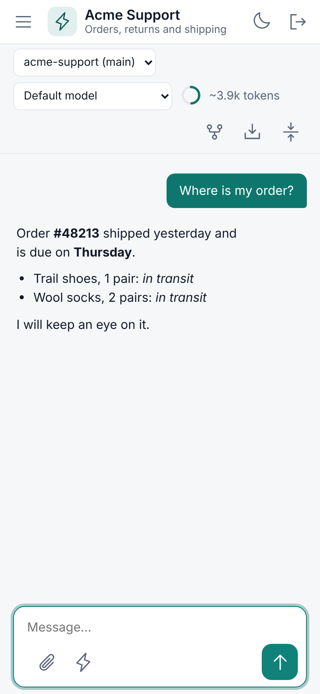
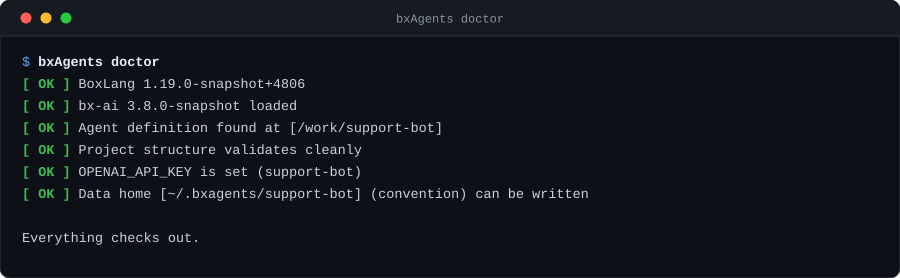

<div class="bxsites-hero">
	
	<div class="bxsites-hero__actions">
		<a class="bxsites-hero__btn bxsites-hero__btn--primary" href="getting-started/installation.md">Get Started</a>
		<a class="bxsites-hero__btn bxsites-hero__btn--secondary" href="https://github.com/ortus-boxlang/bx-agents">View on GitHub</a>
	</div>
</div>

**BxAgents** is a conventions-based AI agent framework for [BoxLang](https://www.boxlang.io),
built on [ColdBox](https://www.coldbox.org) and
[BX AI](https://ai.boxlang.io). You describe an agent
with files and folders, not a framework's API surface, and `bxAgents build` assembles a
real, runnable ColdBox application out of it: a web app with thirteen pages, an API with an OpenAPI
document, twelve kinds of gateway, routines, a vault, backups, and tests that need no API key.



## Watch the web app

<video controls preload="metadata" poster="/assets/video/web-trailer-poster.png" style="max-width:100%">
  <source src="/assets/video/web-trailer.mp4" type="video/mp4">
  <source src="/assets/video/web-trailer.webm" type="video/webm">
  <track kind="captions" src="/assets/video/web-trailer.vtt" srclang="en" label="English" default>
</video>

*Just over three minutes through the whole web app, narrated: the left menu and every page. The answers come from a scripted demo model, so they are canned. Captions are on.*

## Everything the build gives you

| | |
|---|---|
| **Build** | [Folders are the API](conventions/agent-yaml.md). A [wizard](guides/new-wizard.md) and eight starters. [Sub-agents](conventions/subagents.md) you can also talk to directly. [Skills](conventions/skills.md) from a registry, or saved by the agent with your approval. Tests with no tokens. |
| **Run** | A [web app](conventions/web-ui.md) with a left menu and thirteen pages. A [terminal chat](guides/terminal-ui.md) with 34 slash commands. [Routines](conventions/routines.md) people make by asking. [Schedules](conventions/schedules.md), approvals, a packaged `.bxa` and six deploy targets. |
| **Remember** | Memory in the chat database for every agent, per person, the same in the terminal, the web app and the API. Per-person notes and shared notes about the agent's work. A [data home](conventions/data.md) with volumes, and backups with restore. |
| **Connect** | [Twelve gateway types](conventions/gateways/index.md), and routines that deliver to them. An [API](guides/agent-api.md) with 82 routes, OpenAPI and a BoxLang client. [MCP](conventions/mcp.md) in both directions, with [per-person sign-in](conventions/connect.md) and seven built-in [connectors](conventions/connectors.md). A [vault](conventions/vault.md) with an activity log. |
| **Operate** | Admin and member roles, tokens and people, `allowedIPs` and a rate limit. Five [logs](conventions/logs.md). The agent tree, its files and its token usage. Gateway state with a reconnect button. `bxAgents doctor`. |
| **Extend** | [Extensions](conventions/extensions.md) add commands, keys, status items, listeners, schedulers, page slots, CLI verbs, tools, skills and gateway types. [Interceptors](conventions/interceptors.md), modules and a class-based `Agent.bx`. |

## What you can build

Pick the problem, write one file. Most of these have a working example in
[`examples/`](https://github.com/ortus-boxlang/bx-agents/tree/development/examples).

| You need to | You write | You get |
|---|---|---|
| Answer people where they are | [`gateways/slack.bx`](conventions/gateways/index.md) | A Slack bot over Socket Mode (also Telegram, Discord, Teams, WhatsApp, Twilio SMS, GitHub, Signal and email) |
| Run a job every morning | [`schedules/Digest.bx`](conventions/schedules.md) | A task with `.everyDayAt()` that calls `run()`, started with the app, no cron daemon |
| Let other systems call it | [`agentApi` in `Agent.yaml`](guides/agent-api.md) | One HTTP API at `/__bxagents` with an OpenAPI document and a BoxLang client, open on your machine or behind tokens; plus [`gateways/expose.bx`](conventions/gateways/index.md) for a REST path of your choosing, or an MCP server |
| Keep a human in the loop | a tool that needs approval | The run waits for approve or reject, in the terminal, the [web app](conventions/web-ui.md) or a gateway |
| Let people schedule their own work | [`routines: enabled: true`](conventions/routines.md) | A person asks, the agent makes a routine, a heartbeat runs it, reports are saved, and a summary can go to a gateway chat |
| Give each specialist a seat | [`subagents/researcher/`](conventions/subagents.md) | A sub-agent in the web app's Talk to menu and `/agent`, with its own memory |
| Connect it to your accounts | [`vault: {}`](conventions/vault.md) | API keys and logins sealed in the database, typed in a hidden box and never shown to the model; each person can keep their own |
| Let each person sign in to a service | [`oauth:` on an `mcpServers` entry](conventions/connect.md) | Mail, calendars and ticket systems that ask each person to sign in: one click, tokens sealed in the database, the agent acts as them |
| Add your own commands | [`extensions/hello.bx`](conventions/extensions.md) | A chat command, key, status item or listener, in the terminal chat, the web app and gateways |
| Test without spending tokens | [`tests/specs/AgentSpec.bx`](conventions/testing.md) | `mockResponses()` and agent matchers: specs run in CI with no API key and no network |
| Ship it anywhere | `bxAgents package` | A portable `.bxa` and [deploy targets](conventions/deploy.md): local, SSH, FTP, SFTP, Docker, DigitalOcean |

::: cards
::: card title="Assembled at build time" icon="phosphor-duotone:gear-six" href="build-pipeline.md"
Discovery, validation and code generation run **once**, not on every boot. What you run
afterwards is a plain ColdBox app.
:::
::: card title="Folders are the API" icon="phosphor-duotone:tree-structure" href="conventions/agent-yaml.md"
`Agent.yaml` and `instructions.md` are the only required files. Every other convention folder
is optional and only shapes the output if it exists.
:::
::: card title="Tools and skills" icon="phosphor-duotone:wrench" href="conventions/tools.md"
Drop an `@AITool`-annotated function into `tools/`, or a `SKILL.md` folder into `skills/` -
both are discovered and wired for you.
:::
::: card title="Agents all the way down" icon="phosphor-duotone:users-three" href="conventions/subagents.md"
`subagents/` nests the exact same convention tree, so a team of specialists is just more
folders - built leaf-first.
:::
::: card title="Twelve gateway types" icon="phosphor-duotone:chats-circle" href="conventions/gateways/index.md"
Telegram, Slack, Discord, Email, WhatsApp, Teams, Twilio, GitHub and Signal, plus `http`,
`cli` and `mock`.
:::
::: card title="A web app, generated" icon="phosphor-duotone:globe-hemisphere-west" href="conventions/web-ui.md"
Ask for it in a `gateways/` entry and the build produces a themeable app with a left menu and
thirteen pages: chat, conversations, routines, registry, connectors, memory, vault, settings, and for admins the agent,
gateways, logs, access and data.
:::
::: card title="A full-screen terminal chat" icon="phosphor-duotone:terminal-window" href="guides/terminal-ui.md"
`bxAgents chat` keeps your scrollback and has sessions, routines, notes, `@file` and picture attachments,
34 slash commands, a context meter and recording. It can start its own server or connect to a deployed one.
:::
:::

## Build one in four steps

::: stepper
::: step "Install"
=== "BoxLang"
    ```bash
    install-bx-module bx-agents
    ```

=== "CommandBox"
    ```bash
    box install bx-agents
    ```
:::
::: step "Scaffold"
```bash
bxAgents new my-agent --model=openai/gpt-5
```
Then edit `instructions.md` and add whichever convention folders you need.
:::
::: step "Build"
```bash
bxAgents build
```
Discovery, validation, manifest, code generation - into `.build/app/`.
:::
::: step "Talk to it"
```bash
bxAgents chat
# or serve it over HTTP:
bxAgents serve --port=8080
```
:::
:::

## Start from something, not nothing

At a terminal, `new` asks what the agent should do and writes the project to match
([the wizard](guides/new-wizard.md)); `add <kind>` adds a tool, skill, gateway or other piece later. A
template is a preset you build on, not a limit: pick one of 8 built-in templates, clone an
existing GitHub repo, or install a ForgeBox package instead.

::: cards
::: card title="8 built-in templates" icon="phosphor-duotone:squares-four" href="agent-templates.md"
`--template=webui-chat|slack-bot|telegram-bot|github-bot|mcp-server|scheduled|multi-agent` -
real, working content layered on the same base skeleton.
:::
::: card title="Clone a GitHub repo" icon="phosphor-duotone:github-logo" href="agent-templates.md"
`--repo=owner/repo` - a bundled JGit client clones it; no `git` binary required.
:::
::: card title="Install from ForgeBox" icon="phosphor-duotone:package" href="agent-templates.md"
`--forgebox=<slug>` - talks to ForgeBox's REST API directly; no `box` CLI required.
:::
:::

See [Agent Templates](agent-templates.md) for every generated file in detail, and how to
publish your own.

## A web app you didn't have to build

Set `exposes: "webui"` on a gateway and the build emits the whole app: a left menu with thirteen pages,
streaming chat with a Talk to menu for sub-agents, conversations you can filter, routines and their reports,
a registry of tools, skills and volumes, memory and notes, a vault, light and dark theming and a phone layout.
Admins also get Agent, Gateways, Logs, Access and Data and backups. It is wired to your agent through the same
HTTP API your own code can call.



::: columns
::: column

:::
::: column

:::
:::

It is generated CSS and generated markup, [themeable from a `gateways/` entry](conventions/web-ui.md),
with no front-end build step of your own. The [page-by-page guide](conventions/web-ui.md#the-pages) shows every page.

## What `build` actually produces

Your convention tree, and the plain ColdBox application `build` turns it into.

::: columns
::: column
```text
your-agent/
├── Application.bx     # your settings and hooks
├── Agent.yaml         # name, model, description
├── instructions.md    # the system prompt
├── tools/             # @AITool functions
├── skills/            # SKILL.md capabilities
├── subagents/         # nested agent trees
├── gateways/          # HTTP/MCP/chat exposure
├── schedules/         # BoxLang schedulers
├── mcp/               # MCP servers you host
├── interceptors/      # lifecycle hooks
└── modules/           # module dependencies
```
:::
::: column
```text
.build/app/
├── Application.bx
├── bxagents/
│   ├── Application.bx
│   └── Scheduler.bx
├── config/
│   ├── ColdBox.bx
│   ├── WireBox.bx
│   └── Router.bx
├── schedules/
├── agent/
│   └── GeneratedAgentFactory.bx
├── tools/  skills/  mcp/
├── handlers/  interceptors/
└── index.bxm
```
:::
:::

::: expandable "Why assemble at build time instead of at request time?"
Most agent frameworks wire tools, skills, routes and schedules together **at request time**,
on every boot. BxAgents does the opposite: `bxAgents build` runs discovery, validation and
code generation exactly once, producing a plain ColdBox application under `.build/app/`.

Starting it - via `bxAgents serve`, a real
[`boxlang-miniserver`](https://boxlang.ortusbooks.com/getting-started/running-boxlang/miniserver)
process, or a portable `.bxa` deployed anywhere BoxLang runs - is then just booting an
ordinary app. No convention scanning, no dynamic file walking, no build-time work deferred
into the request path.
:::

::: columns
::: column
!!! tip "Start with one file"
    Only `Agent.yaml` is required. `instructions.md` is optional - set `instructions` directly
    in the YAML, or drop the file in and let the build wire it in. Every other folder only
    affects the generated output if it exists **and** has content in it - so you add
    conventions as you actually need them.
:::
::: column
!!! faq "YAML by default, a class when you need code"
    `Agent.yaml` holds the agent's settings - most agents are a few lines of it. When the
    definition needs code (hooks, dynamic instructions, tools registered in code), `Agent.bx`
    extends BX AI's own `AiAgent` directly - the build instantiates your class, so what you
    write is what runs. See [Agent.yaml](conventions/agent-yaml.md) and
    [Agent.bx](conventions/agent-bx.md).
:::
:::

## Reach it from anywhere

::: cards
::: card title="Gateways" icon="phosphor-duotone:plugs-connected" href="conventions/gateways/index.md"
Nine push-style gateways - Telegram, Slack, Discord, Email, WhatsApp Cloud, Teams, Twilio,
GitHub and Signal - coordinated by one session with `reject` / `queue` / `steer` / `interrupt` policies.
Each person and each thread has their own conversation, and slash commands work there too.
:::
::: card title="HTTP and MCP" icon="phosphor-duotone:stack" href="guides/agent-api.md"
Every agent serves an HTTP API (82 routes) with an OpenAPI document, open on your machine or behind tokens,
`allowedIPs` and a rate limit. Host local MCP servers from `mcp/` so other clients can call your tools.
:::
::: card title="Ship it" icon="phosphor-duotone:package" href="deployment-and-secrets.md"
Package a portable `.bxa` and deploy it with `local`, `ssh`, `docker`, `digitalocean`,
`ftp` or `sftp` - secrets stay environment variables, never build artifacts.
:::
:::

## Check your setup at any time



## Where to go next

::: cards
::: card title="Installation" icon="phosphor-duotone:rocket-launch" href="getting-started/installation.md"
Install BoxLang, BX AI and BxAgents.
:::
::: card title="Quick Start" icon="phosphor-duotone:lightning" href="getting-started/quick-start.md"
Scaffold, build and chat with your first agent.
:::
::: card title="Conventions" icon="phosphor-duotone:cube" href="conventions/agent-yaml.md"
One page per convention folder, start to finish.
:::
::: card title="The Build Pipeline" icon="phosphor-duotone:graph" href="build-pipeline.md"
Exactly what `build` does, in order.
:::
::: card title="CLI Reference" icon="phosphor-duotone:terminal-window" href="cli-reference.md"
Every one of the 29 verbs and its flags.
:::
::: card title="Agent Templates" icon="phosphor-duotone:squares-four" href="agent-templates.md"
Every built-in starter, GitHub/ForgeBox sourcing, and publishing your own.
:::
::: card title="Deployment & Secrets" icon="phosphor-duotone:cloud-arrow-up" href="deployment-and-secrets.md"
Package a `.bxa` and ship it, safely.
:::
:::

Every convention folder also has a working, buildable sample under
[`examples/`](https://github.com/ortus-boxlang/bx-agents/tree/development/examples).

