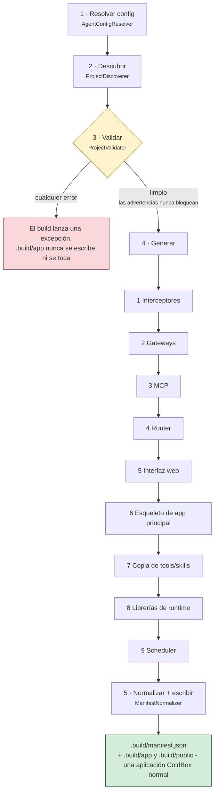

# El pipeline de build

`bxAgents build` ejecuta una secuencia fija de fases, una vez, produciendo una aplicación ColdBox normal con la estructura de la [plantilla ColdBox BoxLang](https://github.com/coldbox-templates/boxlang): el código en `.build/app`, la raíz web en `.build/public`. Nada de esto se vuelve a ejecutar en tiempo de request - ese es todo el sentido del ensamblaje en tiempo de build. Esta página recorre las fases en el orden exacto en que `BuildPipeline.bx` las ejecuta.

## Qué hay en `.build`, y qué se sirve

```text
.build/
  miniserver.json      cómo encuentra boxlang-miniserver todo lo de abajo (rutas relativas a .build)
  manifest.json        el manifiesto interno (ni se sirve ni se empaqueta)
  app/                 el código generado: handlers, config, agent/, tools/, skills/, models/, interceptors/, modules/bxagentsui/ ...
    Application.bx     la guarda de la plantilla: `abort;`
  public/              la raíz web, y la ÚNICA carpeta que se sirve
    Application.bx     el Application.bx de la app (ver conventions/application-bx.md)
    index.bxm          el front controller al que se reescribe cada request
    robots.txt  favicon.ico
    includes/          images/, i18n/, bxagentsui/build/assets/ (scripts y estilos de la página web)
  lib/                 coldbox/, modules/ (qb, cbsecurity, cbauth, cbmailservices), java/
  runtime/             el home de BoxLang
    boxlang.json       la configuración del motor de la plantilla
    modules/bx-agents/ una copia del módulo bxagents, con el nombre de su carpeta instalada: el ÚNICO módulo que carga la app servida
    global/  lib/  logs/
  boxlang_modules/     los módulos BoxLang instalados del propio proyecto
```

`bxAgents serve` arranca `boxlang-miniserver` **en `.build`** con `BOXLANG_HOME=.build/runtime`, usando `.build/miniserver.json` (`webRoot: public`, `configPath: runtime/boxlang.json`, `serverHome: runtime`, reescrituras a `index.bxm`, health check y un `passPredicate` que solo deja ejecutar `index.bxm`).

- **Solo `public/` es raíz web.** Nada de `app/`, `lib/`, `runtime/` o `boxlang_modules/` se puede descargar por su dirección: `/config/agent-settings.json`, `/project/Agent.yml`, `/agent/instructions.md` y un listado de `/config/` se podían descargar sin token antes de esta estructura, y ahora responden 404. Una dirección que ninguna ruta atiende es un `404` JSON pequeño, no una página de error.
- **Solo `index.bxm` se ejecuta.** El servidor ejecuta por defecto cualquier `.bx` o `.bxm` de la raíz web; el `passPredicate` lo limita al front controller, así que una clase de `app/` no se puede invocar por dirección.
- **Solo carga el módulo `bxagents`.** El módulo se copia a `runtime/modules` tal como está instalado, con el nombre de su carpeta (`bx-module install bx-agents` y el build de desarrollo usan `bx-agents`), con los módulos BoxLang empaquetados dentro. El mapeo interno de BoxLang sigue siendo `bxagents`. Cualquier otra carpeta allí se elimina y `runtime/` es el home de BoxLang, así que nunca se lee el `~/.boxlang/modules` de la máquina. La copia se omite mientras no cambie un sello (el `box.json` del módulo y el hash de sus jars).
- **Las rutas son relativas**, así que una copia de `.build` en cualquier lugar (un `.bxa` desempaquetado en otra máquina) se sirve arrancando el servidor dentro de ella. Una ruta con un espacio no funciona: el script de `boxlang-miniserver` no entrecomilla `BOXLANG_HOME`.
- `public/includes/` muestra sus nombres de archivo (el servidor lista una carpeta sin archivo índice y `miniserver.json` no tiene un interruptor); solo contiene lo que el navegador debe cargar.

La plantilla va dentro del módulo como una instantánea fijada (`src/main/bx/templates/coldbox-boxlang`; su `VERSION` nombra la versión y el commit exacto), así que un build nunca lee la red. Sus archivos de `public/` (`index.bxm`, `robots.txt`, `favicon.ico`, `includes/`), `runtime/boxlang.json` y `app/Application.bx` se colocan sin cambios, salvo dos ajustes de `runtime/boxlang.json`: la compresión de espacios en blanco está apagada y `clearClassFilesOnStartup` también, para reutilizar las clases compiladas entre inicios. `public/Application.bx` está **derivado** del de la plantilla y modificado (una clase fina que extiende la base generada, ver [Application.bx](conventions/application-bx.md)). En BoxLang 1.19.0 un stream `SSE()` nativo no depende del ajuste de compresión (14 frames con él activado o apagado); solo un stream de eventos escrito a mano con `writeOutput` pierde sus líneas en blanco si está activado, así que esa línea es una red de seguridad.



La validación es la puerta: recopila **todos** los errores en lugar de fallar rápido, y nada se genera hasta que vuelve limpia.

(El empaquetado en un `.bxa` es un paso deliberadamente separado - ver [Despliegue y secretos](deployment-and-secrets.md) - para que un ciclo rápido de `build` → inspeccionar → `build` de nuevo nunca pague un costo de empaquetado que no necesita.)

## 1. Resolver config

[`AgentConfigResolver`](conventions/agent-yaml.md) carga la definición del agente (`Agent.yml`, o el `Agent.bx` basado en clase), aplica los overrides del entorno activo (el bloque `environments:` de un `Agent.yml`, o el método de override y `configure()` de un `Agent.bx`), luego fusiona en profundidad `boxlang.json`/`boxlang-{env}.json`/`miniserver.json`/`miniserver-{env}.json` si están presentes. Produce el único struct de configuración resuelto del que lee cada fase posterior.

## 2. Descubrir

[`ProjectDiscoverer`](conventions/agent-bx.md) recorre la raíz del proyecto y enumera cada carpeta de convención (`tools/`, `skills/`, `subagents/`, `gateways/`, `mcp/`, `interceptors/`, `modules/`) en entradas crudas `{ name, path, type }`. Los `schedules/*.bx` se listan igual, una entrada por cada archivo de scheduler de BoxLang. Descubrimiento puro - todavía no ocurre ninguna interpretación del contenido de los archivos.

## 3. Validar

[`ProjectValidator`](conventions/agent-bx.md) ejecuta cada validador y recopila **todos** los errores (nunca falla rápido) más cualquier advertencia: nombres duplicados de tool/skill/model/subagent, `name`s de agente duplicados a través de todo el árbol de subagentes (ver [subagents/](conventions/subagents.md#retrieving-an-agent-from-schedules)), referencias circulares de subagente/módulo, las dos formas de entrada de gateway, la completitud de configuración de MCP remoto, y la validez de modelo/proveedor. Si se recopiló algún error, el build lanza una excepción inmediatamente aquí - no se escribe ni se toca `.build/app`. Las advertencias (por ejemplo, un archivo de `schedules/` que no es un `.bx`) nunca bloquean el build.

## 4. Generar

Solo se alcanza una vez que la validación está limpia. Primero se borra cualquier `.build/app` de un build anterior y se coloca la plantilla: su `public/` (reemplazando el anterior), su `runtime/boxlang.json`, la guarda `app/Application.bx` y las carpetas vacías que nombran sus convenciones. En orden:

1. **Interceptores** - [`InterceptorSplitter`](conventions/interceptors.md) copia los interceptores de scope `agent` a `.build/app/interceptors`, los de scope `runtime` a un directorio separado `.build/runtime-interceptors`, fuera de la app (BxAgents no los registra por ti).
2. **Gateways** - [`GatewayGenerator`](conventions/gateways/index.md) emite sentencias `aiGatewayRegistry().register(...)` para las entradas de tipo channel-adapter, y escribe un pequeño handler de webhook `.build/app/handlers/*.bx` por cada entrada `whatsapp-cloud`, `teams`, `twilio` o `github`. Si alguna entrada es un gateway de estilo push (por ejemplo, `type: "telegram"`), también produce la sentencia de arranque que construye un único `GatewaySession` de bx-ai (agrupando cada gateway de estilo push) asociado al agente raíz del proyecto.
3. **MCP** - [`McpGenerator`](conventions/mcp.md) copia los servidores locales `mcp/*` a `.build/app/mcp` y emite sus sentencias de registro `mcpServer(...).registerTool(...)`.
4. **Router** - [`RouterGenerator`](conventions/gateways/index.md) escribe `.build/app/config/Router.bx`: la API de agente reservada [`/__bxagents`](conventions/agent-bx.md#la-ruta-de-agente-siempre-activa) (en `agentApi.path`, salvo que `agentApi.enabled` sea `false`), las mismas cuatro rutas de turno bajo la ruta de cada entrada `exposes: "agent"`, un `route(path).toMCP(...)` por entrada `exposes: "mcp"`, el middleware de cbSecurity para `agentApi.allowedIPs` y `agentApi.rateLimit` cuando se definen, un único `route("/gateways").toAiGateway()` si el proyecto tiene algún gateway de tipo channel-adapter, y una ruta de webhook por cada gateway push de tipo `whatsapp-cloud` (GET+POST), `teams`, `twilio` o `github` presente.
5. **API del agente** - `AgentApiGenerator` escribe `.build/app/handlers/AgentApi.bx`, todas las acciones de la API del agente (`invoke`, `stream`, `batch`, `info`, y las acciones de control de ejecución, conversaciones, notas, comandos y tokens como `events`, `cancel`, `steer`, `resume`, `sessions` y `command`), todas servidas por un único handler. Se omite cuando `agentApi.enabled` es `false`.
6. **Interfaz web** - [`WebUiGenerator`](conventions/web-ui.md) se ejecuta para cualquier entrada `exposes: "webui"`, escribiendo el `<path>/index.html` estático (cliente de la [API del agente](conventions/agent-bx.md#la-ruta-de-agente-siempre-activa), así que sin handler propio), `models/ChatDb.bx` (las cuentas de inicio de sesión y las migraciones exclusivamente hacia adelante del almacén, construido en el arranque por una sentencia de inicio en lugar de en cualquier request que toque primero la base de datos) y los modelos de usuario (`User`, `UserService`, `PasswordHasher`). `apiKeyEnvVar` pasa a ser el secreto compartido de la API del agente. Cuando se declaran `users`, también escribe el seeder de cuentas, `interceptors/WebUiLoginGate.bx` y `handlers/ChatAuth.bx`. Devuelve la configuración de base de datos resuelta, que el siguiente paso necesita.
7. **Esqueleto de app principal** - `ColdBoxAppGenerator` escribe la base generada `app/bxagents/Application.bx` ([Application.bx](conventions/application-bx.md)), `public/Application.bx` (derivado del archivo de la plantilla, que termina como una clase fina que extiende la base), `config/Coldbox.bx` (el nombre que ColdBox carga; antes `ColdBox.bx` nunca se cargaba en un sistema de archivos con distinción de mayúsculas), `config/WireBox.bx`, `handlers/NotFound.bx` (el 404 JSON) y `agent/GeneratedAgentFactory.bx`, incorporando cada sentencia recopilada arriba (registros de gateway, el arranque del `GatewaySession`, registros MCP, el calentamiento del almacén y el seeding de cuentas de la interfaz web, y - si `tools/` tiene algún archivo - una llamada simple `aiToolRegistry().scan("tools")`) en el `onApplicationStart()` de `Application.bx`. Los interceptores también se registran ahí, un `getInterceptorService().register(...)` por cada interceptor de scope `agent` y cada compuerta de la interfaz web: un array declarativo `interceptors` en `config/ColdBox.bx` nunca llega al servicio de interceptores de ColdBox, así que la configuración generada no declara ninguno. Cada agente generado también recibe ahora siempre un checkpointer (`withCheckpointer(...)`, por defecto un `aiMemory()` respaldado por `cache` si el proyecto no declara configuración `checkpointer` y la clase no configuró ninguna propia) - sin uno, los flujos de aprobación human-in-the-loop a través de cualquier gateway que no sea `cli` fallan por completo. `config/WireBox.bx` mapea cada agente en el árbol (raíz + cada subagente) bajo su propio `name` declarado, no solo el alias fijo `"GeneratedAgent"` de la raíz - ver [schedules/](conventions/schedules.md). El `instructions.md` de cada nodo de agente se **copia dentro de la app** como parte de este paso, replicando la estructura del código fuente bajo `agent/` - el del proyecto raíz a `.build/app/agent/instructions.md`, el de cada subagente a `.build/app/agent/subagents/<name>/instructions.md` - de modo que cada nodo conserva el suyo y la app construida lleva el archivo que lee en tiempo de ejecución. La factory lee sus tres rutas de runtime (`instructions.md`, su propio `tools/` y el `Agent.bx` copiado de cualquier agente basado en clase) mediante un pequeño helper generado `resolveAppPath()` que las resuelve relativas a la ubicación en disco de la propia factory, recurriendo a la ruta absoluta del momento del build si esa autolocalización no se resuelve - y eso es lo que hace que un `.bxa` empaquetado sea realmente reubicable en lugar de ejecutable solo en la máquina que lo construyó. Para un proyecto con una exposición `webui` también activa la gestión de sesiones, registra el datasource SQLite (nombrándolo como el datasource por defecto de la app vía `this.datasource`), crea el directorio padre de la base de datos en `onApplicationStart()` - SQLite crea el archivo pero nunca la carpeta que lo contiene - y fija la gramática de qb en `config/ColdBox.bx`.
8. **Copia de tools/skills** - `ToolsSkillsCopier` borra y reescribe `.build/app/tools` y `.build/app/skills` textualmente a partir de las propias carpetas de tu proyecto.
9. **Librerías de runtime** - `RuntimeLibsCopier` copia el runtime de ColdBox incluido dentro de BxAgents hacia `.build/lib`: `coldbox/` más `modules/qb`, `modules/cbsecurity`, `modules/cbauth`, `modules/cbmailservices` y sus dependencias. Una carpeta `lib/` en tu proyecto (misma estructura) se copia después y tiene prioridad, que es como añades o sobrescribes una librería. La copia incluida solo existe en un módulo instalado o construido, así que un checkout de código fuente omite este paso con un aviso.
10. **Schedulers** - [`SchedulerGenerator`](conventions/schedules.md) copia cada `schedules/*.bx` a `.build/app/schedules/<Name>.bx`, añadiendo `extends="app.bxagents.Scheduler"` a una clase que no nombra ningún padre (`bxagents.Scheduler`, el nombre que usan los docs, significa la misma clase). La `Application` base ya los lista en `this.schedulers`, así que BoxLang los arranca con la app.

## 5. Normalizar + escribir el manifest

[`ManifestNormalizer`](manifest.md) produce el manifest interno canónico, con hash estampado, a partir de los datos de descubrimiento + configuración resuelta, y el pipeline lo escribe en `.build/manifest.json`.

## Idempotencia

Reconstruir un proyecto sin cambios produce una salida idéntica byte a byte, hasta los hashes de contenido por archivo del manifest - todo el sentido de pagar el costo de ensamblaje una sola vez, en tiempo de build, en lugar de diferir cualquiera de este trabajo al manejo de requests.
