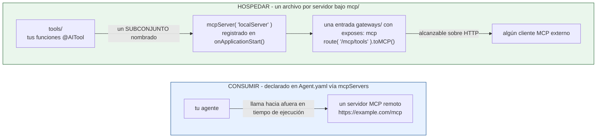

# mcp/

MCP (Model Context Protocol) funciona en dos direcciones - consumiendo servidores remotos, y hospedando los tuyos propios.



Nada vincula a los dos: un agente que consume servidores remotos no necesita hospedar uno, y un servidor hospedado solo es alcanzable si una entrada `gateways/` lo expone.

!!! tip
    `bxAgents add mcp client github` añade un servidor a `Agent.yaml` con su credencial como marcador de entorno, y `bxAgents add mcp server` escribe el archivo de `mcp/` y la entrada de `gateways/` que lo sirve. Ver [`add`](../cli-reference.md#add-mcp).

## Consumir servidores remotos

Declarados directamente en `Agent.yaml` (no un archivo bajo `mcp/`), vía `mcpServers`:

```yaml
# Agent.yaml
name: my-agent
model: openai/gpt-5
mcpServers:
  - https://example.com/mcp
  - url: https://other.com/mcp
    name: other
```

Cada entrada es una cadena URL simple o un mapa. Un mapa puede llevar las credenciales que pida el servidor:

```yaml
mcpServers:
  - name: github
    url: https://api.githubcopilot.com/mcp/
    token: ${env.GITHUB_PERSONAL_ACCESS_TOKEN}
  - url: https://other.com/mcp
    headers:
      X-Api-Key: ${env.OTHER_API_KEY}
    timeout: 20000
```

| Clave | Significado |
|---|---|
| `url` | Requerida. La dirección del servidor |
| `name` | Una etiqueta para el archivo. No se envía al servidor |
| `token` | Un bearer token. Debe ser un marcador `${env.NAME}`: un token escrito en el archivo es un error de build |
| `password`, `user` | Autenticación básica. `password` debe ser un marcador `${env.NAME}` |
| `headers` | Encabezados extra de la petición. Los valores pueden usar `${env.NAME}` |
| `timeout` | Milisegundos |
| `allowedHosts` | Los nombres de host que puede tener la dirección del servidor, por ejemplo `[api.example.com, "*.example.com"]`. `*.example.com` coincide con cualquier subdominio, no con `example.com`. Una petición a cualquier otro host se rechaza antes de enviar nada |
| `redirects` | `false` trata una redirección como un fallo y nunca la sigue |
| `maxResponseBytes` | Rechaza una respuesta más larga que este número de caracteres |
| `handshake` | `true` envía el saludo `initialize` de MCP antes de la primera llamada |
| `prefix` | Las tools se llaman `prefix__tool`, así dos servidores no pueden chocar |
| `toolFilter` | Una lista de nombres de tools; solo estas se entregan al agente |

Los marcadores se reemplazan por la variable de entorno **cuando arranca la app**, nunca en tiempo de build, así que un secreto se queda fuera del proyecto y de un `.bxa` empaquetado. Una variable que no está definida hace fallar el agente al arrancar y la nombra; una definida pero vacía deja arrancar al agente, el servidor rechaza la conexión, y bx-ai lo registra y sigue sin las tools de ese servidor. Cualquier otra clave es un error de build que lista las válidas.

Las entradas se pasan a la llamada `aiAgent(mcpServers: [...])` generada. **Nunca se intenta ninguna conexión de red en tiempo de build** - la alcanzabilidad es una preocupación de tiempo de ejecución; un servidor inalcanzable en tiempo de build no es un error de build. Esta sección es para servidores a los que se llega por la web; los servidores que se ejecutan como programa en la máquina del agente van a continuación.

[`bxAgents new`](../guides/new-wizard.md#servidores-mcp) ofrece GitHub, Stripe, Notion, Atlassian, Cloudflare, Supabase y Git y escribe por ti la entrada y el marcador de `.env`.

Los subagentes pueden declarar sus propios `mcpServers` de forma independiente - cada nodo en el árbol de agentes obtiene su propia lista resuelta.

### Servidores que se ejecutan como programa

Una entrada con `command` arranca un servidor MCP como programa en la máquina que ejecuta el agente, y habla con él por la entrada y la salida estándar del programa:

```yaml
mcpServers:
  - name: git
    command: [uvx, mcp-server-git]
    prefix: git
    toolFilter: [git_status, git_diff, git_log]
  - name: browser
    command: [bxplaywright, mcp]
    env:
      PLAYWRIGHT_API_KEY: ${env.PLAYWRIGHT_API_KEY}
    cwd: .
```

| Clave | Significado |
|---|---|
| `command` | Requerida. Una lista: el programa y luego sus argumentos. Nunca se ejecuta a través de un shell |
| `name` | Una etiqueta para el archivo |
| `env` | Variables de entorno para el programa. Una variable cuyo nombre contenga `KEY`, `TOKEN`, `SECRET`, `PASSWORD` o `CREDENTIAL` debe ser un marcador `${env.NAME}` |
| `cwd` | La carpeta en la que arranca el programa |
| `inheritEnv` | `false` lo arranca solo con `env`. Por defecto `true` |
| `maxRestarts` | Cuántas veces seguidas se vuelve a arrancar un programa que murió. Por defecto 2 |
| `timeout` | Milisegundos por petición |
| `prefix`, `toolFilter` | Igual que en los servidores web |

El programa arranca en la primera llamada y se cierra cuando la app se detiene. `command` no se puede combinar con `url`, y las claves que solo tienen sentido para un servidor web (`token`, `headers`, `user`, `password`, `allowedHosts`, `redirects`, `maxResponseBytes`, `handshake`) son un error de build en él.

Cuando arranca la app, los programas que declaran tus agentes pasan a ser el ajuste `mcp.stdio.allowedCommands` de bx-ai, así el proceso solo arranca lo que declaró el proyecto. Una lista que fijes tú (por ejemplo en `.boxlang.json`) se respeta y debe nombrar los programas. [`bxAgents doctor`](../cli-reference.md) avisa cuando un programa no está en el PATH.

Un programa se ejecuta con los permisos de tu usuario en la máquina que aloja el agente. Lee lo que arrancas y usa `toolFilter` para limitar lo que el agente puede llamar.

## Hospedar un servidor local

Cada archivo `mcp/*.bx` es un servidor MCP local que tu proyecto hospeda, exponiendo un subconjunto de tus `tools/` como tools MCP:

```javascript
// mcp/localServer.bx
class {

	function configure() {
		return {
			description : "Internal tools MCP server",
			version     : "1.0.0",
			cors        : "*",             // opcional - origen(es) CORS permitidos para llamar a este servidor; omitir para ninguno
			tools       : [ "sayHello" ]   // nombres de tools ya declaradas bajo tools/
		};
	}

}
```

El nombre descubierto de la entrada es su **nombre de archivo** (`localServer.bx` → `localServer`), no ningún campo `name` dentro de su propio struct `configure()` - un proyecto todavía puede configurar uno para documentación, pero se ignora para propósitos de nombramiento/registro.

`cors` es opcional y por defecto es una cadena vacía (sin cabecera CORS) cuando se omite - pasado directamente como el 4to argumento posicional de `mcpServer()`.

En tiempo de build, el archivo se copia textualmente a la carpeta `mcp/` de la app generada, y se emite una sentencia de registro en el `onApplicationStart()` de `Application.bx`:

```javascript
mcpServer( "localServer", "Internal tools MCP server", "1.0.0", "*" )
	.registerTool( aiToolRegistry().get( "sayHello" ) )
```

`mcpServer(name, ...)` es un getter singleton global, indexado por nombre, en bx-ai - registrarlo una vez en el arranque es todo lo que se necesita; no hay ningún mapeo de WireBox involucrado (a diferencia del singleton de exposición de agente usado por `toAi()`).

## Exponer un servidor local sobre HTTP

Un servidor local `mcp/*` no es alcanzable sobre HTTP por sí mismo - empárealo con una entrada de exposición de [`gateways/`](gateways/index.md) nombrándolo como el `target`:

```javascript
// gateways/expose-mcp.bx
class {
	function configure() {
		return {
			exposes : "mcp",
			path    : "/mcp/tools",
			target  : "localServer"
		};
	}
}
```

## Validación

- Una entrada de `mcpServers` (forma struct) necesita un `url` o un `command`, no los dos y no ninguno.
- Una entrada de `mcpServers` que no sea ni una cadena no vacía ni un struct falla la validación.
- Un `command` debe ser una lista de palabras no vacías. Una clave del otro tipo de servidor, un secreto de `env` escrito en el archivo, y un `allowedHosts`, `redirects`, `handshake`, `prefix` o `toolFilter` mal escrito fallan la validación.
- Una entrada `gateways/` con `exposes: "mcp"` y un `target` que no coincida con ninguna entrada descubierta `mcp/*` falla la validación.
