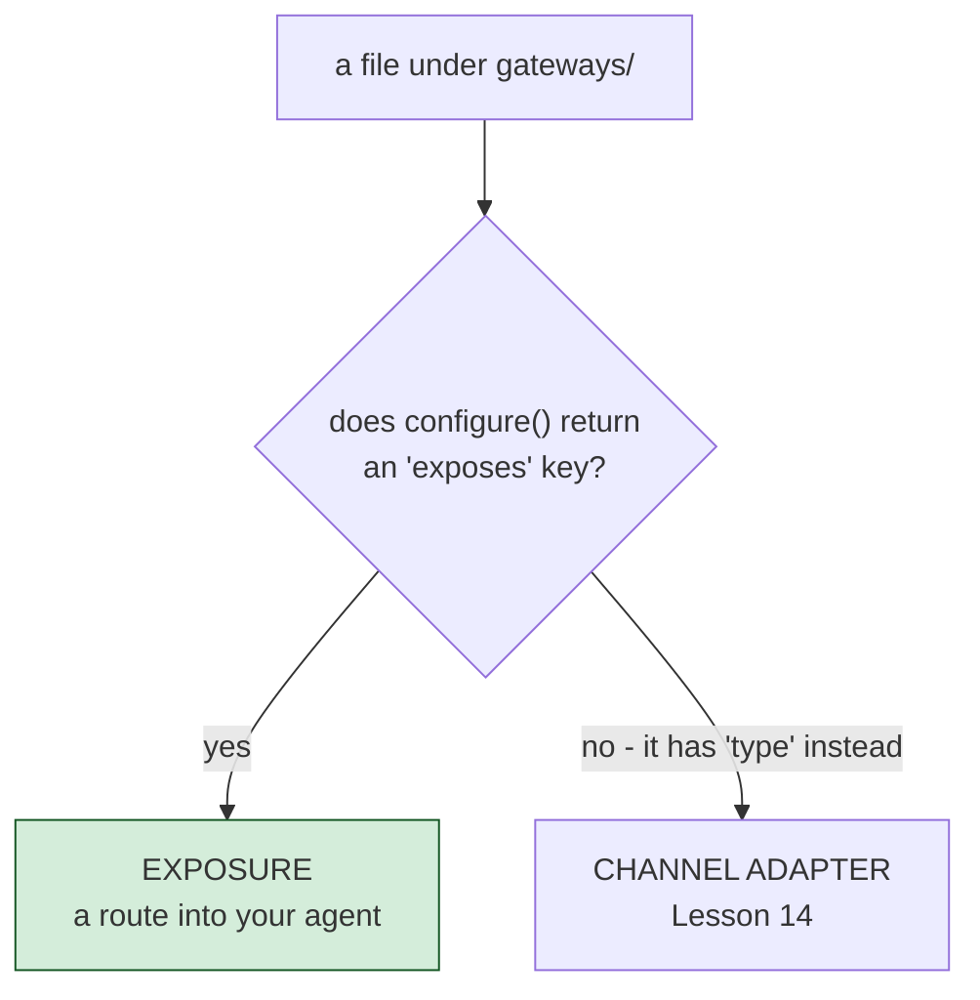

# Exponer tu agente por HTTP y MCP

Los archivos `gateways/*.bx` cubren dos cosas distintas y sin relación entre sí - de qué tipo
es una entrada depende enteramente de si su struct de `configure()` tiene una clave `exposes`.
Esta lección cubre la **exposición** (`exposes: "agent" | "mcp" | "webui"`); la siguiente
cubre el otro tipo, los adaptadores de canal que conectan con plataformas de chat.



## Exponer el propio agente

```javascript
// gateways/expose.bx
class {
	function configure() {
		return {
			exposes : "agent",
			path    : "/api/chat"
		};
	}
}
```

Genera, en `config/Router.bx`, cuatro rutas servidas por el handler de la API del agente:
`POST /api/chat/invoke`, `POST /api/chat/stream` (SSE), `POST /api/chat/batch` y
`GET /api/chat/info`. La ruta `/api/chat` pelada no es enrutable por sí misma. Es un punto de
entrada simple bajo una ruta que eliges tú; con `agentApi.access: token` necesita un token, como
el resto de la API del agente.

## Exponer un servidor MCP local

```javascript
class {
	function configure() {
		return {
			exposes : "mcp",
			path    : "/mcp/tools",
			target  : "local-server"   // must match an mcp/*.bx entry's file name
		};
	}
}
```

Escribirás esa entrada `mcp/*.bx` en la [Lección 17](17-hosting-mcp-servers.md).

## Exponer la UI web de chat

```javascript
// gateways/chat.bx
class {
	function configure() {
		return {
			exposes : "webui",
			path    : "/chat"
		};
	}
}
```

Esta da para su propia lección - consulta la [Lección 15](15-the-generated-web-chat-ui.md).

## La API del agente que siempre está ahí

Todo agente construido sirve además una API HTTP en `/__bxagents`, sin ninguna entrada en
`gateways/`. La página web, el chat de terminal (`chat --server` y `--connect`) y las plataformas
de chat también la usan, así que todo lo que ellos hacen, tu programa puede hacerlo: ejecutar un
turno (`invoke`, `stream`, `events`), detener o reconducir una ejecución, responder una aprobación,
listar y bifurcar conversaciones, guardar notas, ejecutar comandos de barra. Se describe a sí
misma: `GET /__bxagents/openapi` devuelve un documento OpenAPI de las rutas que tu servidor tiene
de verdad. Un cliente BoxLang, `bxModules.bxagents.models.api.AgentApiClient`, tiene un método por
ruta. El recorrido, con ejemplos de curl y BoxLang, está en [Llama a tu agente desde código](../guides/agent-api.md).

Quién puede llamarla se define bajo `agentApi` en `Agent.yaml`:

- **Abierta** (por defecto): cualquiera que llegue al puerto, todos como un único usuario, `local`.
  Bien en tu propia máquina. `bxAgents serve` escucha en `127.0.0.1` por defecto y avisa si una API
  abierta escucha en una dirección a la que pueden llegar otras máquinas.
- **Tras tokens**: quien llama envía una cabecera `x-bxagents-token`. `tokenEnvVar: MY_SECRET` nombra
  una variable de entorno con un secreto compartido (actúa como admin). `tokens: true` acepta además
  tokens creados por persona o programa con `bxAgents token create --name=laptop` (`--scope=chat` o
  `admin`, `--expires=90d`). Un token se muestra una sola vez y solo se guarda un hash, así que
  `token revoke` funciona al instante en un servidor en marcha.
- **Protecciones**: `allowedIPs` deja entrar solo a las direcciones y redes listadas, y `rateLimit:
  { requests, perSeconds }` limita las llamadas por dirección. Ambas valen abierta o cerrada.
- **Gestionar tokens por la API**: `manageTokens: true` (con `tokens: true`) permite a un admin crear
  y revocar tokens de forma remota, y muestra un panel **Tokens** en la página web.
- **Moverla**: `path: /agent-api` sirve toda la API en otro sitio.

```yaml
agentApi:
  tokenEnvVar: AGENT_ADMIN_TOKEN   # the NAME of an environment variable
  tokens: true
  allowedIPs: [ "10.0.0.0/8" ]
  rateLimit: { requests: 60, perSeconds: 60 }
```

```bash
bxAgents token create --name=laptop --expires=90d
bxAgents chat --connect=https://agent.example.com --token=<the token>
```

Lista completa de ajustes: [Agent.bx](../conventions/agent-bx.md#la-ruta-de-agente-siempre-activa).

## Validación

`exposes` debe ser `agent`, `mcp` o `webui`; `path` es obligatorio y debe ser único entre
todas las entradas de exposición; el `target` de una exposición `mcp` debe coincidir con el
nombre de archivo de una entrada `mcp/*` real.

## Pruébalo

```bash
bxAgents build
bxAgents serve --port=8080
curl -X POST http://localhost:8080/api/chat/invoke \
  -H "Content-Type: application/json" \
  -d '{"input":"Hi there"}'
```

(O sáltate `serve` por completo y usa `bxAgents invoke --message="Hi there" --server` de la
[Lección 8](08-talking-to-your-agent.md), que ejercita exactamente esta misma ruta sin que
tengas que gestionar tú el proceso del servidor.)

Referencia completa: [gateways/](../conventions/gateways/index.md).

Siguiente: [Lección 14 - Conectar plataformas de chat](14-connecting-chat-platforms.md)
