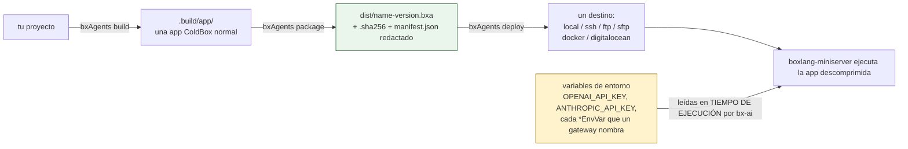

# Despliegue y secretos

Los secretos nunca entran en el artefacto - se suministran al **proceso**, en el extremo derecho de esta cadena:



Nada a la izquierda de `ENV` guarda jamás un valor secreto: los `.env`/dotfiles se excluyen del zip incondicionalmente, y el manifest se redacta además de nunca llevar uno.

## Empaquetado

`bxAgents package` comprime `.build/app/` en un artefacto `.bxa` portable:

```bash
bxAgents package --version=1.0.0
```

produce, en `dist/`:

- `{agentName}-{version}.bxa` - la app comprimida
- `{agentName}-{version}.bxa.sha256` - su checksum
- `manifest.json` - una copia **redactada** del manifest del build (ver abajo)

Empaquetar dos veces seguidas sobre el mismo build produce bytes de zip idénticos byte a byte (orden de entradas/timestamps determinista) - útil para verificar que un artefacto construido en CI coincide con uno construido localmente.

El `.bxa` es **reubicable**: lleva cada archivo que el agente lee en tiempo de ejecución (incluido el `instructions.md` de cada nodo de agente, copiado en `agent/` durante el build), y el `agent/GeneratedAgentFactory.bx` generado resuelve esas rutas relativas a su propia ubicación en disco en lugar de las rutas absolutas de la máquina que lo construyó. Así, un `.bxa` construido en CI se ejecuta sin cambios al descomprimirlo en cualquier otro sitio - lo que también significa que un `.bxaignore` lo bastante amplio como para coincidir con `*.md` quitará del artefacto las propias instrucciones del agente.

`package` requiere un `build` previo (lee `.build/manifest.json`) y se niega a ejecutarse - sin producir ningún `.bxa` - si `manifestVersion` no está definido o está malformado.

## Excluir archivos: `.bxaignore`

Un `.bxaignore` opcional en la raíz del proyecto, un patrón glob por línea (las líneas con prefijo `#` son comentarios), excluye las rutas coincidentes del `.bxa` empaquetado:

```
# .bxaignore
*.log
scratch/
```

Esto se suma a una exclusión codificada y siempre activa de `.env`/`.env.*`/dotfiles en la capa de empaquetado - incluso si `.bxaignore` no los menciona, y aunque de alguna manera hayan terminado dentro de `.build/app`, nunca llegan al zip.

## Redacción de secretos

Los secretos nunca se escriben en `manifest.json` desde el principio - el bloque `agent` del manifest solo contiene campos seguros y estructurales (`name`, `description`, `model`, `environment`). Como defensa en profundidad, `package` además recorre el manifest recursivamente y reemplaza cualquier clave de struct que **parezca** un secreto con `[REDACTED]`:

```
(apikey | api_key | token | secret | password)$   (sin distinguir mayúsculas/minúsculas, cualquier prefijo)
```

Esto protege contra un futuro campo - o un llamador que pase un struct más rico a `package` de alguna otra manera - filtrando accidentalmente un valor, aunque el manifest de hoy nunca coloca uno allí en primer lugar.

## Dónde viven los secretos reales

BxAgents nunca resuelve, almacena, ni incrusta claves de API, tokens o contraseñas de proveedor en ningún build o package. Eso es enteramente trabajo de bx-ai, en **tiempo de ejecución**: los lee del entorno del proceso siguiendo su propia convención de estilo `<PROVIDER>_API_KEY` (por ejemplo, `OPENAI_API_KEY`, `ANTHROPIC_API_KEY`). Configúralos como normalmente gestionas secretos para un proceso desplegado - una variable de entorno del SO o el gestor de secretos de tu plataforma. En desarrollo local, BoxLang y `boxlang-miniserver` cargan por sí mismos un `.env` desde la raíz del proyecto, así que el `.env` que crea `bxAgents new` es el sitio cómodo para ellos; BxAgents nunca lo lee, lo copia ni lo incrusta, y nunca se commitea (el `.gitignore` generado lo cubre) ni se empaqueta. Un `.bxa` desplegado no lleva `.env`, así que dale a ese proceso variables de entorno reales.

```bash
export OPENAI_API_KEY=sk-...
bxAgents serve
```

## Secretos cifrados

Las claves también pueden vivir cifradas en el proyecto, para que viajen con el repositorio. `bxAgents new` lo ofrece como **Cifrados en el proyecto** (el valor por defecto sigue siendo `.env`). Usa el formato `bxsecret:` propio de BoxLang, el mismo que escribe `boxlang generatesecret`.

El asistente escribe dos cosas:

- `secrets.json`: cada valor como `bxsecret:<texto cifrado>`, más una entrada `_seedCheck` que permite que una semilla incorrecta falle con un mensaje claro. Este archivo es **seguro de commitear**.
- `.env`: una línea, `BOXLANG_SECURITY_SECRETSEED=<semilla>`. Es la clave que abre el archivo. Está en el `.gitignore`. **Nunca la commitees** y guarda una copia en un lugar seguro: sin ella no se pueden recuperar los valores.

La semilla se genera por proyecto, así que `secrets.json` no depende de la instalación de BoxLang de una máquina. Al arrancar, la app construida lee `secrets.json`, descifra cada valor con la semilla y lo publica como ajuste, de modo que los marcadores `${env.NOMBRE}`, las claves de proveedor tipo `OPENAI_API_KEY` y los tokens MCP funcionan como si estuvieran en el entorno. Una variable ya definida en el entorno real gana sobre el valor commiteado.

Para añadir o cambiar un valor más tarde:

```bash
export BOXLANG_SECURITY_SECRETSEED=<tu semilla>
boxlang generatesecret "el-nuevo-valor"   # imprime bxsecret:...
```

Pega la salida en `secrets.json` bajo el nombre de la variable. En un servidor, define `BOXLANG_SECURITY_SECRETSEED` como variable de entorno real; `bxAgents build` falla si `secrets.json` contiene un valor en claro, y `bxAgents doctor` revisa el archivo.

## Desplegando

```bash
bxAgents deploy --destination=/path/to/somewhere   # local, forma abreviada solo con flags
bxAgents deploy --name=production                  # cualquier destino, vía deploy/production.bx
```

Seis destinos pluggable vienen incluidos - `local` (copiar el `.bxa` más nuevo a algún lugar), `ssh` (enviarlo a un servidor desnudo), `ftp`/`sftp` (enviarlo vía el módulo real [`bx-ftp`](https://github.com/ortus-boxlang/bx-ftp), incluido con BxAgents), `docker` (construir/subir una imagen de contenedor), y `digitalocean` (desplegar a una app de DigitalOcean App Platform) - ver [deploy/](conventions/deploy.md) para la forma completa de configuración de cada uno y [Referencia de CLI](cli-reference.md#deploy) para los flags de CLI.

Ningún destino lee jamás un secreto desde la configuración de `deploy/*` - las credenciales (contraseñas de registro, claves SSH, el token de API de DigitalOcean) siempre se resuelven desde variables de entorno en tiempo de despliegue, la misma regla de "los secretos permanecen externos" que en cualquier otro lugar de este documento. Ver [deploy/](conventions/deploy.md#secrets-stay-external) para la variable de entorno exacta que espera cada destino.

Para ejecutar un `.bxa` empaquetado en otro lugar manualmente: descomprímelo (es una aplicación ColdBox normal) y apunta `boxlang-miniserver` al directorio extraído, configurando las variables de entorno secretas que ese despliegue necesite.
