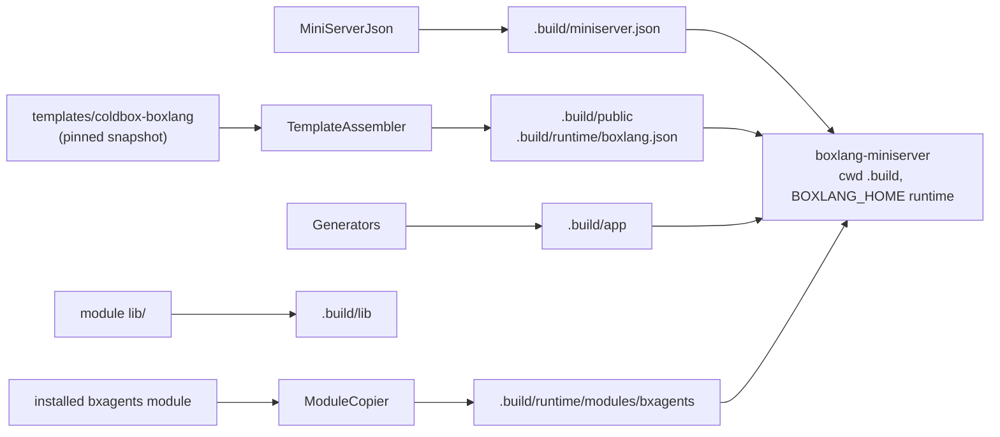

# The built app is `app/` and `public/`

`bxAgents build` wrote one folder, `.build/app`, that was both the code and the web root, and `serve` loaded every module of the machine. The owner decided to follow the ColdBox BoxLang application template verbatim: `app/` for code, `public/` for the web root, `lib/`, `runtime/` and `boxlang_modules/`, with the standalone miniserver still doing the serving (no CommandBox). A spike proved the layout on BoxLang and boxlang-miniserver 1.19.0 and ColdBox 8.3.0 before any of this was written.

## What was decided

| Question | Decision |
|---|---|
| Where does the template come from | A pinned snapshot in the module (`src/main/bx/templates/coldbox-boxlang`, VERSION names the commit `cbbdefa5` on `development`, `box.json` 8.9.0; no `v8.9.0` tag exists upstream, the latest is `v8.8.0`). Only `public/*`, `runtime/boxlang.json` and `app/Application.bx` are vendored. `tools/refresh-coldbox-template.sh` re-vendors and shows the diff. The build never reads the network. |
| The one patched line | `"whitespaceCompressionEnabled": false` in the vendored `runtime/boxlang.json`, a safety net (see the SSE table), kept so `.build/runtime/boxlang.json` is the vendored file byte for byte |
| `public/Application.bx` | Variant A by default: the template's file byte for byte plus four fenced `// >>> BXAGENTS` blocks (a spec removes the blocks and compares with the template). The wiring is `app/bxagents/Wiring.bx`. Variant B (a thin class extending the generated base) is one method, `ColdBoxAppGenerator.defaultVariant()`, or `BXAGENTS_APPLICATION_VARIANT=stub`; both are tested. |
| The project's own `Application.bx` | Variant A: `app/bxagents/UserApplication.bx` extending the wiring, created by the template's file. Variant B: `public/Application.bx` itself. In both the hooks are `before()`, `after()` and `beforeRequest()` and settings are `this.` values; variant B keeps the lifecycle methods too. The build rewrites `extends="bxagents.Application"` (what `new` has always written), and `bxagents.Scheduler`, to the `app.` class. In A a project that overrides `onApplicationStart()` gets a build warning. |
| Module copy | Only the folder `bxagents`, into `.build/runtime/modules/bxagents`, through a work folder and a rename; skipped while the stamp (SHA-256 of `box.json`, the jars and each nested module's `box.json`) is unchanged. `lib/coldbox` and `lib/modules/*` come from the module's own `lib/`. |
| Which module | The installed one (a folder named `bxagents` with `ModuleConfig.bx`), or `BXAGENTS_MODULE_DIR` (the built `build/modules/bxagents` for a checkout and the tests; `none` for no module) |
| No OS modules | `Serve.bx` no longer names the machine's module directory or writes `runtime/config/boxlang.json`; `runtime/` is the BoxLang home. The `test` verb's child loads the module through a link in its work folder. |
| Serving | `.build/miniserver.json`, relative paths, the server started in `.build` with `BOXLANG_HOME=.build/runtime` (`MiniServerLauncher` takes a working directory) |
| Packaging | The template's set: `app`, `lib`, `public`, `runtime` (without logs and what a server creates in its home), `boxlang_modules`, `miniserver.json`. `.bxaignore` patterns are relative to `.build`. |
| Docker | `.build` copied to `/app`, `BOXLANG_HOME=/app/runtime`, host `0.0.0.0` by a `sed` in the Dockerfile, a `.dockerignore`. Unverified. |

## Evidence from the spike

BoxLang 1.19.0, boxlang-miniserver 1.19.0, ColdBox 8.3.0, template v8.9.0 (raw output in the spike's `notes/`).

| URL (unauthenticated) | old layout | new layout |
|---|---|---|
| `/config/agent-settings.json`, `/project/Agent.yml`, `/agent/instructions.md`, `/config/`, `/skills/`, `/config/bxagentsui.json` | 200 with the content | 500 (ColdBox default event), 404 here after the NotFound handler |
| every other file of `app/`, `lib/`, `runtime/`, `boxlang_modules/` | n/a | 500 then, 404 now, never content |
| `/app/tools/Greeter.bx`, `/app/handlers/AgentApi.bx`, `/modules/cbsecurity/ModuleConfig.bx` | n/a | 200 empty (remote class), 404 now with the pass predicate |
| `/includes/` | n/a | 200 directory listing (hard-coded on in the server) |
| `/__bxagents/health` | 200 | 200 |
| `POST /__bxagents/invoke` without a token | 401 | 401 |

| SSE, 1.19.0 | compression ON | compression OFF |
|---|---|---|
| `/__bxagents/stream` (native `SSE()` through `toAi()`) | 14 terminators, 14 frames, 8 deltas | the same |
| `route().toSSE()`, a two-line `SSE()` page | 5, 4 | the same |
| three `writeOutput( "event: tick\ndata: hello N\n\n" )` | 0 terminators, 77 bytes | 3, 82 bytes |

Modules loaded by the served app: `mail, bxai, yaml, ftp, bxagents, sqlite, bxMarkdown` (bxagents and the six modules nested in it). With no `serverHome` and no `BOXLANG_HOME`, BoxLang uses `~/.boxlang/modules` and a decoy module there loads.

## Generator changes (the spike's table, as built)

| Id | Change |
|---|---|
| C1 | `COLDBOX_APP_ROOT_PATH = expandPath( "/app" )`, `COLDBOX_APP_MAPPING = "/app"`, `COLDBOX_WEB_MAPPING = "/"` passed to `Bootstrap` |
| C1a | every `expandPath( "/" )` that meant the app (the generated wiring, `AgentApi`, `SkillWiring`, `RuntimeSettings`, `RoutineWiring`, `BxAiFileToolsModule`, `CommandGatewaySession`) asks `models/util/AppRoot.bx`: the `/app` mapping in a web boot, else the working folder |
| C1b, C1c | `aiToolRegistry().scan( "app.tools" )`, `getInstance( "app.interceptors.X" )` and `registerInterceptor( interceptorClass: "app.interceptors.X" )` |
| C2, C2b, C2c | `this.schedulers` entries `app.schedules.X` and `app.bxagents.RoutinesScheduler`; schedulers extend `app.bxagents.Scheduler`; WireBox maps `app.agent.GeneratedAgentFactory` |
| C3 | `public/Application.bx`, the two variants |
| C4, C4a, C4b | `modulesExternalLocation : [ "/modules" ]`; `variables.coldbox` and `variables.moduleSettings`; the file is `config/Coldbox.bx` |
| C5 | the web app module reads `/app/config/...` |
| C6 | the page's built assets go to `public/includes/bxagentsui/build/assets`, `includesUrl` is `/includes/bxagentsui`; the manifest and the icon sprite stay in the app |
| C7 | `miniserver.json` as proven |
| C8 | the template's files are laid out verbatim, the module and the libraries are copied |

## Hardening beyond the spike

| Item | Result |
|---|---|
| `passPredicate` | `regex( '^/(index)\.bxm(/.*)?$' )`: a `.bx` class or a ColdBox module under the web root is a 404, no longer an empty 200. The integration run adds its runner page by name. |
| Unknown paths | `defaultEvent` and `invalidEventHandler` are the generated `NotFound.index`: a JSON 404 `{"error":"not_found"}` for every address no route answers (a path under `/chat/` still goes to the sign-in form, as it always did) |
| `/includes/` listing | Cannot be turned off: `MiniServer.createHandlerChain` calls `setDirectoryListingEnabled( true )` and `MiniServerConfig` has no key for it. An empty `index.html` in a folder replaces its listing (tried); not added, because the folder holds only files meant for the browser. |
| SSE note | AGENTS.md, `Serve.bx`, `AgentClient`, the integration script now state the measurement above |

## As built

Commits are on `code/app-public-layout`, branched from `origin/development`.

- **New**: `models/build/layout/{BuildLayout,TemplateAssembler,ModuleCopier,MiniServerJson}.bx`, `models/build/generators/TemplateApplication.bx`, `models/util/{AppRoot,Env}.bx`, `templates/coldbox-boxlang/`, `tools/refresh-coldbox-template.sh`.
- **Changed**: `BuildPipeline`, `ColdBoxAppGenerator`, `SchedulerGenerator`, `WebAppModule`, `WebUiGenerator`, `RuntimeLibsCopier`, `BoxLangModulesCopier`, `Serve`, `MiniServerLauncher`, `PackagerService`, `BxaPackager`, `DockerTarget`, `TestRunnerService`, `Clean`, the web app module's `ModuleConfig` and `Forward`.
- **Tests added**: `ServedLayoutSpec` (URL matrix, decoy module with its control, packaged boot), `ColdBoxAppVariantsSpec`, `VendoredTemplateSpec`, `BuildLayoutSpec` (also `TemplateAssembler`), `ModuleCopierSpec`, `MiniServerJsonSpec`, `AppRootSpec`, `EnvSpec`, the layout block of `ColdBoxRuntimeSpec` (module list, `/app` and `/` roots, settings of `config/Coldbox.bx`, the 404 handler), and the Java tests for the packager's include list and the launcher's working directory. The integration run serves the real layout and keeps the stream delta count (more than one) and the heartbeat.

### Deviations from the spike, and defects found

- The template has no `v8.9.0` tag; the pin is the commit, and the VERSION file says so.
- The spike patched `expandPath( "/" )` in two places; all seven sites now share `AppRoot`. Not exercised by the spike, covered here by a source check and by the served run.
- `bxai`'s `skillsDirectory` was `/skills`, which is `public/skills` now: it is `/app/skills`.
- `getSystemSetting()` caches its first answer per key for the life of the process (measured), so a setting a run or a test changes is read by `Env`. The first draft of the module-dir override used it and a test could not clear it.
- `directoryDelete( path, true )` follows links. The test child reaches the module through a link and its work folder was deleted with it, which emptied `build/modules/bxagents` in a full run. The work folder, and `clean`, are deleted with `TreeDelete`, which does not follow links (a spec for each).
- The `boxlang-miniserver` launcher script does not quote `$BOXLANG_HOME`: a path with a space does not start, for any layout. The packaged-boot spec uses a path without one. Stated in the docs.
- Left alone, and not measured here: the generated stub base calls `application.cbBootstrap.processReinit()` for any request that carries `fwreinit` (it did before this change), whatever a reinit password says. The template variant leaves that to ColdBox's own `reloadChecks()`. Worth a look on its own.
- The runner page and `runTests.bxs` printed no failure detail for a spec in a `describe()` inside a `describe()`: both walk nested suites now.

### Known gaps

- **Docker is unverified.** No Docker where this was written. The recipe is pinned by a spec on its text; whether the image's entrypoint starts in `/app` and reads `/app/miniserver.json` needs one run with Docker.
- The other deploy targets ship the `.bxa` and were not run (ssh, ftp, sftp, DigitalOcean); they take the new packaged set through `DistArtifactLocator`.
- Gateways other than the web page (Telegram and the like), MCP serving and extension code in a served app were not driven over HTTP here beyond what the existing integration fixtures cover.
- The nested bundled modules log "already activated, skipping re-activation" and the template's MySQL `coldbox` datasource logs a warning at every start (it is in the vendored `runtime/boxlang.json`; the app has no use for it).
