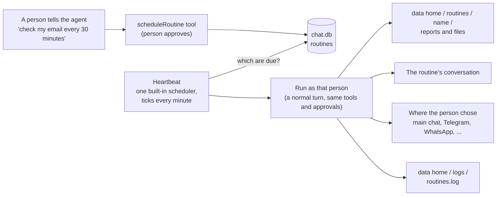

# Nanobox: routines, the heartbeat and logs

Status: API shape for review. No code yet.

## What this is, and what it is not

| | Schedulers (`schedules/*.bx`) | Routines (this plan) |
|---|---|---|
| Who creates them | The developer, by hand, before the agent is published | A person, by asking the running agent |
| Where they live | Code in the project, built into the app | Rows in the chat database (SQLite) |
| Changing one | Edit the file and rebuild | Say so in chat, or edit it in the web page |
| Who they belong to | The agent | One person (an admin sees all) |
| Turned on by | Existing: it is in the project | `routines.enabled: true` in `Agent.yaml`, off by default |

They do not replace each other. A developer who publishes an autonomous agent with its own schedulers keeps doing exactly that. Routines are for the people who use the published agent: "check my email every 30 minutes", "do social listening on these threads and give me a report on Mondays".

This difference is the first thing the documentation says, with a table and a diagram, on both pages ([schedules](../docs/conventions/schedules.md) and the new routines page).



## Decisions so far

- Routines are separate from schedulers. Schedulers stay hand-written by the developer.
- The developer or admin turns the feature on in `Agent.yaml`. Off by default, so no published agent grows automated work by surprise.
- Routines are stored in the chat database, per owner. Admins can see and manage all of them.
- One built-in scheduler, the **heartbeat**, ticks every minute, finds the routines that are due and runs them. Nothing else runs routines. (The earlier idea of a `HEARTBEAT.md` checklist is dropped.)
- Each routine chooses where its result goes when it is created: the main chat, or a chat app such as Telegram or WhatsApp.
- Each routine has a results folder in the data home, with any number of files. It can be listed, read, cleaned up and wiped. Nothing is deleted automatically: a person starts every clean-up.
- A routine has the same approval rules as chat: a tool that needs approval waits until a person answers.
- The web page manages routines: list, edit the schedule, prompt and destination, pause, run now, delete, read and delete results.
- Logs: the data home gets a `logs/` folder with a log per area (gateways, routines, heartbeat, api, agent), written with BoxLang's own logging. We add no rotation or retention settings; BoxLang's rolling file handling does it. Admins read them in the web page.
- One Logs section for the whole app, not one per agent. Every line names the agent.
- "Main chat" means the conversation the routine was created in. Created from Telegram, the answer comes back to Telegram.
- No identity linking and no claim code. The owner made the connection, so the app only needs the *address* to push to, and it already has it: every chat the gateway talks to is stored with its chat id (a conversation `telegram:<chat id>`). A chat-app destination uses that chat. If the gateway has talked with exactly one chat, that one. If more than one, the agent asks which and remembers the answer. If none, it tells the owner to message the bot once (Telegram and others do not allow a bot to write first anyway). Email, SMS and Signal use the address or number the owner gave when setting the gateway up.
- Chat apps belong to the owner. Checked in the code and docs: a gateway is developer configuration (`gateways/<name>.bx`, secrets from the environment, set up by the wizard), shared by the whole app. There is no table, API route or setting that lets a web user connect a chat app of their own; `/connect` is only for signing in to services (OAuth), not chat apps. So for now the person who runs the agent and set up its gateways, the local or admin user, is the only one who has chat apps. Other web users can send a routine's result to the chat it was created in, or to the web page.

## 1. Turning it on

```yaml
routines:
  enabled: true            # default false
  maxPerUser: 20           # default 20
  minInterval: 5m          # default 5m; the shortest a routine may repeat
```

With `enabled: false` (or no block) there is no tool, no command, no route that creates a routine, no heartbeat, and the Routines section of the web page is absent. `doctor` says which it is.

## 2. A routine

A row in the chat database (a versioned migration):

| Field | Meaning |
|---|---|
| `id`, `name` | `name` is folder-style, unique per owner: `check-email` |
| `ownerId` | Whose routine it is. The run is made as this person, so their notes, volumes and permissions apply |
| `schedule` | A cron expression, or `every 30m` |
| `prompt` | What to tell the agent when it fires |
| `destination` | Where the result is sent (section 4) |
| `enabled` | Paused routines stay stored |
| `lastRunAt`, `lastStatus`, `lastError`, `nextRunAt`, `failures` | Shown in the list |

A run:

- Is a normal turn through `TurnRunner`, as a `Caller` with `source = routine`, so memory, notes, approvals and usage all work as they do in chat.
- Has its own conversation, `routine-<name>`, which the person can open and read anywhere.
- Never overlaps itself: a routine still running (or waiting for an approval) is skipped, and the skip is logged.
- Three failures in a row pause the routine and say so where the person was to be notified.
- If the server was down when one was due, it runs once on start, not once per missed time.

### Who may create, change and see one

- The person, by asking the agent (the `scheduleRoutine` tool; they see the schedule, the prompt and the destination and approve), by `/routine`, `bxAgents routines` or the API.
- Everyone sees and changes their own. An admin sees all, and can pause or delete any.
- A routine run is not offered the tool that creates routines, so a prompt cannot make itself spread.

## 3. The heartbeat

A built-in scheduler, always registered when `routines.enabled` is true. Every minute it:

1. Reads the routines that are enabled and due.
2. Starts each one (a few at the same time, a small fixed limit).
3. Writes one line to `heartbeat.log` when it did something, and a warning when it could not.

It needs no dynamic scheduling: the schedule lives in the database, and the heartbeat reads it. Pausing, editing and deleting take effect at the next tick.

## 4. Where a result goes

The person chooses when they create the routine. Default: the conversation they were in when they asked.

| Destination | Meaning |
|---|---|
| `here` (default) | A message in the conversation the routine was created from |
| `routine` | Only the routine's own conversation; nothing is pushed |
| `gateway:telegram`, `gateway:whatsapp`, ... | Also sent to the owner on that chat app. Only the owner may choose it |

- The result is always kept in the routine's conversation and results folder, whatever the destination.
- A chat app can only be chosen by the owner, and only when the gateway has a chat to send to (see above). The agent says so when it has none.
- A send that fails is logged in `routines.log` and shown in the routine's last status; it does not fail the run.

### How the app pushes into a chat app

Verified in the code. Chat apps are bx-ai gateways (`IGateway`), registered in bx-ai's `aiGatewayRegistry()` and driven by one `aiGatewaySession()`. Today they are used one way round: a person writes, the agent answers through `gateway.deliver( event, context )` on the same chat. Approval questions are pushed the same way, but only into the chat that started the run.

Nothing in bxAgents sends a message that nobody asked for yet, but the piece it needs works: `aiGatewayRegistry().get( "telegram" ).deliver( event, context )` needs only a context holding the target (`conversationID` is the chat id, channel id, phone number or address) and the text. A spike with the mock gateway delivered with no inbound message. So we add one small class:

- `Notifier.send( gateway, address, text )` looks up the live gateway, builds the context and event, calls `deliver`, and returns an outcome. Failures go to `gateways.log` and to the routine's last status. Nothing else in the app calls `deliver` for an unprompted message.
- The address comes from the stored conversations of that gateway (and, for email, SMS and Signal, from the gateway's own settings). The one the owner picks, when there are several, is remembered as a preference.
- The agent can use the same class later for its own proactive messages (a `notifyMe` tool), with the same approval rules. Not in this plan.

What each chat app needs to receive an unprompted message:

| Chat app | Address | Works unprompted? |
|---|---|---|
| Telegram | chat id | Yes, once the owner has started the bot |
| Slack | channel or DM id | Yes, with the bot in the channel |
| Discord | channel id | Yes to a channel. A direct message needs the DM channel id, which an inbound DM gives |
| Signal | phone number | Yes |
| Twilio SMS | phone number | Yes (the owner's carrier cost) |
| Email | address | Yes |
| WhatsApp Cloud | wa_id | Only within the platform's reply window after the owner last wrote; sending text outside it needs approved templates, which `deliver` does not do. Reported as a failure with that reason |
| Teams | conversation id and `serviceUrl` | Only after the owner has written once; both values must be stored from that first message |
| GitHub | issue or PR | Not offered as a destination |

## 5. Results in the data home

```
<data home>/
  routines/
    check-email/
      2026-11-08T0800/report.md
      2026-11-08T0800/links.json
      ...
  logs/
```

- The agent saves what a run produced with a `saveReport( file, content )` tool that can only write inside that routine's folder (the same path rules as volumes: no `..`, no links out).
- A run's files go in a folder named by the run's time, so one run's files stay together.
- `bxAgents routines results <name> [--clean --older-than=30d] [--wipe]`, `/routine <name> results`, `GET /routines/results?name=` and `POST /routines/results/delete` list, read and remove them. Removing a routine can remove its folder too (asked).
- `backup` and `restore` already carry the data home, so reports are included.

## 6. Logs

BoxLang's `writeLog( log = "<absolute path>" )` makes a rolling file appender at that path, so no runtime setting is needed. A small `Logger` class writes through it:

```
<data home>/logs/
  agent.log        startup, errors in turns, tool failures
  gateways.log     every chat app: connect, disconnect, send failures, rate limits
  routines.log     created, changed, run, skipped, failed, delivered
  heartbeat.log    each tick that did something
  api.log          refused calls, auth failures (never a token or a message body)
```

- Lines carry time, level, agent name, area and a short message. No secrets, tokens, passwords or message text: the logger redacts known secret names and keeps message bodies out.
- Rolling and retention are BoxLang's own; we do not add settings for them.
- `bxAgents logs [area] [--tail=100] [--level=warn]` prints them.
- `GET /logs` lists the files; `GET /logs/<area>?tail=200&level=warn&q=text` returns lines. Admin only.

### In the web page (admin only)

A **Logs** section in Settings, with one tab per log:

- Lines in a table: time, a coloured level chip (error, warn, info), area, message.
- Filter by level, search box, "last 200 / 1000", auto-refresh toggle, download the file.
- Errors and warnings in the last day show as a count on the Settings icon, so a broken gateway is noticed without opening anything.

### Which chat apps are connected

Today nothing in the API or the web page says which gateways exist or whether they are up. The data is there: the registry lists the gateways, and each one knows whether it is running (`isRunning()`). So the same Settings area gets a **Gateways** section (admin only), next to Logs:

- One row per gateway: name, type, state (connected, stopped, or failing), when it last received and last sent a message, and the last error with a link to its lines in `gateways.log`.
- Which credentials are set, by the name of the environment variable and set or not set. Never a value.
- The chats it has talked with (platform and chat id), which is also what a routine can send to.
- `GET /gateways` (admin) returns the same, for the CLI (`bxAgents gateways`) and the client.

Connections themselves are still made in `gateways/<name>.bx` and `.env`, not in the page.

## 7. Surface for routines

| Where | What |
|---|---|
| Chat | `/routines` lists yours (an admin: all), `/routine <name> run|pause|resume|delete|results`. Creating is by asking the agent |
| CLI | `bxAgents routines [list|add|edit|pause|resume|run|delete|results]` |
| API | `GET /routines`, `POST /routines`, `POST /routines/update`, `/pause`, `/resume`, `/run`, `/delete`, `GET /routines/results`, `POST /routines/results/delete` |
| Web page | A Routines section: list with next and last run and status; edit schedule, prompt and destination; pause, run now, delete; open a routine's conversation; browse and delete its reports |

Everything goes through one `Routines` service (as `Conversations` does for conversations), so chat, CLI, API, web page and the agent's tools cannot disagree.

## 8. Safety

- A routine can do only what its owner's chat could do: no extra tools, no extra volumes.
- Approvals are never skipped because a run came from a schedule. A pending approval shows which routine asked.
- A routine cannot create routines.
- Shortest interval and most routines per person are set by the developer in `Agent.yaml`.
- Reports and logs never contain a vault value.

## Tasks

1. Spike: can `TurnRunner` run on a scheduler thread with no web request? Which chat apps can send a message nobody asked for, and what do they need (a stored chat id per person)? Does `writeLog` with an absolute path roll and keep working under the app's logging config?
2. `Logger` (areas, levels, redaction, files in `<data home>/logs` through `writeLog`), `bxAgents logs`; use it in the gateways, API errors and agent errors; specs.
3. `GET /logs`, `GET /logs/<area>` (admin), contract, handler, client, OpenAPI; specs.
4. Web page: Logs section (tabs, filter, search, tail, count badge), and the Gateways section with `GET /gateways` and `bxAgents gateways`.
5. `routines:` setting (loader, validator, `doctor`); `ChatStore` migration (v10) and the `Routines` service; specs.
6. Heartbeat scheduler and `RoutineRunner` (due, run as the owner, overlap, failures, catch-up); specs with a mock model.
7. `scheduleRoutine`, `saveReport` and routine management tools; approvals from a routine; specs.
8. `Notifier` (look up the live gateway, build the context, `deliver`, log), finding a chat to send to from the stored conversations (and keeping the Teams `serviceUrl`); the destinations `here`, `routine` and `gateway:<name>`; specs with the mock gateway.
9. Results folder: layout, tools, `bxAgents routines results`, API; specs.
10. `/routines`, `/routine`, `bxAgents routines`, the API routes (owner and admin rules), client, OpenAPI; specs.
11. Web page: Routines section.
12. Docs (English and the `1.0.x` mirror): a routines page that opens with the schedulers table and diagram, the `routines:` setting, the data home layout, the API; changelog; full suite; ColdBox integration run.

Slices, one draft pull request each: logs (2 to 4), routines core (5 to 7), delivery and results (8 to 9), surface (10 to 12).

## Open questions

None blocking. One risk to know about, left for later: a chat app's bot is usually findable by anyone, and gateways have no allowed-people list today, so a stranger who messages the bot becomes another chat on that gateway. That is why the agent asks which chat when there is more than one. An optional "only this chat may talk to the agent" setting on a gateway would remove the risk; it is not part of this plan.
