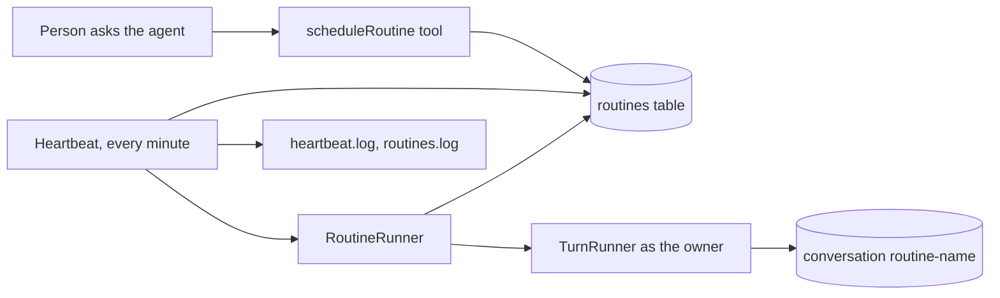

# Routines core: the shape

Slice 2 of `nanobox-routines-and-heartbeat.md` (its tasks 5 to 7). This page fixes the API and the shape before any code. Delivery to chat apps and the results folder are the next slice, so here a routine's answer is stored in its own conversation only.

## What this slice delivers

A person asks the agent "check the build every weekday at 9", the agent saves a routine, and the heartbeat runs it on time as that person. They read the answer in the routine's conversation. Nothing is sent anywhere else yet.



## 1. Setting

```yaml
routines:
  enabled: false     # default false
  maxPerUser: 20     # 1 to 200
  minInterval: 5m    # 1m to 1d; the shortest a routine may repeat
  maxParallel: 2     # 1 to 10; routines started in the same tick
  maxPromptLength: 4000  # 200 to 20000 characters
  approvalTimeout: 24h  # 5m to 7d; how long a run waits for a person to approve a tool
  timezone: ""       # blank = the server's time zone; or an IANA name such as Europe/Madrid
```

`RoutineWiring` (like `SkillWiring`): `problems( settings )` for the validator and `doctor`, `attach( agent, settings, ... )` for the tools, and a `start()` that registers the heartbeat. Unknown keys and wrong types are named in words. With `enabled: false` nothing below exists: no table is read, no tool, no heartbeat, `capabilities` has no `routines`.

## 2. Storage

Migration 10 in `ChatStore`:

```sql
CREATE TABLE IF NOT EXISTS routines (
  id          VARCHAR(64)  NOT NULL PRIMARY KEY,
  ownerId     VARCHAR(255) NOT NULL,
  name        VARCHAR(64)  NOT NULL,
  schedule    VARCHAR(100) NOT NULL,
  prompt      TEXT         NOT NULL,
  enabled     INTEGER      NOT NULL DEFAULT 1,
  status      VARCHAR(16)  NOT NULL DEFAULT 'idle',  -- idle, running
  nextRunAt   DATETIME,
  lastRunAt   DATETIME,
  lastStatus  VARCHAR(16)  NOT NULL DEFAULT '',      -- ok, failed, skipped
  lastError   VARCHAR(500) NOT NULL DEFAULT '',
  failures    INTEGER      NOT NULL DEFAULT 0,
  createdAt   DATETIME,
  updatedAt   DATETIME,
  UNIQUE ( ownerId, name )
);
CREATE INDEX IF NOT EXISTS idx_routines_due ON routines ( enabled, nextRunAt );
```

No `destination` column yet: the next slice adds it as migration 11 with a default of "this routine's own conversation", so nothing here changes.

## 3. Schedule

Stored in one of two forms, nothing else:

- a 5 field cron expression: `0 9 * * 1-5`
- `every <n><m|h|d>`: `every 30m`

The agent's tool takes only these two forms; the model turns "every weekday at 9" into cron. `Schedule` (a small class) does:

| Method | Meaning |
|---|---|
| `Schedule::parse( text )` | Returns the normalised text, or throws `BxAgents.InvalidSchedule` saying what is wrong |
| `next( text, after, zone )` | The next time strictly after `after` |
| `interval( text )` | The shortest gap the schedule can produce, checked against `minInterval` |
| `describe( text )` | A short English reading for the approval and the lists: "weekdays at 09:00" |

To check at the start of task 5: whether BoxLang already ships a cron parser we can call. If not, we write a small 5 field one (numbers, lists, ranges, steps, `*`; no names, no `L`/`W`/`#`).

## 4. Service: `Routines`

One class, the only door to the table, like `Conversations`. Every method takes the `Caller` and returns an `Outcome`.

| Method | Who | Notes |
|---|---|---|
| `list( caller, all=false )` | owner; admin with `all` | Rows without the prompt text beyond 200 characters |
| `get( caller, name )` | owner or admin | Full row |
| `create( caller, name, schedule, prompt )` | owner | Name rules from `NameRules`; unique per owner; `maxPerUser`; `minInterval`; sets `nextRunAt` |
| `update( caller, name, fields )` | owner or admin | `schedule`, `prompt`; recomputes `nextRunAt` |
| `pause( caller, name )`, `resume( caller, name )` | owner or admin | Resume clears `failures` |
| `delete( caller, name )` | owner or admin | Keeps the routine's conversation |
| `runNow( caller, name )` | owner or admin | Starts it on the next heartbeat tick, no waiting for the schedule |

Failures are `Outcome` errors with a code and a sentence for a person: `not_found`, `forbidden`, `invalid`, `limit`, `exists`, `disabled`. The same sentence reaches the agent, the CLI, the API and the web page.

Internal, used by the runner only: `due( now, limit )`, `claim( id )`, `finish( id, status, error )`.

## 5. Running: `RoutineRunner`

`run( routine )`:

1. `claim`: one SQL update sets `status = 'running'` where it is `idle`. If no row changed, another run holds it: log "skipped, still running" and stop. This is the overlap rule and it also keeps two servers on one database from running a routine twice.
2. Build `Caller` with `id = ownerId`, `source = routine`, scope `chat`.
3. Run a turn through `TurnRunner.run` in the conversation `routine-<name>`, with the prompt prefixed by one fixed line: "This is a scheduled routine named <name>. No person is watching; do the task and report the result."
4. Success: `lastStatus = ok`, `failures = 0`. Error or exception: `lastStatus = failed`, `lastError` (cleaned by the Logger's redaction), `failures + 1`. At 3 failures the routine is paused and `routines.log` says so.
5. Always: `status = 'idle'`, `lastRunAt = now`, `nextRunAt = next( schedule, now )`.

A run that needs approval ends in `waiting` for the approval (the existing pending mechanism), so the routine stays `running` until a person answers or it times out. Timeout: `routines.approvalTimeout` (default 24h), after which the run is cancelled and counted as a failure. This is the one case from the spike that is not yet shown; it gets its own spec first.

## 6. Heartbeat

`Heartbeat` is a BoxLang scheduler registered when `enabled` is true, on the same path extension schedulers use. Every minute:

1. `due( now, maxParallel )`: routines with `enabled = 1`, `status = 'idle'` and `nextRunAt <= now`, oldest first.
2. Each is started on its own thread with `RoutineRunner.run`.
3. One line in `heartbeat.log` only when something was started or went wrong. A quiet minute writes nothing.

**Start-up catch-up:** on start, rows left `running` by a crashed server are set back to `idle` (logged), and a routine whose `nextRunAt` is in the past simply shows up as due: it runs once, then `nextRunAt` moves to the next time after now. Missed ticks are never replayed.

## 7. Tools

Added to the root agent only (sub-agents and routine runs never get them, so a routine cannot create routines).

| Tool | Arguments | Approval |
|---|---|---|
| `scheduleRoutine` | `name`, `schedule`, `prompt` | A person approves. The approval shows the schedule in words, the next run time and the full prompt |
| `listRoutines` | none | None |
| `changeRoutine` | `name`, `action` = `pause`, `resume`, `delete`, `run`, or `schedule` / `prompt` with a new value | Approval for `delete`, and for any change to `schedule` or `prompt` |

`saveReport` and the results folder are in the next slice.

Every tool answer says what happened or why not, in a sentence the model can act on, like `saveSkill`.

## 8. Logging

`routines.log`: created, changed, paused, resumed, deleted, started, ok, failed, skipped, auto-paused. `heartbeat.log`: ticks that started something, catch-up on start. Prompts are never logged, only the routine name and owner id.

## 9. Not in this slice

Destinations and chat app delivery, the results folder and `saveReport`, `/routines`, `bxAgents routines`, API routes, the web page section, the docs page. The `Routines` service is built so those are thin callers.

## 10. Tasks

5a. `routines:` setting: `RoutineWiring.problems`, validator and `doctor`, defaults, docs row in `agent-yaml`.
5b. `Schedule` class (after checking BoxLang's cron support), with specs for parse, next, interval, describe, time zones and DST.
5c. Migration 10 and the `Routines` service with all the rules in section 4; specs for each rule and each error.
6a. `RoutineRunner`: claim, run as the owner, outcomes, auto-pause; specs with the mock model, including overlap and a failing model.
6b. `Heartbeat`: due selection, parallel limit, catch-up, crash recovery; registered only when enabled; specs with a fake clock.
6c. Spec: an approval that pauses a scheduled run and resumes later, with the timeout.
7a. The three tools and their approvals; specs for what the agent gets back on each error.
7b. A routine run is not given the routine tools; `routines.enabled: false` gives no tools.
7c. `capabilities.routines`, changelog entry, full suite, ColdBox integration run, draft PR.

## 11. Decisions

Answered by the owner.

1. **Time zone:** one `routines.timezone` in `Agent.yaml`, default the server's.
2. **Schedule words:** stored forms are cron and `every Nm` only. The model translates and the approval shows the English reading.
3. **Approval timeout:** 24 hours by default, set with `routines.approvalTimeout`. The other limits are settings too: `maxPerUser`, `minInterval`, `maxParallel`.
4. **Prompt length:** 4000 characters by default, set with `routines.maxPromptLength`. Longer needs go in a skill.
