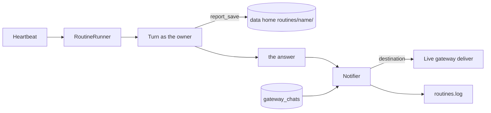

# Routines delivery and results: the shape

Slice 3 of `nanobox-routines-and-heartbeat.md` (its tasks 8 and 9). Routines core is merged (`nanobox-routines-core-shape.md`). This page fixes the API and the shape before any code.

## What this slice delivers

A routine can send what it found to a chat app, and can keep reports as files. "Every weekday at 9, check the build and message me on Telegram", and the full report is in a file the person can read later.



## What I found while reading the code

- A gateway chat is stored as a conversation with `source = <gateway type>`, id `<gateway name>:<chat id>[:<thread id>]` and user `<gateway name>:<user id>`.
- `deliver( event, context )` needs a `GatewayContext` with the chat id in `conversationID`. Teams also needs `metadata.serviceUrl` and a conversation id, both taken from the first inbound message.
- The stored conversation rows keep neither the serviceUrl nor the thread as separate fields. So the Notifier cannot rebuild a Teams address from them, and parsing ids back apart is fragile.
- Telegram's `deliver` reads `event.data.text`, while the chat session sends `data.content` for a completed response. Which one every gateway honours is the first thing to check (task 8a).

So this slice records the chats a gateway talks to in its own table, written when a message arrives.

## 1. Where a result goes: `destination`

Stored on the routine as two columns (migration 11):

| Column | Meaning |
|---|---|
| `destination` | `routine` (its own conversation, as today) or `gateway:<name>` |
| `destinationChat` | The chat id on that gateway, or blank for `routine` |

`routine_schedule` and `routine_update` get an optional `destination`:

| Given | Means |
|---|---|
| nothing | The chat the routine was made in, if that is a chat app (that gateway and chat). Otherwise `routine`. Decided when it is made and stored as the concrete value |
| `routine` | Only its own conversation |
| `gateway:telegram` | That chat app. The chat is the one chat that gateway has talked to. With more than one chat, the tool answers that it needs a `chat`, lists them, and the agent asks the person. With none, it says the owner has to message the bot once |

Who may choose a chat app: a routine made from a chat app may deliver to that same chat. Choosing a gateway explicitly is for the local user and admins, because chat apps belong to the person who runs the agent (decided earlier). Anyone else gets `routine` and is told why.

## 2. `gateway_chats` and `GatewayChats`

Migration 11 also adds:

```sql
CREATE TABLE IF NOT EXISTS gateway_chats (
  gateway    VARCHAR(64)  NOT NULL,   -- the gateway's name
  chatId     VARCHAR(255) NOT NULL,   -- context.conversationID
  threadId   VARCHAR(255) NOT NULL DEFAULT '',
  userId     VARCHAR(255) NOT NULL DEFAULT '',  -- context.userID of the last sender
  metadata   TEXT         NOT NULL DEFAULT '{}', -- Teams: { serviceUrl }
  firstSeen  INTEGER,
  lastSeen   INTEGER,
  PRIMARY KEY ( gateway, chatId, threadId )
);
```

`GatewayChats` (a small service, like `Routines`):

| Method | Meaning |
|---|---|
| `seen( context )` | Upserts the chat and its metadata. Called by `CommandGatewaySession` for every inbound message. Never throws |
| `forGateway( name )` | The chats a gateway has talked to, newest first: `{ chatId, threadId, userId, lastSeen }` |
| `contextFor( name, chatId, threadId )` | A `GatewayContext` ready for `deliver`, with the stored metadata |

Only addresses and the Teams serviceUrl are stored, never message text. A chat is forgotten when its gateway is removed from the project (checked at start).

## 3. `Notifier`

```
Notifier( chats, registry?, settings, clock? )
deliver( row, text ) -> { ok, reason }
```

1. Reads the routine's destination. `routine` returns ok and does nothing.
2. Finds the live gateway in bx-ai's registry. Not registered or not running: `{ ok : false, reason : "The telegram chat app is not connected" }`.
3. Builds the context with `GatewayChats.contextFor` and sends an event with the text, prefixed `Routine check-build:`.
4. Logs the outcome to `routines.log` (name, gateway, ok or the reason; never the text).

What is sent is a **summary**: the agent's final answer cut to `routines.summaryLength` characters, with a last line `Full report: <file>` when the run saved one. Chat apps cap message length, and the full text is in the routine's conversation and results folder anyway.

A failed delivery counts as a failed run (so three in a row pause the routine) and says so in `lastError`. The turn's answer is not lost: it is in the conversation.

## 4. The results folder

`<data home>/routines/<routine name>/`, one folder per routine, files of any number. Nothing is deleted automatically, ever.

`RoutineResults` (the only door to the folder):

| Method | Meaning |
|---|---|
| `save( ownerId, routine, file, content )` | Writes a new file. Never overwrites: a name already used gets `-2`, `-3`. Refuses a bad name, a file over `maxReportSize`, or a folder with `maxReportFiles` files |
| `list( ownerId, routine )` | `{ file, bytes, savedAt }` newest first |
| `read( ownerId, routine, file )` | The text, cut at the read limit, with a note when cut |

A file name is letters, digits, `.`, `_`, `-`, up to 80 characters, ending in `.md`, `.txt`, `.json`, `.csv` or `.html`. Paths, `..` and hidden files are refused. The folder of a routine belongs to its owner: `routines/<name>` holds that name for that owner, and two owners with the same routine name get `routines/<name>-<owner hash>` so they never share. Symlinks inside are never followed.

The data home gets a `routines` folder (the README lists it). It is part of `backup`; logs are not.

## 5. Tools, named `{type}_{action}`

| Tool | Does | Approval |
|---|---|---|
| `routine_schedule`, `routine_update` | gain `destination` and `chat` | as today |
| `report_save` | Saves a file for the routine that is running. Refuses outside a routine's run | No |
| `report_list` | Lists a routine's files (the person's own routines) | No |
| `report_read` | Reads one | No |

There is no tool to delete a report. A person does that, with the commands of the next slice.

## 6. Settings added to `routines:`

| Setting | Default | Range |
|---|---|---|
| `summaryLength` | `1500` | 200 to 4000 characters sent to a chat app |
| `maxReportSize` | `256kb` | `1kb` to `5mb` per file |
| `maxReportFiles` | `500` | 10 to 5000 per routine |

## 7. Failure and safety

- Delivery needs the gateway to be connected at that moment. If not, the run fails with a clear reason and the heartbeat tries again at the next scheduled time, not before.
- A report or a summary is written by a model. The Logger already redacts token shapes in anything it logs, and the Notifier logs no text.
- Unprompted messages can reach a person who never wrote to the bot only if that chat is already in `gateway_chats`, which only fills from inbound messages. The risk noted in the first plan (a stranger who messages a bot becomes a known chat) is why a gateway with more than one chat makes the agent ask. An "only this chat may talk to the agent" setting on a gateway is still not part of this plan.

## 8. Not in this slice

`/routines`, `bxAgents routines` (including `results` and clean-up), the API routes, the web section, the Reconnect button and the docs page for the whole feature. Those are slice 4.

## 9. Tasks

8a. Check first, with throwaway specs: which event data key each gateway's `deliver` reads (`text` or `content`), and that a context built from stored fields works for Telegram, Slack and Teams. Fix this page if it differs.
8b. Migration 11: `routines.destination`, `routines.destinationChat`, `gateway_chats`.
8c. `GatewayChats`, and `CommandGatewaySession` records each chat it hears from.
8d. `Notifier`, with the mock gateway and specs for each failure.
8e. The runner delivers after a run and counts a failed delivery as a failed run.
8f. `destination` and `chat` on the routine tools: resolution, the owner rule, and the answer that asks which chat.
9a. `RoutineResults` and the `routines` folder of the data home.
9b. `report_save`, `report_list`, `report_read`.
9c. Settings (`summaryLength`, `maxReportSize`, `maxReportFiles`), docs (English and the 1.0.x mirror), changelog, full suite, ColdBox integration run, one PR.

## 10. Decisions

Taken from the recommended answers unless you say otherwise:

1. A gateway with more than one chat: the agent asks which, the tool lists them.
2. Deleting a report: a person only, in slice 4.
3. A delivery failure fails the run.
4. Chat apps get a summary and a pointer to the file, not the whole report.
