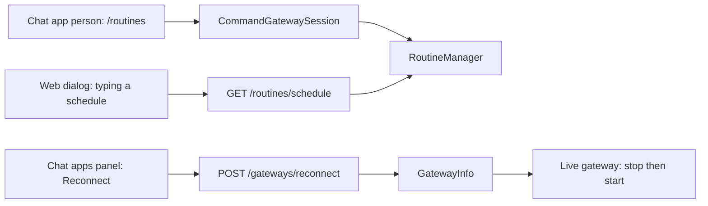

# Finishing routines: the shape

Three loose ends from `nanobox-routines-surface-shape.md`, all small. Nothing here changes how routines run or are stored.

## 1. Reconnect a chat app

Stops and starts one chat app in place, so a fixed credential or a dropped connection does not need an app restart. Admin only, like the rest of the Chat apps panel.

| Piece | Shape |
|---|---|
| `GatewayInfo.reconnect( name )` | Finds the live gateway (bx-ai registry, by the entry's type), calls `stop()` then `start()` and answers an `Outcome` with that gateway's fresh listing row. A gateway not registered answers `not_found`. A `start()` that throws answers a failure with the gateway's own message, and the row then shows `failing` |
| Route | `POST /gateways/reconnect` with `{ name }`, admin only, in `ApiContract` (router, OpenAPI, handler coverage follow) |
| `AgentService.reconnectGateway( caller, name )` | The service call the handler uses |
| Client | `AgentApiClient.reconnectGateway( name )` |
| CLI | `bxAgents gateways reconnect <name>` (the verb exists for listing) |
| Web | A **Reconnect** button on each chat app row, disabled while it works, with the result in the panel's foot line. The row refreshes after |
| Log | `gateways.log`: `Reconnected [telegram]` or `Could not reconnect [telegram]: <reason>` (never a credential) |

Notes: stopping does not cancel a turn already running, and the session keeps its message handler, so messages arrive again once `start()` returns. Chat apps that are webhook-only have nothing to reconnect: `stop()` and `start()` are then a harmless flip and the row says so.

## 2. `/routines` and `/routine` on chat apps

Today the gateway session has no routines manager, so the commands are only offered on the terminal and the web page.

- `CommandGatewaySession` takes `commands.routines` (the resolved routines settings, stamped by the generator only when `routines.enabled` is true) and builds the same `RoutineManager` the API uses, from the shared chat store and the data home.
- The person is the chat app caller already used by the routine tools: id `<gateway>:<user>`, chat scope. `commands.admins` still decides who is an admin, so `/routines all` works for them and nobody else.
- The two commands list `gateway` as a transport again, so they can be named in `commands.allow`. **They are not in the default allow list**, as decided: a developer opts in with `commands: { allow: [ routines, routine ] }`.
- When routines are on but the command is not allowed, nothing changes. When routines are off the commands do not exist on the gateway.
- Replies use the plain renderer the gateway already has (tables become text).
- Deleting a routine still needs `confirm`, and there is still no report removal.

## 3. The schedule read back as you type

A route that says what a schedule means, so the web dialog (and anything else) can show it before saving.

| Piece | Shape |
|---|---|
| `RoutineManager.describeSchedule( schedule )` | `Schedule::check`, then `Schedule::describe` and the next run in the routines time zone. Answers `{ value, text, nextRunText }`, or `bad_request` with the same sentence the save would give (including the minimum interval) |
| Route | `GET /routines/schedule?schedule=`, any signed-in person when routines are on (it stores nothing) |
| Client | `AgentApiClient.describeSchedule( schedule )` |
| Web | Under the schedule field, after 300 ms of no typing: "weekdays at 09:00, next 2026-11-12 09:00 (UTC)" in muted text, or the problem in the error colour. The words are also in an `aria-live` region |

## 4. Also folded in

The dialog asks for a chat id by hand when a chat app has talked to more than one chat. `GET /gateways` gets `chats: [ { chatId, threadId, lastSeen } ]` (addresses only, never text, admin only like the rest), and the dialog turns the chat id box into a pick list when the chosen chat app has any. This finishes the chat app destination path, which was not checked in a browser last time.

## 5. Tasks

1. `GatewayInfo.reconnect`, `AgentService`, the route, handler, client, `bxAgents gateways reconnect`; specs with the mock gateway.
2. Reconnect button in the Chat apps panel; checked in a real browser.
3. `GatewayInfo.listing` gains `chats`; the dialog's chat pick list.
4. `RoutineManager.describeSchedule`, route, client, the dialog's live reading; specs and a browser check.
5. Routines on `CommandGatewaySession` (setting, manager, person, transports); generator stamping; specs with the mock gateway, including the not-allowed and routines-off cases.
6. Docs (English and the `1.0.x` mirror: routines page, gateways page, web UI, CLI, API guide, slash commands), changelog, full suite, ColdBox integration run (with real calls to the new routes), one PR.

## 6. Decisions

Taken from the recommended answers unless you say otherwise:

1. Reconnect is admin only and does not cancel running turns.
2. The gateway commands are opt-in through `commands.allow`, not on by default.
3. The schedule route is open to anyone signed in (it stores nothing).
4. The chat pick list shows ids and last-seen times only.
