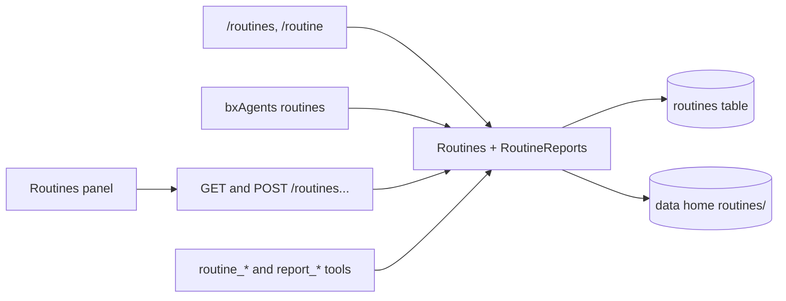

# Routines surface: the shape

Slice 4 of `nanobox-routines-and-heartbeat.md` (its tasks 10 to 12). Core and delivery are merged. Until now a routine could only be made, changed and read by asking the agent. This slice adds every other way in: a chat command, the terminal, the API and the web page, and the clean-up of reports that was left for a person.

Everything goes through the services that exist (`Routines`, `RoutineResults`), plus one new door for reports with the owner and admin rules, so no surface can disagree with another.



## 1. One door for reports: `RoutineReports`

`RoutineResults` stays the only thing that touches files. `RoutineReports` is the person-facing side, like `Routines` is for routines: every method takes the `Caller`, finds the routine with the same owner and admin rules (`Routines.get`), and answers an `Outcome`.

| Method | Who | Notes |
|---|---|---|
| `list( caller, ref )` | owner; admin any | `{ files : [ { file, bytes, savedAt } ], totalBytes }` |
| `read( caller, ref, file )` | owner; admin any | text, cut at the read limit |
| `remove( caller, ref, file )` | owner; admin any | One file. Only a person ever calls it: the agent has no tool for it |
| `clean( caller, ref, olderThanDays, all, apply )` | owner; admin any | Picks files older than N days, or all of them. Without `apply` it only says what it would remove (`removed : false`). With `apply` it removes them and logs the count |

`RoutineResults` gets the matching `remove( row, file )` and `files with age`, and the same name rules and link refusal as saving. Nothing here runs by itself, and a routine's delete leaves its reports (as promised in the docs).

## 2. API

Routes in `ApiContract`, tag `Routines`. Every route answers `not_found` ("Routines are not turned on") when the feature is off. People see their own; an admin adds `all=1` to list everyone's and may act on any by id or by a name only one owner has.

| Route | Does | Body or query |
|---|---|---|
| `GET /routines` | List, with schedule in words, next and last run, status, destination, the routine's `conversationId` | `all?` |
| `GET /routines/get` | One, with its full prompt | `name` |
| `POST /routines` | Make one | `name, schedule, prompt, destination?, chat?` |
| `POST /routines/update` | Change schedule, prompt or destination | `name, schedule?, prompt?, destination?, chat?` |
| `POST /routines/pause`, `/resume`, `/run`, `/delete` | As the tools | `name` |
| `GET /routines/reports` | List the files | `name` |
| `GET /routines/report` | Read one | `name, file` |
| `POST /routines/reports/delete` | Remove one file | `name, file` |
| `POST /routines/reports/clean` | Remove old files; dry run unless `apply` | `name, olderThanDays?, all?, apply?` |

The order of the routes follows the contract rule (a pattern also matches what follows it). The OpenAPI document, the router and the handler-coverage spec all come from the contract, so they cannot drift.

Where an answer goes is decided by `Destinations`, as for the tools, with one change: an **admin** caller is treated like the local user, so an admin web account can pick a chat app here (the gap noted when the tools were built).

`AgentService` gets `routines( caller )` and `reports( caller )`. The build stamps the resolved settings into the handler (it stamps only a yes or no today) so the service can be built.

`AgentApiClient`: `routines()`, `routine( name )`, `createRoutine()`, `updateRoutine()`, `pauseRoutine()`, `resumeRoutine()`, `runRoutine()`, `deleteRoutine()`, `reports( name )`, `report( name, file )`, `deleteReport()`, `cleanReports()`.

## 3. Chat commands

| Command | Does |
|---|---|
| `/routines` | Lists yours (an admin may add `all`): name, schedule in words, status, next run |
| `/routine <name>` | Shows one: prompt, destination, last run and error |
| `/routine <name> run` or `pause` or `resume` | As the tools |
| `/routine <name> delete confirm` | Deletes. Without `confirm` it says to add it |
| `/routine <name> reports` and `/routine <name> report <file>` | Lists and reads reports |

Making and changing a routine stays "ask the agent", where a person sees and approves it. **Report removal is not a command**: it is CLI, API and web only, so nothing in a chat can delete files. The commands are not in the default allow list of a chat app gateway (a chat app person has `/routines` only when the developer allows it).

The command layer works through `AgentConversation`, so `routines` and `reports` methods are added to `InProcessSession` (the terminal), `HttpSession` (a remote server, through the client) and `ServerConversation` (the web page and API). The spec that runs every command each transport offers (`CommandsEverySpec`) gets a case for both.

## 4. Terminal

```
bxAgents routines [list|show|add|edit|pause|resume|run|delete|reports|report|clean]
```

Works on the project's chat database like `sessions` does, as the local operator (admin scope), so `--all` lists every owner's.

| Form | Does |
|---|---|
| `routines list [--all] [--json]` | The table |
| `routines show <name>` | One, in full |
| `routines add --name= --schedule= --prompt= [--destination= --chat=]` | Make one |
| `routines edit <name> [--schedule= --prompt= --destination= --chat=]` | Change |
| `routines pause|resume|run|delete <name>` | `delete` asks to confirm unless `--yes` |
| `routines reports <name>` | List files |
| `routines report <name> <file>` | Print one |
| `routines clean <name> [--older-than=30d | --all] [--yes]` | Shows what would be removed; removes only with `--yes` |

`run` marks the routine due: it runs at the next heartbeat of a served app (the CLI says so). Completions for bash, fish and PowerShell are regenerated.

## 5. Web page

When `/info` says `capabilities.routines`, **Settings** gets a **Routines** item, opening a panel:

- A list, one row per routine: name, the schedule in words, a status in words as well as colour (running, waiting for approval, paused, failed, ok), next run, last run, destination. Admins get an "all owners" switch and an owner column.
- Row actions: **Run now**, **Pause** or **Resume**, **Edit**, **Delete** (a confirm dialog), **Open conversation** (the routine's own, which shows its answers), **Reports**.
- **New routine** and **Edit** share one dialog: name, schedule (with the two forms explained and examples, and the English reading shown as you type, from the server), prompt (with the length limit), and where the answer goes: its own conversation, or a chat app (for admins; the chats are listed from `/gateways`).
- **Reports**: the files with size and date, a viewer, a delete button per file with a confirm, and **Clean up older than N days** that first shows how many files and bytes it would remove.
- Failed or auto-paused routines show their last error and a Resume button.

It follows the page's existing patterns (dialogs, focus handling, keyboard, light and dark, small screens) and is checked in a real browser at desktop and phone width.

## 6. Logging and safety

- Everything a person does here is logged as it is today (made, changed, paused, resumed, deleted, run requested), now with the report removals and clean-ups (the count, never a name or text).
- A clean-up is a dry run unless it is explicitly applied, in the CLI, the API and the web page.
- Report names and links are checked by the same code as saving, so a name from a request cannot leave the folder.
- Nobody sees another person's routines or reports, except an admin.

## 7. Not in this slice

The gateway **Reconnect** button, which stops and starts one chat app in place, stays its own piece of work. It is not about routines.

## 8. Tasks

10a. `RoutineResults.remove` and ages, `RoutineReports` (list, read, remove, clean with dry run); specs for every rule.
10b. `Destinations`: an admin caller may pick a chat app; the routine summary gains `conversationId`; specs.
10c. `AgentService.routines` and `reports`, the handler actions, the `ApiContract` routes, stamping the settings; specs including the coverage and OpenAPI specs.
10d. `AgentApiClient` methods and their spec.
10e. `/routines` and `/routine`, with the `AgentConversation` methods on the three transports; specs, including the every-command spec and the menus.
10f. `bxAgents routines`, the verb table, completions; specs.
11. The Routines panel in the web page; checked in a real browser at desktop and phone width.
12. Docs (English and the `1.0.x` mirror: routines page, CLI reference, web UI, slash commands, API guide), changelog, full suite, ColdBox integration run (with real calls to the new routes), one PR.

## 9. Decisions

Taken from the recommended answers unless you say otherwise:

1. Report clean-up is a dry run unless applied (`apply`, `--yes`, or a confirm in the web page).
2. No chat command removes reports; deleting a routine in chat needs `confirm`.
3. `/routines` is not in the default allow list of a chat app gateway.
4. The terminal acts as the local operator (admin scope), with `--all` for every owner.
5. Creating and editing in the web page is one dialog; chat app destinations are offered to admins.

## 10. As built

Where the code differs from the shape above, the code wins:

- **The commands are for the terminal and the web page only.** `/routines` and `/routine` list only the `tui` and `web` transports, so a chat app never offers them (the gateway session has no routines manager). A chat app person asks the agent, which has the `routine_*` tools. Giving them to chat apps later means passing a manager to `CommandGatewaySession`.
- **One adapter shape for every transport.** A command reads `context.chat().routines()`, which is a `BoundRoutines` (a `RoutineManager` with the person filled in; the server and the terminal) or a `RemoteRoutines` (a connected terminal, through the API). `RoutineManager` answers every `Outcome` the same way, so the commands are written once.
- **`ProjectRoutines`** builds the manager for the terminal and the `routines` verb from the project's resolved `Agent.yaml`, its chat database and its data home. It answers null (and the verb says so) when routines are off.
- **The summary gained `statusText`, `nextRunText` and `lastRunText`**, the time as `2026-11-09 09:00 (Europe/Madrid)` in the routines time zone, so no surface formats times itself.
- **`capabilities.admin`** was added to `GET /agent` so the page can offer the all-owners switch.
- **The page does not read the schedule back as you type.** There is no route for it, so the reading in words comes back when you save. Chat app destinations in the dialog list the project's chat apps from `/gateways` (admin only); that path was not exercised in the browser run because the demo project has no chat app, only the route and the plain destination were.
- **Checked in a real browser** (desktop 1280 wide and phone 390 wide) against a served app with real HTTP calls: list, status chips, make, edit (a bad schedule answered in the dialog), pause, resume, reports (view, delete), clean-up with its confirmation, Escape closing a dialog, no sideways scroll.
- **Fixed on the way:** a wrong `tail` on `GET /logs` answered `500` (an unlisted error code); it is `400` now.

