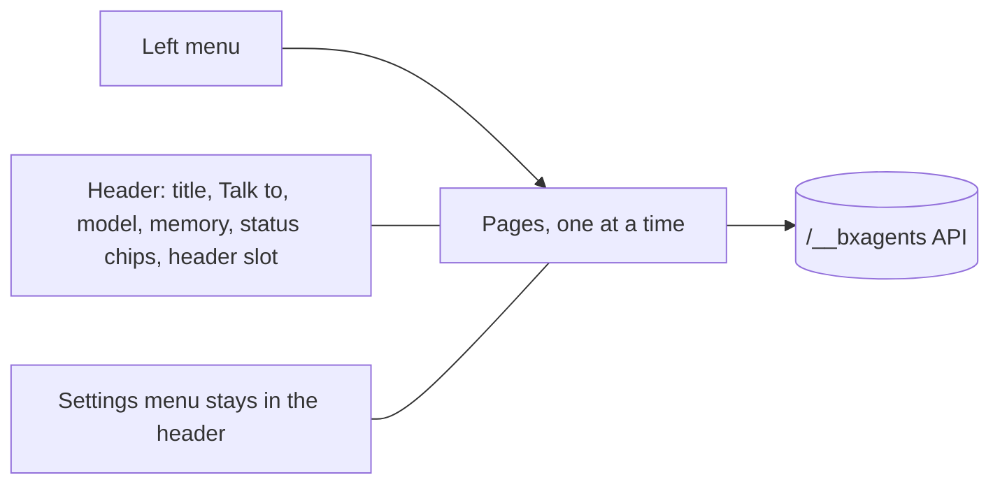

# Web UI revamp: the shape

The approved mock-ups are the canvas "Web app layout mockup" (27 boards, version 24): https://claude.ai/artifact/UjboUxtPTt7TQ2WiFQg7Yr. This page fixes what is built, in which order, and every new server route, before code. Docs are deferred to the end of the whole piece, as agreed.

Rules that hold for all of it:

- **Nothing is removed** from today's page. The "Nothing removed" board lists every control and where it lives now. Every extension slot (header, composer, sidebar, status chips, slots API) stays.
- **Whatever the terminal does, the web page does.**
- **Accessible on web and phone**: a skip link first, a visible focus ring, targets of at least 44 by 44 px, the current page marked with `aria-current`, status in words and icons as well as colour, contrast of at least 4.5 to 1, `prefers-reduced-motion` respected, and dialogs that trap and return focus.
- **Phosphor icons everywhere** (MIT, the `@phosphor-icons/core` 2.1.1 regular set). The page keeps one SVG sprite (`webui/vendor/icons.svg`, today 55 symbols); the revamp adds the ones the mock-ups use (about 90 more) and nothing else.
- The light and dark themes, accent colours, text size and density of Appearance stay. The mock-ups are drawn light; dark uses the same tokens.
- The user-facing word is **Gateways** (not chat apps), and the section is **Memory** (not Memory and notes). Messages the server writes ("The telegram chat app is not connected") are renamed to match.

## 1. The layout

One generated HTML file, as today. A small hash router (`#/chat`, `#/conversations`, `#/routines`...) shows one page at a time inside the shell, so the server needs no new page routes and the page keeps working behind any reverse proxy path. The shell is the left menu plus the header; the Chat page keeps the conversations sidebar.

| Menu group | Pages | Who |
|---|---|---|
| Main | Chat, Conversations, Routines, Registry (Tools, Skills, Volumes), Memory, Vault, Settings | everyone |
| Admin | Agent (Composition, Files, Usage), Gateways, Logs, Access (Tokens, People), Data and backups | admins only |

- The menu folds to icons (remembered in the browser), becomes a drawer on a phone, and keeps the admin items apart in a labelled group. A member never sees the Admin group, and the server refuses the routes behind it anyway (every route already has an `access`).
- The Logs item shows the count of recent errors.
- Today's header buttons and Settings menu stay and gain the new entries, exactly as the coverage board says.

## 2. Screen to data

"New" means the route does not exist yet and is built in the backend slices.

| Screen | Data | Route |
|---|---|---|
| Chat | stream, history, commands, approvals, context | existing |
| Chat header: Talk to | the agent tree | `GET /agent` gains `agents` (new) |
| Conversations | paged, filtered list, counts | `GET /sessions` extended (new) |
| Routines (member and admin) | routines, reports, schedule reading | existing |
| Registry: Tools | tools with approval marks | `GET /tools` (existing; the page groups by prefix) |
| Registry: Skills | list and a reader | `GET /skills` existing, `GET /skills/read` (new) |
| Registry: Volumes | volumes | `GET /volumes` existing |
| Memory | notes, conversation memory per agent, clear | `GET /notes` existing, `POST /notes/clear`, `POST /memory/clear` (new), `GET /sessions` with `agent` |
| Vault | secrets, key status, activity | `GET /vault` existing, `GET /vault/activity` (new) |
| Agent: Composition | parts, gateways, sub-agents, outgoing | `GET /agent/composition` (new, admin) |
| Agent: Files | the project's own files, read only | `GET /agent/files`, `GET /agent/file` (new, admin) |
| Agent: Usage | small snapshots, off until turned on | `GET /usage` (new, admin) |
| Gateways | state, credentials, chats, reconnect | existing |
| Logs | areas, lines | existing |
| Access: Tokens | tokens | existing |
| Access: People | accounts and the admin switch | `GET /users`, `POST /users/admin` existing |
| Data and backups | folders, memory settings, backups | `GET /data` existing, backup routes (new) |
| Settings | appearance, model, extensions, server | existing plus `GET /extensions`, `POST /extensions/reload` (new) |

## 3. New server routes

All go through `ApiContract` (router, OpenAPI and the handler-coverage spec follow), `AgentApiClient`, and a service method each, with the owner and admin rules below. Errors use the existing `Outcome` codes.

### 3.1 Conversations: paging, filters, agent

- Migration 12: `conversations.agent VARCHAR(64) NOT NULL DEFAULT ''` (blank means the main agent), index on `( userId, agent, updatedAt )`.
- `GET /sessions` takes `limit` (default 25, at most 100), `offset`, `q` (title contains), `source`, `agent`, `since` (ISO date) and `before` (ISO date), plus the existing `all`. It answers `{ sessions, total, limit, offset }`. With `facets=1` it also answers `{ facets : { source : { web : 120 }, agent : { nanobox : 262 } } }`, counted with the same filters except the facet's own.
- Today it takes only `limit`, and the page asks for 100 and draws them all, so the oldest are unreachable. The sidebar changes to 25 plus Show more and a quick filter; the Conversations page is the full list.
- A conversation row gains `agent`. The terminal's `sessions list` gains `--agent` and `--q`, and `/sessions` takes the same words, so the three surfaces agree.

### 3.2 Sub-agents: talk to one directly

- The built app can already hold sub-agents. `GET /agent` gains `agents: [ { name, parent, description, tools, skills, model } ]`, a tree (parent blank for the main agent); `subAgents` (names) stays.
- `invoke`, `stream`, `events`, `cancel`, `steer`, `resume` and `pending` take an optional `agent` (a name from the tree). Blank means the main agent. An unknown name is `bad_request`.
- A conversation belongs to the agent it started with: the first turn stores `agent`; a later turn that names a different one is `conflict` ("This conversation belongs to researcher"). Forks keep the agent.
- Memory and notes (decided): conversation memory is kept per agent under its own key (agent, person, conversation); the person's notes about themselves are the same for every agent; agent notes are global (3.3). Verified: `MemoryWiring.keyOf` gives every agent node its own memory key, its trimmed name. bx-ai's jdbc memory stores rows per ( memory_key, user_id, conversation_id ), so a sub-agent talked to directly keeps its own history and cannot collide with the main agent's unless two agents share a name. A delegated run reuses the root conversation id under the sub-agent's key; a direct conversation with a sub-agent gets its own id. The project validator already rejects two nodes with the same declared name across the tree, the root included.
- Terminal parity: `bxAgents chat --agent=researcher` and `/agent [name]` (shows or switches, starting a new conversation on a switch). Gateways keep talking to the main agent.

### 3.3 Notes and memory

- Agent notes become **global**: one fixed owner for the agent scope instead of the agent's name, so every agent and sub-agent reads and writes the same set. Migration 13 re-owns existing `notes` rows with `scope = 'agent'` to the fixed owner. Notes about a person stay per person; the notes API still returns only the caller's own, so nobody sees another person's (an admin included).
- `POST /notes/clear { scope : "user" | "agent" }` removes every note of that scope. `user` clears the caller's; `agent` needs an admin. Answers the count removed.
- `POST /memory/clear { agent?, conversationId?, all? }` clears conversation memory: one conversation (as `POST /clear` does today), or `all` for one agent or every agent, admin only. Answers the count of conversations and messages cleared. Clearing keeps the conversation rows.
- The terminal gets `/notes clear` and `bxAgents notes clear` and `bxAgents sessions clear`.

### 3.4 Skills

- `GET /skills/read?name=` answers `{ name, description, origin, size, savedAt, body }`: the SKILL.md text, cut at a read limit, with a path shown only as origin (never a folder on the machine). Any caller may read, as they may already list.
- `bxAgents skills show NAME` and `/skills NAME` print the same.

### 3.5 Admin data routes

| Route | Does |
|---|---|
| `GET /agent/composition` | `{ incoming : [ { kind, name, detail, state } ], parts : [ { key, title, count, detail } ], agents : [ tree ], outgoing : [ ... ], asksFirst : [ tool names ] }`, one call for the Composition page |
| `GET /agent/files` and `GET /agent/file?path=` | The project's own files that are safe to show (Agent.yaml with secrets shown as names only, instructions.md, the tools, skills, subagents and gateways folders), listed and read, read only, paths relative, size capped, `.env` never |
| `GET /usage?days=` | The small snapshot behind `bxAgents stats`: tokens by day and by model, off until `usage: true` (answers `{ enabled : false }` with how to turn it on). No history, as decided: the history is for the cloud version |
| `GET /vault/activity` | The vault's key status (set, where) and the recent audit lines (what was used, by whom, when), never a value |
| `GET /data/backups`, `POST /data/backup`, `GET /data/backup?name=` (download), `POST /data/restore` | The backup list, make one, download one, and schedule a restore for the next start (`before-restore` kept), as `bxAgents backup` and `restore` do |
| `GET /extensions`, `POST /extensions/reload` | The loaded extensions with what each adds, and the same reload as `/reload` |

Every one is admin only except the notes, memory (own conversation), skills read and sessions routes.

### 3.6 Wording

User-facing server text says gateway, not chat app: the delivery and reconnect messages, the routine tool answers, the logs, and the OpenAPI summaries.

## 4. Slices and tasks

Two builders work in parallel on two branches and two PRs (backend first, the page stacked on it), so the single page file is edited by one person at a time.

Backend (one PR):

- **B1** Conversations: migration 12, paged and filtered `sessions`, facets, `agent` on rows, terminal parity; specs.
- **B2** Sub-agents: verify the memory key, `agents` tree in `GET /agent`, the `agent` argument on the run routes, conversation ownership, `--agent` and `/agent`; specs with a mock agent that has a sub-agent.
- **B3** Notes and memory: global agent notes and migration 13, `notes/clear`, `memory/clear`, skills read, terminal parity; specs.
- **B4** Admin data routes (composition, files, usage, vault activity, backups, extensions) and the gateway wording; specs.
- **B5** Contract: OpenAPI, client methods, handler coverage, full suite, ColdBox integration with real HTTP calls to every new route.

Page (one PR, stacked on the backend branch):

- **F1** Shell: the sprite with the new icons, tokens, the left menu (groups, fold, drawer, skip link), the router, the header, the page frame; today's panels keep working until each page replaces its panel.
- **F2** Chat with the Talk to picker and the paged, filtered sidebar; the Conversations page.
- **F3** Agent (Composition with the moving lines and reduced-motion off switch, Files, Usage on and off) and Registry (Tools grouped by prefix, Skills with the reader, Volumes).
- **F4** Routines (member and admin views, the two dialogs, reports), Gateways, Logs, Access (Tokens and People).
- **F5** Memory (notes, global notes, per-agent conversation memory, clear), Vault with activity, Data and backups, Settings (Appearance, Model, Extensions, Server).
- **F6** The phone layout, the folded menu, the accessibility pass, the "Nothing removed" check done control by control, light and dark, and a real-browser run at 1280, 768 and 390 wide against a served app (including an admin and a member).
- **F7** Full suite, ColdBox integration, changelog; docs wait until the end of everything.

## 5. Decisions

Taken from the answers already given:

1. Agent, Gateways, Logs, Access and Data and backups are admin only; everything else is for everyone.
2. A conversation belongs to the agent it started with, and can be filtered by agent.
3. Conversation memory is per agent; notes about the person are per person; agent notes are global.
4. Run order stays cut. Usage is a small snapshot with a teaser for the cloud version.
5. The Vault is a main section with list, add, edit and remove.
6. Skills are readable; editing a skill stays a file edit or asking the agent.

## 6. Not in this piece

Docs, the homepage and the tour videos (they come after everything), recall search over past conversations (the Memory page keeps its "planned" card), and permissions by tool pattern (the `type_action` names are ready for it).
