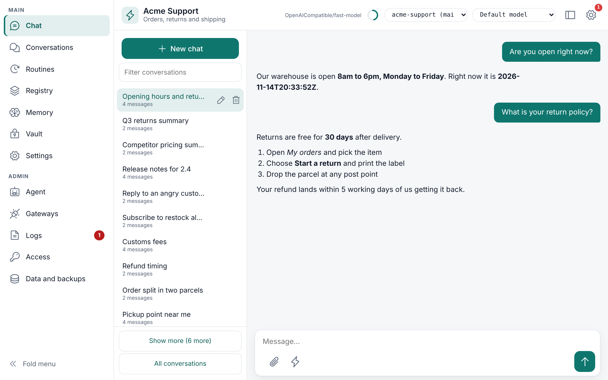

# ⚡︎ BxAgents

```text
|:------------------------------------------------------:|
| ⚡︎ B x A g e n t s ⚡︎
| Build AI Agents by Convention
|:------------------------------------------------------:|
```

<blockquote>
	Copyright Since 2023 by Ortus Solutions, Corp
	<br>
	<a href="https://www.boxlang.io">www.boxlang.io</a> |
	<a href="https://www.ortussolutions.com">www.ortussolutions.com</a>
</blockquote>

<p>&nbsp;</p>

**BxAgents** is a conventions-based framework for building AI agents your team can ship, powered by [BoxLang AI](https://ai.boxlang.io) and built on [ColdBox](https://www.coldbox.org). You describe an agent with files and folders (`Agent.yml`, `instructions.md`, and whichever of `tools/`, `skills/`, `subagents/`, `gateways/`, `schedules/`, `mcp/`, `interceptors/`, `modules/` it needs) and `bxAgents build` assembles a real ColdBox application from them, **once, at build time**: a thirteen-page web app, an HTTP API with OpenAPI, gateways, routines, a vault and backups. Serve it, chat with it in the terminal, or package it as a portable `.bxa`.

Documentation: **[bxagents.ai](https://bxagents.ai)** (source in [docs/](docs/index.md)). Free course: **[Introduction to BxAgents](docs/course/index.md)**, 20 lessons from install to a deployed agent.

## Requirements

- [BoxLang](https://www.boxlang.io) 1.18.0 or later, on Java 21 or later.
- The module itself: `install-bx-module bx-agents`. It bundles `bx-ai`, `bx-sqlite`, `bx-ftp`, `bx-mail`, `bx-yaml`, `bx-markdown`, ColdBox, `qb`, `cbsecurity`, `cbauth` and `cbmailservices`, so there is nothing else to install.
- `boxlang-miniserver` on your `PATH`, for `serve`, `chat --server` and `invoke --server`. The other verbs do not need it.
- [CommandBox](https://commandbox.ortusbooks.com) (`box`) only to fetch TestBox for `bxAgents test`. `new` still works without it and prints the command to run later.
- An API key for the model provider you choose (or use the `mock` provider to try it with none).

See [Installation](docs/getting-started/installation.md).

## Quick start

```bash
install-bx-module bx-agents

bxAgents new my-agent --model=openai/gpt-5    # at a terminal, plain `bxAgents new my-agent` asks questions instead
cd my-agent                                   # put OPENAI_API_KEY in .env; edit instructions.md
bxAgents doctor                               # checks the runtime and the project
bxAgents build                                # assembles the app into .build/
bxAgents chat                                 # full-screen terminal chat; or: bxAgents serve --port=8080
```

No API key yet? Scaffold with `--model=mock/mock-model` and the agent answers with a canned reply. Checked end to end with that model: after `bxAgents serve --port=8080`, `GET /__bxagents/health` answers `{"success":true,"status":"ok"}` and `POST /__bxagents/invoke` with `{"message":"hi"}` answers `Mock response`.

`new` can also start from one of 8 built-in `--template`s, clone a GitHub repo (`--repo=owner/repo`) or install a ForgeBox package (`--forgebox=<slug>`); see [Agent Templates](docs/agent-templates.md). The full walk-through is the [Quick Start](docs/getting-started/quick-start.md).

## What you get

| | |
|---|---|
| Web app | A left menu and thirteen pages: Chat, Conversations, Routines, Registry, Connectors, Memory, Vault and Settings for everyone; Agent, Gateways, Logs, Access and Data and backups for admins. Light and dark, phone layout. [Guide](docs/conventions/web-ui.md#the-pages) |
| Terminal chat | Full screen with a header, a footer, a slash-command menu, `/settings`, notes, sessions, `@file` and picture attachments, a context meter. `--server` starts its own server, `--connect=<url>` joins a deployed one. [Guide](docs/guides/terminal-ui.md) |
| API | One HTTP API at `/__bxagents` with an OpenAPI document and a BoxLang client. [Guide](docs/guides/agent-api.md) |
| Gateways | Slack, Telegram, Discord, Teams, WhatsApp, Twilio SMS, GitHub, Signal and email, plus `http`, `cli` and `mock`; an agent can also be exposed as a REST path or an MCP server. [Gateways](docs/conventions/gateways/index.md) |
| Routines and reports | People ask, the agent creates a routine, a heartbeat runs it, reports are saved and can be sent to a gateway chat. Developers write [schedules](docs/conventions/schedules.md) too. [Routines](docs/conventions/routines.md) |
| Vault and connectors | API keys sealed in the database and never shown to the model, per person if you like; a catalog of connectors and per-person OAuth sign-in for MCP servers. [Vault](docs/conventions/vault.md), [Connectors](docs/conventions/connectors.md), [Connect](docs/conventions/connect.md) |
| Settings in layers | The person who installs an agent can override its settings from `~/.bxagents/Agent.yml` (every agent) or `~/.bxagents/<agent>/Agent.yml` (one agent). [Layered settings](docs/conventions/layered-settings.md) |
| Access | Access tokens for the API, and users with admin and member roles for the web app. [`agentApi`](docs/conventions/agent-bx.md#agentapi) |
| Data and backups | One data home per agent (`~/.bxagents/<name>/` by default) with chat database, files, skills and volumes; `backup` and `restore`. [Data](docs/conventions/data.md) |
| Extend and test | [Sub-agents](docs/conventions/subagents.md), [skills](docs/conventions/skills.md), [interceptors](docs/conventions/interceptors.md), [extensions](docs/conventions/extensions.md), and specs that run with `mockResponses()` and no API key. [Testing](docs/conventions/testing.md) |
| Ship | `bxAgents package` makes a `.bxa`; `deploy` targets local, SSH, FTP, SFTP, Docker and DigitalOcean. [Deploy](docs/conventions/deploy.md) |

Live counts of verbs, slash commands, API routes, pages, gateway types, starters, connectors, skills, deploy targets, examples and lessons come from `python3 tools/docs-counts.py`; at the time of writing that is 29 verbs, 36 slash commands, 82 API routes, 13 pages, 12 gateway types, 8 starters, 7 connectors, 6 shipped skills, 6 deploy targets, 20 examples and 20 lessons.

## See it



[Watch the web app trailer](docs/assets/video/web-trailer.mp4) (just over three minutes, narrated, with captions). The terminal chat and the `new` wizard:


The recordings and screenshots come from a demo project and a scripted stand-in for a model ([`tools/demo/fakellm.bxs`](tools/demo/README.md)), so the answers are canned. The same kit renders the trailers and screenshots under [`tools/demo`](tools/demo/README.md).

## The CLI

`bxAgents <verb>` (or `boxlang module:bxagents <verb>`); `bxAgents --help` lists them, and the [CLI reference](docs/cli-reference.md) has every flag.

| Verb | What it does |
|---|---|
| `new`, `add` | Scaffold a project (a wizard at a terminal); add a tool, skill, sub-agent, gateway, schedule, MCP server, profile, provider, capability or extension |
| `build`, `clean` | Build the project into `.build/`; remove `.build/` and `dist/` |
| `chat`, `invoke`, `serve` | Terminal chat, one message in and out, serve over HTTP |
| `doctor`, `inspect` | Check the runtime and project; report how the agent is composed |
| `test`, `models` | Run the project's specs; list and test the models it can talk to |
| `package`, `deploy` | Make a `.bxa`; deploy it to a target |
| `sessions`, `notes`, `routines` | Conversations, notes and routines of an agent |
| `vault`, `connect`, `connectors` | Sealed secrets, connector and MCP sign-in, the connector catalog |
| `token`, `users`, `hash-password` | Access tokens, web app sign-in accounts and roles, password hashes |
| `data`, `backup`, `restore`, `logs`, `stats` | The data home, backups, logs, token usage |
| `skills`, `extensions` | Skills from the registry; chat extensions |

## What `build` produces

```text
my-agent/                   your source: Agent.yml, instructions.md, tools/, skills/, ...
└── .build/
    ├── app/                the generated ColdBox application
    ├── public/             the web root: the only folder a server serves
    ├── lib/                ColdBox and its modules
    ├── runtime/            engine config and the BoxLang home; only the bxagents module is loaded
    ├── boxlang_modules/
    ├── manifest.json
    └── miniserver.json
```

Rebuild any app made before this layout; `serve` refuses it and says so. See the [build pipeline](docs/build-pipeline.md).

## Security notes

- Only `public/` is served. Files outside it (`Agent.yml`, `instructions.md`, `config/`, `skills/`) answer 404, and only `index.bxm` is executed by address.
- `serve` binds to `127.0.0.1`; pass `--host=0.0.0.0` deliberately. A built app is open on your own machine; to share it set `agentApi` tokens or `access: token`, and turn on web app sign-in. `allowedIPs` and a rate limit are available.
- Secrets go in `.env` or the vault, never in `Agent.yml`; packaging redacts them. See [Deployment & Secrets](docs/deployment-and-secrets.md).
- The Docker deploy target installs the app at `/srv/bxapp` (not `/app`, which is also the ColdBox mapping name) and was run in real Docker: health, the web UI and its assets answer, and config and project files return 404. A model call from inside the container and gateways other than web were not tested. Check `/__bxagents/health` after your first deploy.

## Examples and templates

[`examples/`](examples/README.md) holds 20 buildable projects (11 core conventions and one per push-style chat gateway), built in CI as a regression gate.

## Status and license

Version 1.0 is in development (the `Unreleased` section of the [changelog](changelog.md)); the docs for it live in `docs/versions/1.0.x/`. Licensed under [Apache-2.0](LICENSE).

---

## Contributing to BxAgents

The rest of this readme covers developing BxAgents itself (this repo), not building an agent with it. Read [AGENTS.md](AGENTS.md) first: it holds the project rules and the BoxLang and ColdBox gotchas. See [CONTRIBUTING.md](CONTRIBUTING.md#the-developer-flow---boxlang-is-dynamic) for the actual edit/test loop - BoxLang is a dynamic language, so it isn't the usual edit-compile-run cycle, and there's a real subtlety around how this module's own classes reference each other that's worth reading before you touch `src/main/bx`.

### Directory Structure

- `.github/workflows` - GitHub Actions to test and build the module via CI
- `docs/` - user documentation, a [bx-sites](https://bxsites.io/development/) site (see [Working on the docs](#working-on-the-docs))
- `examples/` - working sample agent projects, built as a CI regression gate (`./gradlew verifyExamples`)
- `src/main/bx` - the BoxLang source: `ModuleConfig.bx` (CLI entry point), `models/build` (the build pipeline: config resolution, discovery, validation, manifest, and code generators), `models/cli` (one class per CLI verb)
- `src/main/java` - supporting Java (packager, miniserver launcher, dynamic class loader, key dictionary)
- `src/main/bx/bxagentsui`, `src/main/bx/catalog`, `src/main/bx/skills` - the generated web app module, the connector catalog and the skills the module ships
- `ui/` - the web app's front-end sources (npm; `npm run lint`, `npm run lint:md`, `npm test`); its build is committed under `src/main/bx/bxagentsui/includes/build`
- `tools/` - `docs-counts.py` (the numbers the docs state), the demo and screenshot kit in `tools/demo/`, generators and the ColdBox template refresh script
- `plans/`, `completions/` - design notes and the shell completions
- `src/test` - JUnit (Java-level) tests and fixtures
- `tests/` - the TestBox BDD suite (`tests/specs`), including the ColdBox-dependent integration specs under `tests/specs/integration/coldbox`
- `box.json` - published to ForgeBox; also declares the `bxAgents` native CLI executable
- `build.gradle` - the Gradle build file, including every verification task below

### Gradle Tasks

Before you get started, fetch the BoxLang binary (until this module is published to Maven):

```bash
./gradlew downloadBoxLang     # BoxLang core, MiniServer, and bundled BX Agents modules
```

| Task | Description |
| --- | --- |
| `build` | The default lifecycle task: `clean`, `assemble`, and others. |
| `clean` | Deletes the `build` folder. |
| `compileJava` | Compiles Java source in `src/main/java`. |
| `test` | Runs the JUnit suite. |
| `testBx` | Runs the TestBox BDD suite (`tests/specs`, excluding the ColdBox-dependent bundle) via `runTests.bxs`. Runs `installDevLibs` first for TestBox. |
| `testColdBoxIntegration` | Boots a real `boxlang-miniserver` against a generated app and hits a `toAi()` route over real HTTP, via `runColdBoxIntegrationTests.bxs`. Needs the miniserver jar; ColdBox and its modules come from the module's bundled `lib/`. |
| `verifyExamples` | Builds every project under `examples/` through the real build pipeline via `verifyExamples.bxs` - a regression net across the whole feature matrix. |
| `checkTemplateTokens` | Fails if any leftover `@MODULE_*@` boxlang-module-template placeholder tokens remain anywhere in the repo. Runs as part of `check`. |
| `downloadBoxLang` | Downloads the BoxLang core and boxlang-miniserver binaries into `src/test/resources/libs`, then downloads all bundled BoxLang modules. |
| `downloadModules` | Downloads the bundled BoxLang modules (bx-ai, bx-ftp, bx-sqlite, bx-mail, bx-yaml, bx-markdown; versions in `gradle.properties`) into `build/bundle-modules`. Runs automatically after `downloadBoxLang`. |
| `installLibs` | Runs `box install --production` (CommandBox required) against `src/main/lib/box.json`, staging ColdBox, qb, cbsecurity, cbauth and cbmailservices in `build/lib-prod`; the module zip ships them as `lib/`. |
| `installDevLibs` | Same manifest, full `box install` into `build/lib-stage`: adds TestBox (a devDependency, never shipped). The test tasks run it for you. |
| `jar` / `shadowJar` | Packages compiled classes/resources into a JAR under `build/libs`. |
| `javadoc` | Generates Javadocs into `build/docs/javadoc`. |
| `spotlessApply` / `spotlessCheck` | Formats / checks code formatting. |
| `tasks` | Lists every available Gradle task. |

Run the full local verification pass with:

```bash
./gradlew shadowJar checkTemplateTokens test testBx testColdBoxIntegration verifyExamples
```

### Markdown lint

```bash
cd ui && npm ci && npm run lint:md    # docs/, changelog.md and this readme
```

### VSCode Tests

If running tests via the VSCode test explorer, remove the `/src/main/resources` classpath entry first (Java Projects panel → the 3 dots → Configure Classpath), or BoxLang core will try loading service loaders it finds there. Module development only.

### GitHub Actions Automation

CI clones, tests, packages, and deploys this module to ForgeBox and the Ortus S3 accounts. The following repository environment variables are required (most are already set at the org level):

- `FORGEBOX_API_TOKEN` - the Ortus ForgeBox API token (the name `release.yml` actually reads)
- `AWS_ACCESS_KEY` / `AWS_ACCESS_SECRET` - the S3 credentials

Contact `#infrastructure` for these credentials if needed.

Optionally, `NOVITA_API_KEY` (a [Novita AI](https://novita.ai) API key) enables one real, live LLM integration test - see [`tests/specs/integration/LiveLlmSpec.bx`](tests/specs/integration/LiveLlmSpec.bx). It's genuinely optional: unset, that spec reports as cleanly "Skipped" rather than failing, so a fork PR without it still runs the rest of the suite.

### Working on the docs

`docs/` is a [bx-sites](https://bxsites.io/development/) site - plain Markdown, where the folder structure *is* the navigation and `docs/nav.json` overrides the order. `bxsites.yaml` at the repo root holds the site config.

```bash
# once - bx-sites depends on bx-markdown, bx-esapi, bx-yaml and bx-image;
# all four install automatically as box.json dependencies
install-bx-module bx-sites

bxSites serve     # live-reloading preview on http://127.0.0.1:8080 - saves rebuild in ~1-2s, not a full site rebuild
bxSites build     # render docs/ to site/ (gitignored)
bxSites doctor    # environment/config health check
bxSites audit     # CI-grade broken-link/missing-alt gate over an already-built site/
bxSites lint      # pre-build content checks on the raw docs/ Markdown
```

`bxSites build` needs no network and takes about 35 seconds here (it builds the released tree, `/next/` and the Spanish locale). `bxSites lint` (about 4 seconds) checks the Markdown, and `bxSites audit` (about 5 seconds, after a build) is the broken-link and missing-alt check CI-grade; run both before pushing docs. A screenshot a page names but that does not exist fails the audit.

Every page starts with a small frontmatter block (`title`, `icon`, `summary`, `description`, `tags`); `summary` renders under the page title, `description` is meta-only, and `tags` become clickable badges plus a site-wide `/tags/` index. Scaffold a new one with `bxSites page:new --path=guides/setup.md`, or move one (rewriting every relative Markdown link that pointed at it) with `bxSites page:rename --from=... --to=...`.

The homepage is not Markdown. `docs/.theme/` is an ejected copy of the bx-sites `bootstrap` theme (an override wins outright, so it has to be the whole theme), and its `home.bxm` hardcodes the landing page; `docs/index.md` only selects it with `layout: home`, and its body is kept for search and the MCP index. The look lives in `docs/.theme/assets/agents-home.{css,js}`, every class there is prefixed `bxa-` so nothing collides with bootstrap, and `agents-data.js` holds the real scaffolder output and HTTP capture the page shows. The walkthrough videos under `docs/assets/video/` are recordings of real runs. When bx-sites ships theme changes you want, re-eject `bootstrap` and carry `home.bxm` over.

`bxsites.yaml` turns on `generateOgImages` (a distinct 1200x630 social card per page, built from its `title`/`description`, falling back to `ogImage: assets/home-banner.jpg` for anything the generator can't handle) and `pageActions` (the per-page copy/view-as-Markdown/open-in-AI-chat/PDF/share menu). `sitemap.xml`, `robots.txt` and `llms.txt` are generated for free once `baseURL` is an absolute URL, which it already is here - no extra config needed.

The Spanish translation under `docs/versions/1.0.x/i18n/es/` covers page content; the
surrounding theme chrome (search placeholder, "On this page," "Edit this page," the 404
page, ...) is translated automatically too - bx-sites ships built-in `es`/`de`/`ja` chrome
translations out of the box, so nothing extra needs configuring for those locales. Note the
path: a translation has to live inside the tree that actually builds at the site root
(`docs/versions/1.0.x/`, per `versions.default`), not under `docs/i18n/` - see
[CONTRIBUTING.md](CONTRIBUTING.md) for why. German and Japanese are parked under
`translations-wip/` until they reach parity.

`.github/workflows/docs.yml` publishes straight to the site root (<https://bxagents.ai>) for whichever branch it runs on. Versioning is handled inside the docs themselves via bx-sites' own `versions:` support - `bxsites.yaml`'s `versions.default` (`1.0.x`) builds at the root, and in-progress docs build under `/next/`.

This follows [bx-sites' own documented deployment approach](https://bxsites.io/development/guides/deployment/): the workflow builds `site/` and pushes it to a **`gh-pages`** branch with `keep_files: true`.

The repository's **Settings -> Pages -> Build and deployment -> Source** must be **Deploy from a branch** -> **`gh-pages`** -> **`/ (root)`**. The first successful run creates `gh-pages`, so set it after that run completes; no workflow file can set it for itself.

Do **not** point that setting at `development` (or any other source branch), and do **not** add a root `.nojekyll` to quiet a failing Jekyll build. A branch source other than `gh-pages` makes GitHub run its built-in Jekyll pipeline over the whole repository root - which is not a Jekyll site - and a `.nojekyll` would only make that pipeline *succeed*, publishing the raw repo over these docs.

## Ortus Sponsors

BoxLang is a professional open-source project and it is completely funded by the [community](https://patreon.com/ortussolutions) and [Ortus Solutions, Corp](https://www.ortussolutions.com). Ortus Patreons get many benefits like a cfcasts account, a FORGEBOX Pro account and so much more. If you are interested in becoming a sponsor, please visit our patronage page: [https://patreon.com/ortussolutions](https://patreon.com/ortussolutions)

### THE DAILY BREAD

> "I am the way, and the truth, and the life; no one comes to the Father, but by me (JESUS)" Jn 14:1-12
